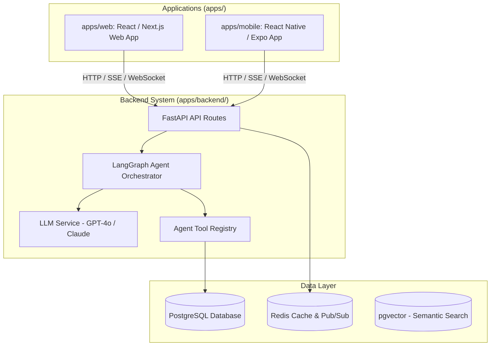

# Monorepo Architecture Document - AI Concierge (X-One Assistant)

> **Mô Hình Kiến Trúc Monorepo Chuẩn Đa Nền Tảng (Web, Mobile App, Backend API)**

---

## 1. System Architecture Overview

Hệ thống **AI Concierge (X-One Assistant)** được tổ chức theo mô hình **Domain-Driven Monorepo Architecture** với thư mục `apps/` chứa tất cả các ứng dụng đầu ra và `packages/` chứa các tài nguyên dùng chung.



---

## 2. Directory Structure Layout (Monorepo Standard)

```
d:\VIN\Projects\P-018\
├── apps/                    <-- Tất cả ứng dụng (Applications)
│   ├── backend/             <-- Python FastAPI & LangGraph AI Agent
│   │   ├── src/             <-- Core Python source (agents, api, models, services)
│   │   ├── tests/           <-- Unit & Integration tests
│   │   ├── Dockerfile       <-- Dedicated Backend Dockerfile
│   │   └── requirements.txt <-- Backend Python dependencies
│   │
│   ├── web/                 <-- Web Application (React / Next.js / Vite)
│   │   ├── src/             <-- Web source code
│   │   ├── package.json     <-- Node dependencies
│   │   └── Dockerfile       <-- Dedicated Web Dockerfile
│   │
│   └── mobile/              <-- Mobile Application (React Native / Expo / Flutter)
│       ├── src/             <-- Mobile source code
│       ├── package.json     <-- Mobile app package definition
│       └── README.md        <-- Mobile run instructions
│
├── packages/                <-- Shared code & specifications
│   └── api-contracts/       <-- Shared OpenAPI / Pydantic / TypeScript Schemas
│
├── docs/                    <-- Project documentation & PRDs
│   └── AI_Concierge_Project_Docs/
├── eval/                    <-- Agent evaluation benchmarks & datasets
├── scripts/                 <-- Monorepo build, dev, log & deployment scripts
├── docker-compose.yml       <-- Multi-container docker setup (web, backend, db, redis)
├── Makefile                 <-- Root task runner for Monorepo
└── README.md                <-- Root Monorepo README
```

---

## 3. Development Workflow & Commands

| Thao tác | Câu lệnh thực thi (từ Root) | Mô tả |
| :--- | :--- | :--- |
| **Chạy Backend API** | `make run-backend` | Chạy FastAPI tại `http://localhost:8000` với live-reload |
| **Chạy Web Frontend**| `make run-web` | Chạy Vite Web server tại `http://localhost:5173` |
| **Chạy Mobile App** | `make run-mobile` | Khởi chạy Expo Metro Bundler cho ứng dụng di động |
| **Chạy Test Backend** | `make test-backend` | Chạy bộ kiểm thử Pytest trong `apps/backend/tests/` |
| **Lint & Format** | `make check` | Kiểm tra cú pháp và định dạng code với Ruff |
| **Docker Compose** | `docker-compose up --build` | Khởi tạo toàn bộ container backend và web |
