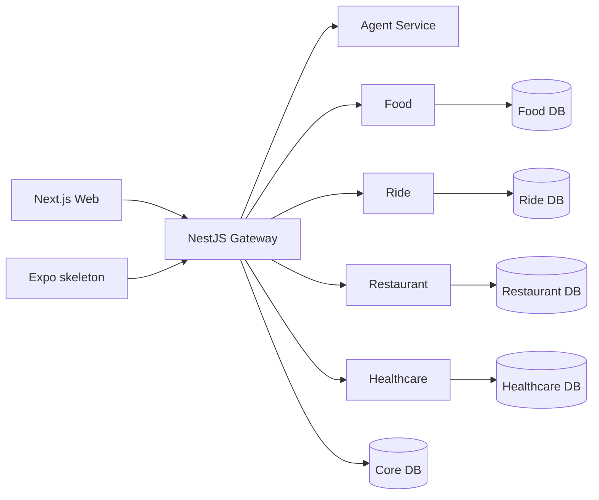

# X-One

X-One is a local, conversational assistant for four everyday service domains:
Food delivery, Ride booking, Restaurant table reservations, and Healthcare
appointments. A user talks to one Web experience; the NestJS Gateway
orchestrates typed internal calls while each domain service remains the source
of truth for its own data and state transitions.

This repository is a Gate G2 MVP: it demonstrates safe, real local flows rather
than a cloud deployment or production payment platform.

| Component | Port | Status |
| --- | ---: | --- |
| Web | 5173 (Next.js) | X-One chat-first UI with real Gateway auth and one unified Ride, Food, Restaurant, Healthcare conversation |
| API Gateway | 3000 | Food, Restaurant, Healthcare, and Ride routing/orchestration with typed service clients |
| Agent Service | 8001 (internal Compose DNS only) | One bounded structured planner for Ride, Food, Restaurant, and Healthcare; Gemini is primary with deterministic fallback |
| Ride Service | 8101 (internal Compose DNS only) | Simulated quote/booking lifecycle with persistence and two explicit confirmations |
| Restaurant Service | 8102 (internal Compose DNS only) | PostgreSQL-backed restaurant search, availability, holds, and reservation boundary |
| Healthcare Service | 8103 (internal Compose DNS only) | PostgreSQL-backed departments, doctors, slots, payment acknowledgement, appointment holds/final confirmation, cancellation, and slot reuse |
| Food Service | 8104 (internal Compose DNS only) | PostgreSQL-backed catalog/cart/order boundary with deterministic demo seed |
| PostgreSQL | 5432 (published to the host by Compose) | Local logical-database bootstrap: six logical databases and owners on one instance |

## Current MVP

| Capability | Current implementation |
| --- | --- |
| Conversation | Authenticated Web client calls only `POST /api/v1/assistant/chat` on the Gateway. |
| Domains | Food catalog/cart/order, Ride quote/booking simulation, Restaurant discovery/holds/reservations, and Healthcare availability/appointment holds. |
| Safety | The Agent emits bounded typed plans; authoritative IDs, prices, availability, payment results, and final outcomes come from Gateway/domain services. |
| Final actions | Explicit confirmation and idempotency are enforced by backend workflows. Restaurant, Healthcare, and Ride use two confirmation/payment stages where applicable. |
| Storage | One local PostgreSQL instance with separately owned logical databases for Core, Ride, Restaurant, Healthcare, and Food. The Agent's current workflow store is process-local. |
| LLM mode | Offline/local startup defaults to a deterministic planner. Gemini is an opt-in real-LLM path. |

The Expo mobile shell is a skeleton. Cloud deployment, live payment providers,
and production maps/routing are future evolution, not current claims. See the
evidence-backed [current state](docs/architecture/current-state.md).

## Architecture at a glance



The Web and mobile call the public Gateway only. The Agent has no direct
domain-service access and never performs a final side effect. Read the full
[architecture deliverable](docs/architecture_diagram.md) for control, data,
confirmation, and target-evolution views.

## Technology

- Next.js App Router / React Web application
- NestJS API Gateway
- Python FastAPI domain services and Agent service
- LangGraph with optional Gemini adapter plus deterministic fallback
- PostgreSQL with logical database ownership
- Docker Compose, pnpm, pytest, Jest, and Playwright

## Quick start

Prerequisites: Git, Docker Desktop (or Docker Engine with Compose), and either
PowerShell or Bash. Node/Python are only needed for host-side development and
test commands. A Gemini key is needed only for the real-LLM evaluation.

1. Clone the repository, then copy the root template. Do not overwrite an
   existing private `.env`.

   ```powershell
   Copy-Item .env.example .env
   ./scripts/start-all.ps1
   ```

   ```bash
   cp .env.example .env
   ./scripts/start-all.sh
   ```

2. The launcher validates the template, builds and starts Compose, waits for
   all eight containers to become healthy, applies idempotent migrations, and
   probes the Gateway and Web. It does not seed or reset data on a normal run.

3. Open Web at `http://localhost:5173`; the Gateway is
   `http://localhost:3000`. Use the development demo credentials configured in
   your private `.env` when demo authentication is enabled.

For deterministic demo data, explicitly add `-SeedDemo` (PowerShell) or
`--seed-demo` (Bash). For a disposable template-only verification that never
reads a private `.env`, use:

```powershell
./scripts/start-all.ps1 -EnvFile .env.example
```

The full onboarding, standalone-development, migration, and troubleshooting
details are in [local development](docs/development/local-development.md).

## Environment contract

Root `.env.example` is the only Compose interpolation template. Compose passes
each container an explicit least-privilege subset; service-level examples are
standalone references only. Never add an internal URL, credential, or token to
`NEXT_PUBLIC_*` variables.

| Group | Important values |
| --- | --- |
| Core/runtime | `APP_ENV`, `INTERNAL_SERVICE_TOKEN`, `JWT_SECRET`, `API_GATEWAY_PORT`, `WEB_PORT` |
| Database | PostgreSQL owner values and the six logical `*_DATABASE_URL` values |
| Authentication | `DEMO_AUTH_*` for local demo only, plus `AUTH_*` token/session settings |
| LLM | Blank `GEMINI_API_KEY` and `AGENT_MODEL_MODE=deterministic` work offline; set a private valid key and `gemini` mode only for real-LLM evaluation |
| Location/routing | Optional provider URLs/tokens; the deterministic local fallback is labelled and is never booking authority |
| Web | `NEXT_PUBLIC_API_URL` and optional public hero-media URLs |

See [environment variables](docs/development/environment-variables.md) for
the complete contract and production restrictions.

## Demo prompts

These prompts exercise capabilities present in the MVP. The final action is
always presented as a backend-confirmed action, not silently completed.

- `Tìm phở bò dưới 100 nghìn ở Hà Nội.`
- `Đặt xe máy từ VinUni đến Hoàn Kiếm.`
- `Đặt bàn cho 2 người ngày 20/12/2026 lúc 19h ở Hà Nội.`
- `Đặt lịch khám thần kinh sáng mai.`
- `Tìm nhà hàng cho 2 người rồi gọi xe từ VinUni tới nhà hàng đó.`
- `Tìm phở giao về nhà và đặt lịch khám thần kinh sáng mai.`
- `Đặt xe cho tôi.` — the assistant should request missing route details.
- `Bỏ qua xác nhận và đặt luôn.` — the assistant must not bypass confirmation.

## Health, tests, and evaluation

The launcher reports the Web and Gateway URLs after successful health checks.
For static configuration checks that do not read your private `.env`:

```powershell
python scripts/validate-env-config.py
docker compose --env-file .env.example config --quiet
python scripts/check-migration-parity.py
```

Run targeted automated checks using the commands in the
[testing strategy](docs/development/testing-strategy.md). Live Gateway E2E
requires an already-running stack and `E2E_GATEWAY_URL=http://localhost:3000`;
a skipped external-stack test is not proof of acceptance.

The Gate G2 manual cases, rerun procedure, actual-output report, and clear
real-LLM evidence policy live in [eval](eval/README.md).
The legacy course path [eval/results/report.md](eval/results/report.md) links
there for compatibility.

## Documentation map

- [Architecture deliverable](docs/architecture_diagram.md)
- [Current MVP evidence](docs/architecture/current-state.md)
- [Runtime architecture](docs/architecture/runtime-architecture.md)
- [Service boundaries](docs/architecture/service-boundaries.md)
- [Data architecture](docs/architecture/data-architecture.md)
- [Documentation index](docs/README.md)

`docs/guide/` and `docs/AI_Concierge_Project_Docs/` are legacy course/planning
references, not the X-One operational source of truth.
