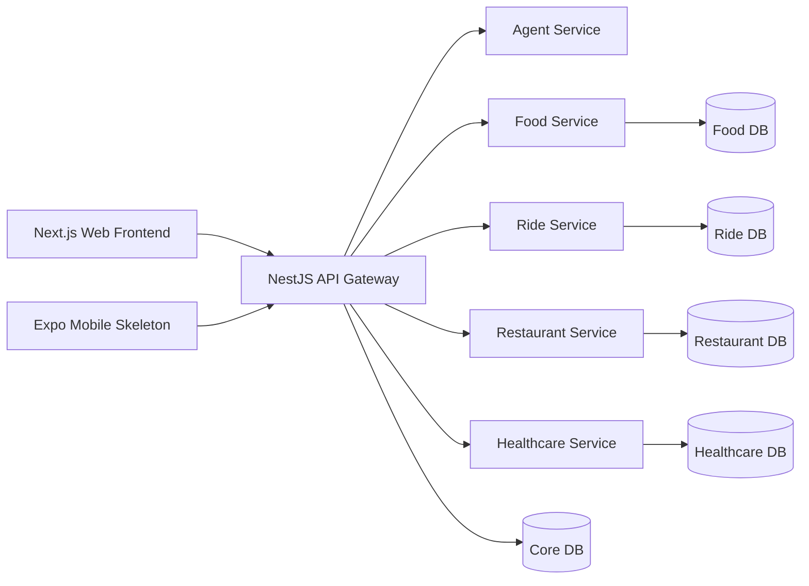

# X-One - Nền Tảng Trợ Lý Đa Dịch Vụ Thông Minh

**X-One** là trợ lý hội thoại thông minh hỗ trợ 4 lĩnh vực dịch vụ thiết yếu hàng ngày:
1. **Giao đồ ăn (Food Delivery)**
2. **Đặt xe di chuyển (Ride Booking)**
3. **Đặt bàn nhà hàng (Restaurant Reservations)**
4. **Đặt lịch khám bệnh (Healthcare Appointments)**

Người dùng tương tác qua một giao diện Web duy nhất; **NestJS API Gateway** đóng vai trò là bộ điều phối trung tâm (Central Orchestrator) chuyển tiếp các lệnh nội bộ có định kiểu (typed internal calls), trong khi mỗi dịch vụ miền (Domain Microservice) vẫn giữ quyền kiểm soát tuyệt đối và là nguồn chân lý duy nhất (Source of Truth) cho dữ liệu và các bước chuyển trạng thái (state transitions) của chính nó.

Kho lưu trữ này hiện triển khai theo phiên bản **Gate G2 MVP**: chứng minh luồng nghiệp vụ an toàn, dữ liệu thực tế tại môi trường local, không phụ thuộc vào dịch vụ cloud hay cổng thanh toán production.

---

## 1. Trạng Thái MVP Hiện Tại

| Năng Lực Hệ Thống | Hiện Trạng Triển Khai Thực Tế |
| :--- | :--- |
| **Giao tiếp hội thoại** | Web client (đã xác thực) chỉ gọi duy nhất `POST /api/v1/assistant/chat` trên API Gateway. |
| **Các dịch vụ miền** | Danh mục/giỏ hàng/đơn món (Food), báo giá/mô phỏng đặt xe (Ride), tìm kiếm/giữ chỗ/đặt bàn (Restaurant), và tra cứu lịch/giữ chỗ khám bệnh (Healthcare). |
| **An toàn & Thẩm quyền** | AI Agent chỉ phát sinh bản kế hoạch có định kiểu (bounded typed plans); toàn bộ ID chính thức, giá tiền, tình trạng khả dụng, kết quả thanh toán và trạng thái đơn cuối cùng đều do Gateway và các Domain Service quyết định. |
| **Xác nhận giao dịch** | Cơ chế xác nhận rõ ràng (Explicit Confirmation) và khóa chống trùng lặp (Idempotency Key) được kiểm soát nghiêm ngặt bởi các workflow backend. Đặt bàn, Khám bệnh và Đặt xe áp dụng xác nhận 2 bước trước khi kích hoạt thanh toán/hoàn tất. |
| **Lưu trữ dữ liệu** | 1 máy chủ PostgreSQL quản lý 6 cơ sở dữ liệu logic độc lập: `xone_core`, `xone_ride`, `xone_restaurant`, `xone_healthcare`, `xone_food`, và `xone_agent`. |
| **Chế độ LLM** | Mặc định cấu hình sử dụng Google Gemini; khi không có API key hoặc kết nối mạng lỗi, hệ thống tự động chuyển đổi an toàn (fallback) sang bộ lập kế hoạch tất định (Deterministic Planner) chạy offline. |

> [!NOTE]
> Khung ứng dụng di động Expo hiện là bộ khung giao diện mẫu (Skeleton). Triển khai cloud tập trung, cổng thanh toán ngân hàng thực tế, và bản đồ định tuyến production thuộc lộ trình phát triển tiếp theo. Xem chi tiết trạng thái kiểm thử tại [Báo cáo hiện trạng kiến trúc](docs/02-architecture/current-state.md).

---

## 2. Kiến Trúc Tổng Quan



- **Nguyên tắc cốt lõi**: Web và Mobile **chỉ gọi duy nhất API Gateway công khai**. 
- AI Agent **không được phép truy cập trực tiếp CSDL** hay gọi thẳng tới các Domain Service, và **không bao giờ tự ý thực hiện hành động tài chính/giao dịch** mà chưa có sự đồng ý của người dùng.
- Chi tiết sơ đồ luồng dữ liệu, luồng điều khiển và bảo mật có trong [Tài liệu kiến trúc Gate G2](docs/02-architecture/architecture_diagram.md).

---

## 3. Công Nghệ Sử Dụng

- **Frontend**: Next.js App Router (React 18/19), TypeScript, Vanilla CSS module.
- **API Gateway**: NestJS, TypeScript, Axios, JWT Passport, Rate Limiter.
- **Intelligence Layer**: Python 3.11, FastAPI, LangGraph, Google Gemini API.
- **Domain Microservices**: Python 3.11, FastAPI, SQLAlchemy, Alembic, Pydantic.
- **Cơ sở dữ liệu**: PostgreSQL 16 (phân tách 6 CSDL logic), migrations độc lập.
- **Hạ tầng & Kiểm thử**: Docker Compose, pnpm, Pytest, Jest, Playwright E2E.

---

## 4. Hướng Dẫn Khởi Chạy Nhanh (Quick Start)

### Yêu cầu môi trường
- Git, Docker Desktop (hoặc Docker Engine kèm Compose v2).
- PowerShell (trên Windows) hoặc Bash (trên Linux/macOS).
- *(Node.js và Python chỉ cần thiết khi muốn chạy kiểm thử hoặc phát triển trực tiếp trên máy host)*.

### Các bước thực hiện:

1. **Sao chép cấu hình môi trường**:
   ```powershell
   # Windows PowerShell:
   Copy-Item .env.example .env
   ./scripts/local/start-all.ps1
   ```
   ```bash
   # Linux / macOS Bash:
   cp .env.example .env
   ./scripts/local/start-all.sh
   ```

2. **Cơ chế khởi chạy tự động**:
   - Kịch bản sẽ xác thực file `.env`, build và khởi chạy các container trong Docker Compose.
   - Chờ cả 8 container đạt trạng thái `healthy`.
   - Tự động áp dụng các migration CSDL cần thiết.
   - Kiểm tra kết nối API Gateway và Web.

3. **Truy cập ứng dụng**:
   - **Giao diện Web**: [http://localhost:5173](http://localhost:5173) *(hoặc cổng được cấu hình trong `.env`)*.
   - **API Gateway**: [http://localhost:3000](http://localhost:3000).
   - Đăng nhập bằng tài khoản thử nghiệm được định nghĩa trong `.env` khi `DEMO_AUTH_ENABLED=true`.

4. **Nạp dữ liệu mẫu (Seed Demo Data)**:
   Để nạp thêm dữ liệu mẫu tất định (nhà hàng, thực đơn, bác sĩ, tài xế):
   ```powershell
   ./scripts/local/start-all.ps1 -SeedDemo
   ```
   ```bash
   ./scripts/local/start-all.sh --seed-demo
   ```

Chi tiết hướng dẫn cài đặt từng phân hệ và xử lý sự cố có tại [Hướng dẫn phát triển Local](docs/05-development/local-development.md).

---

## 5. Quy Ước Biến Môi Trường

File [.env.example](.env.example) là nguồn cấu hình mẫu duy nhất cho Docker Compose. Khi chạy qua Compose, mỗi container chỉ nhận tập hợp biến tối thiểu cần thiết theo nguyên tắc đặc quyền tối thiểu (least privilege).

| Nhóm Biến | Các Biến Tiêu Biểu & Vai Trò |
| :--- | :--- |
| **Core / Runtime** | `APP_ENV`, `INTERNAL_SERVICE_TOKEN`, `JWT_SECRET`, `API_GATEWAY_PORT`, `WEB_PORT` |
| **Cơ sở dữ liệu** | Thông tin admin PostgreSQL và 6 biến URL kết nối riêng: `*_DATABASE_URL` |
| **Xác thực (Auth)** | `DEMO_AUTH_*` (chỉ dùng cho local dev), các thông số thời gian sống của token: `AUTH_*` |
| **Trí tuệ nhân tạo (LLM)** | `AGENT_MODEL_MODE=gemini`; để trống `GEMINI_API_KEY` sẽ kích hoạt fallback tất định chạy offline an toàn; điền key hợp lệ sẽ dùng model Gemini |
| **Bản đồ & Vị trí** | Cấu hình Geoapify tùy chọn; có chế độ dự phòng vị trí local rõ ràng |
| **Giao diện Web** | `NEXT_PUBLIC_API_URL` và các URL tài nguyên tĩnh public |

> [!WARNING]
> Tuyệt đối không đưa mật khẩu, token nội bộ hoặc URL private vào các biến tiền tố `NEXT_PUBLIC_*`. Xem chi tiết tại [Tài liệu biến môi trường](docs/05-development/environment-variables.md).

---

## 6. Kịch Bản Prompt Thử Nghiệm (Demo Prompts)

Các câu lệnh mẫu tiếng Việt sau đây minh họa đầy đủ năng lực của hệ thống. Lưu ý rằng mọi hành động có tính giao dịch/chi phí đều yêu cầu người dùng xác nhận:

- `Tìm phở bò dưới 100 nghìn ở Hà Nội.` *(Tìm món ăn)*
- `Đặt xe máy từ VinUni đến Hoàn Kiếm.` *(Báo giá và đề xuất chuyến xe)*
- `Đặt bàn cho 2 người ngày 20/12/2026 lúc 19h ở Hà Nội.` *(Tra cứu và giữ chỗ nhà hàng)*
- `Đặt lịch khám thần kinh sáng mai.` *(Tra cứu lịch khám bệnh viện)*
- `Tìm nhà hàng cho 2 người rồi gọi xe từ VinUni tới nhà hàng đó.` *(Phối hợp đa dịch vụ theo chuỗi)*
- `Tìm phở giao về nhà và đặt lịch khám thần kinh sáng mai.` *(Xử lý đồng thời 2 dịch vụ độc lập)*
- `Đặt xe cho tôi.` — *(Trợ lý sẽ hỏi bổ sung điểm đón, điểm đến còn thiếu)*
- `Bỏ qua xác nhận và đặt luôn.` — *(Trợ lý tuân thủ chính sách an toàn, từ chối bỏ qua bước xác nhận)*

---

## 7. Kiểm Tra Chất Lượng & Đánh Giá

Kiểm tra cú pháp cấu hình và tính nhất quán của môi trường mà không làm lộ thông tin nhạy cảm trong `.env`:
```powershell
python scripts/quality/validate-env-config.py
docker compose --env-file .env.example config --quiet
python scripts/database/check-migration-parity.py
```

- Chạy kiểm thử tự động theo hướng dẫn tại [Chiến lược kiểm thử (Testing Strategy)](docs/05-development/testing-strategy.md).
- Bộ dữ liệu đánh giá 150 kịch bản và kết quả audit Gate G2 nằm trong thư mục [eval/](eval/README.md).

---

## 8. Sơ Đồ Tài Liệu Hệ Thống

- [Mục lục tài liệu toàn diện (Documentation Portal)](docs/README.md)
- [Slide thuyết trình & Demo nghiệm thu](docs/00-presentation/README.md)
- [Bản nộp kiến trúc Gate G2](docs/02-architecture/architecture_diagram.md)
- [Báo cáo hiện trạng thực tế](docs/02-architecture/current-state.md)
- [Tổng quan hệ thống](docs/02-architecture/system-overview.md)
- [Ranh giới dịch vụ & CSDL](docs/02-architecture/service-boundaries.md)
- [Kiến trúc Runtime & Docker](docs/02-architecture/runtime-architecture.md)
- [Kiến trúc CSDL & Dữ liệu](docs/02-architecture/data-architecture.md)
- [Danh mục API thực tế](docs/03-api/api-inventory.md)
