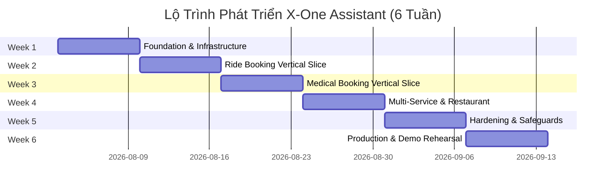

# Project Timeline & Implementation Roadmap

> **X-ONE ASSISTANT | LỘ TRÌNH TRIỂN KHAI DỰ ÁN 6 TUẦN (6-WEEK ROADMAP)**\
> **Phương pháp triển khai:** Agile Vertical Slices | **Quy mô:** 4 thành viên\

---

## 1. Lộ Trình Triển Khai Chi Tiết Theo Tuần (Weekly Milestones)

---

### Tuần 1 — Foundation & Core Infrastructure
- **Phạm vi công việc:**
  - Hoàn thiện tài liệu PRD v1.0, API Contract, DB Schema.
  - Thiết lập Monorepo, môi trường Docker Compose, CI Skeleton.
  - Xây dựng Auth Service (JWT, RBAC), Conversation Management API.
  - Xây dựng Chat UI cơ bản, hỗ trợ Streaming Response (SSE).
  - Định nghĩa LangGraph AgentState cơ bản.
- **Milestone bàn giao:** User đăng ký, đăng nhập thành công và chat được end-to-end với giao diện phản hồi từ AI.

---

### Tuần 2 — Ride Booking Vertical Slice
- **Phạm vi công việc:**
  - Xây dựng Ride Mock Provider API (xe máy, economy, premium, xe 7 chỗ).
  - Huấn luyện Prompt Slot Filling & Intent cho mảng đặt xe.
  - Xây dựng các Rich Cards: Search Results, Option Selector, Confirmation Card.
  - Phát hành Confirmation Token, xác thực chữ ký và tạo Order đặt xe.
  - Tích hợp Payment Sandbox, xuất hóa đơn/biên nhận.
  - Xây dựng WebSocket Realtime Tracking (tìm tài xế $\rightarrow$ hoàn thành).
  - Triển khai tính năng hủy chuyến, Idempotency Key và Audit Log.
- **Milestone bàn giao:** Người dùng hoàn thành luồng đặt xe, thanh toán sandbox và theo dõi hành trình tài xế theo thời gian thực hoàn chỉnh.

---

### Tuần 3 — Medical Booking Vertical Slice
- **Phạm vi công việc:**
  - Xây dựng Medical Mock Provider API (Bệnh viện, Chuyên khoa, Bác sĩ, Lịch trống).
  - Trích xuất slot đặt lịch khám bệnh qua câu thoại tự nhiên.
  - Xây dựng UI Cards cho danh sách phòng khám, chọn bác sĩ và chọn lịch.
  - Xây dựng quy trình đặt lịch, đổi giờ khám (reschedule) và hủy lịch khám qua chat.
  - Tự động hiển thị hướng dẫn chuẩn bị trước khi khám.
  - Cài đặt bộ lọc Guardrail chống tư vấn y tế/chẩn đoán bệnh trái phép.
- **Milestone bàn giao:** Người dùng tìm kiếm, đặt lịch, đổi giờ và hủy lịch khám bệnh qua giao diện chat thành công.

---

### Tuần 4 — Multi-Service Coordination & Restaurant Extension
- **Phạm vi công việc:**
  - Triển khai Planning Node (`build_plan`) xử lý câu lệnh đa dịch vụ phức hợp.
  - Xây dựng logic tính toán thời gian di chuyển (Travel Time Calculation) nối liền giữa lịch khám và điểm đón xe.
  - Phối hợp tự động: Đặt lịch khám bệnh $\rightarrow$ Tự động đặt xe đón trước 15-20 phút.
  - Phát hiện xung đột thời gian (Conflict Detection) giữa các dịch vụ.
  - Xây dựng module đặt bàn nhà hàng cơ bản (Restaurant Booking).
  - Cơ chế xử lý sự cố từng phần (Partial Failure Handling).
- **Milestone bàn giao:** Demo thành công kịch bản hội thoại lập kế hoạch đa dịch vụ kết hợp (Medical + Ride) hoàn chỉnh.

---

### Tuần 5 — Hardening, Safeguards & Operational Tools
- **Phạm vi công việc:**
  - Xây dựng module thanh toán hóa đơn giả lập (Bill Payment Sandbox).
  - Triển khai User Memory Engine có sự đồng ý (Consent) và UI quản lý Memory.
  - Triển khai Operator Dashboard giám sát đơn lỗi và tính năng chuyển giao cuộc thoại (Human Handoff).
  - Tăng cường bảo mật: Chống Prompt Injection, Rate Limiting, Data Masking.
  - Xây dựng tập dữ liệu kiểm thử 150 kịch bản đánh giá Agent.
- **Milestone bàn giao:** Chạy thành công toàn bộ các luồng Happy Path, Failure Path và Operator Handoff Path ổn định.

---

### Tuần 6 — Production Release & Demo Rehearsal
- **Phạm vi công việc:**
  - Thực hiện kiểm thử toàn diện E2E, Load Testing (50 concurrent users), Security Audit.
  - Tối ưu hóa hiệu năng API và thời gian phản hồi LLM Token.
  - Khởi tạo Seed Data đầy đủ, đóng gói Docker Production và triển khai Server (Railway/Render/VPS).
  - Hoàn thiện toàn bộ bộ tài liệu dự án và báo cáo thành số liệu Success Metrics.
  - Quay video Demo sản phẩm, chuẩn bị Slide và tổng duyệt thuyết trình.
- **Milestone bàn giao:** Bản Public Release hoạt động ổn định trên hạ tầng Server và Báo cáo đánh giá các chỉ số Success Metrics.

---

## 2. Quy Tắc Tiến Độ & Nguyên Tắc Quản Lý (Execution Rules)

1. **Nguyên tắc Vertical Slice Review:** Mỗi luồng vertical slice khi hoàn thành phải có **ít nhất 2 thành viên cùng review**; tuyệt đối không để cả 4 module ở trạng thái "gần xong" nhưng chưa có một luồng end-to-end nào chạy được.
2. **Quy tắc Deadline cố định:**
   - Luồng Đặt xe (Ride Slice) **bắt buộc chạy end-to-end cuối Tuần 2**.
   - Luồng Đặt lịch khám (Medical Slice) **bắt buộc chạy end-to-end cuối Tuần 3**.
3. **Quy tắc xử lý khi chậm tiến độ (Fallback Strategy):** Nếu bị chậm tiến độ, nhóm sẽ cắt giảm chiều sâu của mảng Restaurant và Bill Payment trước; **tuyệt đối không được cắt giảm** tính năng Confirmation Token, Idempotency Key, Audit Log hoặc Testing System.
4. **Quy tắc duy trì tiến độ daily:** Mỗi ngày đều phải có phiên bản Integration Build cập nhật và tổ chức demo nội bộ ngắn (10-15 phút).
5. **Đóng băng tính năng ở Tuần 6:** Tuyệt đối không thêm tính năng mới trong Tuần 6, chỉ tập trung tối ưu hóa, sửa lỗi, kiểm thử và chuẩn bị demo.
