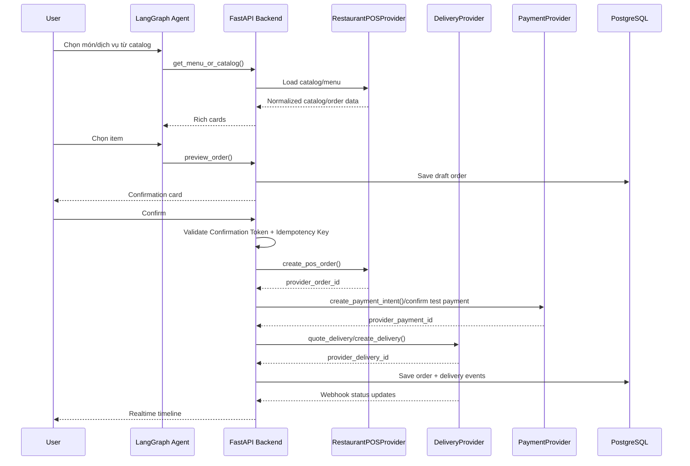

# Service API Integration Guide

> **X-ONE ASSISTANT | MÔ TẢ DỊCH VỤ, CÁCH HOẠT ĐỘNG VÀ CÁCH TÍCH HỢP API/SANDBOX**\
> **Mục tiêu:** Chọn đúng sandbox/API cho giai đoạn phát triển, đồng thời giữ kiến trúc đủ gần thực tế để sau này thay bằng provider như Grab, ShopeeFood, Shopee, Lalamove hoặc đối tác thật mà không phải sửa toàn bộ hệ thống.

---

## 1. Tư Duy Tích Hợp Đúng

Không nên xem một provider là giải pháp thay thế toàn bộ hệ sinh thái như ShopeeFood hoặc Grab. Mỗi provider thường chỉ cung cấp một phần trong chuỗi nghiệp vụ.

```text
AI Concierge
-> Internal Tool
-> Provider Adapter
-> External Sandbox / Partner API
```

Với mảng nhà hàng/giao hàng, nên tách thành 3 lớp:

```text
FoodMarketplaceProvider
- search_restaurants()
- get_menu()
- create_food_order()
- get_food_order_status()
- cancel_food_order()

RestaurantPOSProvider
- sync_menu()
- create_pos_order()
- update_order_status()
- receive_order_webhook()

DeliveryProvider
- quote_delivery()
- create_delivery()
- get_delivery_status()
- cancel_delivery()
- handle_delivery_webhook()
```

Lý do: ShopeeFood-like flow bao gồm tìm quán, xem menu, đặt món, thanh toán, nhà hàng nhận đơn, chuẩn bị món và giao hàng. DoorDash Drive, Uber Direct hoặc Lalamove chỉ bao phủ phần giao hàng. Square/Toast bao phủ phần POS/order nhà hàng. Uber Eats/DoorDash Marketplace/Deliverect bao phủ phần marketplace hoặc POS middleware nhưng thường cần partner approval.

---

## 2. Bảng Dịch Vụ Dev/Sandbox Để Giả Lập

Bảng này liệt kê các lựa chọn dùng trong **môi trường phát triển** để giả lập nghiệp vụ mà không tạo giao dịch thật ngoài đời. Một số dịch vụ là self-serve bằng tài khoản developer/test, một số có sandbox nhưng cần được cấp credential/whitelist trước khi dùng.

| Dịch vụ / Dev Provider | Nhóm | Giả lập phần nào | Cung cấp trong môi trường dev | Free/dev cost | Điều kiện dùng | Mức phù hợp dev |
| :--- | :--- | :--- | :--- | :--- | :--- | :--- |
| [Uber Guest Rides Sandbox](https://developer.uber.com/docs/guest-rides/guides/sandbox) | Ride Booking | Đặt xe giả lập | Estimate, request trip, mock driver behavior, driver state, trip status, receipt | **Không tạo chuyến thật**; sandbox ephemeral | Cần Uber developer app; có thể cần whitelist nếu gặp `Unauthorized` | Rất tốt cho ride nếu xin được access |
| [DoorDash Drive Sandbox](https://developer.doordash.com/en-US/docs/drive/tutorials/get_started/) | Delivery | Giao hàng giả lập | Quote, create delivery, Delivery Simulator, tracking, cancel, webhook | **Miễn phí sandbox**, không gọi Dasher thật | Tạo DoorDash developer account và sandbox access key | Cao nếu cần test giao hàng |
| [Uber Direct Test Mode](https://developer.uber.com/docs/deliveries/get-started) | Delivery | Giao hàng giả lập | Quote, create test delivery, tracking/courier fulfillment flow | **Không tạo delivery thật** trong test mode | Cần Uber Direct account; availability theo khu vực, có thể cần Uber contact/account manager | Tốt nếu target market có Uber Direct |
| [Lalamove Sandbox](https://developers.lalamove.com/) | Delivery | Giao hàng giả lập gần Việt Nam/SEA | Quotation, place order, driver detail, webhook, proof of delivery | **Có sandbox** với `pk_test/sk_test`; production mới cần wallet/top-up | Tạo tài khoản developer/portal để lấy test key; theo docs không cần approval | Rất đáng dùng nếu nhắm Việt Nam/SEA |
| [Shipday Free/Dev Account](https://docs.shipday.com/) | Delivery Management | Điều phối giao hàng/driver giả lập hoặc quy mô nhỏ | Delivery order, driver assignment, tracking, webhook/API | **Có free starter hạn chế**; on-demand 3rd-party delivery có thể cần paid plan/credit card | Tạo Shipday account; kiểm tra plan trước khi dùng 3rd-party delivery | Tốt nếu muốn lớp dispatch trung gian |
| [Square Sandbox](https://developer.squareup.com/docs/devtools/sandbox/overview) | Restaurant POS / Payment | POS/order/payment giả lập | Catalog, order, fulfillment, payment sandbox, test seller account | **Miễn phí sandbox**, unlimited sandbox calls, không charge thẻ thật | Tạo Square developer account | Rất tốt để test POS/order/payment |
| [Microsoft Bookings Dev Tenant](https://learn.microsoft.com/en-us/graph/api/resources/booking-api-overview?view=graph-rest-1.0) | Appointment | Đặt lịch khám/đặt bàn như lịch hẹn | Business, staff, service, appointment | **Không free nếu chưa có license**; dùng được nếu nhóm đã có Microsoft 365 Business Premium/dev tenant | Cần Microsoft 365 Business Premium/shared bookings | Tốt để mô phỏng medical/restaurant appointment |
| [Zocdoc Sandbox](https://api-docs.zocdoc.com/guides/authentication) | Medical Marketplace | Medical marketplace giả lập | Provider search, availability, appointment booking, appointment management | **Sandbox nhưng cần credentials** | Cần sandbox credentials từ Zocdoc | Rất giống medical booking thật nếu xin được access |
| [OpenTable Sandbox](https://docs.opentable.com/) | Restaurant Reservation | Đặt bàn nhà hàng giả lập | Availability, reservation, booking APIs, curated sandbox/pre-production data | **Sandbox cho approved partners** | Cần được duyệt integration partner trước khi có sandbox | Rất giống đặt bàn thật nếu xin được access |
| [Stripe Test Mode](https://docs.stripe.com/testing) | Payment | Thanh toán giả lập | Payment intent, success/failure/timeout/refund simulation, test cards, receipt-like flow | **Miễn phí test mode**, không charge thẻ thật | Tạo Stripe developer account | Tốt để test transaction safety |

### 2.1 Ghi Chú Chi Phí & Quyền Truy Cập

Các trạng thái trong bảng nên hiểu như sau:

- **Miễn phí sandbox/test mode:** Có thể test chức năng mà không tạo giao dịch thật. Chỉ cần developer/test account thông thường.
- **Sandbox cần credential/whitelist:** Có thể dùng để giả lập develop, nhưng phải xin hoặc được cấp sandbox access trước.
- **Không free nếu chưa có license:** API dùng được trong dev, nhưng nhóm phải có sẵn subscription hoặc tenant phù hợp.

Ưu tiên tiết kiệm nhất cho giai đoạn phát triển:

```text
FoodMarketplaceProvider = Không có lựa chọn self-serve/no-approval đủ giống ShopeeFood; cần dùng POS/payment/delivery sandbox để test từng phần
RideProvider = UberGuestRidesSandboxProvider nếu được cấp/whitelist
MedicalProvider = MicrosoftBookingsProvider nếu đã có license, hoặc ZocdocSandboxProvider nếu được cấp credentials
RestaurantReservationProvider = MicrosoftBookingsProvider nếu đã có license, hoặc OpenTableSandboxProvider nếu được duyệt sandbox
DeliveryProvider = LalamoveSandboxProvider hoặc DoorDashDriveSandboxProvider
RestaurantPOSProvider = SquareSandboxProvider
PaymentProvider = StripeTestModeProvider hoặc SquareSandboxProvider
```

Các provider nên tránh phụ thuộc cho sprint đầu nếu chưa có credential/approval rõ ràng:

```text
DoorDashMarketplaceProvider
UberEatsMarketplaceProvider
OpenTableProvider
ZocdocProvider
DeliverectProvider
ToastProvider
ShopeeFoodProvider
UberGuestRidesSandboxProvider
UberDirectProvider
```

Lý do: các provider này giống thực tế hơn, nhưng thường cần approval, whitelist, credentials riêng, license hoặc hợp đồng thương mại trước khi test được đầy đủ.

---

## 3. Hướng Dẫn Đăng Ký Và Tích Hợp Từng Dịch Vụ

Phần này mô tả từng provider trong bảng ở mục 2: dịch vụ cung cấp gì, đăng ký thế nào, cấu hình gì, dùng sandbox/dev theo từng bước ra sao, và nên map vào AI Concierge như thế nào.

### 3.1 Uber Guest Rides Sandbox

**Dịch vụ cung cấp:** giả lập đặt xe cho khách qua Uber Guest Rides. Sandbox chạy trên `https://sandbox-api.uber.com`, cho phép tạo sandbox run, rider/driver test, request trip, đổi trạng thái tài xế và lấy receipt. Sandbox không tạo chuyến thật.

**Dùng cho module:** `RideProvider`.

**Cách đăng ký**

1. Tạo Uber developer account.
2. Tạo app trong Uber Developer Dashboard.
3. Lấy `client_id`, `client_secret` và scope cần dùng cho Guest Rides.
4. Nếu gọi sandbox bị `Unauthorized`, liên hệ Uber để whitelist app cho Guest Rides Sandbox.
5. Chuẩn bị pickup/dropoff ở khu vực Uber hỗ trợ.

**Env config**

```env
RIDE_PROVIDER=uber_guest_sandbox
UBER_GUEST_API_BASE_URL=https://sandbox-api.uber.com
UBER_GUEST_CLIENT_ID=
UBER_GUEST_CLIENT_SECRET=
```

**Flow tích hợp**

1. Backend lấy OAuth access token từ Uber.
2. Gọi `POST /v1/guests/sandbox/run` để tạo sandbox run.
3. Lưu `run_id`, dùng header `x-uber-sandbox-runuuid` cho các call sandbox.
4. Gọi endpoint estimate để lấy ride option/fare.
5. Hiển thị Ride Option Card cho user.
6. Sau khi user xác nhận, backend validate Confirmation Token.
7. Gọi `POST /v1/guests/trips` để tạo trip giả lập.
8. Dùng sandbox driver-state endpoint để mô phỏng `ACCEPT`, `ARRIVED`, `BEGIN_TRIP`, `DROPOFF`, `CANCEL`.
9. Poll trip detail/status và push vào WebSocket timeline.
10. Sau khi hoàn tất, lấy receipt và lưu vào `receipts`.

**Mapping trạng thái**

```text
ACCEPT      -> DRIVER_ASSIGNED
ARRIVED     -> DRIVER_ARRIVED
BEGIN_TRIP  -> IN_TRANSIT
DROPOFF     -> COMPLETED
CANCEL      -> CANCELLED
```

---

### 3.2 DoorDash Drive Sandbox

**Dịch vụ cung cấp:** giao hàng white-label. Ứng dụng tự có order, DoorDash Drive chỉ lo quote, tạo delivery, tracking, cancel và webhook. Sandbox có Delivery Simulator, không gọi Dasher thật.

**Dùng cho module:** `DeliveryProvider`.

**Cách đăng ký**

1. Vào DoorDash Developer Portal.
2. Đăng ký hoặc đăng nhập tài khoản developer.
3. Vào phần `Credentials`.
4. Tạo sandbox access key.
5. Lưu `developer_id`, `key_id`, `signing_secret`.
6. Cài JWT library trong backend để ký request.

**Env config**

```env
DELIVERY_PROVIDER=doordash_drive_sandbox
DOORDASH_DRIVE_API_BASE_URL=https://openapi.doordash.com
DOORDASH_DRIVE_DEVELOPER_ID=
DOORDASH_DRIVE_KEY_ID=
DOORDASH_DRIVE_SIGNING_SECRET=
```

**Flow tích hợp**

1. Backend tạo JWT với `developer_id`, `key_id`, `signing_secret`.
2. User xác nhận giao hàng trong AI Concierge.
3. Backend validate Confirmation Token và idempotency key.
4. Gọi `POST /drive/v2/deliveries` với `external_delivery_id`, pickup/dropoff, contact, instruction và order value.
5. Lưu `external_delivery_id` vào `order_items.provider_metadata`.
6. Dùng Delivery Simulator để chuyển trạng thái delivery.
7. Gọi `GET /drive/v2/deliveries/{external_delivery_id}` để lấy trạng thái.
8. Nhận webhook nếu cấu hình webhook URL.
9. Push status vào Redis/WebSocket.
10. Gọi cancel endpoint nếu user hủy delivery.

**Mapping trạng thái**

```text
created              -> DELIVERY_CREATED
enroute_to_pickup    -> PICKUP_STARTED
arrived_at_pickup    -> PICKUP_STARTED
picked_up            -> PICKED_UP
enroute_to_dropoff   -> DROPOFF_STARTED
delivered            -> DELIVERED
cancelled            -> DELIVERY_CANCELLED
```

---

### 3.3 Uber Direct Test Mode

**Dịch vụ cung cấp:** delivery-as-a-service của Uber. Test mode cho phép tạo quote/delivery thử nghiệm, tracking và courier fulfillment flow mà không tạo delivery thật.

**Dùng cho module:** `DeliveryProvider`.

**Cách đăng ký**

1. Vào Uber Direct.
2. Đăng nhập hoặc tạo Uber account.
3. Kiểm tra khu vực/tài khoản có được dùng Uber Direct hay không.
4. Vào Developer tab trong dashboard.
5. Lấy `customer_id`, `client_id`, `client_secret`.
6. Bật hoặc dùng credentials test mode nếu dashboard hỗ trợ.

**Env config**

```env
DELIVERY_PROVIDER=uber_direct_test
UBER_DIRECT_API_BASE_URL=https://api.uber.com
UBER_DIRECT_CUSTOMER_ID=
UBER_DIRECT_CLIENT_ID=
UBER_DIRECT_CLIENT_SECRET=
```

**Flow tích hợp**

1. Backend lấy OAuth token cho Uber Direct.
2. Gọi quote endpoint để lấy phí/ETA giao hàng.
3. Hiển thị Delivery Preview Card.
4. User xác nhận giao hàng.
5. Backend validate Confirmation Token và idempotency key.
6. Gọi create delivery endpoint với pickup/dropoff, manifest items và contact info.
7. Lưu `provider_delivery_id` và `tracking_url`.
8. Poll delivery detail hoặc dùng webhook nếu được cấu hình.
9. Map trạng thái courier vào Order Timeline.
10. Hủy delivery nếu user yêu cầu và provider cho phép.

**Mapping trạng thái**

```text
courier_assigned  -> COURIER_ASSIGNED
pickup            -> PICKUP_STARTED
pickup_complete   -> PICKED_UP
dropoff           -> DROPOFF_STARTED
delivered         -> DELIVERED
canceled          -> DELIVERY_CANCELLED
```

---

### 3.4 Lalamove Sandbox

**Dịch vụ cung cấp:** giao hàng/logistics theo khu vực châu Á, phù hợp nếu định hướng Việt Nam/SEA. Sandbox hỗ trợ quotation, place order, driver detail, webhook và proof of delivery.

**Dùng cho module:** `DeliveryProvider`.

**Cách đăng ký**

1. Tạo tài khoản trên Lalamove Developer/Partner Portal.
2. Lấy sandbox API key/secret dạng test, ví dụ `pk_test` và `sk_test`.
3. Chọn market, ví dụ `VN`.
4. Đọc quy tắc ký request bằng HMAC trong docs.
5. Chuẩn bị địa chỉ pickup/dropoff thuộc khu vực sandbox hỗ trợ.

**Env config**

```env
DELIVERY_PROVIDER=lalamove_sandbox
LALAMOVE_API_BASE_URL=https://rest.sandbox.lalamove.com/v3
LALAMOVE_API_KEY=
LALAMOVE_API_SECRET=
LALAMOVE_MARKET=VN
```

**Flow tích hợp**

1. Backend tạo HMAC signature cho từng request.
2. Gọi quotation endpoint với service type, stops, language, schedule time.
3. Hiển thị phí/ETA cho user.
4. User xác nhận tạo delivery.
5. Backend validate Confirmation Token và idempotency key.
6. Gọi place order endpoint bằng quotation/order payload.
7. Lưu `provider_order_id`.
8. Gọi order detail/driver detail endpoint để lấy trạng thái.
9. Nhận webhook trạng thái nếu đã cấu hình callback.
10. Lưu proof of delivery vào timeline khi hoàn tất.

**Mapping trạng thái**

```text
ASSIGNING_DRIVER  -> DELIVERY_CREATED
ON_GOING          -> DROPOFF_STARTED
PICKED_UP         -> PICKED_UP
COMPLETED         -> DELIVERED
CANCELED          -> DELIVERY_CANCELLED
REJECTED          -> DELIVERY_FAILED
```

---

### 3.5 Shipday Free/Dev Account

**Dịch vụ cung cấp:** delivery management/dispatch. Shipday không phải marketplace đặt món; nó giúp quản lý order giao hàng, driver, dispatch, tracking và webhook/API. Có thể dùng để giả lập vận hành giao hàng hoặc điều phối driver quy mô nhỏ.

**Dùng cho module:** `DeliveryManagementProvider` hoặc `DeliveryProvider`.

**Cách đăng ký**

1. Tạo Shipday account.
2. Vào dashboard lấy API key/token.
3. Kiểm tra plan hiện tại có hỗ trợ API, driver dispatch và third-party delivery gateway đến mức nào.
4. Nếu cần on-demand third-party delivery, kiểm tra yêu cầu paid plan/credit card.
5. Tạo driver/test driver nếu muốn mô phỏng đội giao hàng nội bộ.

**Env config**

```env
DELIVERY_PROVIDER=shipday_dev
SHIPDAY_API_BASE_URL=https://api.shipday.com
SHIPDAY_API_KEY=
```

**Flow tích hợp**

1. Backend tạo order nội bộ sau khi user xác nhận.
2. Gọi Shipday create/insert order API với restaurant/store, customer, address, items.
3. Lưu `provider_order_id`.
4. Gán driver hoặc để Shipday dispatch tùy cấu hình.
5. Gọi API lấy order status hoặc nhận webhook.
6. Push delivery tracking vào WebSocket timeline.
7. Khi order hoàn tất, cập nhật `DELIVERED`.

**Mapping trạng thái đề xuất**

```text
ORDER_CREATED      -> DELIVERY_CREATED
ASSIGNED           -> COURIER_ASSIGNED
PICKED_UP          -> PICKED_UP
ON_THE_WAY         -> DROPOFF_STARTED
DELIVERED          -> DELIVERED
FAILED/CANCELLED   -> DELIVERY_FAILED
```

---

### 3.6 Square Sandbox

**Dịch vụ cung cấp:** sandbox POS/order/payment. Square không phải marketplace như ShopeeFood, nhưng rất tốt để test catalog, order, fulfillment và payment mà không charge thẻ thật.

**Dùng cho module:** `RestaurantPOSProvider`, `PaymentProvider`.

**Cách đăng ký**

1. Tạo Square developer account.
2. Tạo application trong Square Developer Dashboard.
3. Chuyển sang Sandbox mode.
4. Lấy sandbox access token.
5. Tạo hoặc chọn sandbox test seller account.
6. Lấy `location_id`.
7. Tạo catalog items để giả lập menu.

**Env config**

```env
RESTAURANT_POS_PROVIDER=square_sandbox
PAYMENT_PROVIDER=square_sandbox
SQUARE_ENV=sandbox
SQUARE_ACCESS_TOKEN=
SQUARE_LOCATION_ID=
```

**Flow tích hợp**

1. Tạo menu bằng Catalog API hoặc seed sẵn trong Square Sandbox.
2. User chọn món/order trong AI Concierge.
3. Backend tạo preview order và tính tổng tiền.
4. User xác nhận.
5. Backend validate Confirmation Token và idempotency key.
6. Gọi Orders API để tạo Square order.
7. Nếu cần payment, dùng Payments API ở sandbox với test nonce/test card.
8. Lưu `provider_order_id` và `provider_payment_id`.
9. Map fulfillment/payment status về Order Timeline.
10. Test refund bằng Refunds API nếu có flow hoàn tiền.

**Mapping trạng thái đề xuất**

```text
OPEN       -> SUBMITTED_TO_MERCHANT
COMPLETED  -> COMPLETED
CANCELED   -> CANCELLED
PAID       -> PAYMENT_SUCCEEDED
FAILED     -> PAYMENT_FAILED
REFUNDED   -> REFUNDED
```

---

### 3.7 Microsoft Bookings Dev Tenant

**Dịch vụ cung cấp:** quản lý lịch hẹn qua Microsoft Graph. Dùng tốt để mô phỏng đặt lịch khám, đặt lịch tư vấn hoặc đặt bàn như một appointment. Không phải marketplace.

**Dùng cho module:** `MedicalProvider`, `AppointmentProvider`, `RestaurantReservationProvider` fallback.

**Cách đăng ký**

1. Chuẩn bị Microsoft 365 tenant có license hỗ trợ Bookings/shared bookings, ví dụ Business Premium.
2. Tạo booking business trong Microsoft Bookings.
3. Tạo staff, services và availability.
4. Tạo Azure app registration để gọi Microsoft Graph.
5. Cấp Graph permissions liên quan Bookings/Calendars theo nhu cầu.
6. Lấy OAuth access token cho Graph.

**Env config**

```env
APPOINTMENT_PROVIDER=ms_bookings
MS_TENANT_ID=
MS_CLIENT_ID=
MS_CLIENT_SECRET=
MS_BOOKING_BUSINESS_ID=
```

**Flow tích hợp**

1. Backend lấy Graph access token.
2. Gọi API lấy booking business/service/staff.
3. Lấy availability hoặc calendar view theo ngày.
4. Hiển thị Appointment Slot Card.
5. User chọn khung giờ và xác nhận.
6. Backend validate Confirmation Token.
7. Gọi Graph API tạo appointment.
8. Lưu `provider_appointment_id`.
9. Cho phép reschedule/cancel bằng Graph API.
10. Đồng bộ trạng thái vào Order Timeline.

**Mapping trạng thái đề xuất**

```text
scheduled  -> CONFIRMED
cancelled  -> CANCELLED
updated    -> RESCHEDULED
```

---

### 3.8 Zocdoc Sandbox

**Dịch vụ cung cấp:** medical marketplace sandbox: search provider, specialty/location, availability và appointment booking. Đây là lựa chọn giống medical booking thật hơn Microsoft Bookings, nhưng cần sandbox credentials từ Zocdoc.

**Dùng cho module:** `MedicalProvider`.

**Cách đăng ký**

1. Liên hệ hoặc đăng ký developer access với Zocdoc.
2. Nhận sandbox credentials/access token theo tài liệu Zocdoc.
3. Đọc authentication guide và booking appointment guide.
4. Chuẩn bị test patient profile theo yêu cầu sandbox.
5. Xác định specialty/location test được dùng trong sandbox.

**Env config**

```env
MEDICAL_PROVIDER=zocdoc_sandbox
ZOCDOC_API_BASE_URL=
ZOCDOC_CLIENT_ID=
ZOCDOC_CLIENT_SECRET=
ZOCDOC_ACCESS_TOKEN=
```

**Flow tích hợp**

1. Backend xác thực với Zocdoc bằng sandbox credentials.
2. Gọi provider/location/specialty search.
3. Lấy availability theo provider/specialty/date.
4. Hiển thị Facility/Doctor/Slot Card.
5. User chọn slot.
6. Backend preview appointment và validate Confirmation Token.
7. Gọi book appointment endpoint.
8. Lưu `provider_appointment_id`.
9. Gọi appointment management endpoint để cancel/reschedule nếu được hỗ trợ.
10. Map trạng thái appointment vào timeline.

**Mapping trạng thái đề xuất**

```text
available_slot_selected  -> PENDING_CONFIRMATION
booked                   -> CONFIRMED
rescheduled              -> RESCHEDULED
cancelled                -> CANCELLED
failed                   -> FAILED
```

---

### 3.9 OpenTable Sandbox

**Dịch vụ cung cấp:** restaurant reservation sandbox/pre-production: availability, reservation, guest/CRM APIs tùy quyền. Đây là lựa chọn gần đặt bàn thật nhất, nhưng sandbox thường chỉ cấp cho approved integration partners.

**Dùng cho module:** `RestaurantReservationProvider`.

**Cách đăng ký**

1. Đăng ký hoặc liên hệ OpenTable để trở thành integration/API partner.
2. Sau khi được duyệt, nhận sandbox/pre-production credentials.
3. Lấy API docs, base URL, auth method và test restaurant IDs.
4. Cấu hình callback/webhook nếu OpenTable cấp event integration.
5. Chuẩn bị mapping giữa restaurant/party size/time slot và internal order item.

**Env config**

```env
RESTAURANT_RESERVATION_PROVIDER=opentable_sandbox
OPENTABLE_API_BASE_URL=
OPENTABLE_CLIENT_ID=
OPENTABLE_CLIENT_SECRET=
OPENTABLE_API_KEY=
```

**Flow tích hợp**

1. Backend xác thực bằng sandbox credentials.
2. Gọi availability endpoint theo restaurant, party size, date/time.
3. Hiển thị Reservation Slot Card.
4. User chọn khung giờ.
5. Nếu provider hỗ trợ hold/lock slot, tạo hold với TTL ngắn.
6. User xác nhận bằng Confirmation Token.
7. Backend gọi create reservation endpoint.
8. Lưu `provider_reservation_id`.
9. Cho phép update/cancel reservation qua provider API nếu được cấp.
10. Map trạng thái vào Order Timeline.

**Mapping trạng thái đề xuất**

```text
available   -> SLOT_AVAILABLE
held        -> PENDING_CONFIRMATION
reserved    -> CONFIRMED
modified    -> RESCHEDULED
cancelled   -> CANCELLED
no_show     -> NO_SHOW
```

---

### 3.10 Stripe Test Mode

**Dịch vụ cung cấp:** payment test mode. Stripe cho phép dùng test API keys, test cards, PaymentIntent, refund, webhook và các trạng thái thanh toán mà không charge thẻ thật.

**Dùng cho module:** `PaymentProvider`.

**Cách đăng ký**

1. Tạo Stripe developer account.
2. Bật Test mode trong Dashboard.
3. Lấy `STRIPE_SECRET_KEY` dạng test.
4. Lấy publishable key nếu frontend cần xác nhận card/payment element.
5. Cài Stripe CLI nếu muốn test webhook local.
6. Copy webhook signing secret cho endpoint backend.

**Env config**

```env
PAYMENT_PROVIDER=stripe_test
STRIPE_SECRET_KEY=sk_test_...
STRIPE_PUBLISHABLE_KEY=pk_test_...
STRIPE_WEBHOOK_SECRET=whsec_...
```

**Flow tích hợp**

1. Backend tạo PaymentIntent ở test mode sau khi có order preview.
2. Frontend dùng publishable key để confirm payment hoặc dùng backend test flow.
3. Dùng test cards để mô phỏng success, decline, authentication required.
4. Stripe gửi webhook như `payment_intent.succeeded` hoặc `payment_intent.payment_failed`.
5. Backend verify webhook signature.
6. Cập nhật `payment_transactions`.
7. Nếu cần refund, gọi refund API ở test mode.
8. Lưu receipt/payment metadata vào order.

**Mapping trạng thái đề xuất**

```text
requires_payment_method  -> PAYMENT_PENDING
requires_action          -> PAYMENT_REQUIRES_ACTION
succeeded                -> PAYMENT_SUCCEEDED
canceled                 -> PAYMENT_CANCELLED
payment_failed           -> PAYMENT_FAILED
refunded                 -> REFUNDED
```

---

### 3.11 Ghi Chú Chung Khi Tích Hợp Provider

Luồng chuẩn cho mọi provider:

```text
User request
-> Agent extracts slots
-> Backend calls provider search/quote/availability
-> Backend normalizes provider response
-> Frontend displays rich card
-> User confirms
-> Backend validates Confirmation Token + Idempotency Key
-> Backend calls provider create/booking/payment endpoint
-> Backend stores provider_*_id
-> Backend maps provider status to internal timeline
```

Nguyên tắc bắt buộc:

- Không để LLM tự tạo giá, ETA, slot, trạng thái hoặc provider ID.
- Không gọi production API khi `PROVIDER_MODE=sandbox`.
- Không tạo booking/payment/delivery trước khi Confirmation Token hợp lệ.
- Nếu provider không hỗ trợ idempotency, backend vẫn phải chống double-click bằng unique constraint nội bộ.

## 4. Cách Tích Hợp Vào AI Concierge

### 4.1 Cấu hình provider

Backend nên chọn provider bằng biến môi trường để đổi adapter mà không đổi LangGraph Tool.

```env
PROVIDER_MODE=sandbox

FOOD_MARKETPLACE_PROVIDER=none
RIDE_PROVIDER=uber_guest_sandbox
MEDICAL_PROVIDER=zocdoc_sandbox
RESTAURANT_RESERVATION_PROVIDER=opentable_sandbox
RESTAURANT_POS_PROVIDER=square_sandbox
DELIVERY_PROVIDER=lalamove_sandbox
PAYMENT_PROVIDER=stripe_test

UBER_GUEST_API_BASE_URL=https://sandbox-api.uber.com
UBER_GUEST_CLIENT_ID=
UBER_GUEST_CLIENT_SECRET=

DOORDASH_DRIVE_API_BASE_URL=
DOORDASH_DRIVE_DEVELOPER_ID=
DOORDASH_DRIVE_KEY_ID=
DOORDASH_DRIVE_SIGNING_SECRET=

UBER_DIRECT_CUSTOMER_ID=
UBER_DIRECT_CLIENT_ID=
UBER_DIRECT_CLIENT_SECRET=

LALAMOVE_API_BASE_URL=https://rest.sandbox.lalamove.com/v3
LALAMOVE_API_KEY=
LALAMOVE_API_SECRET=
LALAMOVE_MARKET=VN

SQUARE_ENV=sandbox
SQUARE_ACCESS_TOKEN=
SQUARE_LOCATION_ID=

MS_TENANT_ID=
MS_CLIENT_ID=
MS_CLIENT_SECRET=
MS_BOOKING_BUSINESS_ID=

ZOCDOC_API_BASE_URL=
ZOCDOC_CLIENT_ID=
ZOCDOC_CLIENT_SECRET=
ZOCDOC_ACCESS_TOKEN=

OPENTABLE_API_BASE_URL=
OPENTABLE_CLIENT_ID=
OPENTABLE_CLIENT_SECRET=
OPENTABLE_API_KEY=

STRIPE_SECRET_KEY=sk_test_...
STRIPE_PUBLISHABLE_KEY=pk_test_...
STRIPE_WEBHOOK_SECRET=whsec_...
```

### 4.2 Cấu trúc adapter

```text
apps/api/
  providers/
    ride/
      base.py
      uber_guest.py
    appointment/
      base.py
      microsoft_bookings.py
      zocdoc.py
    reservation/
      base.py
      opentable.py
    restaurant_pos/
      base.py
      square.py
    delivery/
      base.py
      doordash_drive.py
      uber_direct.py
      lalamove.py
      shipday.py
    payment/
      base.py
      stripe.py
      square.py
```

Interface mẫu:

```python
class DeliveryProvider(Protocol):
    async def quote_delivery(self, request: DeliveryQuoteRequest) -> DeliveryQuoteResult: ...
    async def create_delivery(self, request: CreateDeliveryRequest) -> DeliveryResult: ...
    async def get_delivery_status(self, provider_delivery_id: str) -> DeliveryStatusResult: ...
    async def cancel_delivery(self, provider_delivery_id: str, reason: str) -> CancelDeliveryResult: ...
    async def normalize_webhook(self, payload: dict, headers: dict) -> DeliveryEvent: ...
```

```python
class RideProvider(Protocol):
    async def search_rides(self, request: RideSearchRequest) -> RideSearchResult: ...
    async def book_ride(self, request: BookRideRequest) -> RideBookingResult: ...
    async def get_ride_status(self, provider_trip_id: str) -> RideStatusResult: ...
    async def cancel_ride(self, provider_trip_id: str, reason: str) -> CancelRideResult: ...
```

```python
class AppointmentProvider(Protocol):
    async def search_slots(self, request: AppointmentSearchRequest) -> AppointmentSlotResult: ...
    async def book_appointment(self, request: BookAppointmentRequest) -> AppointmentResult: ...
    async def reschedule_appointment(self, request: RescheduleAppointmentRequest) -> AppointmentResult: ...
    async def cancel_appointment(self, provider_appointment_id: str, reason: str) -> CancelAppointmentResult: ...
```

```python
class RestaurantReservationProvider(Protocol):
    async def check_availability(self, request: ReservationAvailabilityRequest) -> ReservationSlotResult: ...
    async def book_reservation(self, request: BookReservationRequest) -> ReservationResult: ...
    async def update_reservation(self, request: UpdateReservationRequest) -> ReservationResult: ...
    async def cancel_reservation(self, provider_reservation_id: str, reason: str) -> CancelReservationResult: ...
```

```python
class PaymentProvider(Protocol):
    async def create_payment_intent(self, request: PaymentIntentRequest) -> PaymentIntentResult: ...
    async def get_payment_status(self, provider_payment_id: str) -> PaymentStatusResult: ...
    async def refund_payment(self, provider_payment_id: str, reason: str) -> RefundResult: ...
    async def normalize_webhook(self, payload: dict, headers: dict) -> PaymentEvent: ...
```

### 4.3 Luồng POS order + giao hàng đề xuất



---

## 5. Khuyến Nghị Cho Giai Đoạn Phát Triển

### 5.1 Nếu muốn giống ShopeeFood bằng provider bên thứ ba

Không có provider self-serve/no-approval nào thay thế đầy đủ ShopeeFood trong giai đoạn phát triển. Với tiêu chí chỉ dùng provider bên thứ ba, chỉ nên test các phần tách rời:

```text
FoodMarketplaceProvider = Không khả dụng theo tiêu chí self-serve/no-approval
DeliveryProvider = LalamoveSandboxProvider
RestaurantPOSProvider = SquareSandboxProvider
PaymentProvider = StripeTestModeProvider hoặc SquareSandboxProvider
```

Lý do:
- Lalamove Sandbox giúp test logistics/giao hàng gần Việt Nam/SEA.
- Square Sandbox giúp test catalog/order/payment ở mức POS/order.
- Stripe Test Mode giúp test transaction safety, payment success/failure/refund.
- Phần marketplace đúng nghĩa như tìm quán đa nhà hàng, menu marketplace, merchant accept, voucher và platform order status không có lựa chọn self-serve/no-approval tương đương ShopeeFood.

### 5.2 Nếu muốn demo quốc tế giống marketplace thật

Sử dụng:

```text
FoodMarketplaceProvider = UberEatsMarketplaceProvider hoặc DoorDashMarketplaceProvider
DeliveryProvider = UberDirectProvider hoặc DoorDashDriveProvider
RestaurantPOSProvider = DeliverectProvider hoặc ToastProvider
```

Ràng buộc: các API marketplace/POS thật thường cần partner approval, whitelist scopes hoặc tài khoản business được duyệt.

### 5.3 Nếu muốn release thật ở Việt Nam

Ưu tiên chuẩn bị:

```text
DeliveryProvider = LalamoveProvider hoặc đối tác logistics nội địa
FoodMarketplaceProvider = ShopeeFoodProvider nếu có partnership, nếu không cần tự onboard nhà hàng
RestaurantPOSProvider = tùy nhà hàng/chuỗi, có thể không dùng nếu merchant vận hành qua portal riêng
```

Không nên phụ thuộc vào DoorDash Drive nếu production target là Việt Nam, vì nó tốt cho test delivery nhưng không đại diện cho thị trường nội địa.

---

## 6. Rủi Ro Và Quy Tắc An Toàn

### 6.1 Không để sandbox tạo giao dịch thật

Backend phải chặn production base URL trong môi trường dev/staging:

```text
if ENVIRONMENT != "production":
    assert provider_base_url contains "sandbox" or provider_uses_test_credentials is True
```

### 6.2 Không bỏ qua Confirmation Token

Mọi hành động sau phải đi qua Confirmation Token nội bộ:

- Tạo order đồ ăn.
- Gửi order vào POS/kitchen.
- Tạo delivery.
- Hủy order có phí.
- Hoàn tiền.

### 6.3 Không để LLM tự tạo giá hoặc trạng thái

LLM chỉ được trình bày dữ liệu đã được Backend/provider trả về. Giá, phí, ETA, trạng thái order và cancellation fee phải đến từ tool hoặc business logic nội bộ.

### 6.4 Mỗi provider cần idempotency riêng

Nếu provider hỗ trợ idempotency/request ID thì truyền key nội bộ xuống provider. Nếu không hỗ trợ, backend vẫn phải tự chống double-click bằng bảng `idempotency_keys` hoặc unique constraint theo `confirmation_id`.

---

## 7. Kết Luận

Không có một sandbox duy nhất thay thế hoàn toàn ShopeeFood/Grab/Shopee. Hướng đúng là tách provider theo trách nhiệm:

```text
Marketplace/Menu/Order -> FoodMarketplaceProvider
Restaurant POS/Kitchen -> RestaurantPOSProvider
Delivery/Tracking     -> DeliveryProvider
```

Trong giai đoạn phát triển, lựa chọn thực dụng nhất là:

```text
LalamoveSandboxProvider hoặc DoorDashDriveProvider cho delivery
SquareSandboxProvider cho POS/order/payment thử nghiệm
StripeTestModeProvider cho payment sandbox nếu cần tách riêng payment
MicrosoftBookingsProvider cho appointment nếu nhóm đã có license
```

Cách này không mô phỏng đầy đủ ShopeeFood/Grab, nhưng đúng với yêu cầu chỉ dùng provider bên thứ ba self-serve và không cần partner approval. Khi có access chính thức từ ShopeeFood, Grab, Uber Eats, DoorDash Marketplace, OpenTable, Zocdoc, Toast hoặc Deliverect, chỉ cần thêm adapter mới thay vì đổi toàn bộ LangGraph Tool.
