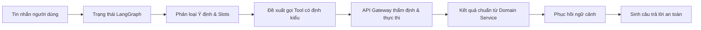

# Kiến Trúc Trí Tuệ Nhân Tạo (AI Agent Architecture)

Tầng trí tuệ nhân tạo (Intelligence Layer) của **X-One** được triển khai tại dịch vụ `apps/agent-service` sử dụng **Python 3.11**, **FastAPI** và **LangGraph**. Agent chịu trách nhiệm phân loại ý định (intent), trích xuất tham số (slots), lập kế hoạch gọi công cụ (tool requests) và sinh câu trả lời ngôn ngữ tự nhiên an toàn.

---

### 1. Luồng Xử Lý Cốt Lõi Của Agent

### 2. Các Nguyên Tắc Ranh Giới Bất Biến Của Agent

1. **Đầu ra luôn có định kiểu (Pydantic Schema Constrained)**: Mọi kết quả từ mô hình ngôn ngữ lớn (LLM) đều phải được kiểm định qua Pydantic schema với `include_raw=True`.
2. **Không tin cậy LLM trong việc tạo dữ liệu nghiệp vụ (Untrusted Authority)**:
   - LLM **không được phép tự bịa ID đơn hàng, giá tiền, số lượng phòng/bàn hay kết quả thanh toán**.
   - Mọi ID do LLM tự sinh đều bị loại bỏ. Toàn bộ ID thực tế, giá cước và trạng thái đều do Gateway và Domain Services cung cấp.
3. **Không gọi trực tiếp Domain Service**: Agent không có client kết nối xuống database hay các dịch vụ Food, Ride, Restaurant, Healthcare. Agent chỉ phát sinh bản đề xuất công cụ (Tool Proposal) gửi về Gateway.
4. **Không rò rỉ Chain-of-Thought**: Câu trả lời gửi cho người dùng không chứa prompt hệ thống, chuỗi suy luận nội bộ (chain-of-thought) hay thông tin nhạy cảm.

---

### 3. Bộ Lập Kế Hoạch Hợp Nhất (Unified Assistant Planner)

Bộ lập kế hoạch cấp cao nhất được cài đặt tại `apps/agent-service/src/agents/assistant_graph.py`:

- **Giao diện Handoff Core A (`core-a.v1`)**:
  - Nhận một lượt hội thoại và trả về bản kế hoạch `PlanningDecision` có định kiểu, giới hạn tối đa 4 task tương ứng với 4 domain (Ride, Food, Restaurant, Healthcare).
  - Gateway sẽ từ chối ngay lập tức nếu phiên bản handoff hoặc catalog phiên bản không khớp, hoặc có chu trình phụ thuộc vòng (cyclic dependency).
- **Cơ chế Phối Hợp Đa Dịch Vụ Có Thứ Tự (Multi-Service Dependency)**:
  - Agent có thể diễn đạt các quan hệ phụ thuộc như: *Chọn nhà hàng xong mới có địa chỉ làm điểm đến cho cuốc xe*, hoặc *Giữ chỗ bệnh viện xong mới đặt xe tới viện*.
  - Trong trường hợp cuốc xe phụ thuộc vào lịch khám bệnh, Agent chỉ trích xuất điểm đón của người dùng; điểm đến bệnh viện sẽ do Gateway tự động lấy từ kết quả chính thức của Healthcare Service.
- **Xử lý Chitchat & Đổi Ngữ Cảnh (Context Switching)**:
  - Khi người dùng hỏi các câu đệm, chào hỏi hoặc tư vấn chung (`interaction_mode: CHITCHAT`), hệ thống sẽ trả lời tự nhiên mà không kích hoạt gọi tool nghiệp vụ và không làm mất trạng thái đơn hàng đang chờ trước đó.
  - Khi người dùng chủ động chuyển sang dịch vụ khác, task cũ có thể được đánh dấu `DISCARDED` ở tầng điều phối. Lưu ý rằng `DISCARDED` chỉ là trạng thái tập trung của hội thoại, không phải là lệnh hủy đơn/hủy thanh toán ở domain service.

---

### 4. Cơ Chế Dự Phòng Tất Định (Conservative Deterministic Fallback)

Hệ thống được thiết kế để hoạt động hoàn toàn ổn định ngay cả khi không có kết nối Internet hoặc không có API key:

- **Chế độ Gemini chính**: Kích hoạt khi cấu hình `AGENT_MODEL_MODE=gemini` và có biến `GEMINI_API_KEY` (hỗ trợ luân chuyển nhiều key qua `GEMINI_API_KEYS` với cơ chế Round-Robin và tự động Failover khi chạm quota).
- **Chế độ Fallback Tất Định (Deterministic Fallback)**:
  - Tự động kích hoạt khi: Không có API key, mạng lỗi, hoặc mô hình LLM trả về cấu trúc JSON không hợp lệ.
  - Sử dụng các bộ trích xuất quy tắc regex và xử lý ngôn ngữ tiếng Việt tất định:
    - Nhận biết số lượng người tách biệt với ngày giờ.
    - Nhận diện loại phương tiện rõ ràng (`BIKE`, `CAR_4`, `CAR_7`).
    - Phân tích khung giờ khám bệnh (`tomorrow_morning`, `buổi sáng`, `buổi chiều`).
  - Đảm bảo các luồng Demo và kiểm thử tự động luôn chạy thông suốt 100% offline.

---

### 5. Thu Thập Dữ Liệu Đo Lường Từ Xa Với Langfuse (Telemetry Tracing)

Hệ thống tích hợp giám sát Langfuse v4 thông qua adapter riêng biệt tại Agent:
- Chỉ tự động kích hoạt khi có cả `LANGFUSE_PUBLIC_KEY` và `LANGFUSE_SECRET_KEY`.
- **Chính sách an toàn dữ liệu (Data Privacy Policy)**:
  - Langfuse tracer **tuyệt đối không ghi nhận**: Nội dung prompt thô, completion của người dùng, số thẻ thanh toán, PII (thông tin cá nhân nhạy cảm).
  - Chỉ ghi nhận: Thời gian thực thi (latency), số lượt retry, mã lỗi an toàn, tên mô hình và tên công cụ được đề xuất.
  - Lỗi gửi telemetry ra ngoài không bao giờ làm gián đoạn hoặc thay đổi phản hồi trả về cho người dùng.

---

### 6. CSDL Trạng Thái Agent (`xone_agent`)
- Agent sở hữu CSDL logic `xone_agent` với migration `002_agent_run_metadata.sql`.
- Bảng metadata chỉ lưu trữ ID lượt chạy, phase, phiên bản schema, thời gian phản hồi, mã lỗi an toàn và hash payload.
- Trạng thái hội thoại chính thức vẫn do Core Gateway nắm giữ để đảm bảo tính nhất quán trên toàn hệ thống.
