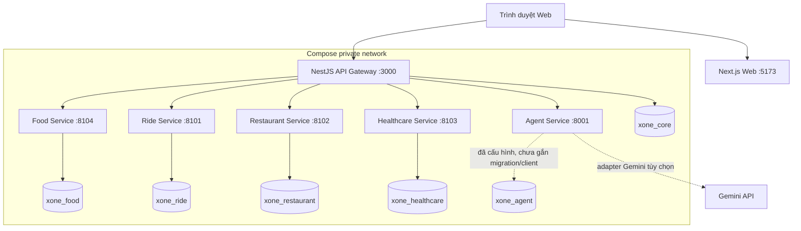
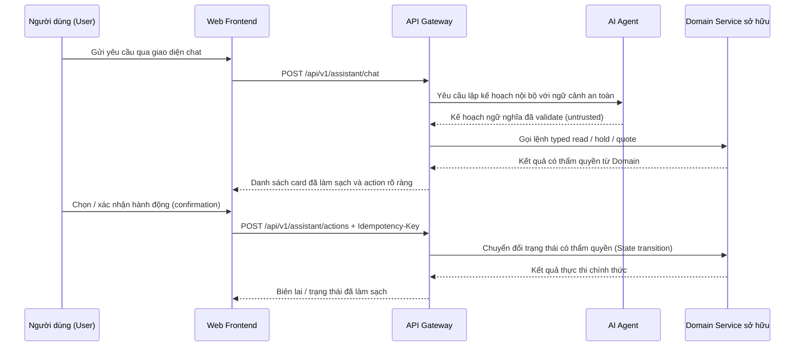
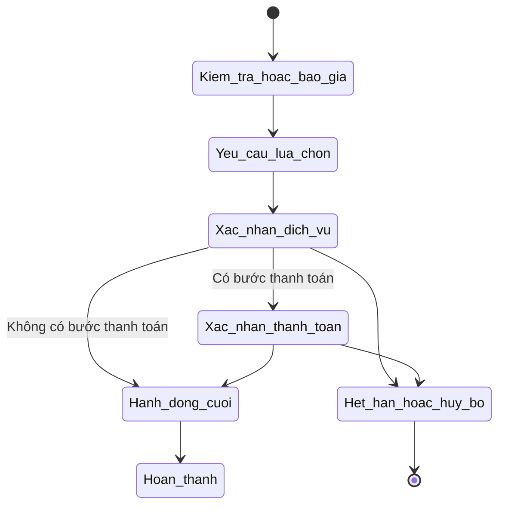
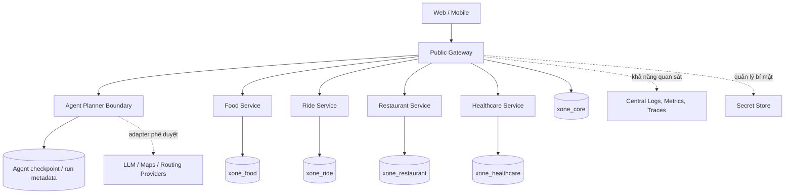

# Tài Liệu Kiến Trúc Bàn Giao Gate G2 (Architecture Deliverable)

Tài liệu này là góc nhìn kiến trúc phục vụ đánh giá nghiệm thu cho X-One. Tài liệu thể hiện cấu trúc MVP cục bộ đang hoạt động trong mã nguồn trước, sau đó mô tả định hướng tiến hóa tiếp theo có căn cứ kỹ thuật. Trạng thái triển khai và chi tiết xác minh lịch sử được lưu trữ chuẩn tắc tại [Trạng thái hiện tại](architecture/current-state.md).

## 1. MVP Hiện Tại

### Tô-pô thời gian chạy (Runtime Topology)

Client Web và Mobile chỉ gọi duy nhất vào API Gateway công khai. Tuyến `/api/health` của Next.js chỉ là container probe, không phải là BFF hay nguồn thẩm quyền nghiệp vụ. Agent, tất cả domain service, và PostgreSQL là các service nội bộ thuộc mạng riêng của Compose; chỉ có Web, Gateway và PostgreSQL được công khai cổng ra máy host phục vụ quy trình phát triển cục bộ.

### Quyền sở hữu và Giao diện (Ownership and Interfaces)

| Thành phần | Trách nhiệm | Giao diện | Trạng thái / Lưu trữ |
| --- | --- | --- | --- |
| **Web** | Hiển thị giao diện, xác thực/phiên trên trình duyệt, các thẻ hội thoại tương tác | Chỉ gọi REST Gateway công khai | Trạng thái trình duyệt không có thẩm quyền |
| **API Gateway** | Xác thực đầu vào công khai, phân quyền, định hình phản hồi, correlation/audit, điều phối xác nhận 2 bước, typed client nội bộ | Public `/api/v1`; Typed HTTP client nội bộ | Sở hữu dữ liệu Core trong `xone_core` |
| **Agent** | Lập kế hoạch ngữ nghĩa có giới hạn và tổng hợp ngôn ngữ an toàn | HTTP nội bộ từ Gateway sang Agent | `workflow_store` hiện tại chạy in-memory trong tiến trình; `xone_agent` đã cấp phát nhưng chưa gắn migration/client |
| **Food** | Danh mục món ăn, giỏ hàng, báo giá, đơn hàng và trạng thái giao hàng | REST nội bộ (chỉ Gateway gọi) | `xone_food` / asyncpg |
| **Ride** | Báo giá chuyến đi, giữ chỗ xe (hold), đặt chuyến và theo dõi mô phỏng (tracking) | REST nội bộ (chỉ Gateway gọi) | `xone_ride` / SQLAlchemy |
| **Restaurant** | Khám phá quán ăn, kiểm tra bàn trống, giữ chỗ bàn, đặt bàn dine-in | REST nội bộ (chỉ Gateway gọi) | `xone_restaurant` / SQLAlchemy |
| **Healthcare** | Lịch trống chuyên khoa/bác sĩ, giữ chỗ khám, xác nhận thanh toán, vòng đời lịch hẹn | REST nội bộ (chỉ Gateway gọi) | `xone_healthcare` / SQLAlchemy |
| **PostgreSQL** | Một phiên bản DB cục bộ với sự phân tách logic triệt để | Kết nối cơ sở dữ liệu riêng biệt | Nghiêm cấm query chéo database, khóa ngoại chéo, chung ORM model hay import chéo domain |

Tập danh mục tool chuẩn tắc là V2, trong khi các luồng tương thích Food/Restaurant/Healthcare đang dùng các request Agent định dạng V1 có giới hạn thông qua Gateway. Bề mặt tương thích đó không phải là bằng chứng cho việc đã tương đương 100% V2; xem thêm [hợp đồng công cụ (tool contracts)](api/tool-contracts.md) và [danh mục API (API inventory)](api/api-inventory.md).

### Luồng điều khiển (Control Flow)

Mô hình AI (LLM) không bao giờ tự quyết định các định danh ID có thẩm quyền, giá tiền, tình trạng phòng/bàn trống, trạng thái thanh toán hay thành công giao dịch. Model không có quyền truy cập trực tiếp database domain hoặc kích hoạt hành động cuối. Việc Gateway điều phối cũng không cho phép Gateway can thiệp trực tiếp vào database của domain service.

### Cơ chế xác nhận và Phục hồi (Confirmation and Recovery)

Một thao tác ghi có thể thử lại (retryable write) luôn bắt đầu với một `Idempotency-Key`. Domain service giới hạn phạm vi khóa theo actor, thao tác (operation), và payload đã chuẩn hóa. Xác nhận được ràng buộc chặt chẽ với actor, action, phiên bản/giá trị vật chất, thời gian hết hạn (expiry), và bằng chứng audit dùng một lần. Bất kỳ chi tiết nào thay đổi sẽ vô hiệu hóa hành động trước đó thay vì tái sử dụng âm thầm.

### Cấu hình cục bộ và Kiểm tra sức khỏe (Healthcheck)

Quy trình khởi động cục bộ khuyến nghị là chạy `scripts/local/start-all.ps1` (hoặc `scripts/local/start-all.sh`) sau khi sao chép file cấu hình gốc `.env.example` thành `.env`. Các probe kiểm tra liveness của container xác minh tiến trình; Gateway `/health/ready` xác minh các dependency mà nó thực sự kiểm tra. Script khởi động chạy tuần tự các migration idempotent và kiểm tra khả năng kết nối của Gateway và Web.

Mẫu cấu hình mặc định không yêu cầu API key của Gemini và sẽ sử dụng bộ lập kế hoạch tất định (deterministic planning). Đối với lượt chạy nghiệm thu Gate G2 thực tế với Gemini, cấu hình môi trường cần đặt `AGENT_MODEL_MODE=gemini` cùng `GEMINI_API_KEY` hợp lệ; bài đánh giá phải chứng minh được `decision_source=model` cho các kịch bản đa dịch vụ / non-fast-path.

## 2. Các Giới Hạn Của MVP Hiện Tại

- Cơ sở dữ liệu của Agent (`xone_agent`) chưa được nối dây cho checkpoint bền vững; trạng thái workflow cũ của Agent sẽ bị mất khi restart tiến trình Agent.
- Gemini là tùy chọn; lượt chạy Gate G2 độc lập ngày 2026-08-16 đã ghi nhận chẩn đoán Gemini thành công cho các ca đa miền mà không cần fallback. Chế độ lập kế hoạch tất định đóng vai trò là phương án dự phòng cục bộ.
- Tính năng theo dõi chuyến đi (Ride tracking) và thanh toán là mô phỏng nội bộ/sandbox.
- Tích hợp Geoapify cục bộ là tùy chọn; phương án dự phòng vị trí tất định luôn được dán nhãn rõ ràng và không bao giờ đóng vai trò thẩm quyền đặt xe.
- Mobile hiện tại là khung ứng dụng Expo (skeleton), chưa phải là client hoàn thiện thứ hai.
- Các luồng tương thích Agent V1 cũ và kiểm tra tương đương registry V2 một chiều cần hoàn thiện thống nhất dứt điểm trong các chu kỳ sau.

## 3. Kiến Trúc Mục Tiêu (Target Architecture)

Kiến trúc mục tiêu phát triển dựa trên ranh giới hiện tại thay vì đập đi xây lại:

| Hướng tiến hóa | Điều kiện kích hoạt | Bất biến kiến trúc cần giữ |
| --- | --- | --- |
| Trạng thái Agent in-memory → Lưu trữ checkpoint / run metadata bền vững | Cần khôi phục sau sự cố restart và lưu trữ hội thoại lâu dài | Không lưu prompt thô / CoT; Agent tuyệt đối không có thẩm quyền giao dịch |
| Logical database cục bộ → Các database server vật lý độc lập | Tải vận hành hoặc sự phân chia nhóm phát triển yêu cầu | Mỗi domain sở hữu 1 database; tuyệt đối không truy vấn SQL chéo domain |
| Rate limit in-memory → Rate limiter phân tán tại Gateway edge | Mở rộng quy mô nhiều hơn 1 instance Gateway | Gateway vẫn giữ vai trò là biên kiểm soát công khai |
| Log cục bộ → Centralized logs / metrics / traces (OTel, Grafana) | Vận hành hệ thống cần tương quan (correlation) giữa các service | Không bao giờ ghi log bí mật, prompt thô, hoặc PII nhạy cảm |
| Cấu hình biến môi trường cục bộ → Quản lý secret tập trung (Vault) | Triển khai production và nhu cầu xoay vòng khóa bí mật định kỳ | Đầu ra provider luôn là untrusted và không thể tự ủy quyền hành động |
| Luồng Agent V1 cũ → Hợp đồng dữ liệu typed V2 chuẩn tắc hoàn toàn | Hoàn tất kiểm thử tương thích và migration | Agent không được cấp quyền truy cập trực tiếp domain hoặc chốt hành động |

Các giải pháp như Message Queue, Event Sourcing, Service Mesh, Kubernetes, Kiến trúc đa vùng (Multi-region), hay Vector Database chuyên biệt không phải là cam kết cho phiên bản MVP này. Chúng chỉ được áp dụng khi có nhu cầu đo lường thực tế và quyết định thiết kế riêng biệt.

## 4. Danh Mục Kiểm Tra Đánh Giá (Review Checklist)

- Client công khai chỉ gọi duy nhất vào API Gateway.
- Mỗi domain service sở hữu độc quyền dữ liệu và chuyển đổi trạng thái của chính nó.
- Đầu ra của Agent luôn được validate chặt chẽ, coi là untrusted và không thể tự chốt giao dịch.
- Các bước tài chính/quyết định cuối cùng yêu cầu xác nhận 2 bước rõ ràng và có Idempotency-Key.
- Khẳng định MVP dựa trên mã nguồn thực tế; các hạng mục tương lai được dán nhãn rõ ràng là tiến hóa có lộ trình.
- Kết quả đánh giá Gate G2 thực tế được ghi nhận chi tiết tại [root eval](../eval/README.md), không suy diễn từ mock unit test.
