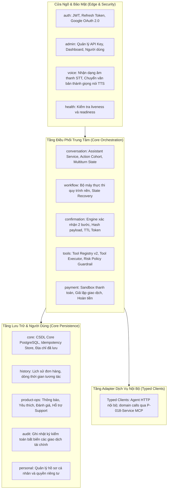

# Kiến Trúc Backend (Backend Architecture)

Hệ thống backend của **X-One** được thiết kế theo mô hình **Backend-First Microservices**. Trong đó, **NestJS API Gateway** đóng vai trò là cửa ngõ công khai duy nhất và bộ điều phối quy trình trung tâm (Central Orchestrator), kết nối với 5 microservices chuyên biệt viết bằng **Python FastAPI**.

---

### 1. Cấu Trúc Phân Hệ Của NestJS API Gateway

Mã nguồn tại `apps/api-gateway/src/modules/` được tổ chức thành 15 module chuyên biệt, tuân thủ nguyên tắc phân tách trách nhiệm cao (Separation of Concerns):

---

### 2. Chi Tiết Các Module Chức Năng Cốt Lõi

#### A. Module Điều phối Hội thoại (`conversation`)
- Quản lý phiên hội thoại thời gian thực qua `POST /api/v1/assistant/chat`.
- Nhận tin nhắn của người dùng, chuyển tiếp sang Agent Service để phân tích Intent và trích xuất Slots.
- Xử lý **Action Cohort**: duy trì ngữ cảnh tài nguyên đang tương tác (ví dụ: đang chọn nhà hàng, hoặc đang chờ chọn xe) mà không bị mất dấu khi người dùng hỏi chêm các câu đệm (chitchat).
- Định hình cấu trúc phản hồi dạng Rich Cards (vé xe, thẻ món ăn, thẻ nhà hàng, phiếu hẹn bác sĩ).

#### B. Cơ chế Xác nhận Hai Bước (`confirmation`)
- Mọi hành động tài chính hoặc đặt dịch vụ sau cùng đều bắt buộc trải qua quy trình xác nhận:
  1. **Bước 1: Xác nhận dịch vụ & chi tiết**: Người dùng duyệt thông tin cuốc xe, thực đơn hoặc giờ hẹn khám bệnh.
  2. **Bước 2: Xác nhận thanh toán (Financial Confirmation)**: Kèm chữ ký mã hóa (Hash Payload), người dùng thực thi, thời hạn hiệu lực (TTL 5 phút) và bằng chứng Idempotency một lần.
- Bất kỳ thay đổi nào về giá hoặc lộ trình trong quá trình xác nhận đều làm vô hiệu hóa token cũ và yêu cầu người dùng xác nhận lại từ đầu.

#### C. Bộ Thực Thi & Đăng Ký Công Cụ (`tools`)
- Quản lý **Tool Registry v2**: Danh mục toàn bộ công cụ được phép gọi trong hệ thống.
- **Risk Policy Guardrail**: Đánh giá mức độ rủi ro của từng công cụ (READ-ONLY, HIGH-RISK, MUTATING).
- Áp dụng kiểm tra bảo mật trước khi cho phép điều phối viên nội bộ (In-process Typed Dispatcher) gọi xuống các Domain Service.

#### D. Quản lý Đơn hàng & Quy trình nền (`workflow`)
- Quản lý trạng thái đơn hàng xuyên suốt qua các máy trạng thái hữu hạn (Finite State Machine - FSM).
- Worker nền chạy theo chu kỳ `GATEWAY_WORKFLOW_POLL_INTERVAL_MS` để phục hồi các giao dịch dở dang (recovery) và tự động cập nhật tiến độ đơn giao đồ ăn hoặc chuyến xe.

#### E. Tầng Khách Nội Bộ Có Định Kiểu (`services`)
- Toàn bộ giao tiếp từ Gateway tới domain services sử dụng Typed Client chuyên dụng và đi qua MCP; Agent nội bộ vẫn dùng HTTP client riêng:
  - `AgentClient`: Gửi yêu cầu lập kế hoạch và phân tích ngữ nghĩa.
  - `FoodClient`: Tương tác thực đơn, giỏ hàng, đặt món.
  - `RideClient`: Yêu cầu báo giá, đặt xe, theo dõi tài xế.
  - `RestaurantClient`: Tra cứu bàn trống, giữ chỗ nhà hàng.
  - `HealthcareClient`: Tra cứu bác sĩ, đặt slot khám, liên kết bệnh nhân.
- Tự động truyền mã định danh tương quan `X-Correlation-Id` và kiểm soát timeout bảo vệ hệ thống.

---

### 3. Kiến Trúc Các Domain Microservices (Python FastAPI)

Mỗi dịch vụ miền được xây dựng độc lập bằng Python 3.11:
- **Cấu trúc module chuẩn**:
  - `src/main.py`: Khởi tạo ứng dụng FastAPI, nạp middleware CORS, logging, và route controllers.
  - `src/api/`: Các router REST API phân tách theo phiên bản (`/api/v1/...`).
  - `src/domain/`: Thực thể nghiệp vụ, logic tính toán giá cước, xác thực tính hợp lệ.
  - `src/infrastructure/`: Kết nối SQLAlchemy ORM, repository pattern, giao tiếp database.
  - `migrations/`: Quản lý lược đồ CSDL bằng Alembic hoặc SQL migration riêng biệt.
  - `seeds/`: Nạp dữ liệu mẫu tất định ban đầu.

---

### 4. Xử Lý Lỗi An Toàn & Khả Năng Chống Chịu (Error Hygiene & Resilience)
- **Chuẩn hóa lỗi RFC 7807 (Problem Details)**: Mọi lỗi API đều trả về dạng JSON chuẩn gồm: `status`, `error_code`, `message`, `correlation_id` và `timestamp`.
- **Tuyệt đối không rò rỉ**: Không bao giờ trả về stack trace, lỗi nội bộ của Python/SQLAlchemy hay thông tin nhạy cảm của server cho client.
- **Fast-fail & Timeout**: Các kết nối ra ngoài đều có giới hạn thời gian (UPSTREAM_TIMEOUT_MS: 5000ms), tự động ngắt nếu dịch vụ phía sau bị treo để tránh làm cạn kiệt tài nguyên Gateway.
