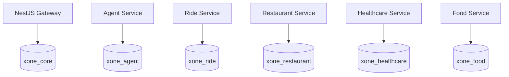

# Kiến Trúc Dữ Liệu & Quản Lý CSDL (Data Architecture)

Hệ thống cơ sở dữ liệu của **X-One** sử dụng **PostgreSQL 16**, được cấu hình phân chia thành **6 cơ sở dữ liệu logic (Logical Databases)** với người dùng sở hữu (DB Owners) riêng biệt:
1. `xone_core` (User: `core_user`): CSDL của API Gateway.
2. `xone_agent` (User: `agent_user`): CSDL metadata của AI Agent.
3. `xone_ride` (User: `ride_user`): CSDL của Ride Service.
4. `xone_restaurant` (User: `restaurant_user`): CSDL của Restaurant Service.
5. `xone_healthcare` (User: `healthcare_user`): CSDL của Healthcare Service.
6. `xone_food` (User: `food_user`): CSDL của Food Service.

---

### 1. Nguyên Tắc Phân Tách Logic Tuyệt Đối (Logical Isolation)

- **Không có truy vấn chéo (No Cross-Database Queries)**: Mỗi microservice chỉ được phép kết nối vào duy nhất CSDL logic của chính nó. Không bao giờ dùng SQL JOIN giữa các database.
- **Không có khóa ngoại chéo (No Cross-Service Foreign Keys)**: Mọi liên kết giữa các dịch vụ đều được truyền tải thông qua API snapshot hoặc ID tham chiếu định kiểu.
- **Không dùng chung ORM Entity**: Mỗi service tự định nghĩa Schema/Model nội bộ (TypeORM/Prisma cho NestJS và SQLAlchemy cho Python).
- **Phân tách vật lý (Physical Separation)**: Ở giai đoạn hiện tại (MVP/Staging), việc dùng chung 1 instance PostgreSQL với 6 logical DB giúp tiết kiệm tài nguyên máy chủ. Khi quy mô tăng trưởng trong tương lai, các database này có thể dễ dàng tách sang các máy chủ vật lý độc lập mà không cần sửa code.

---

### 2. Chi Tiết Dữ Liệu Từng Phân Hệ

#### A. CSDL Core (`xone_core`) — Sở hữu bởi Gateway
- Quản lý qua các bản migration SQL lũy tiến từ `001` đến `018`:
  - `001`–`009`: Bảng `users` (mật khẩu băm bằng Argon2id), `user_sessions` (quản lý token family, refresh token hash SHA-256), `audit_logs`, và các bằng chứng giao dịch sandbox.
  - `010_core_personal_context.sql`: Quản lý hồ sơ người dùng, sổ địa chỉ đã lưu (`saved_addresses`) và metadata hội thoại.
  - `011_core_multi_service_workflows.sql`: Lưu trữ kế hoạch workflow đa dịch vụ, trạng thái phụ thuộc, bù trừ lỗi (compensation) và bằng chứng Idempotency.
  - `012_core_product_ops.sql`: Lưu trữ thông báo (`notifications`), yêu thích (`user_favorites`), đánh giá dịch vụ (`service_feedback`), và phiếu hỗ trợ (`support_tickets`).
  - `013_core_admin_support_idempotency.sql`: Khóa chống lặp khi Admin xử lý ticket.
  - `015_core_api_keys.sql` & `016_core_token_usage.sql`: Quản lý API Key nội bộ và thống kê lượng token AI tiêu thụ.
  - `017_core_four_roles_rbac.sql`: Mở rộng RBAC 4 tầng (`admin`, `manager`, `provider`, `user`) và bảng `provider_profiles`.
  - `018_core_seed_four_roles.sql`: Hạt giống tất định 4 tài khoản role chuẩn cho toàn bộ môi trường và production.
  - `019_core_provider_offerings.sql`: Cập nhật `provider_profiles` (thương hiệu, địa chỉ, webhook, trạng thái nhận khách) và tạo bảng `provider_service_items` cho phép đối tác tự đăng ký và gắn danh mục dịch vụ (món ăn, phương tiện, gói khám) vào hệ thống X-One.

#### B. CSDL Ride (`xone_ride`) — Sở hữu bởi Ride Service
- Quản lý bằng Alembic migrations:
  - Bảng `quotes`: Lưu trữ báo giá lộ trình, mức cước (tariff), thời gian hết hạn của báo giá và snapshot lộ trình.
  - Bảng `bookings`: Lưu trữ cuốc xe chính thức, thông tin tài xế nhận chuyến, trạng thái chuyến đi (`REQUESTED`, `ASSIGNED`, `ARRIVED`, `IN_PROGRESS`, `COMPLETED`, `CANCELLED`).
  - Bảng `tracking_events`: Lưu trữ nhật ký tọa độ di chuyển theo thời gian thực (Append-only).
  - Khắc phục phantom revision và snapshot bất biến: Mỗi đơn đặt xe lưu giữ toàn bộ snapshot JSON của báo giá tại thời điểm đặt xe để đảm bảo tính minh bạch.

#### C. CSDL Restaurant (`xone_restaurant`) — Sở hữu bởi Restaurant Service
- Quản lý bằng Alembic migrations:
  - Bảng `restaurants`: Danh mục nhà hàng, địa chỉ, loại hình ẩm thực, tọa độ địa lý.
  - Bảng `tables`: Quản lý danh sách bàn ăn và sức chứa (capacity).
  - Bảng `holds`: Giữ chỗ bàn tạm thời trong 15 phút.
  - Bảng `reservations`: Đơn đặt bàn đã được xác nhận chính thức.
  - Bảng `catalog_dataset_versions`: Theo dõi phiên bản dữ liệu nhà hàng được nạp từ file CSV.

#### D. CSDL Healthcare (`xone_healthcare`) — Sở hữu bởi Healthcare Service
- Quản lý qua SQL migrations từ `001` đến `005`:
  - Bảng `departments`: Danh mục chuyên khoa khám bệnh.
  - Bảng `doctors`: Thông tin bác sĩ chuyên khoa, học hàm/học vị.
  - Bảng `time_slots`: Các khung giờ khám bệnh khả dụng.
  - Bảng `patient_user_links`: Liên kết giữa tài khoản người dùng và hồ sơ bệnh nhân.
  - Bảng `appointments`: Đơn hẹn khám bệnh chính thức, kèm mã xác nhận và trạng thái thanh toán.

#### E. CSDL Food (`xone_food`) — Sở hữu bởi Food Service
- Quản lý qua SQL migrations từ `001` đến `008`:
  - Bảng `merchants`, `menus`, `menu_items`: Thực đơn, danh mục món ăn và giá bán.
  - Bảng `carts`: Giỏ hàng của người dùng, tự động đồng bộ và tính toán tổng tiền.
  - Bảng `orders`: Đơn hàng món ăn, địa chỉ giao hàng snapshot và tiến trình giao hàng.
  - `008_food_catalog_search.sql`: Cung cấp cột `search_text` loại bỏ dấu tiếng Việt và chỉ mục Trigram (Trigram Index) để tìm kiếm món ăn cực nhanh.

#### F. CSDL Agent (`xone_agent`) — Sở hữu bởi Agent Service
- Quản lý qua migration `002_agent_run_metadata.sql`:
  - Chỉ lưu trữ metadata: ID lượt chạy, phase, phiên bản schema, thời gian phản hồi, mã lỗi an toàn và hash payload.
  - Tuyệt đối không lưu trữ prompt thô hay nội dung hội thoại nhạy cảm.

---

### 3. Quy Trình Nạp Dữ Liệu Mẫu (Catalog Importer & Seeding)

1. **Catalog Importer tĩnh (DataOps)**:
   - Toàn bộ dữ liệu nhà hàng, thực đơn và danh mục bác sĩ tại Hà Nội được lưu trữ dưới dạng file CSV phiên bản hóa trong thư mục [data/](file:///d:/VIN/Projects/P-018/data/).
   - Khi chạy script hoặc khởi động staging, container `catalog-importer` sẽ nạp tự động dữ liệu vào PostgreSQL một cách tất định và lũy tiến (Idempotent Upsert).
2. **Kịch bản Demo Seeding (`-SeedDemo`)**:
   - Tự động tạo 36 tài xế Ride với biển số xe và thông tin đầy đủ.
   - Tạo 32 bàn ăn mẫu `DEMO-XONE-*` tại các nhà hàng để tránh hết chỗ khi demo.
   - Tạo các khung giờ khám bệnh khả dụng trong tương lai và liên kết bệnh nhân mẫu.
   - Kịch bản dọn dẹp [scripts/database/demo-reset.ps1](file:///d:/VIN/Projects/P-018/scripts/database/demo-reset.ps1) chỉ xóa các đơn hàng phát sinh trong phiên demo, bảo toàn nguyên vẹn danh mục gốc.
