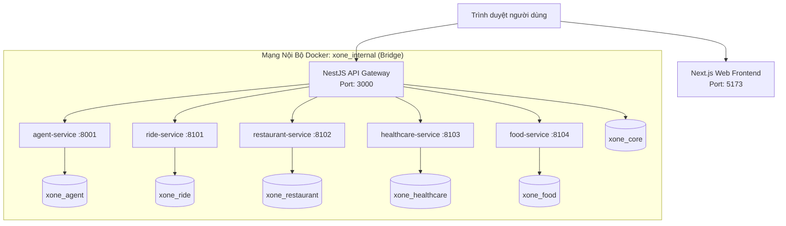

# Kiến Trúc Vận Hành & Khởi Chạy (Runtime Architecture)

Tài liệu này mô tả chi tiết cách thức toàn bộ hệ thống **X-One** được triển khai, vận hành và phân bổ tài nguyên trên môi trường máy chủ và máy lập trình viên (Local Development).

---

### 1. Sơ Đồ Cấu Trúc Mạng & Cổng Giao Tiếp (Network Topology & Ports)

### 2. Danh Mục Phân Bổ Cổng Dịch Vụ (Port Allocation)

| Dịch Vụ | Container Name | Cổng Host (Mặc định) | Cổng Nội Bộ Container | Phạm Vi Truy Cập |
| :--- | :--- | :--- | :--- | :--- |
| **Frontend Web** | `web` | `5173` (`${WEB_PORT}`) | `3000` | Công khai (Public) |
| **API Gateway** | `api-gateway` | `3000` (`${API_GATEWAY_PORT}`) | `3000` | Công khai (Public) |
| **PostgreSQL** | `postgres` | `5432` (`${POSTGRES_PORT}`) | `5432` | Nội bộ / Host dev |
| **Agent Service** | `agent-service` | Không public | `8001` (`${AGENT_SERVICE_PORT}`) | Chỉ nội bộ (`xone_internal`) |
| **Ride Service** | `ride-service` | Không public | `8101` (`${RIDE_SERVICE_PORT}`) | Chỉ nội bộ (`xone_internal`) |
| **Restaurant Service**| `restaurant-service` | Không public | `8102` (`${RESTAURANT_SERVICE_PORT}`) | Chỉ nội bộ (`xone_internal`) |
| **Healthcare Service**| `healthcare-service` | Không public | `8103` (`${HEALTHCARE_SERVICE_PORT}`) | Chỉ nội bộ (`xone_internal`) |
| **Food Service** | `food-service` | Không public | `8104` (`${FOOD_SERVICE_PORT}`) | Chỉ nội bộ (`xone_internal`) |

> [!IMPORTANT]
> - Chỉ có **Web** và **API Gateway** mở cổng công khai ra ngoài máy host.
> - Toàn bộ 5 microservices backend và các kết nối CSDL nằm trọn vẹn bên trong mạng ảo `xone_internal` (Docker Bridge).
> - Giao tiếp giữa các container bắt buộc sử dụng **Docker Service DNS** (ví dụ: `http://agent-service:8001`), tuyệt đối **không được dùng `localhost`** khi giao tiếp giữa các container với nhau.

---

### 3. Chính Sách Quản Lý Tài Nguyên & Log Chuẩn Doanh Nghiệp

Hệ thống áp dụng các tiêu chuẩn DevOps khắt khe để đảm bảo máy chủ chạy mát, nhẹ, không rò rỉ bộ nhớ:

1. **Khóa trần RAM & CPU (Resource Limits & Reservations)**:
   - Toàn bộ 8 containers được cấp trần tối đa tổng cộng **~3.0 GB RAM**.
   - Phân bổ chi tiết:
     - `postgres`: Limit 512MB RAM, 1.0 CPU (Reservation 256MB).
     - `api-gateway`: Limit 512MB RAM, 0.8 CPU (Reservation 256MB).
     - `web`: Limit 512MB RAM, 0.8 CPU (Reservation 256MB).
     - `agent-service`: Limit 512MB RAM, 1.0 CPU (Reservation 256MB).
     - `food-service`: Limit 300MB RAM, 0.5 CPU (Reservation 128MB).
     - `ride-service`, `restaurant-service`, `healthcare-service`: Limit 256MB RAM, 0.4 CPU (Reservation 128MB).
2. **Kiểm tra sức khỏe tối ưu (Healthchecks with Grace Period)**:
   - Áp dụng `start_period: 20s - 30s`: Cho phép container có thời gian ân hạn nạp model và CSDL khi vừa bật lên.
   - Chu kỳ `interval: 30s` (thay vì 10s): Giảm 66% số lần spawn tiến trình Python/Node ngầm.
   - Ngưỡng thất bại `retries: 3`: Fail-fast chuẩn xác khi gặp sự cố thực sự.
3. **Cơ chế xoay vòng Log (Log Rotation)**:
   - Cấu hình driver `json-file` tự động cắt file khi đạt `max-size: 20m` và giữ tối đa `max-file: 3`. Đảm bảo mỗi container tiêu tốn không quá 60MB dung lượng log, triệt tiêu nguy cơ tràn ổ cứng.

---

### 4. Quy Trình Khởi Động & Kiểm Tra Khả Dụng

- **Kịch bản tự động `scripts/local/start-all.ps1` (hoặc `.sh`)**:
  1. Kiểm tra tính hợp lệ của file `.env`.
  2. Build và khởi chạy Docker Compose trong chế độ detached (`-d`).
  3. Chờ đợi cơ chế Healthcheck xác nhận cả 8 container đạt trạng thái `healthy`.
  4. Tự động áp dụng các bản migration CSDL cần thiết (Alembic và SQL script).
  5. Thăm dò (probe) trạng thái hoạt động của Gateway tại `/health/live` và Web tại `/api/health`.
  6. In ra thông báo sẵn sàng kèm đường dẫn truy cập cho người dùng.

---

### 5. Phương Án Phát Triển Cực Nhẹ: Hybrid Local Process

Dự án cung cấp kịch bản chạy trực tiếp trên máy host qua [scripts/local/local-dev.ps1](file:///d:/VIN/Projects/P-018/scripts/local/local-dev.ps1):
- Chỉ bật duy nhất container **PostgreSQL** trong Docker (`docker compose up -d postgres`).
- Chạy Web, Gateway và 5 microservices trực tiếp bằng Python/Node của máy tính.
- Phương pháp này giúp **tiết kiệm hơn 80% RAM và CPU**, hỗ trợ Hot-Reload code tức thì mà không cần rebuild container.
