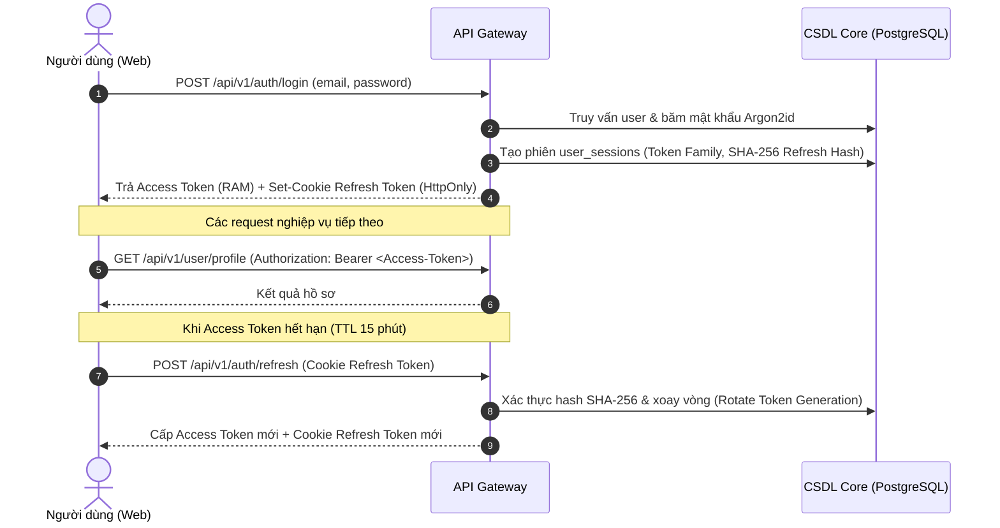

# Kiến Trúc An Toàn & Bảo Mật (Security Architecture)

Tài liệu này đặc tả toàn diện các cơ chế phòng thủ nhiều lớp, chính sách xác thực, phân quyền và bảo vệ dữ liệu trong hệ thống **X-One**.

---

### 1. Chính Sách Bảo Mật Tầng Mạng & Cửa Ngõ (Edge & Network Security)

- **Điểm kết thúc lưu lượng (Traffic Termination)**: Toàn bộ lưu lượng từ trình duyệt Web và ứng dụng di động đều dừng tại API Gateway. Các microservice bên trong không mở cổng ra ngoài internet.
- **CORS nghiêm ngặt**: Cấu hình `GATEWAY_CORS_ORIGINS` chỉ chấp nhận danh sách tên miền cụ thể (whitelist), từ chối ký tự đại diện `*`. Trong môi trường Production, toàn bộ origin dạng `localhost` đều bị từ chối.
- **HTTP Security Headers**: Gateway phát sinh đầy đủ các header bảo mật tiêu chuẩn:
  - `X-Content-Type-Options: nosniff`
  - `X-Frame-Options: DENY` (chống Clickjacking)
  - `Content-Security-Policy` (CSP) hạn chế nguồn tài nguyên
  - `Strict-Transport-Security` (HSTS) trên môi trường Production
  - Giới hạn kích thước payload `GATEWAY_BODY_LIMIT_BYTES` và trả mã lỗi `REQUEST_BODY_TOO_LARGE` khi vượt ngưỡng.

---

### 2. Xác Thực Người Dùng & Quản Lý Phiên (Authentication & Session Security)

- **Mật khẩu an toàn**: Mật khẩu người dùng được băm bằng thuật toán **Argon2id** (bộ nhớ 19 MiB, time cost 2, parallelism 1), bắt buộc độ dài 15–128 ký tự Unicode.
- **Không phân biệt lỗi đăng nhập (Timing Attack Prevention)**: Khi đăng nhập thất bại, hệ thống trả về thông báo giống hệt nhau cho cả trường hợp sai email hoặc sai mật khẩu.
- **Access Token (JWT)**:
  - Định dạng HS256, kiểm tra chữ ký, issuer (`AUTH_ISSUER`), audience (`AUTH_AUDIENCE`) và thời hạn sống (`AUTH_ACCESS_TOKEN_TTL_SECONDS`).
  - Phía Web chỉ lưu Access Token trong **bộ nhớ RAM của JavaScript**; tuyệt đối không lưu vào `localStorage`, `sessionStorage` để chống tấn công XSS.
- **Refresh Token & Xoay Vòng Token Family (Rotation & Anti-Replay)**:
  - Refresh Token là chuỗi ngẫu nhiên dài. Chỉ có mã băm SHA-256 được lưu trong bảng `user_sessions`.
  - Giá trị thật chỉ được gửi qua cookie có cờ `HttpOnly`, `SameSite=Lax`, `Path=/api/v1/auth` và `Secure` (ngoại trừ môi trường dev local HTTP).
  - Khi refresh, một thế hệ token mới được sinh ra và token cũ bị hủy. Nếu phát hiện token cũ bị dùng lại (Replay Attack), hệ thống sẽ **thu hồi toàn bộ gia đình token (Token Family)** của phiên đó ngay lập tức và ghi nhật ký kiểm toán.

---

### 3. Bảo Vệ Tương Tác Giữa Các Service Nội Bộ (Service-to-Service Security)

- **Mã token nội bộ (`INTERNAL_SERVICE_TOKEN`)**:
  - Mọi yêu cầu từ Gateway gửi xuống 5 microservices đều phải mang header `Authorization: Bearer <INTERNAL_SERVICE_TOKEN>` và `X-Actor-Id: <user_id>`.
  - Các service kiểm tra token này bằng phép so sánh thời gian không đổi (Constant-time comparison) để chống Timing Attacks.
  - Bất kỳ yêu cầu nào thiếu token hoặc thiếu Actor ID đều bị từ chối với mã lỗi `401 Unauthorized`.

---

### 4. An Toàn Giao Dịch & Quy Trình Xác Nhận 2 Bước (Transaction Safeguards)

1. **Xác nhận rõ ràng (Explicit Confirmation)**:
   - Các hành động tạo cuốc xe, đặt bàn, đặt món và khám bệnh bắt buộc phải có bước xác nhận của người dùng (`confirmation_form`).
   - Token xác nhận được ràng buộc với: Actor ID, mã hash của payload, phiên bản báo giá, số tiền và thời gian hết hạn (TTL 5 phút).
   - Nếu người dùng hoặc hệ thống thay đổi bất kỳ thông tin nào (đổi món, đổi điểm đón), token xác nhận cũ sẽ lập tức bị hủy bỏ (`confirmation_invalidated`).
2. **Khóa chống trùng lặp (Idempotency Key)**:
   - Mọi thao tác ghi hoặc thanh toán đều yêu cầu `Idempotency-Key` từ client.
   - Domain Service lưu trữ mã băm payload cùng kết quả giao dịch. Nếu client gửi lại cùng một key với cùng payload (do timeout mạng), hệ thống trả về kết quả cũ mà không thực hiện lại giao dịch lần 2. Nếu gửi cùng key nhưng khác payload, hệ thống báo lỗi xung đột an toàn (`409 Conflict`).

---

### 5. An Toàn AI Prompt & Bảo Vệ Dữ Liệu Nhạy Cảm (Prompt Safety & Privacy)

- **Dữ liệu bên ngoài là không tin cậy (Untrusted External Content)**: Tin nhắn người dùng, tài liệu tra cứu và kết quả từ API bên thứ ba được đối xử như dữ liệu chưa được xác thực, không bao giờ được coi là câu lệnh hệ thống (System Instruction).
- **Chống Prompt Injection**: Agent chỉ sinh ra JSON có cấu trúc (Pydantic Schema); Gateway là chốt chặn cuối cùng thẩm định tính hợp lệ của các tham số trước khi chuyển thành lệnh gọi hàm.
- **Giữ kín thông tin bí mật (No Secret Leakage)**: Nhật ký ghi log (Application logs, Audit logs và Langfuse traces) tự động loại bỏ mật khẩu, token, thông tin thẻ tín dụng và dữ liệu cá nhân nhạy cảm (PII).
