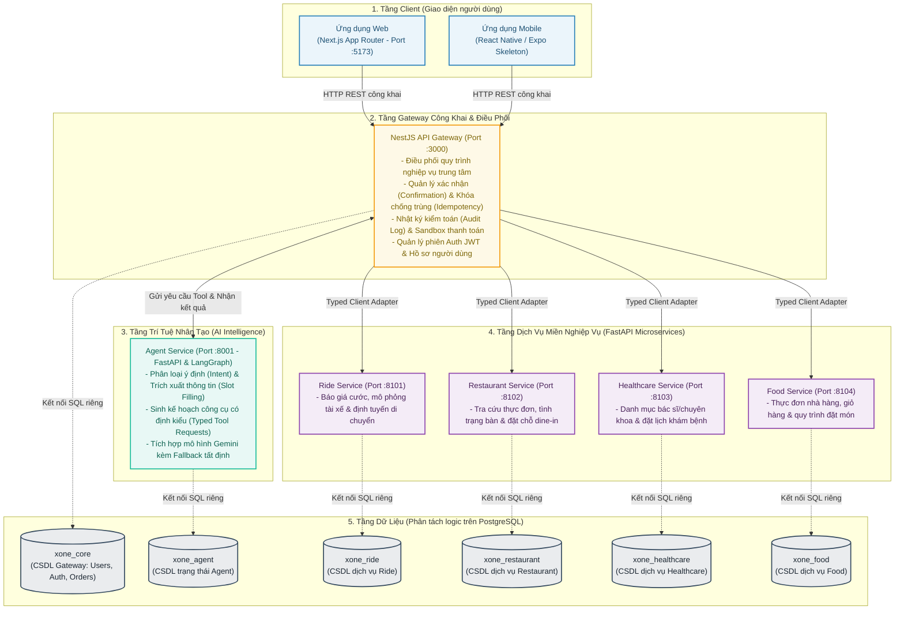

# Tổng Quan Kiến Trúc Hệ Thống (System Overview)

**X-One** là nền tảng trợ lý hội thoại thông minh phục vụ đặt dịch vụ và mua sắm đa lĩnh vực. Hệ thống được xây dựng theo triết lý **Backend-First**: cả ứng dụng Web và Mobile đều chỉ tương tác qua một điểm tiếp xúc backend duy nhất (NestJS API Gateway), trong đó Gateway đóng vai trò điều phối trung tâm giữa trí tuệ nhân tạo (AI Agent) và các dịch vụ nghiệp vụ chuyên biệt (Domain Services).

### Nguyên tắc kiến trúc cốt lõi:
1. **Sở hữu miền độc lập (Domain Ownership)**: Mỗi dịch vụ miền sở hữu toàn bộ logic nghiệp vụ, schema cơ sở dữ liệu và các bước chuyển trạng thái của riêng mình.
2. **Hợp đồng REST/JSON/OpenAPI**: Giao tiếp nội bộ hoàn toàn qua HTTP REST có định kiểu rõ ràng, không chia sẻ code nghiệp vụ hoặc ORM model giữa các dịch vụ.
3. **Xác nhận giao dịch rõ ràng (Explicit Confirmation)**: Mọi tác vụ có chi phí, thay đổi trạng thái hoặc ảnh hưởng quyền lợi người dùng đều phải trải qua bước xác nhận người dùng trước khi thực thi.
4. **Tính Idempotent cho các thao tác ghi**: Mọi yêu cầu ghi hoặc thanh toán đều mang `Idempotency-Key` để bảo đảm an toàn khi mạng chập chờn hoặc retry.
5. **Truy cập đặc quyền tối thiểu (Least Privilege)**: Tách biệt hoàn toàn quyền truy cập cơ sở dữ liệu và biến môi trường giữa các phân hệ. Lưu lượng công khai từ người dùng kết thúc tại Gateway; các liên kết còn lại hoàn toàn là kết nối mạng nội bộ riêng tư.

---

### Sơ Đồ Kiến Trúc Đa Tầng

---

### Mô Tả Hoạt Động & Phạm Vi Hiện Tại

- **Luồng xử lý tích hợp thực tế**:
  - **Đồ ăn (Food)**: Duyệt thực đơn món ăn, quản lý giỏ hàng, xác nhận địa chỉ giao hàng và theo dõi tiến độ đơn hàng.
  - **Đặt xe (Ride)**: Báo giá lộ trình di chuyển (xe máy CAR/BIKE), mô phỏng vòng đời tài xế nhận chuyến, di chuyển và hoàn thành chuyến đi.
  - **Đặt bàn (Restaurant)**: Khám phá nhà hàng theo khu vực và món ăn, kiểm tra tình trạng bàn trống, giữ chỗ tạm thời và xác nhận đặt bàn.
  - **Khám bệnh (Healthcare)**: Tra cứu danh sách bác sĩ, chuyên khoa bệnh viện, kiểm tra slot khám khả dụng, giữ chỗ và ghi nhận thanh toán.
  - **Cốt lõi (Core)**: Quản lý tài khoản người dùng, địa chỉ quen thuộc đã lưu, lưu trữ lịch sử hội thoại nhiều lượt và quản trị hệ thống.
- **Tính an toàn tuyệt đối**:
  - Mọi thao tác tài chính hay đặt chỗ sau cùng của Restaurant, Ride, Food và Healthcare đều bắt buộc có sự xác nhận của người dùng (`confirmation_form`).
  - AI Agent không có quyền tự quyết định thanh toán hay thay đổi dữ liệu trực tiếp trong CSDL.
- **Hạ tầng tinh gọn**:
  - Tối ưu hóa trong 1 máy chủ Docker Compose nội bộ với trần RAM kiểm soát trong ~3.0 GB.
  - Tránh đưa vào các hạ tầng phân tán phức tạp chưa cần thiết (như Redis, Kafka, Kubernetes hay Service Mesh) để giữ hệ thống chạy mượt mà, dễ bảo trì và dễ nghiệm thu.
