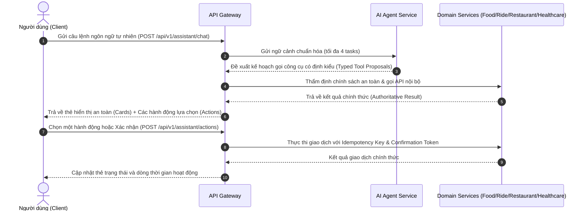
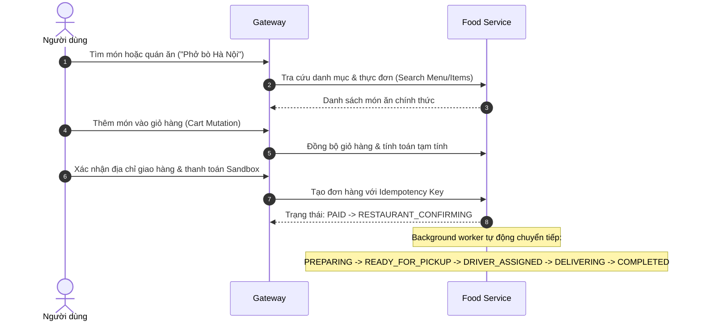
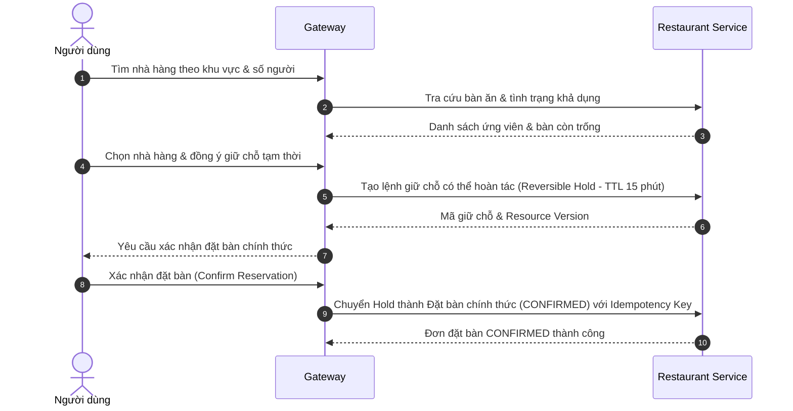
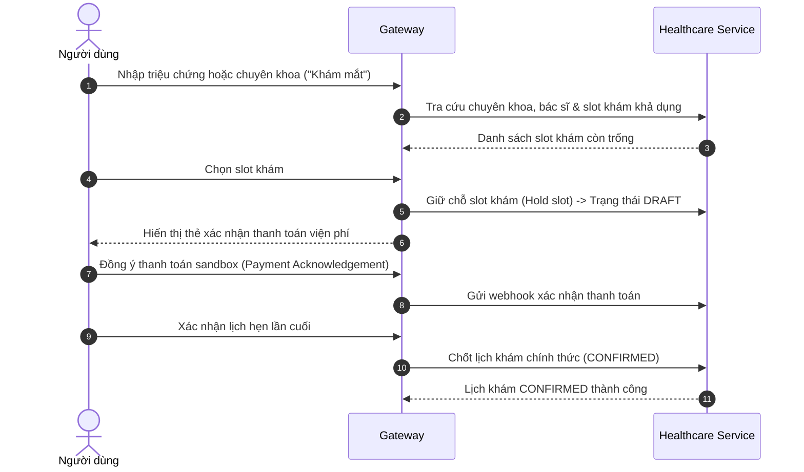

# Quy Trình Nghiệp Vụ & Vòng Đời Dịch Vụ (Workflows)

Tài liệu này mô tả chi tiết các luồng tương tác của trợ lý hội thoại **X-One**, quy trình nghiệp vụ đơn dịch vụ và cách thức phối hợp đa dịch vụ theo chuỗi phụ thuộc có độ tin cậy cao.

---

### 1. Luồng Tương Tác Hội Thoại Tổng Quát (General Chat & Tools)



---

### 2. Phối Hợp Đa Dịch Vụ Theo Chuỗi (Multi-Service Composition)

#### A. Chuỗi Nhà Hàng $\rightarrow$ Đặt Xe (Restaurant-to-Ride)
- **Ràng buộc phụ thuộc (`STOP_DEPENDENTS`)**: Khi người dùng yêu cầu: *"Tìm quán lẩu Cầu Giấy rồi đặt xe đến đó"*, tác vụ Đặt xe (Ride) sẽ bị khóa ở trạng thái `NEEDS_INFO` cho đến khi người dùng chọn xong nhà hàng cụ thể.
- Chỉ khi nhà hàng đã được chọn và trả về **địa chỉ chính xác từ CSDL Restaurant**, Gateway mới lấy địa chỉ đó làm điểm đến để yêu cầu Ride Service báo giá.
- Thao tác đặt xe chỉ được phép kích hoạt sau khi việc giữ chỗ bàn tại nhà hàng hoàn tất.

#### B. Chuỗi Khám Bệnh $\rightarrow$ Đặt Xe (Healthcare-to-Ride)
- Khi người dùng đặt lịch khám bệnh và yêu cầu xe đưa đón:
  1. Người dùng chọn chuyên khoa/bác sĩ và slot giờ khám bệnh.
  2. Bệnh viện giữ chỗ slot khám thành công và trả về địa chỉ cơ sở y tế kèm giờ hẹn khám (`appointment_start`).
  3. Gateway tự động tính toán giờ khởi hành đề xuất:
     $$\text{Giờ khởi hành đề xuất} = \text{Giờ khám} - \text{Thời gian di chuyển ước tính} - 20\text{ phút (Buffer)}$$
     *(20 phút là hằng số `HEALTHCARE_RIDE_DEPARTURE_BUFFER_MINUTES`)*.
  4. Nếu giờ khám quá gấp hoặc đã trôi qua, Gateway sẽ cảnh báo `ride_timing_conflict` để người dùng chủ động điều chỉnh.

---

### 3. Vòng Đời Dịch Vụ Đặt Xe (Ride Lifecycle)

Ride Service là nguồn chân lý duy nhất cho giá cước và trạng thái cuốc xe:
- **Vòng đời Báo giá (Quote)**:
  $$\text{QUOTE\_CREATED} \longrightarrow \text{AWAITING\_CONFIRMATION} \longrightarrow \text{CONSUMED (hoặc EXPIRED)}$$
- **Vòng đời Cuốc xe (Booking)**: Bắt buộc trải qua 2 bước xác nhận rõ ràng:
  1. Xác nhận chi tiết lộ trình và loại xe.
  2. Xác nhận thanh toán/đặt xe.
- **Tiến trình mô phỏng tài xế thời gian thực**:
```text
AWAITING_CONFIRMATION (Chờ người dùng xác nhận)
  └──> SEARCHING_DRIVER (Đang tìm tài xế xung quanh)
        └──> DRIVER_ASSIGNED (Đã tìm thấy tài xế - khởi tạo cách điểm đón 2-3km)
              └──> DRIVER_TO_PICKUP (Tài xế đang di chuyển tới điểm đón)
                    └──> DRIVER_ARRIVED (Tài xế đã đến điểm đón)
                          └──> IN_PROGRESS (Đang chở khách tới điểm đến)
                                └──> COMPLETED (Hoàn thành cuốc xe)
```
- Các trạng thái kết thúc khác: `NO_DRIVER` (không tìm thấy tài xế), `PAYMENT_FAILED` (thanh toán thất bại), `CANCELLED` (người dùng hủy chuyến).

---

### 4. Vòng Đời Dịch Vụ Đặt Món & Giao Đồ Ăn (Food Ordering)



- **Xử lý sự cố**: Nếu nhà hàng từ chối (`RESTAURANT_REJECTED`) hoặc người dùng hủy đơn, hệ thống tự động hoàn tiền một cách idempotent (Refund Sandbox).

---

### 5. Vòng Đời Dịch Vụ Đặt Bàn Nhà Hàng (Restaurant Reservation)



---

### 6. Vòng Đời Dịch Vụ Khám Bệnh (Healthcare Appointment)



- **Hủy lịch khám**: Người dùng có thể hủy slot giữ chỗ trước khi thanh toán (`healthcare_cancel`), slot sẽ được giải phóng ngay lập tức cho bệnh nhân khác.

---

### 7. Độ Tin Cậy & Xử Lý Sự Cố Đa Dịch Vụ (Multi-Service Reliability)

Khi thực thi nhiều dịch vụ cùng lúc, Gateway lưu trữ kế hoạch điều phối bền vững vào CSDL Core (`011_core_multi_service_workflows.sql`):
- **Thành công một phần (`PARTIAL_SUCCESS`)**: Ví dụ người dùng đặt lịch khám bệnh thành công nhưng sau đó cuốc xe gặp lỗi `NO_DRIVER`. Hệ thống ghi nhận trạng thái `PARTIAL_SUCCESS`: **Lịch khám bệnh vẫn được bảo toàn nguyên vẹn**, không bị tự ý hủy bỏ, đồng thời thông báo rõ ràng cho người dùng để họ có thể tự bắt phương tiện khác.
- **Bù trừ lỗi (Compensation)**: Mỗi bước có chính sách bù trừ riêng (ví dụ Food có thể hoàn tiền tự động, Healthcare yêu cầu người dùng xác nhận hủy chủ động).
