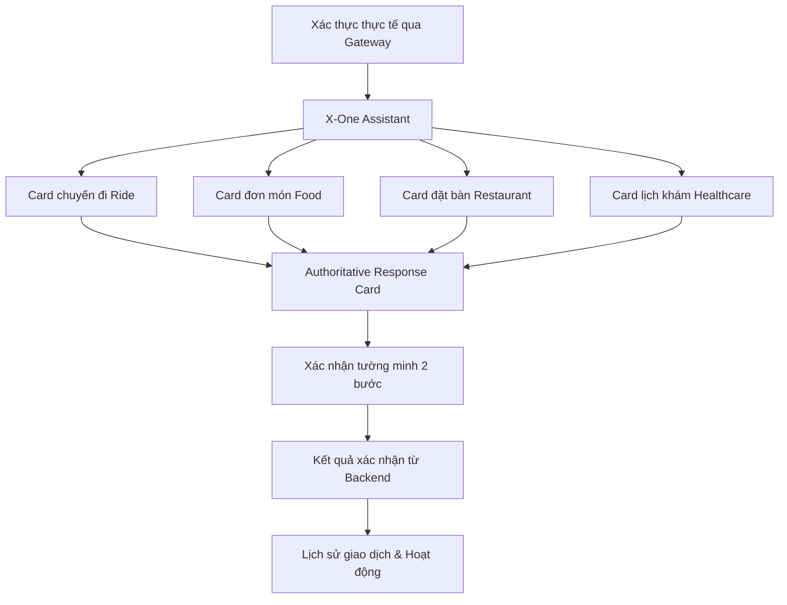

# Khung Wireframe & Luồng Giao Diện Người Dùng (Wireframe & UI Flow)

Tài liệu này mô tả giao diện frontend của ứng dụng Web (`apps/web/`). Ứng dụng Web là một client gọi duy nhất vào API Gateway của NestJS tại `http://localhost:3000`; tuyệt đối không gọi trực tiếp Agent, các domain service con hay cơ sở dữ liệu. Bốn năng lực nghiệp vụ chính hiển thị trên giao diện người dùng bao gồm: Di chuyển (Ride), Đồ ăn (Food), Nhà hàng (Restaurant) và Y tế (Healthcare).

## Kiến Trúc Thông Tin (Information Architecture)



Khung ứng dụng (App Shell) bao gồm các khu vực:
1. **Trợ lý (Assistant)**: Màn hình mặc định, định hướng chat-first, hiển thị các card kết quả trong cùng một dòng thời gian hội thoại.
2. **Khám phá dịch vụ (Service Hub)**: Duyệt các danh mục Ride, Food, Restaurant, Healthcare trực tiếp theo nhu cầu.
3. **Hoạt động & Lịch sử (History & Activity)**: Hiển thị các đơn đặt chỗ, chuyến đi, lịch hẹn đã được Gateway xác nhận chính thức từ domain.
4. **Tài khoản & Địa chỉ (Account & Context)**: Thông tin định danh từ `/api/v1/users/me`, sổ địa chỉ đã lưu (`/api/v1/addresses`), quản lý phiên (`/api/v1/auth/sessions`) và đăng xuất.

## Luồng Xác Thực (Authentication)

```text
+-------------------------------------------------------+
| X-One                                                 |
| Một trợ lý. Mọi dịch vụ hằng ngày.                    |
|                                                       |
| +---------------- Đăng nhập ------------------------+ |
| | Email                                             | |
| | Mật khẩu                                          | |
| | [Đăng nhập]                                       | |
| +---------------------------------------------------+ |
+-------------------------------------------------------+
```

Frontend gọi `POST /api/v1/auth/login`, nhận `access_token` (lưu chỉ trong RAM) và danh tính người dùng, đồng thời nhận cookie `HttpOnly` refresh token. Sau đó xác thực lại bằng `GET /api/v1/auth/me`. Khi access token hết hạn, client tự động gửi cookie refresh để lấy token mới. Nếu Gateway trả về mã lỗi 401, frontend tự động xóa phiên và chuyển hướng về màn hình đăng nhập.

## Không Gian Làm Việc Trợ Lý (X-One Assistant)

```text
+----------------------+-------------------------------------------+
| X-One                | Trạng thái ●           [Tạo hội thoại mới]|
| [Trợ lý]             | Bạn muốn làm gì hôm nay?                  |
| [Dịch vụ]            | Gợi ý: Tìm món / Đặt xe / Đặt bàn / Khám  |
| [Lịch sử]            +-------------------------------------------+
| [Tài khoản]          | Bong bóng chat                            |
|                      | Card nghiệp vụ có thẩm quyền              |
| Thông tin tài khoản  |                                           |
|                      +-------------------------------------------+
|                      | Ô nhập [Nhập yêu cầu…]            [Gửi]   |
+----------------------+-------------------------------------------+
```

Tin nhắn bao gồm vai trò (role: user/assistant), domain, mốc thời gian và payload có cấu trúc. Phản hồi văn bản luôn được hiển thị trước; payload không xác định được fallback về phần tóm tắt an toàn. Trạng thái workflow nội bộ do Gateway lưu giữ; Web chỉ nhận phản hồi người dùng và mã định danh hành động (action descriptor):

```text
Hội thoại -> conversation_id
Hành động -> action_id + Idempotency-Key ổn định cho mỗi lượt gọi
Card      -> Chỉ chứa các trường dữ liệu có thẩm quyền từ domain
```

Việc chuyển đổi sang yêu cầu khác không làm mất các kết quả đã hoàn thành trước đó. Nhấn `Enter` để gửi, `Shift+Enter` để xuống dòng; khi gặp lỗi, nội dung tin nhắn được giữ lại trong ô nhập để người dùng thử lại.

## Các Card Nghiệp Vụ Trong Trợ Lý

Trợ lý không yêu cầu người dùng phải chọn dịch vụ thủ công trước. Hệ thống tự động phân tích ngôn ngữ tự nhiên và trả về card kết quả có thẩm quyền tương ứng:

| Dịch vụ | Ví dụ câu lệnh | Kết quả hiển thị |
| --- | --- | --- |
| **Ride** | *Từ sân bay Nội Bài về Hồ Hoàn Kiếm bằng xe 4 chỗ* | Báo giá (quote), chuẩn bị đặt xe, thông tin tài xế |
| **Food** | *Tìm quán phở bò ngon dưới 100 nghìn ở Ba Đình* | Danh sách quán, món ăn, giỏ hàng, xem trước và đơn hàng |
| **Restaurant** | *Đặt bàn cho 4 người tối mai lúc 19h tại Hà Nội* | Gợi ý nhà hàng, kiểm tra bàn trống, giữ chỗ, xác nhận đặt bàn |
| **Healthcare** | *Tôi bị đau dạ dày và muốn đặt lịch khám chuyên khoa tiêu hóa* | Chuyên khoa, bác sĩ, khung giờ trống, xác nhận lịch khám |

## Quy Trình Xác Nhận Hai Bước (Two-Step Confirmation Flows)

Bề mặt Web sử dụng một ranh giới hội thoại hợp nhất:
- `POST /api/v1/assistant/chat`: Lập kế hoạch và trả về các card kết quả có thẩm quyền.
- `POST /api/v1/assistant/actions`: Thực thi các hành động cụ thể kèm theo header `Idempotency-Key`.

### 1. Dịch Vụ Di Chuyển (Ride)
```text
POST /api/v1/assistant/chat
  -> Card báo giá (quote card)
  -> Bước 1: Xác nhận chi tiết lộ trình và giá cước
POST /api/v1/assistant/actions (prepare)
  -> Trạng thái AWAITING_CONFIRMATION
  -> Bước 2: Xác nhận thanh toán / đặt chuyến chính thức
POST /api/v1/assistant/actions (confirm)
  -> Trạng thái DRIVER_ASSIGNED / IN_PROGRESS / NO_DRIVER
```
Giao diện không bao giờ tự tạo giá cước hay mã chuyến xe giả lập. Chỉ phản hồi chính thức từ Gateway mới tạo bản ghi trong lịch sử.

### 2. Dịch Vụ Đồ Ăn (Food)
```text
POST /api/v1/assistant/chat
  -> Tìm món / chọn món vào giỏ / nhập địa chỉ / xem trước đơn hàng
  -> Card xem trước đơn hàng (preview card)
  -> Xác nhận đặt món & thanh toán
POST /api/v1/assistant/actions (execute)
  -> Đơn hàng chính thức và thanh toán sandbox từ Gateway
  -> Theo dõi trạng thái đơn hàng (Food tracking)
```

### 3. Dịch Vụ Nhà Hàng (Restaurant)
```text
POST /api/v1/assistant/chat
  -> Tìm quán -> Kiểm tra bàn trống (availability snapshot 30s) -> Giữ chỗ bàn (hold)
  -> Card yêu cầu xác nhận đặt bàn (CONFIRMATION_REQUIRED)
  -> Xác nhận thông tin đặt bàn
POST /api/v1/assistant/actions (restaurant_confirm)
  -> Đơn đặt bàn CONFIRMED với mã đặt bàn chính thức
```

### 4. Dịch Vụ Y Tế (Healthcare)
```text
POST /api/v1/assistant/chat
  -> Chọn chuyên khoa -> Bác sĩ / Khung giờ -> Giữ chỗ lịch khám
  -> Bước 1: Xác nhận chi tiết lịch hẹn khám bệnh
  -> Bước 2: Xác nhận chi phí và thanh toán
POST /api/v1/assistant/actions (healthcare_payment & confirm)
  -> Lịch hẹn khám bệnh CONFIRMED
```

## Xử Lý Tải Trang, Báo Lỗi Và Ngoại Tuyến

- Thanh trạng thái hệ thống gọi `GET /health/ready` và chỉ hiển thị chấm xanh khi hệ thống hoàn toàn sẵn sàng.
- Khi gửi tin nhắn, giao diện hiển thị hiệu ứng chờ phản hồi (typing indicator); các nút xác nhận bị vô hiệu hóa khi request đang được xử lý để ngăn bấm đúp.
- Lỗi hiển thị mã lỗi (code) và chi tiết (detail) an toàn, tuyệt đối không lộ stack trace.
- Khi thử lại (retry), hệ thống tái sử dụng đúng `Idempotency-Key` để tránh tạo trùng lặp giao dịch.
- Lỗi của một lượt tương tác không xóa đi các tin nhắn hay kết quả thành công trước đó.

## Lịch Sử Giao Dịch & Hoạt Động

Lịch sử giao dịch đọc trực tiếp từ endpoint hợp nhất `GET /api/v1/history`, hỗ trợ lọc theo danh mục dịch vụ (`food`, `ride`, `restaurant`, `healthcare`), trạng thái và thời gian. Giao diện hiển thị chi tiết biên lai, trạng thái hoàn tiền và liên kết tới tài nguyên gốc của domain.

## Hướng Bố Cục Responsive

- **Desktop**: Cột điều hướng bên trái, khung hội thoại chính ở giữa, và thanh ngữ cảnh (ContextRail) ở bên phải.
- **Tablet / Mobile**: Bố cục một cột tinh gọn, bộ chọn dịch vụ cuộn ngang, khung nhập liệu ghim ở cuối màn hình và menu điều hướng chuyển thành dải icon phía dưới.
