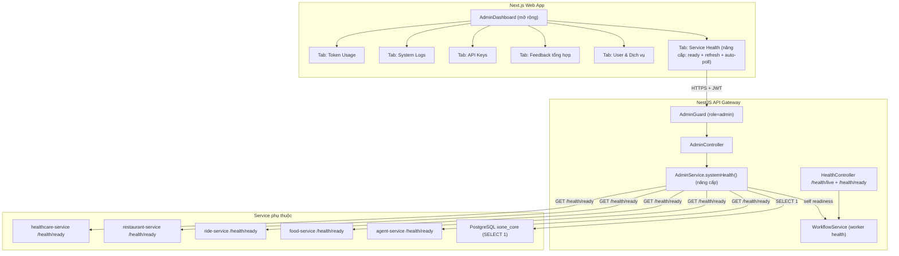

# [FEATURE][P1][Admin] Trang quản trị: Service Health, API Key, Log hệ thống, Token Usage & User-Service View

> **Trạng thái:** Draft — chờ phê duyệt
> **Ưu tiên:** P1
> **Phạm vi:** Admin-only — `/admin` (mở rộng trang hiện có)
> **Cập nhật:** 2026-08-26 — bổ sung đặc tả đầy đủ cho **Service Health** (healthcheck) và ghi rõ phần đã có sẵn để tránh làm lại.

---

## 0. Bối cảnh & đánh giá plan hiện tại

Bản plan trước đã tốt về cấu trúc (6 tab, guard rõ ràng, migration tách bạch, verification có test case). Điểm cần chỉnh: phần **Service Health** trước đây chỉ ghi một dòng *"đã có sẵn, chỉ cần thêm nút Refresh"* — chưa phản ánh đúng những gì hệ thống đang có và **chưa** tận dụng các tín hiệu sức khỏe sâu hơn đã tồn tại. Vì người dùng muốn tập trung vào tính năng healthcheck (xem dịch vụ nào còn sống, agent và api-gateway còn không), phần này được nâng thành **mục đặc tả đầy đủ** ở Mục 2.3 và Mục 4.

> **Kết luận nhanh:** tính năng healthcheck **không phải xây mới từ đầu** — backend + frontend + docker healthcheck đã dựng sẵn ~90%. Việc còn lại là **nâng độ sâu** (liveness → readiness), **hiện thêm chi tiết** (worker của gateway, cấu hình LLM/persistence của agent) và **thêm nút Refresh + auto-poll** riêng cho khu vực này.

### 0.1 Những gì ĐÃ CÓ SẴN (không làm lại)

| Thành phần | Vị trí | Hiện trạng |
| :--- | :--- | :--- |
| Aggregator health | `apps/api-gateway/src/modules/admin/admin.service.ts` → `systemHealth()` | Probe song song 6 đích: `gateway-core` (DB `SELECT 1`), `agent-service`, `food/ride/restaurant/healthcare-service`. Trả `{ service, status: 'healthy'\|'unavailable', latency_ms, checked_at, error? }`. |
| Endpoint admin | `admin.controller.ts` → `@Get('system-health')` | `GET /api/v1/admin/system-health`, bảo vệ bởi `AuthGuard + AdminGuard`. |
| Probe client | `apps/api-gateway/src/clients/service.clients.ts` → `.live()` | Mỗi client gọi `GET /health/live` của service tương ứng, có **timeout** `UPSTREAM_TIMEOUT_MS` (mặc định 5000ms) qua `AbortController`. |
| Health của gateway | `apps/api-gateway/src/modules/health/health.module.ts` | `GET /health/live` + `GET /health/ready` (ready kiểm tra DB `checkReadiness()` **và** `isWorkerHealthy()`; trả `database`, `workflow_worker`, `confirmation_recovery_worker`). |
| Health của agent | `apps/agent-service/src/main.py` | `/health/live`, `/health/ready` (trả `llm_configured`, `persistence_mode`; 503 nếu persistence chưa sẵn sàng), `/health` (legacy). |
| Health của microservice | `services/{food,ride,restaurant,healthcare}-service/src/api/health.py` | `APIRouter(prefix="/health")` → `/health/live` + `/health/ready`; có test `tests/test_health.py`. |
| Frontend | `apps/web/src/features/admin/admin-dashboard.tsx` | Tab **"Sức khỏe hệ thống"** + card **"Tín hiệu hệ thống"** ở Tổng quan, dùng `HealthList`. Load lúc mở trang và khi bấm nút **"Làm mới"** toàn trang. |
| API client | `apps/web/src/lib/api-client.ts` → `getAdminSystemHealth()` | Gọi `/api/v1/admin/system-health`, trả `{ items: AdminHealthCheck[] }`. Type `AdminHealthCheck` ở `apps/web/src/types/index.ts`. |
| Docker healthcheck | `docker-compose.yml` + các `Dockerfile` | postgres (`pg_isready`), gateway (`/health/live`), web (`/api/health`), 4 python service (`/health/live`), interval 10s / retries 10. |

### 0.2 Những gì CÒN THIẾU (phạm vi nâng cấp thực sự của tính năng này)

1. **Chỉ probe liveness, không probe readiness.** Aggregator gọi `/health/live` (chỉ trả lời "tiến trình còn sống"). Nó **không** gọi `/health/ready`, nên không phân biệt được service *đang sống nhưng chưa sẵn sàng* (mất DB, worker chết, LLM chưa cấu hình, persistence chưa lên). Đây là khoảng mù nguy hiểm nhất.
2. **api-gateway không có dòng liveness riêng.** Aggregator chạy *bên trong* gateway nên chỉ hiện `gateway-core` = tình trạng DB. Sức khỏe tiến trình gateway và worker (`workflow_worker`, `confirmation_recovery_worker`) không được đưa lên UI.
3. **Không hiện chi tiết agent.** `llm_configured` và `persistence_mode` mà `/health/ready` của agent trả về không bao giờ tới tay admin.
4. **Trạng thái nhị phân.** UI chỉ có `healthy`/`unavailable`, thiếu trạng thái trung gian `degraded` (live nhưng not-ready).
5. **Không có Refresh riêng cho khu vực health, không auto-poll.** Chỉ có nút "Làm mới" toàn trang (kéo lại tất cả 8 truy vấn admin), không tiện để theo dõi sức khỏe theo thời gian thực.

---

## 1. Mục tiêu

Mở rộng khu vực Admin hiện có (`/admin`) thành một **Operations Hub** đầy đủ, bổ sung vào `AdminDashboard` đang có. Trọng tâm đợt này là nâng cấp **Service Health (healthcheck)** thành công cụ giám sát tin cậy: biết ngay dịch vụ nào còn sống, dịch vụ nào sống-nhưng-chưa-sẵn-sàng, agent và api-gateway có khỏe không. Ngoài ra tiếp tục các tab: User & Dịch vụ, Feedback tổng hợp, API Keys, System Logs, Token Usage. Mọi route đều được bảo vệ bởi `AdminGuard` (role = `admin`) ở cả API lẫn UI.

---

## 2. Phạm vi chức năng

### 2.1 User & Dịch vụ
- Bảng danh sách user: Email, Tên, Vai trò, Trạng thái, Ngày tạo.
- Filter theo role (`admin` / `user`) và status (`active` / `disabled`).
- Click vào từng user → xem tóm tắt service activity: số lần dùng Ride, Food, Restaurant, Healthcare.
- Mỗi user có tab con **Feedback** xem toàn bộ đánh giá (rating + comment) user đó đã gửi, kèm domain, resource_id, thời gian.

### 2.2 Feedback tổng hợp
- Bảng tổng hợp toàn bộ feedback của tất cả user (không lọc theo actor).
- Cột: Actor, Domain (food/ride/restaurant/healthcare), Resource ID, Rating (1–5 sao), Comment, Thời gian.
- Filter theo: domain, rating range (min/max), time range.
- Sắp xếp theo: rating thấp nhất (ưu tiên xem sự cố), mới nhất.
- Thống kê nhanh: trung bình sao theo từng domain.

### 2.3 Service Health (healthcheck) — TRỌNG TÂM ĐỢT NÀY

**Mục tiêu:** một bảng giám sát cho admin biết ngay **service nào còn sống / sẵn sàng**, kèm độ trễ và lý do khi lỗi, bao phủ **cả agent-service và api-gateway**.

**Đối tượng giám sát (7 đích):**

| Đích | Nguồn tín hiệu | "Sẵn sàng" nghĩa là |
| :--- | :--- | :--- |
| `api-gateway` (self) | nội bộ: `WorkflowService.isWorkerHealthy()` + `checkReadiness()` | Tiến trình gateway đang phục vụ; DB kết nối được; workflow worker + confirmation-recovery worker còn chạy. |
| `gateway-core` (DB) | `core.checkHealth()` (`SELECT 1`) | PostgreSQL `xone_core` truy vấn được. |
| `agent-service` | `GET /health/ready` (fallback `/health/live`) | Tiến trình sống; persistence sẵn sàng; báo kèm `llm_configured`, `persistence_mode`. |
| `food-service` | `GET /health/ready` (fallback `/health/live`) | Tiến trình sống; phụ thuộc (DB/dataset) sẵn sàng. |
| `ride-service` | `GET /health/ready` (fallback `/health/live`) | như trên. |
| `restaurant-service` | `GET /health/ready` (fallback `/health/live`) | như trên. |
| `healthcare-service` | `GET /health/ready` (fallback `/health/live`) | như trên. |

**Trạng thái mỗi đích (3 mức thay vì 2):**

- `healthy` — probe readiness OK (200).
- `degraded` — tiến trình **live** nhưng **ready** trả 503 (còn sống, chưa sẵn sàng: mất DB/worker/persistence/LLM). Đây là trạng thái mới, quan trọng cho chẩn đoán.
- `unavailable` — không kết nối được / timeout / lỗi mạng.

**Thông tin mỗi dòng:** Tên service, Status (healthy/degraded/unavailable), Latency (ms), Thời điểm kiểm tra (`checked_at`), Chi tiết/Lỗi (mã lỗi hoặc thông tin readiness: `database`, `workflow_worker`, `llm_configured`, `persistence_mode`…).

**Hành vi UI:**
- Nút **Refresh** riêng cho khu vực health (probe lại ngay, không kéo lại toàn bộ dashboard).
- **Auto-poll** tùy chọn (bật/tắt) mặc định 15s; hiển thị "cập nhật X giây trước".
- Badge màu: xanh (healthy), vàng (degraded), đỏ (unavailable).
- Bao ràng buộc thời gian: mỗi probe đã có timeout 5s (`UPSTREAM_TIMEOUT_MS`), nên toàn bộ bảng phản hồi trong ~5s kể cả khi một service treo.

**Không làm:** lưu lịch sử/biểu đồ chuỗi thời gian, cảnh báo (alerting), trang health public — để pha sau nếu cần.

### 2.4 API Keys
- Hiển thị danh sách provider key: Gemini, Trello, Geoapify, Google Maps, Other.
- Thông tin: Provider, Label, `last4` (**không bao giờ hiện plaintext**), Status, Environment, Ngày hết hạn, Người cập nhật.
- Chức năng: **Thêm**, **Test Connection**, **Rotate** (+ Idempotency-Key + confirm), **Revoke** (+ Idempotency-Key + confirm).
- Mọi thao tác Rotate/Revoke ghi **audit log bất biến**.

### 2.5 System Logs
- Lọc theo: time range, service, level, HTTP status, correlation ID, actor ID.
- Xem chi tiết request lifecycle (an toàn — không có raw prompt, secret, PII không cần thiết).
- Phân trang. Xuất CSV (đã loại bỏ thông tin nhạy cảm).

### 2.6 Token Usage
- Tổng prompt/completion/total token theo khoảng thời gian.
- Filter theo: model, provider, feature (assistant/ride/food/restaurant/healthcare), actor.
- Biểu đồ xu hướng theo ngày. Bảng top consumer. Ước tính chi phí.

---

## 3. Kiến trúc tổng quan



---

## 4. Thay đổi theo layer

### 4.1 Database — Core Migrations

> Bảng `service_feedback` **đã có sẵn** trong migration 012. `audit_events` đã có sẵn. **Service Health không cần migration** (probe realtime, không lưu trạng thái).

#### [NEW] `apps/api-gateway/migrations/015_core_api_keys.sql`
```sql
CREATE TABLE api_key_records (
  id TEXT PRIMARY KEY,
  provider TEXT NOT NULL CHECK (provider IN ('gemini','trello','geoapify','google_maps','other')),
  label TEXT NOT NULL,
  last4 TEXT NOT NULL CHECK (length(last4) <= 8),  -- masked, never plaintext
  status TEXT NOT NULL DEFAULT 'active' CHECK (status IN ('active','disabled','expired')),
  environment TEXT NOT NULL DEFAULT 'development',
  expires_at TIMESTAMPTZ,
  updated_at TIMESTAMPTZ NOT NULL DEFAULT now(),
  updated_by TEXT NOT NULL,
  created_at TIMESTAMPTZ NOT NULL DEFAULT now()
);
```

#### [NEW] `apps/api-gateway/migrations/016_core_token_usage.sql`
```sql
CREATE TABLE agent_token_usage (
  id TEXT PRIMARY KEY,
  actor_id TEXT,                      -- nullable: system calls
  model TEXT NOT NULL,
  provider TEXT NOT NULL DEFAULT 'google',
  feature TEXT NOT NULL CHECK (feature IN ('assistant','ride','food','restaurant','healthcare','other')),
  prompt_tokens INTEGER NOT NULL DEFAULT 0,
  completion_tokens INTEGER NOT NULL DEFAULT 0,
  total_tokens INTEGER NOT NULL DEFAULT 0,
  estimated_cost_usd NUMERIC(12,8),
  recorded_at TIMESTAMPTZ NOT NULL DEFAULT now()
);
```

---

### 4.2 Backend — API Gateway

#### [MODIFY] `apps/api-gateway/src/clients/service.clients.ts` — thêm probe readiness
Mỗi client (`AgentClient`, `FoodClient`, `RideClient`, `RestaurantClient`, `HealthcareClient`) đang có `live()` gọi `/health/live`. Bổ sung `ready()` gọi `/health/ready` và **trả cả body** (để lấy `database`, `llm_configured`, `persistence_mode`, …) thay vì chỉ ném lỗi:

```typescript
async ready(correlationId: string): Promise<{ ok: boolean; status: number; body: JsonObject }> {
  // Dùng biến thể không-throw: đọc status code + body, KHÔNG ném ở 503
  // để phân biệt degraded (503, còn sống) với unavailable (không kết nối được).
}
```

> Giữ nguyên timeout hiện có (`UPSTREAM_TIMEOUT_MS`, mặc định 5000ms). Không cần thêm timeout mới.

#### [MODIFY] `apps/api-gateway/src/modules/admin/admin.service.ts` — nâng cấp `systemHealth()`
Đổi từ probe liveness sang **readiness có phân mức**, thêm dòng `api-gateway` (self) và chi tiết readiness:

```typescript
type HealthStatus = 'healthy' | 'degraded' | 'unavailable';
type HealthItem = {
  service: string;
  status: HealthStatus;
  latency_ms: number;
  checked_at: string;
  detail?: Record<string, unknown>;   // database, workflow_worker, llm_configured, persistence_mode…
  error?: string;
};
```

Logic:
- `api-gateway` (self): `healthy` nếu `workflow.isWorkerHealthy()` **và** `checkReadiness()` true; ngược lại `degraded`. Không bao giờ `unavailable` (nếu gateway chết thì cả endpoint đã không phản hồi).
- `gateway-core`: `SELECT 1` OK → `healthy`, lỗi → `unavailable`.
- Các service còn lại: gọi `ready()`. `200` → `healthy` (kèm `detail`); `503` → `degraded` (kèm `detail` để biết lý do); lỗi mạng/timeout → `unavailable` (kèm `error`).
- Giữ `Promise.all` (chạy song song); mỗi probe đã tự bound 5s.

> Endpoint `GET /api/v1/admin/system-health` **giữ nguyên đường dẫn**, chỉ mở rộng response (thêm `status='degraded'` và trường `detail`). Tương thích ngược: FE cũ vẫn đọc được `service/status/latency_ms/checked_at`.

#### Các tab khác (giữ nguyên đặc tả trước)

##### [MODIFY] `apps/api-gateway/src/modules/core/product-ops.store.ts`
Thêm `listAllFeedback(filters)` — query toàn bộ `service_feedback` (không giới hạn `actor_id`), hỗ trợ filter domain/rating/time.

##### [MODIFY] `apps/api-gateway/src/modules/core/core.module.ts`
Thêm types + methods vào `CoreRepository`, `PostgresCoreRepository`, `InMemoryCoreRepository`, `CoreStore`:

| Method | Mô tả |
| :--- | :--- |
| `queryApiKeys()` | Danh sách api_key_records (masked) |
| `getApiKeyRecord(id)` | Lấy 1 record |
| `createApiKeyRecord(data)` | Tạo record mới |
| `rotateApiKeyRecord(id, data, idempotencyKey, hash)` | Cập nhật last4/expires_at |
| `revokeApiKeyRecord(id, actorId, idempotencyKey, hash)` | Đặt status = disabled |
| `queryAuditLogs(filters)` | Query audit_events, không trả PII/secret |
| `queryTokenUsage(filters)` | Aggregate agent_token_usage |

##### [MODIFY] `apps/api-gateway/src/modules/admin/admin.service.ts` (các method ngoài health)

| Method | Mô tả |
| :--- | :--- |
| `userServiceSummary(userId, correlationId)` | Activity domain của 1 user |
| `userFeedback(userId, page, pageSize)` | Feedback của 1 user cụ thể |
| `allFeedback(filters)` | Toàn bộ feedback + thống kê trung bình sao |
| `listApiKeys()` | Metadata masked |
| `createApiKey(data, actorId, correlationId)` | Tạo + audit |
| `rotateApiKey(id, data, actorId, correlationId, idempotencyKey)` | Rotate + audit |
| `revokeApiKey(id, actorId, correlationId, idempotencyKey)` | Revoke + audit |
| `testApiKey(id, correlationId)` | Ping provider health |
| `systemLogs(filters)` | Query audit log, strip sensitive |
| `tokenUsageSummary(filters)` | Aggregate token usage |

##### [MODIFY] `apps/api-gateway/src/modules/admin/admin.controller.ts`
Thêm endpoints (tất cả `@UseGuards(AuthGuard, AdminGuard)`):

| Method | Route | Mô tả |
| :--- | :--- | :--- |
| GET | `/api/v1/admin/users/:id/services` | Service activity của 1 user |
| GET | `/api/v1/admin/users/:id/feedback` | Feedback của 1 user |
| GET | `/api/v1/admin/feedback` | Tổng hợp toàn bộ feedback + stats |
| GET | `/api/v1/admin/api-keys` | Danh sách keys (masked) |
| POST | `/api/v1/admin/api-keys` | Tạo key record |
| PATCH | `/api/v1/admin/api-keys/:id/rotate` | Rotate + Idempotency-Key |
| PATCH | `/api/v1/admin/api-keys/:id/revoke` | Revoke + Idempotency-Key |
| POST | `/api/v1/admin/api-keys/:id/test` | Test provider connectivity |
| GET | `/api/v1/admin/logs` | System logs với filter |
| GET | `/api/v1/admin/token-usage` | Token usage summary |

> **Lưu ý:** `GET /api/v1/admin/system-health` **đã có sẵn** — chỉ mở rộng response như trên, không thêm route mới.

---

### 4.3 Frontend — Web App

#### [MODIFY] `apps/web/src/types/index.ts` — mở rộng `AdminHealthCheck`
```typescript
export interface AdminHealthCheck {
  service: string;
  status: "healthy" | "degraded" | "unavailable";   // + degraded
  latency_ms: number;
  checked_at: string;
  detail?: Record<string, unknown>;                  // NEW: database, workflow_worker, llm_configured…
  error?: string;
}
```
Thêm 5 interface cho các tab khác: `AdminApiKeyRecord`, `AdminLogEntry`, `AdminTokenUsageReport`, `AdminUserServiceSummary`, `AdminFeedbackSummary`.

#### [MODIFY] `apps/web/src/lib/api-client.ts`
- `getAdminSystemHealth()` **giữ nguyên chữ ký**, chỉ ăn theo type mới.
- Thêm 10 hàm cho các tab khác:

| Hàm | Endpoint |
| :--- | :--- |
| `getAdminUserServices(userId)` | GET `/admin/users/:id/services` |
| `getAdminUserFeedback(userId, page)` | GET `/admin/users/:id/feedback` |
| `getAdminAllFeedback(filters)` | GET `/admin/feedback` |
| `getAdminApiKeys()` | GET `/admin/api-keys` |
| `postAdminApiKey(body)` | POST `/admin/api-keys` |
| `rotateAdminApiKey(id, idempotencyKey)` | PATCH `/admin/api-keys/:id/rotate` |
| `revokeAdminApiKey(id, idempotencyKey)` | PATCH `/admin/api-keys/:id/revoke` |
| `testAdminApiKey(id)` | POST `/admin/api-keys/:id/test` |
| `getAdminLogs(filters)` | GET `/admin/logs` |
| `getAdminTokenUsage(filters)` | GET `/admin/token-usage` |

#### [MODIFY] `apps/web/src/features/admin/admin-dashboard.tsx` — nâng cấp khu vực health
- Tách state health khỏi `load()` toàn trang: thêm `refreshHealth()` riêng gọi `getAdminSystemHealth()`, không kéo lại 8 truy vấn.
- Header section **"Sức khỏe hệ thống"**: thêm nút **Refresh** riêng + toggle **Auto-poll (15s)** (`setInterval`, cleanup trong `useEffect`), hiện "cập nhật X giây trước".
- `HealthList`: render 3 mức `status-healthy` / `status-degraded` / `status-unavailable`; khi có `detail` thì hiện dòng phụ (vd: `DB: connected · worker: healthy · llm: configured`).
- Bổ sung 5 nav item cho các tab còn lại:
```typescript
["user-services", "User & Dịch vụ"],
["feedback", "Feedback"],
["api-keys", "API Keys"],
["logs", "System Logs"],
["token-usage", "Token Usage"],
```

#### [MODIFY] `apps/web/src/app/globals.css` (hoặc file style admin)
Thêm class `.status-degraded` (vàng/amber) cho `admin-status-dot` và `admin-badge`, đặt giữa `healthy` (xanh) và `unavailable` (đỏ).

#### [NEW] `apps/web/src/features/admin/sections/`

| File | Mô tả |
| :--- | :--- |
| `user-services-section.tsx` | Bảng user + service activity + tab Feedback của từng user |
| `feedback-section.tsx` | Tổng hợp feedback toàn hệ thống. Filter domain/rating/time. Thống kê trung bình sao. |
| `api-keys-section.tsx` | Danh sách key masked. Test/Rotate/Revoke có confirm dialog. |
| `system-logs-section.tsx` | Filter time/service/level/status/correlationId/actor. Phân trang. Export CSV. |
| `token-usage-section.tsx` | Filter time/model/feature/actor. Biểu đồ xu hướng. Top consumer. |

### 4.4 Thiết kế giao diện đồng bộ với trang user

Admin phải dùng lại ngôn ngữ giao diện của `apps/web/src/features/product/app-shell.tsx`,
`apps/web/src/styles/product.css` và token trong `apps/web/src/app/globals.css`; không
tạo dashboard SaaS hoặc design system riêng.

**Đầu vào:** `AuthUser` hiện tại, quyền `admin`, pathname `/admin`, navigation của
`AppShell`, các token màu/type/spacing, cùng 8 khu vực admin hiện có và 5 khu vực mới.

**Đầu ra bắt buộc:**

- Desktop có sidebar trái có thể thu gọn; mobile chuyển thành `Sheet`. Giữ `XOneMark`,
  `brand-link`, icon Lucide, hành vi logout và focus pattern của trang user.
- Nội dung dùng `width: min(1120px, 100%)`, nền `--color-canvas`, surface trắng,
  border `--color-border`, radius 11–13px; không dùng gradient, glow hoặc glassmorphism.
- Dùng Be Vietnam Pro cho nội dung; IBM Plex Mono chỉ cho ID, timestamp, latency và
  correlation ID. Dùng lại `.button`, `.button-secondary`, `.button-danger`,
  `.section-heading`, `.activity-*`, `.profile-*` khi phù hợp.
- Trạng thái luôn gồm dot + badge + text: healthy xanh, degraded amber,
  unavailable đỏ; không truyền đạt trạng thái chỉ bằng màu.
- Bảng có caption, header `scope="col"`; từ 320px chuyển thành row/card có label,
  không tạo scroll ngang.
- Mỗi section có cùng thứ tự: `SectionHeading` → toolbar/filter → content panel →
  pagination/summary. Luôn có loading, error + “Thử lại”, empty, partial và success.
- Health đặt `api-gateway` và `agent-service` ở đầu; có “Làm mới”, toggle “Tự động
  kiểm tra · 15 giây”, “Cập nhật X giây trước”, detail an toàn và `aria-live="polite"`.
- User & Dịch vụ dùng filter form giống trang user; click user mở detail panel có
  service activity và tab Feedback, giữ nguyên context.
- API Keys dùng last4 dạng mono; Test/Rotate/Revoke có label và `AlertDialog` xác nhận.
- Logs ưu tiên level/time/service/correlation ID; detail mặc định collapsed. Token Usage
  có bảng dữ liệu thay thế chart và không phụ thuộc vào animation.
- Admin ưu tiên rõ ràng và thao tác nhanh: chỉ dùng fade/soft-hover ngắn, tôn trọng
  `prefers-reduced-motion`, không autoplay/parallax.

---

## 5. Quyền & An toàn

| Quy tắc | Chi tiết |
| :--- | :--- |
| ADMIN-only | Non-admin nhận 403 ở cả UI và API (gồm cả `system-health`) |
| Health không lộ nội bộ nhạy cảm | `detail` chỉ chứa cờ trạng thái (connected/healthy, llm_configured=true/false, persistence_mode); **không** trả DSN, secret, đường dẫn nội bộ |
| Không lộ secret | Response API key chỉ chứa `last4`, không bao giờ trả plaintext key |
| Rotate/Revoke | Bắt buộc `Idempotency-Key` header + confirm dialog trên UI |
| Audit bất biến | Mọi mutation ghi vào `audit_events` với actor, timestamp, action, result |
| Log an toàn | Không ghi raw prompt, chain-of-thought, token, credential, PII không cần thiết |
| Secret store | Secret nằm trong env/secret manager, không lưu plaintext trong DB hay FE bundle |
| Feedback | Admin chỉ đọc feedback, không thể xóa/sửa — chỉ user chủ sở hữu được chỉnh sửa |

---

## 6. Thứ tự thực hiện chi tiết

Mỗi bước phải hoàn tất đầu ra và kiểm tra đạt trước khi chuyển bước tiếp theo. Không
đánh dấu `implemented` nếu chỉ mới tạo file mà chưa có source/configuration observable
và check tương ứng.

### Phase 0 — Baseline và contract

**Step 0.1 — Kiểm kê hiện trạng**

- **Đầu vào:** các file hiện có ở Mục 0.1, route `/app`, `AppShell`, design/motion system.
- **Thực hiện:** lập mapping file → trách nhiệm → giữ nguyên/thay đổi; xác nhận route,
  guard, response health, migration cuối và test hiện có.
- **Đầu ra:** baseline checklist, danh sách file thay đổi, danh sách phần health không
  được làm lại.
- **Đạt khi:** có response mẫu health và xác định được component/style user sẽ reuse.

**Step 0.2 — Chốt API/UI contract**

- **Đầu vào:** đặc tả Mục 2–5 và Mục 4.4.
- **Thực hiện:** chốt field, enum, error code, pagination, filter query, copy tiếng Việt,
  loading/error/empty/partial state và wireframe desktop/mobile.
- **Đầu ra:** DTO/OpenAPI/type checklist + acceptance criteria cho từng tab.
- **Đạt khi:** không còn field tùy ý; mọi mutation có actor, idempotency và audit.

### Phase 1 — Service Health

**Step 1 — Client readiness**

- **Đầu vào:** 5 typed clients, `UPSTREAM_TIMEOUT_MS`, response `/health/ready`.
- **Thực hiện:** thêm `ready()` đọc status/body, không throw ở 503; giữ timeout,
  correlation ID; parse body an toàn.
- **Đầu ra:** contract `{ ok, status, body }` hoặc tương đương; test 200/503/timeout/
  malformed body.
- **Đạt khi:** 503 không reject `Promise.all`, không log secret/DSN.

**Step 2 — Gateway aggregator**

- **Đầu vào:** `ready()`, `WorkflowService`, `checkReadiness()`, core DB health.
- **Thực hiện:** probe song song 7 đích; map 200→healthy, live+503→degraded,
  network/timeout→unavailable; thêm self `api-gateway`; giữ field response cũ.
- **Đầu ra:** item có `service/status/latency_ms/checked_at`, optional `detail/error`.
- **Đạt khi:** H1–H7 pass; toàn bảng có giới hạn 5s; route cũ không đổi.

**Step 3 — Frontend health state**

- **Đầu vào:** `AdminHealthCheck` mới và `getAdminSystemHealth()`.
- **Thực hiện:** tách `refreshHealth()` khỏi `load()`; thêm last checked/error/loading;
  auto-poll 15s có cleanup; dừng khi tab hidden/unmount.
- **Đầu ra:** refresh chỉ gọi system-health; không leak interval; có text thời gian.
- **Đạt khi:** H8–H10 pass bằng fake timer/visibility test.

**Step 4 — Health UI**

- **Đầu vào:** 7 health items, UI contract Mục 4.4, breakpoints 320/768/1440px.
- **Thực hiện:** render 3 badge/status, detail, loading/error/empty; thêm refresh,
  toggle và live feedback; đặt gateway/agent đầu danh sách.
- **Đầu ra:** admin nhận biết live/readiness trong một lần nhìn, không overflow.
- **Đạt khi:** keyboard, focus, reduced-motion và screenshot desktop/mobile đạt.

**Step 5 — Health checkpoint**

- **Đầu vào:** code Phase 1 và H1–H10.
- **Thực hiện:** chạy test khả dụng; nếu môi trường giới hạn, parse-check TypeScript,
  `py_compile`, mô phỏng 200/503/timeout.
- **Đầu ra:** health checkpoint pass hoặc issue list có owner; chỉ pass mới sang Phase 2.

### Phase 2 — Database và backend

**Step 6 — Migrations**

- **Đầu vào:** schema keys/token usage, migration number tiếp theo, data architecture.
- **Thực hiện:** tạo migration owned, constraint/index, không lưu plaintext secret;
  cập nhật data-architecture và seed deterministic nếu cần.
- **Đầu ra:** migration forward/rollback/compatibility note.
- **Đạt khi:** không dùng `create_all()`, test constraint và token total.

**Step 7 — Repository/store**

- **Đầu vào:** migration và filter contract.
- **Thực hiện:** implement interface + Postgres + InMemory + CoreStore cho feedback,
  keys, audit logs, token usage; parameterized query, pagination, ordering ổn định.
- **Đầu ra:** methods Mục 4.2 và test parity Postgres/InMemory.
- **Đạt khi:** filter đúng, key masked, idempotency conflict an toàn.

**Step 8 — Admin service**

- **Đầu vào:** repository methods và actor/correlation/idempotency context.
- **Thực hiện:** thêm 10 methods; validate input; map lỗi; audit mutation sau kết quả thật.
- **Đầu ra:** service orchestration đúng boundary, không đẩy business rule sang FE.
- **Đạt khi:** quyền, audit và sensitive-data tests pass.

**Step 9 — Controller/DTO/OpenAPI**

- **Đầu vào:** service methods và API conventions.
- **Thực hiện:** thêm routes/DTO/header validation, guard mọi route; cập nhật OpenAPI,
  compatibility tests.
- **Đầu ra:** API contract dùng được cho FE, docs cập nhật cùng patch.
- **Đạt khi:** non-admin 403; thiếu idempotency 400; không plaintext key.

### Phase 3 — Frontend và đồng bộ user UI

**Step 10 — Types và API client**

- **Đầu vào:** OpenAPI/DTO.
- **Thực hiện:** thêm interfaces và 10 functions; encode query; typed error mapping;
  không hand-edit generated client.
- **Đầu ra:** FE typecheck/build nhận đúng response/error.
- **Đạt khi:** test URL, method, query, header và mapping pass.

**Step 11 — AdminShell/navigation**

- **Đầu vào:** `AppShell`, tokens, Mục 4.4.
- **Thực hiện:** refactor sidebar/mobile Sheet; reuse mark, button, icon, typography;
  bảo toàn 8 khu vực hiện có và thêm 5 nav item.
- **Đầu ra:** desktop/mobile admin đồng bộ user, active/focus/logout đúng.
- **Đạt khi:** 320/768/1440px không overflow và không mất context.

**Step 12 — Implement 5 section theo thứ tự**

- **Đầu vào:** types/API client và UI contract.
- **Thực hiện:** `user-services` → `feedback` → `api-keys` → `system-logs` →
  `token-usage`; mỗi section đủ 5 trạng thái trước khi sang section tiếp theo.
- **Đầu ra:** sections wired vào nav, filter/pagination/action gọi API thật, không fake data.
- **Đạt khi:** acceptance, responsive, keyboard và security check từng section pass.

**Step 13 — Integration polish**

- **Đầu vào:** toàn bộ tabs admin hiện có và 5 section mới.
- **Thực hiện:** thống nhất copy, status, table/card responsive, spacing, icon,
  `aria-live`, reduced-motion, confirm dialog.
- **Đầu ra:** Operations Hub liền mạch với user app, không có tab lạc design.
- **Đạt khi:** screenshot review và accessibility smoke test pass.

### Phase 4 — Verification và bàn giao

**Step 14 — Test tổng thể**

- **Đầu vào:** code hoàn chỉnh và test matrix Mục 7.
- **Thực hiện:** lint/type/test/build, env validation, compose config; ghi fallback check
  nếu toolchain bị giới hạn.
- **Đầu ra:** report có lệnh, kết quả và limitation, không báo pass giả.

**Step 15 — Bàn giao**

- **Đầu vào:** test report, screenshot, migration/docs diff.
- **Thực hiện:** cập nhật status plan/docs; chạy `git status --short` lần cuối.
- **Đầu ra:** acceptance checklist hoàn tất, file thay đổi rõ ràng; không commit/push,
  không xóa volume/file người dùng.

---

## 7. Verification Plan

### Automated Tests
```bash
cd apps/api-gateway && npx jest --testPathPattern=admin
cd apps/web && npx jest --testPathPattern=admin
# health của downstream đã có sẵn:
cd services/food-service && pytest tests/test_health.py
```

> **Ràng buộc môi trường (đã biết trong repo này):** không chạy được `tsc/jest/pytest/npm/pip` trực tiếp trong workspace mount (pnpm symlink lỗi I/O, không có mạng). Khi chưa chạy được test thật, kiểm chứng thay thế bằng: parse-check TypeScript qua compiler API, `py_compile`, và mô phỏng logic phân mức status trên response mẫu (200/503/timeout).

### Test cases bắt buộc — Service Health

| # | Case | Kết quả mong đợi |
| :--- | :--- | :--- |
| H1 | Downstream trả `/health/ready` = 200 | status `healthy`, có `latency_ms`, có `detail` |
| H2 | Downstream trả `/health/ready` = 503 (còn sống, chưa sẵn sàng) | status `degraded` (KHÔNG phải unavailable), `detail` nêu lý do |
| H3 | Downstream không kết nối / timeout 5s | status `unavailable`, có `error`, không treo toàn bảng |
| H4 | Gateway worker chết (`isWorkerHealthy()`=false) | dòng `api-gateway` = `degraded` |
| H5 | DB rớt (`SELECT 1` lỗi) | dòng `gateway-core` = `unavailable`; `api-gateway` self = `degraded` |
| H6 | Agent thiếu `GEMINI_API_KEY` | `agent-service` readiness phản ánh `llm_configured=false` trong `detail` |
| H7 | Non-admin gọi `GET /api/v1/admin/system-health` | 403 ADMIN_REQUIRED |
| H8 | Bấm Refresh khu vực health | chỉ gọi lại system-health, không kéo lại toàn dashboard |
| H9 | Bật Auto-poll | `checked_at` cập nhật mỗi ~15s; tắt tab/unmount → dừng interval (không leak) |
| H10 | Response tương thích ngược | FE cũ vẫn đọc được `service/status/latency_ms/checked_at` |

### Test cases bắt buộc — các tab khác

| # | Case | Kết quả mong đợi |
| :--- | :--- | :--- |
| 1 | Non-admin gọi bất kỳ endpoint admin mới | 403 ADMIN_REQUIRED |
| 2 | Response API key có chứa plaintext secret | Không bao giờ — chỉ last4 |
| 3 | Rotate thiếu Idempotency-Key | 400 IDEMPOTENCY_KEY_REQUIRED |
| 4 | Rotate đúng key → ghi audit | Audit event ADMIN_API_KEY_ROTATED tồn tại |
| 5 | Log filter theo correlation_id | Trả đúng entries, không có secret/PII |
| 6 | Token total = prompt + completion | Đúng cho mọi bản ghi |
| 7 | Token filter theo feature=food | Chỉ trả entries của food |
| 8 | Non-admin xem UI /admin | Tab mới không hiển thị |
| 9 | GET /admin/feedback → nhiều user | Không lọc theo actor của admin |
| 10 | GET /admin/users/:id/feedback | Chỉ trả feedback đúng actor_id |

### Manual Verification
- [ ] Đăng nhập Admin → khu vực **Sức khỏe hệ thống** liệt kê đủ 7 đích gồm `api-gateway` và `agent-service`
- [ ] Tắt 1 service (vd `docker stop`) → dòng đó chuyển đỏ `unavailable` sau lần refresh/poll kế tiếp
- [ ] Ngắt DB → `gateway-core` đỏ, `api-gateway` self vàng `degraded`
- [ ] Bấm Refresh khu vực health → chỉ badge health cập nhật, phần khác của trang không nạp lại
- [ ] Bật Auto-poll → thời điểm kiểm tra tự cập nhật; rời tab → không còn request nền
- [ ] Đăng nhập Admin → thấy đủ các tab mới (User, Feedback, API Keys, Logs, Token Usage)
- [ ] Test Connection provider → badge "Kết nối thành công"
- [ ] Rotate key → confirm dialog → submit → audit log ghi nhận
- [ ] Filter log theo correlation ID → đúng request lifecycle
- [ ] Token usage filter theo ngày → biểu đồ cập nhật
