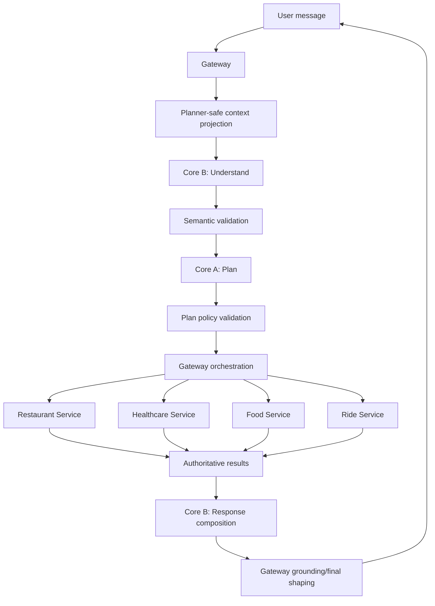

# Kế hoạch chuyển X-One sang mô hình AI Core A, AI Core B và AI Eval

Tài liệu này phân tích và lập kế hoạch chuyển hệ thống Agent hiện tại sang mô hình trách nhiệm được đề xuất trong `team (1).md`.

Phần Core A còn đối chiếu trực tiếp `db.md`, migration, API route và tool wiring hiện có của Food, Restaurant, Healthcare và Ride. Các bảng/capability được ghi là “hiện có” chỉ khi có source/configuration quan sát được; dữ liệu crawl đề xuất không được xem là database runtime.

## 1. Quyết định kiến trúc quan trọng nhất

Không nên chuyển X-One thành nhiều agent runtime kiểu:

```text
Planner Agent
Understanding Agent
Restaurant Agent
Healthcare Agent
Ride Agent
Supervisor Agent
```

Điều này làm tăng độ trễ, chi phí và độ phức tạp, đồng thời trái với định hướng hiện tại: multi-agent orchestration đang là non-goal trong `docs/architecture/system-overview.md`.

Mô hình phù hợp nên là:

> **Một Agent Service, một pipeline có hai lớp trách nhiệm Core B → Core A, Gateway tiếp tục sở hữu orchestration và side effect.**

“Core A” và “Core B” trong `team (1).md` nên được hiểu là:

- Hai lớp phần mềm có contract rõ ràng.
- Hai phạm vi ownership của Minh và Tài.
- Không phải hai service hoặc hai agent tự giao tiếp.

## 2. Đánh giá trạng thái hiện tại

Hệ thống đã có nền tảng tốt:

- Một top-level assistant planner cho bốn domain.
- Pydantic validation.
- Model fallback.
- Không tin ID, giá, availability và status do model sinh.
- Gateway lưu task, revision, pending action và authoritative results.
- Gateway đã điều phối confirmation, idempotency và dependency; domain service vẫn phải enforce write invariant/idempotency và mức độ confirmation hiện chưa đồng đều giữa bốn domain.
- Có domain graph cho Food, Restaurant, Healthcare và Ride.
- Có E2E cho unified assistant.

Nhưng chưa đạt mô hình Core A/Core B rõ ràng vì các trách nhiệm đang bị trộn.

### 2.1. `assistant_graph.py` đang chứa quá nhiều trách nhiệm

`apps/agent-service/src/agents/assistant_graph.py` hiện chứa:

- system prompt;
- normalization tiếng Việt;
- parse số, địa điểm và ngày giờ;
- semantic slot extraction;
- follow-up/reference routing;
- task decomposition;
- missing information;
- dependency;
- plan validation;
- context projection;
- model invocation;
- response composition;
- deterministic fallback.

Đây là vùng xung đột lớn nhất giữa Minh và Tài.

### 2.2. `AssistantPlan` đang trộn kết quả của Core A và Core B

Schema hiện tại có dạng:

```python
class PlannedTask:
    domain
    goal
    normalized_request
    extracted_slots
    depends_on
    needs_clarification
    missing_information

class AssistantPlan:
    assistant_message
    tasks
    needs_clarification
    clarification_question
```

Các trường đang bị trộn:

- `extracted_slots`: Core B.
- `depends_on`: Core A.
- `missing_information`: Core A.
- `clarification_question`: Core B.
- `assistant_message`: Core B.
- task decomposition: Core A.

Không có contract trung gian để kiểm tra riêng Core B hiểu đúng hay Core A lập kế hoạch đúng.

### 2.3. Slot chưa được typed theo domain

`extracted_slots` hiện chỉ là:

```python
dict[str, Any]
```

Hệ quả:

- Model có thể trả field sai tên.
- Khó phân biệt slot do user nói với slot suy diễn.
- Khó đánh giá slot accuracy.
- Core A không biết slot đến từ user, context hay inference.
- Gateway phải tự sanitize lại.

### 2.4. Logic hiểu ngôn ngữ bị lặp tại Gateway

Gateway hiện tự tìm các từ khóa như “phở”, “bún”, “đặt bàn”, “nhà hàng”, “lịch khám”, “bác sĩ”, “đặt xe”. Điều này tạo hai nguồn sự thật:

```text
Agent Core B hiểu intent/reference
Gateway cũng tự hiểu intent/reference
```

Khi hai bên khác nhau, rất khó biết lỗi thuộc đâu. Gateway vẫn cần policy validation, nhưng không nên trở thành lớp NLP thứ hai.

### 2.5. Workflow chưa biểu diễn rõ partial success và blocked dependency

Task phase hiện chỉ có:

```text
PLANNING
NEEDS_INFO
IN_PROGRESS
AWAITING_CONFIRMATION
COMPLETED
FAILED
```

Chưa có trạng thái thể hiện:

- task bị chặn vì dependency thất bại;
- workflow tổng thể là partial success;
- task bị skip mà không phải bản thân nó failed.

Ví dụ:

```text
Healthcare = COMPLETED
Ride = FAILED
Workflow = PARTIAL_SUCCESS
```

Hiện có thể suy ra từ danh sách task, nhưng chưa có semantics rõ và chưa có evaluator riêng.

### 2.6. Evaluation gần như chưa được xây dựng

`tests/agent-evals/README.md` hiện chỉ có yêu cầu một dòng, chưa có:

- dataset;
- schema eval case;
- runner;
- evaluator;
- report;
- failure taxonomy;
- baseline;
- LangSmith experiment integration.

Đây là khoảng trống lớn nhất so với `team (1).md`.

### 2.7. Internal OpenAPI chưa ghi nhận `/assistant-chat`

Runtime có `/api/v1/assistant-chat`, nhưng `packages/contracts/openapi/agent-service.v1.yaml` mới liệt kê các endpoint Food, Restaurant, Healthcare và Ride. Đây là contract drift cần xử lý trước khi mở rộng schema.

### 2.8. Core A chưa có catalog thống nhất bám API runtime

Capability metadata hiện nằm ở nhiều nơi:

- Food tool registry trong `tool.module.ts`;
- Ride registry riêng trong `tool-registry.ts`;
- Restaurant/Healthcare dùng typed union, policy và client mapping;
- một số runtime API chưa được wired vào unified assistant.

Nếu Minh hard-code thêm danh sách trong planner, hệ thống sẽ có thêm một nguồn sự thật và tiếp tục drift. Core A cần `CapabilitySnapshot` canonical, versioned và được parity-test.

### 2.9. Mức độ confirmation khác nhau theo domain

- Ride đã có quote expiry, hai action xác nhận, payload/version/amount binding và one-time confirmation consumption.
- Food đã có preview cùng snapshot/cart/quote version và amount/currency, nhưng chưa có persistence confirmation evidence tương đương Ride trong domain.
- Restaurant có hold/reservation và idempotency nhưng chưa mô hình hóa đầy đủ hai evidence.
- Healthcare có hold/payment acknowledgement/confirm nhưng payment còn là local simulation và chưa có evidence contract tương đương Ride.

Core A phải biết “đang ở phase nào và phải dừng ở gate nào”, nhưng không được che khoảng trống bằng cách tuyên bố mọi domain đã hoàn thành cùng một chuẩn.

## 3. Kiến trúc mục tiêu



### 3.1. Quyền sở hữu dữ liệu

| Dữ liệu/quyết định | Owner |
|---|---|
| User intent, slot, reference, ambiguity | Core B |
| Task decomposition | Core A |
| Dependency graph | Core A |
| Missing workflow fields | Core A |
| Capability/next-step proposal | Core A |
| Canonical workflow state | Gateway |
| Confirmation intent, evidence issuance và workflow audit | Gateway |
| Confirmation validation/one-time consumption | Gateway + domain service theo contract; Ride đã có persistence, các domain khác còn khoảng trống |
| Idempotency key generation/propagation | Gateway |
| Idempotency enforcement cho domain write | Domain service |
| Giá, availability, booking status | Domain service |
| Câu trả lời tự nhiên | Core B |
| Public cards/actions | Gateway |
| Eval dataset và metrics | Eval owner |

### 3.2. Luồng kế hoạch

```text
User input
    ↓
Core B
    ↓
SemanticTurn
    ↓
Core A
    ↓
PlanningDecision
    ↓
Deterministic policy gate
    ↓
AssistantPlan
    ↓
Gateway
```

Core B không chọn tool. Core A không tự resolve authoritative ID. Cả hai không thực thi side effect.

## 4. Contract Core B → Core A

Đây phải là thay đổi đầu tiên trước khi Minh và Tài làm song song.

### 4.1. `SemanticTurn`

Đề xuất schema:

```python
class SlotSource(str, Enum):
    USER_EXPLICIT = "USER_EXPLICIT"
    CONVERSATION_REFERENCE = "CONVERSATION_REFERENCE"
    AUTHORITATIVE_CONTEXT = "AUTHORITATIVE_CONTEXT"
    INFERRED_PREFERENCE = "INFERRED_PREFERENCE"


class SemanticSlot(BaseModel):
    value: str | int | bool
    source: SlotSource
    confidence: float | None = None


class SemanticReference(BaseModel):
    expression: str
    reference_type: Literal[
        "candidate",
        "saved_address",
        "previous_task",
        "previous_result",
    ]
    target_task_ref: int | None
    target_domain: Domain | None
    resolution: Literal["RESOLVED", "AMBIGUOUS", "UNRESOLVED"]


class SemanticIntent(BaseModel):
    domain: Domain
    goal: str
    normalized_request: str
    slots: DomainSlots
    references: list[SemanticReference]
    explicit_confirmation_language: bool = False


class SemanticTurn(BaseModel):
    intents: list[SemanticIntent]
    ambiguity: list[SemanticAmbiguity]
    unsupported_requests: list[str]
    language: Literal["vi", "en", "mixed", "unknown"]
```

### 4.2. Domain-specific slot schemas

Không tiếp tục dùng một `dict[str, Any]` cho mọi domain.

```python
class RideSemanticSlots(BaseModel):
    pickup_address: SemanticSlot | None
    dropoff_address: SemanticSlot | None
    vehicle_type: Literal["BIKE", "CAR_4", "CAR_7"] | None


class RestaurantSemanticSlots(BaseModel):
    location: SemanticSlot | None
    party_size: SemanticSlot | None
    start_at: SemanticSlot | None
    selection: SemanticSlot | None


class HealthcareSemanticSlots(BaseModel):
    department: SemanticSlot | None
    symptoms: SemanticSlot | None
    start_at: SemanticSlot | None
    time_preference: SemanticSlot | None
    selection: SemanticSlot | None


class FoodSemanticSlots(BaseModel):
    query: SemanticSlot | None
    location: SemanticSlot | None
    delivery_preference: SemanticSlot | None
    selection: SemanticSlot | None
```

Các field authoritative sau không được xuất hiện:

```text
restaurant_id
appointment_id
booking_id
price
availability
payment_status
resource_version
confirmation_id
```

### 4.3. Quy tắc reference

Core B chỉ trả:

```text
“đó” trỏ tới Restaurant task trước đó
```

Core B không trả:

```text
dropoff_address = "12 Tràng Tiền"
```

trừ khi địa chỉ đó do user nói trực tiếp hoặc đã có trong planner-safe authoritative context được phép sử dụng.

Ví dụ:

```json
{
  "expression": "đó",
  "reference_type": "previous_task",
  "target_domain": "restaurant",
  "target_task_ref": 0,
  "resolution": "RESOLVED"
}
```

Core A sau đó tạo:

```json
{
  "domain": "ride",
  "depends_on": [0],
  "required_authority": ["restaurant.location"]
}
```

## 5. Contract Core A → Gateway

### 5.1. `PlanningDecision`

```python
class PlannedTask(BaseModel):
    task_ref: int
    domain: Domain
    goal: str
    normalized_request: str
    semantic_slots: DomainSlots
    depends_on: list[int]
    missing_information: list[str]
    required_authority: list[str]
    next_step: Literal[
        "ASK_USER",
        "DISCOVER",
        "CHECK_AVAILABILITY",
        "CREATE_HOLD",
        "PREPARE_CONFIRMATION",
        "WAIT_FOR_DEPENDENCY",
        "NO_ACTION",
    ]
    suggested_capability: str | None
    risk_ceiling: Literal[
        "READ",
        "REVERSIBLE_WRITE",
        "FINANCIAL_OR_FINAL",
    ]


class PlanningDecision(BaseModel):
    tasks: list[PlannedTask]
    clarification_need: ClarificationNeed | None
    workflow_relation: Literal[
        "SINGLE_TASK",
        "INDEPENDENT_TASKS",
        "DEPENDENT_TASKS",
        "MIXED",
    ]
```

### 5.2. Core A chỉ đề xuất capability

Core A có thể trả:

```text
suggested_capability = restaurant.search
```

Nhưng không được trả một executable final action.

Gateway phải:

1. Kiểm tra capability có trong registry.
2. Kiểm tra schema.
3. Kiểm tra risk level.
4. Kiểm tra actor.
5. Kiểm tra task revision.
6. Kiểm tra confirmation.
7. Sau đó mới gọi domain service.

### 5.3. Clarification chia thành hai bước

Core A quyết định:

```json
{
  "missing_fields": ["pickup_address", "dropoff_address"],
  "reason": "RIDE_ROUTE_INCOMPLETE"
}
```

Core B quyết định cách nói:

```text
“Bạn cho mình biết điểm đón và điểm đến cụ thể nhé?”
```

Không để Core B tự quyết định field nào là bắt buộc.

### 5.4. Đầu vào Core A được phép sử dụng

Core A không chỉ nhận `SemanticTurn`. Để lập kế hoạch đúng qua nhiều turn, nó cần ba input typed:

```python
class CoreAInput(BaseModel):
    semantic_turn: SemanticTurn
    planner_context: PlannerContext
    capability_snapshot: CapabilitySnapshot
```

Trong đó:

- `semantic_turn`: intent, preference, reference và ambiguity do Core B tạo; vẫn là model output nên phải qua schema/policy.
- `planner_context`: projection tối thiểu từ Gateway gồm task ref, phase, revision, dependency, pending action và authoritative facts được phép dùng.
- `capability_snapshot`: danh sách capability, schema version và risk do Gateway/contract cung cấp; Core A không tự bịa tên tool.

Mỗi authoritative fact trong context cần provenance:

```python
class AuthoritativeFact(BaseModel):
    fact_type: Literal[
        'selected_candidate',
        'saved_address',
        'resource_snapshot',
        'quote',
        'booking_state',
    ]
    source_task_ref: int | None
    field: str
    value: str | int | bool
    resource_version: str | int | None
    expires_at: datetime | None
```

Quy tắc:

- ID, giá, availability, status và version chỉ được dùng khi đến từ `AuthoritativeFact`.
- Fact hết hạn không được đưa vào proposed write/final step.
- Core A chỉ tham chiếu fact bằng `source_task_ref + field`; Gateway resolve giá trị thật ngay trước dispatch.
- Core A không nhận raw token, payment credential, prompt hoặc toàn bộ medical history.

### 5.5. Output Core A phải biểu diễn kế hoạch, không biểu diễn side effect

`suggested_capability` một chuỗi là chưa đủ. Kế hoạch cần biết capability được đề xuất cho giai đoạn nào, cần authority nào và phải dừng ở confirmation nào:

```python
class AuthorityRequirement(BaseModel):
    source_task_ref: int | None
    fact: str
    required_version: bool = False
    must_be_unexpired: bool = False


class PlannedStep(BaseModel):
    step_ref: int
    purpose: str
    capability: str | None
    phase: Literal[
        'DISCOVERY',
        'SELECTION',
        'AVAILABILITY',
        'DRAFT_WRITE',
        'QUOTE_OR_PREVIEW',
        'SERVICE_CONFIRMATION',
        'PAYMENT_CONFIRMATION',
        'STATUS',
        'CANCELLATION_PREVIEW',
        'CANCELLATION_CONFIRMATION',
    ]
    requires_semantic_fields: list[str]
    requires_authority: list[AuthorityRequirement]
    depends_on_steps: list[int]
    risk_ceiling: Literal['READ', 'REVERSIBLE_WRITE', 'FINANCIAL_OR_FINAL']
    confirmation_gate: Literal[
        'NONE',
        'SERVICE_DETAILS',
        'FINAL_COMMIT',
        'PAYMENT',
        'CANCELLATION',
    ]
```

Core A được phép trả:

```text
Food cần preview_order, sau đó dừng ở SERVICE_DETAILS confirmation.
```

Core A không được trả:

```text
Gọi POST /orders với order ID/model price này và tự tạo idempotency key mới.
```

Gateway vẫn chịu trách nhiệm:

1. resolve authority reference thành ID/version hiện hành;
2. validate capability/risk/schema;
3. tạo và giữ idempotency key cho cùng intent;
4. phát/kiểm tra confirmation evidence;
5. dispatch qua typed client;
6. nhận kết quả authoritative và cập nhật canonical state.

Domain service vẫn phải kiểm tra lại actor, payload, state, version, confirmation theo contract và idempotency cho write.

### 5.6. Capability catalog Core A phải lập kế hoạch theo

Catalog dưới đây bám vào tool/Gateway/API hiện có. Đây là input versioned của planner, không phải danh sách hard-code nằm rải trong prompt.

#### Food

| Phase Core A | Capability hiện có | Semantic input | Authority bắt buộc | Risk/gate |
|---|---|---|---|---|
| Discovery | `search_food` | `query`, district/category/max price tùy chọn | Không | `READ/NONE` |
| Selection | `view_menu`, `view_menu_item` | lựa chọn của user | `restaurant_id` hoặc `menu_item_id` từ candidate | `READ/NONE` |
| Draft | `create_cart`, `add_to_cart`, update/remove item, voucher | quantity/options/note/voucher | restaurant/item/cart ID thuộc actor | `REVERSIBLE_WRITE/NONE` |
| Address | `list_food_delivery_addresses` | label/reference | saved address thuộc actor | `READ/NONE` |
| Quote | `quote_delivery` | delivery preference | restaurant + address ID | `READ/NONE` |
| Preview | `preview_order` | cart/delivery intent | cart + address; service trả snapshot/cart/quote version, amount/currency | `READ/NONE` |
| Final order | Không cho Core A gọi trực tiếp `/orders` | payment method chỉ sau user input | preview còn hạn và khớp version/price | `FINANCIAL_OR_FINAL/SERVICE_DETAILS`, sau đó `PAYMENT` |
| Cancel | `preview_food_order_cancellation`; final cancel qua confirmation flow | ý định hủy | owned order + cancellation preview | `FINANCIAL_OR_FINAL/CANCELLATION` |
| Status | `get_food_order`, `track_food_order` | yêu cầu xem trạng thái | owned `order_id` | `READ/NONE` |

Food planning invariants:

- Một cart không trộn hai restaurant.
- Không đưa giá/menu cache từ SemanticTurn vào final step.
- `preview_order` phải xảy ra sau mọi thay đổi cart, address hoặc voucher.
- `CART_CHANGED`, `PAYLOAD_MISMATCH` làm vô hiệu confirmation và quay lại preview.
- `MENU_ITEM_UNAVAILABLE`, `INVALID_OPTION`, `RESTAURANT_CLOSED`, `DELIVERY_OUT_OF_RANGE` cần user sửa lựa chọn; không tự thay món/địa chỉ/giờ.
- `VOUCHER_USAGE_LIMIT` do tranh chấp không được retry bằng key mới.

#### Restaurant

| Phase Core A | Capability hiện có | Semantic input | Authority bắt buộc | Risk/gate |
|---|---|---|---|---|
| Discovery | `restaurant.search`, `restaurant.get` | location/cuisine/budget | Candidate ID chỉ từ search | `READ/NONE` |
| Availability | `restaurant.check_availability` | party size, `start_at`, duration, seating | selected restaurant ID | `READ/NONE` |
| Hold | `restaurant.create_hold` | dữ liệu availability đã xác nhận | restaurant/table/time snapshot | `REVERSIBLE_WRITE/SERVICE_DETAILS` |
| Reservation | `restaurant.create_reservation` | special requests tùy chọn | hold còn `ACTIVE`, chưa hết hạn, payload khớp | `FINANCIAL_OR_FINAL/FINAL_COMMIT`; nếu thêm payment thì phải có `PAYMENT` gate riêng |
| Update/cancel | Runtime API có nhưng unified capability catalog chưa đầy đủ | field user muốn đổi/hủy | owned reservation + current version | Gate tương ứng policy |

Restaurant planning invariants:

- `start_at` phải có timezone; không tự biến daypart mơ hồ thành giờ chính xác.
- Hold hết hạn, khác actor hoặc payload mismatch phải tạo hold mới và xác nhận lại.
- `CAPACITY_UNAVAILABLE` làm quay lại availability; không tự giảm party size.
- Ride phụ thuộc Restaurant chỉ được lấy destination từ authoritative restaurant result.
- Không xem hold là reservation thành công.

#### Healthcare

| Phase Core A | Capability hiện có | Semantic input | Authority bắt buộc | Risk/gate |
|---|---|---|---|---|
| Discovery | `healthcare.list_departments`, `healthcare.list_slots` | department/symptoms/time preference | Department/doctor/slot từ service | `READ/NONE` |
| Hold | `healthcare.hold_slot` | symptoms, patient reference nếu có | slot còn available; patient thuộc context hợp lệ | `REVERSIBLE_WRITE/SERVICE_DETAILS` |
| Payment | Không cho model chọn `healthcare.payment.acknowledge` | payment intent | DRAFT appointment còn hold, amount/facility snapshot | `FINANCIAL_OR_FINAL/PAYMENT` |
| Confirm | `healthcare.confirm_appointment` qua confirmation flow | explicit confirmation | appointment paid, hold chưa hết hạn | `FINANCIAL_OR_FINAL/PAYMENT` |
| Cancel | `healthcare.cancel_appointment` | explicit cancel intent | owned DRAFT/CONFIRMED appointment | `REVERSIBLE_WRITE/CANCELLATION` |
| Status | Gateway client có appointment get; catalog cần chuẩn hóa | yêu cầu xem lịch | owned appointment ID | `READ/NONE` |

Healthcare planning invariants:

- Không chẩn đoán từ symptoms; symptoms chỉ hỗ trợ discovery/booking.
- Không đưa medical history vào planner context nếu không cần.
- Hold 10 phút hết hạn thì appointment `EXPIRED`; Core A phải quay lại slot discovery/hold.
- `PAYMENT_REQUIRED` không được lách bằng việc gọi confirm lại.
- Payment webhook/acknowledgement là integration action, không phải capability cho model tự chọn.
- Ride sau Healthcare chỉ lấy pickup/dropoff từ facility identity authoritative, không lấy tên khoa/bác sĩ làm địa chỉ.

#### Ride

| Phase Core A | Capability hiện có | Semantic input | Authority bắt buộc | Risk/gate |
|---|---|---|---|---|
| Quote | `ride.quote.create` | pickup, dropoff, vehicle, promo | Address có thể user-explicit hoặc authoritative dependency | `READ/NONE` |
| Service confirmation | `ride.booking.prepare` | explicit confirmation lần một | quote ID/version/amount/currency còn hạn | `REVERSIBLE_WRITE/SERVICE_DETAILS` |
| Payment confirmation | Gateway confirmation flow gọi booking confirm | explicit confirmation lần hai | prepared booking + fresh payment evidence | `FINANCIAL_OR_FINAL/PAYMENT` |
| Status | `ride.booking.status.get` | yêu cầu status | owned booking ID | `READ/NONE` |
| Cancel | `ride.booking.cancel.prepare`; final cancel sau evidence | explicit cancel intent | owned booking + current resource version | `REVERSIBLE_WRITE/CANCELLATION` |

Ride planning invariants:

- `QUOTE_EXPIRED` luôn tạo quote mới và xác nhận lần một lại.
- Evidence sai actor/action/hash/version/amount/currency hoặc hết hạn không được sửa/refresh âm thầm.
- `CONFIRMATION_ALREADY_USED` phải đọc lại kết quả intent trước, không tạo confirmation thứ hai ngay.
- Cancel bằng stale resource version phải lấy booking mới và xin xác nhận lại.

### 5.7. Khoảng trống capability registry phải xử lý trước khi Core A chọn tool

Hiện capability metadata đang bị phân mảnh:

- Ride có `apps/api-gateway/src/modules/tools/tool-registry.ts`.
- Food có registry trong `apps/api-gateway/src/modules/tools/tool.module.ts`.
- Restaurant/Healthcare dùng typed union và mapping riêng trong `service.clients.ts`.
- Một số API runtime như Restaurant update/cancel và Healthcare appointment get chưa có representation thống nhất cho unified planner.

Vì vậy Minh không nên tạo thêm một allowlist thứ tư trong `planning/capability_selection.py`. PR contract cần tạo một `CapabilitySnapshot` canonical được sinh/kiểm tra từ OpenAPI và Gateway registry, tối thiểu có:

```text
name
domain
schema_version
risk_level
confirmation_gate
input_schema_ref
output_schema_ref
implemented
```

Core A chỉ đề xuất capability có `implemented = true`. API tồn tại nhưng chưa wired phải được đánh dấu `skeleton` hoặc không xuất hiện; tuyệt đối không lập kế hoạch như đã chạy được.

### 5.8. Re-plan policy của Core A theo kết quả domain

Core A không xử lý exception trực tiếp và không quyết định giao dịch thành công. Gateway chuẩn hóa authoritative result/error thành `StepOutcome`, sau đó Core A chỉ quyết định hướng kế hoạch tiếp theo:

```python
class StepOutcome(BaseModel):
    task_ref: int
    step_ref: int
    capability: str
    outcome: Literal['SUCCEEDED', 'REJECTED', 'RETRYABLE_FAILURE', 'UNKNOWN']
    error_code: str | None
    retryable: bool
    authoritative_facts: list[AuthoritativeFact]


class ReplanDirective(str, Enum):
    CONTINUE = 'CONTINUE'
    ASK_USER = 'ASK_USER'
    REFRESH_AUTHORITY = 'REFRESH_AUTHORITY'
    REQUOTE_OR_REPREVIEW = 'REQUOTE_OR_REPREVIEW'
    WAIT_AND_RETRY_SAME_KEY = 'WAIT_AND_RETRY_SAME_KEY'
    BLOCK_DEPENDENTS = 'BLOCK_DEPENDENTS'
    TERMINAL_FAILURE = 'TERMINAL_FAILURE'
    RECONCILIATION_REQUIRED = 'RECONCILIATION_REQUIRED'
```

Ma trận tối thiểu:

| Nhóm outcome/error | Directive Core A | Điều cấm |
|---|---|---|
| Validation/thiếu semantic field | `ASK_USER` | Không đoán field |
| `CART_CHANGED`, `PAYLOAD_MISMATCH`, `QUOTE_EXPIRED`, stale resource version | `REQUOTE_OR_REPREVIEW` | Không giữ confirmation cũ |
| `MENU_ITEM_UNAVAILABLE`, `INVALID_OPTION`, `DELIVERY_OUT_OF_RANGE`, `CAPACITY_UNAVAILABLE`, `SLOT_UNAVAILABLE` | `REFRESH_AUTHORITY` rồi `ASK_USER` nếu có nhiều lựa chọn | Không tự chọn tài nguyên thay thế |
| Hold/appointment expired | `REFRESH_AUTHORITY` | Không hồi sinh hold cũ |
| Retryable `503`, provider timeout trước khi biết kết quả | `WAIT_AND_RETRY_SAME_KEY` hoặc `RECONCILIATION_REQUIRED` | Không sinh idempotency key mới |
| `CONFIRMATION_MISMATCH/EXPIRED/ALREADY_USED` | Refresh state; tạo evidence mới chỉ sau tương tác phù hợp | Không sửa evidence hoặc confirm thay user |
| Payment outcome unknown | `RECONCILIATION_REQUIRED` | Không thu tiền lần hai, không tuyên bố thành công/thất bại |
| `FORBIDDEN`/safe `404` ở owned resource | `TERMINAL_FAILURE` cho step | Không tiết lộ owner/existence |
| Dependency task failed | `BLOCK_DEPENDENTS` | Không đánh dependent là `FAILED` nếu chưa chạy |
| Independent task failed | Task đó failed; task độc lập tiếp tục | Không rollback task độc lập |

`retryable=true` không đồng nghĩa Core A luôn retry. Chỉ Gateway/worker có retry budget và giữ idempotency key; Core A mô tả `WAIT_AND_RETRY_SAME_KEY`.

### 5.9. Validation pipeline riêng cho Core A

`validate_plan` cần chạy deterministic checks theo thứ tự:

1. Schema: `extra='forbid'`, giới hạn bốn task/step.
2. Domain: chỉ bốn domain hỗ trợ.
3. Graph: task refs/step refs tồn tại, không self-edge, không cycle.
4. Capability: tên, version, risk phải khớp `CapabilitySnapshot`.
5. Authority: mọi ID/price/status/version có provenance; không lấy từ semantic slot.
6. Phase: không final trước preview/hold/prepare tương ứng.
7. Confirmation: final/financial và cancel có đúng gate; hai confirmation không dùng chung evidence.
8. Freshness: quote/hold/resource version chưa stale theo context.
9. Ownership: planner không tự đưa actor/user ID vào argument.
10. Isolation: task độc lập không bị gắn dependency chỉ vì cùng conversation.

Nếu model plan fail policy:

```text
model PlanningDecision
    ↓ schema/policy fail
deterministic Core A planner
    ↓ policy pass
safe plan hoặc typed clarification need
```

Không sanitize một final action nguy hiểm thành action khác rồi tiếp tục âm thầm. Với vi phạm risk/authority/confirmation, bỏ model plan và dùng deterministic fallback.

### 5.10. Unit test bắt buộc riêng cho Minh

Minh cần test planner ở ba lớp, không chỉ test output chatbot:

1. `task_decomposition`:
   - một intent → một task;
   - intent độc lập không bị thêm dependency;
   - Restaurant/Healthcare → Ride reference tạo đúng edge;
   - tối đa bốn task, duplicate intent có policy rõ.
2. `requirements/dependencies`:
   - semantic field thiếu khác authoritative fact thiếu;
   - address reference unresolved không biến thành string address;
   - DAG/cycle/invalid ref bị reject;
   - failed dependency → `BLOCKED`, independent task vẫn chạy.
3. `capability_selection/plan_policy`:
   - chỉ capability `implemented`;
   - risk/gate khớp registry;
   - không final trước preview/hold;
   - stale quote/hold/version quay lại đúng phase;
   - mọi fabricated ID/amount/currency/version bị reject.

Golden scenario Core A tối thiểu:

| Case | PlanningDecision mong đợi |
|---|---|
| “Tìm phở dưới 100k” | Food discovery, không final action |
| “Thêm món đầu tiên vào giỏ” sau search | Resolve candidate qua authority, draft write; không lấy ID từ model |
| “Đặt luôn” sau cart nhưng chưa có address | Liệt kê address/clarify, chưa preview/final |
| Giá Food đổi sau preview | Re-preview, confirmation cũ vô hiệu |
| “Đặt bàn Nhật cho 4 người tối mai rồi gọi xe tới đó” | Restaurant discovery/availability trước; Ride phụ thuộc authoritative restaurant location |
| Hold bàn hết hạn | Availability/hold mới, xác nhận lại |
| “Khám thần kinh sáng mai rồi đi xe đến bệnh viện” | Healthcare discovery/hold; Ride đợi facility address authoritative |
| Healthcare slot vừa bị người khác giữ | Refresh slot, hỏi chọn lại |
| Ride quote hết hạn | Quote mới, quay về service confirmation |
| Payment timeout không rõ kết quả | Reconciliation, không tạo payment intent mới |
| Food fail, Healthcare độc lập | Food failed; Healthcare tiếp tục; aggregate có thể partial success |
| Restaurant fail, Ride phụ thuộc | Restaurant failed; Ride blocked, không dispatch |

## 6. Cấu trúc thư mục mục tiêu

Nên refactor mà vẫn giữ một Agent Service:

```text
apps/agent-service/src/agents/
├── assistant_graph.py              # compatibility facade, sau đó thu nhỏ
│
├── assistant/
│   ├── __init__.py
│   ├── contracts.py                # shared, Pydantic
│   ├── graph.py                    # pipeline wiring
│   │
│   ├── understanding/
│   │   ├── interpreter.py          # Core B
│   │   ├── normalization.py        # Core B
│   │   ├── temporal.py             # Core B
│   │   ├── reference_resolver.py   # Core B
│   │   └── fallback.py             # Core B deterministic
│   │
│   ├── planning/
│   │   ├── planner.py              # Core A
│   │   ├── task_decomposition.py   # Core A
│   │   ├── dependencies.py         # Core A
│   │   ├── requirements.py         # Core A
│   │   ├── capability_selection.py # Core A
│   │   └── fallback.py             # Core A deterministic
│   │
│   ├── policy/
│   │   ├── semantic_policy.py      # shared safety
│   │   ├── plan_policy.py          # Core A + lead
│   │   └── grounding.py            # Core B + lead
│   │
│   ├── context/
│   │   ├── projection.py           # Core B + safety review
│   │   └── task_reference.py       # Core B
│   │
│   ├── composition/
│   │   ├── composer.py             # Core B
│   │   └── fallback.py             # Core B
│   │
│   └── prompts/
│       ├── invariants.py            # lead/shared
│       ├── understanding_v1.py      # Core B
│       ├── planning_v1.py           # Core A, Tài review
│       └── composition_v1.py        # Core B
│
└── domain/
    ├── food/
    ├── restaurant/
    ├── healthcare/
    └── ride/
```

Không cần di chuyển toàn bộ domain graph ngay. Có thể giữ đường dẫn cũ và dùng import facade để giảm rủi ro.

## 7. Kế hoạch triển khai theo PR

### PR 0 — Characterization baseline

**Owner:** Eval, Minh và Tài cùng review.

Mục tiêu: ghi lại hành vi hiện tại trước khi refactor.

Tạo:

```text
tests/agent-evals/
├── README.md
├── cases/
│   ├── single_domain.v1.jsonl
│   ├── multi_domain.v1.jsonl
│   ├── references.v1.jsonl
│   ├── vietnamese_robustness.v1.jsonl
│   ├── safety.v1.jsonl
│   └── failures.v1.jsonl
├── schemas.py
├── runner.py
└── evaluators/
```

Ban đầu 40–50 case:

- 8 single-domain;
- 8 multi-domain;
- 8 reference/context;
- 8 missing information/clarification;
- 8 safety/failure;
- 5–10 tiếng Việt khó.

Kết quả bắt buộc:

- Có baseline current behavior.
- Không thay prompt.
- Không sửa planner để làm đẹp số liệu.
- Mỗi case có expected output rõ.

### PR 1 — Sửa contract drift

**Owner:** Lead hoặc người phụ trách contract. Minh/Tài review.

Cập nhật:

- `packages/contracts/openapi/agent-service.v1.yaml`;
- contract tests;
- API docs;
- Pydantic request/response parity.

Bổ sung:

```text
POST /api/v1/assistant-chat
AssistantChatRequest
AssistantPlan
AssistantComposition
decision_source
mode = plan | compose
```

Đồng thời lập inventory machine-readable cho capability đã wired:

- Food từ tool module;
- Restaurant/Healthcare từ typed clients và policy;
- Ride từ tool registry;
- API runtime chưa được unified flow sử dụng phải ghi `skeleton`, không phải `implemented`.

Chưa đổi hành vi runtime.

Acceptance:

- Runtime route và OpenAPI giống nhau.
- Contract parity test pass.
- Gateway client payload hợp lệ.
- Không lộ plan qua public Gateway response.

### PR 2 — Tạo internal contracts, chưa đổi behavior

**Owner:** Minh tạo phần planning, Tài tạo phần semantic; cả hai review.

Tạo `assistant/contracts.py`, bao gồm:

- `Domain`;
- `SlotSource`;
- domain slot schemas;
- `SemanticTurn`;
- `PlanningDecision`;
- `ClarificationNeed`;
- `CompositionResult`;
- `PlannerContext`.
- `AuthoritativeFact`;
- `AuthorityRequirement`;
- `PlannedStep`;
- `CapabilitySnapshot`;
- `StepOutcome`;
- `ReplanDirective`.

`assistant_graph.py` dùng các schema mới thông qua compatibility adapter nhưng output vẫn giống cũ.

Acceptance:

- Tất cả test cũ vẫn pass.
- Không thay output của `/assistant-chat`.
- `extra="forbid"` cho model-generated schema.
- Không dùng `dict[str, Any]` ở biên Core B → Core A.
- ID/version/amount/currency trong planner context phải có provenance.
- Capability snapshot có version và parity test với Gateway registry/client.

Đây là điểm freeze interface. Sau PR này Minh và Tài mới làm song song an toàn.

### PR 3A — Tách Core B Understanding

**Owner:** Tài.

Di chuyển logic từ `assistant_graph.py`:

- `_plain`;
- `_number`;
- `_location`;
- `_route`;
- `_has_explicit_clock`;
- `_time_slot`;
- `_semantic_slots`;
- slot aliases;
- `_canonical_model_slots`;
- `_normalized_datetime`.

Sang:

```text
understanding/normalization.py
understanding/temporal.py
understanding/interpreter.py
```

Hợp nhất hoặc tái sử dụng `reference_resolution.py` và `option_resolution.py`. Không duy trì hai reference resolver khác nhau cho top-level và Food nếu semantics giống nhau.

Acceptance:

- “sáng mai” Healthcare vẫn là daypart, không tự thành 08:00.
- “10 giờ” giữ đúng 10:00.
- “nhà” là saved-address reference, không phải địa chỉ bịa.
- “đó” không trở thành chuỗi địa chỉ.
- “chọn cái đầu tiên” khi có nhiều domain phải ambiguous.
- “chọn quán đầu tiên” resolve Restaurant.
- Không dấu, typo, slang có test.

### PR 3B — Tách Core A Planning

**Owner:** Minh.

Có thể làm song song PR 3A sau khi PR 2 đã merge.

Di chuyển logic từ `assistant_graph.py`:

- `_task`;
- `deterministic_plan`;
- dependency construction;
- missing workflow fields;
- plan sanitization;
- dependency enforcement;
- capability selection.

Sang:

```text
planning/planner.py
planning/task_decomposition.py
planning/dependencies.py
planning/requirements.py
planning/capability_selection.py
planning/fallback.py
```

Nên có bảng requirement typed:

```python
DOMAIN_REQUIREMENTS = {
    "restaurant": {
        "discovery": ["location"],
        "availability": ["party_size", "start_at"],
    },
    "ride": {
        "quote": ["pickup_address", "dropoff_address"],
    },
    "healthcare": {
        "discovery": ["department"],
    },
}
```

Đây là workflow requirement, không phải domain invariant authoritative.

Acceptance:

- Restaurant → Ride dependency đúng.
- Healthcare → Ride dependency đúng.
- Food + Healthcare độc lập.
- Dependent Ride không chứa destination do model suy diễn.
- Không cycle.
- Dependency chỉ được trỏ tới task ref hợp lệ.
- Tối đa bốn task.
- Không capability ngoài allowlist/registry.
- Không final action từ first turn.

#### PR 3B.1 — Characterize planner trước khi di chuyển

Minh tạo test khóa hành vi cho:

- `_task`, `deterministic_plan`;
- `_sanitize_plan`, `_enforce_reference_dependencies`;
- giới hạn bốn task;
- follow-up dựa trên `pending_actions`;
- model output chứa forbidden field.

Không refactor và đổi semantics trong commit đầu. Mỗi behavior drift phải là bug fix có fixture riêng.

#### PR 3B.2 — Xây deterministic kernel

Thứ tự module:

```text
planning/task_decomposition.py
    ↓
planning/requirements.py
    ↓
planning/dependencies.py
    ↓
planning/capability_selection.py
    ↓
policy/plan_policy.py
    ↓
planning/fallback.py
```

Mỗi module nhận/trả model typed, không mutate dictionary dùng chung. `planner.py` chỉ phối hợp.

Workflow phase là dữ liệu testable:

```python
DOMAIN_WORKFLOWS = {
    'food': ['DISCOVERY', 'DRAFT_WRITE', 'QUOTE_OR_PREVIEW', 'SERVICE_CONFIRMATION', 'PAYMENT_CONFIRMATION'],
    'restaurant': ['DISCOVERY', 'AVAILABILITY', 'DRAFT_WRITE', 'SERVICE_CONFIRMATION', 'FINAL_COMMIT'],
    'healthcare': ['DISCOVERY', 'DRAFT_WRITE', 'PAYMENT_CONFIRMATION'],
    'ride': ['QUOTE_OR_PREVIEW', 'SERVICE_CONFIRMATION', 'PAYMENT_CONFIRMATION'],
}
```

Đây là planner phase, không sao chép state machine authoritative của domain.

#### PR 3B.3 — Capability selection bám registry

Minh dùng `CapabilitySnapshot`, không import TypeScript, parse OpenAPI lúc runtime hoặc hard-code URL:

- capability chưa wired → `NO_ACTION`/clarification an toàn;
- registry quyết định risk; model không được hạ risk;
- input chỉ chứa semantic value hợp lệ và authority reference;
- không sinh actor ID, idempotency key, confirmation ID, provider reference;
- payment webhook, internal order transition và recovery không bao giờ model-selectable.

#### PR 3B.4 — Re-plan và freshness

Thêm pure function:

```python
def replan(
    previous: PlanningDecision,
    outcome: StepOutcome,
    context: PlannerContext,
    capabilities: CapabilitySnapshot,
) -> PlanningDecision:
    ...
```

Phải cover stale quote/cart/hold/version, availability conflict, retry cùng key, payment unknown cần reconciliation, dependent blocked, independent task tiếp tục và confirmation vô hiệu khi payload material đổi.

Acceptance bổ sung:

- Bốn domain đều có capability/phase fixture.
- Không có HTTP path trong `assistant/planning/`.
- Không import repository/domain model service khác.
- Plan pass schema + graph + authority + risk + confirmation validation.
- Model planner fail vẫn có deterministic safe plan/clarification.
- Test chứng minh Core A không tạo ID, price, availability, payment status hoặc final success.

### PR 4 — Dựng pipeline Core B → Core A

**Owner:** Minh wiring; Tài review semantic boundary.

Graph mục tiêu:

```python
graph.add_node("project_context", project_context)
graph.add_node("understand", understand)
graph.add_node("validate_semantics", validate_semantics)
graph.add_node("plan", plan)
graph.add_node("validate_plan", validate_plan)
graph.add_node("render_plan_message", render_plan_message)
```

Luồng:

```text
project_context
→ understand
→ validate_semantics
→ plan
→ validate_plan
→ END
```

Composition vẫn là nhánh riêng:

```text
sanitize_authoritative_results
→ compose_response
→ grounding_check
→ END
```

Không cần hai model độc lập. Khuyến nghị rollout:

1. Core B dùng structured LLM + deterministic fallback.
2. Core A ưu tiên deterministic rules trên `SemanticTurn`.
3. Chỉ sử dụng planner LLM cho case multi-intent phức tạp sau khi eval chứng minh cần thiết.

`validate_plan` phải chạy authority, capability version, risk, phase, freshness và confirmation checks ở Mục 5.9; không chỉ xóa field cấm.

Fallback chain:

```text
Core B model failure
    ↓
deterministic semantic interpreter
    ↓
Core A deterministic planner
    ↓
safe clarification hoặc plan

Composition model failure
    ↓
grounded deterministic template
```

### PR 5 — Làm rõ ranh giới Gateway

**Owner:** Lead/Gateway; Minh cung cấp planner contract; Tài cung cấp reference semantics.

Giữ lại trong Gateway:

- canonical task state;
- revisions;
- action cohorts;
- confirmation;
- idempotency;
- audit;
- dependency readiness validation;
- domain clients;
- authoritative cards;
- action execution;
- partial success aggregation.
- capability snapshot canonical;
- idempotency key generation/propagation;
- retry budget và reconciliation scheduling.

Dần loại bỏ khỏi Gateway các keyword NLP trong `resolvePlanTasks` và `followUpDomains`. Thay bằng kết quả từ Core B/Core A:

```text
target_task_refs
target_domain
ambiguity
new_intents
```

Gateway vẫn phải kiểm tra:

- task ref tồn tại;
- domain hợp lệ;
- revision hiện hành;
- dependency không cycle;
- task không vượt giới hạn;
- action chưa stale;
- model không cung cấp authoritative ID.

Agent hiểu đúng không thay thế Gateway validation.

Gateway validation cũng không thay thế domain enforcement: Food, Restaurant, Healthcare và Ride vẫn tự kiểm tra actor, idempotency, resource state/version và invariant trong transaction.

Compatibility strategy:

```text
Agent semantic target
    ↓
Gateway validates
    ↓
Nếu field mới thiếu → dùng heuristic hiện tại
```

Sau khi eval và E2E ổn định mới xóa heuristic fallback.

### PR 6 — Partial success và failure propagation

**Owner:** Minh thiết kế semantics; Lead thực hiện Gateway state; Eval viết scenario.

Bổ sung task phase:

```text
BLOCKED
```

với metadata:

```json
{
  "blocking_task_id": "...",
  "reason": "DEPENDENCY_FAILED"
}
```

Không dùng `FAILED` cho dependent chưa từng được chạy.

Gateway tính workflow aggregate status, không để model quyết định:

```text
IN_PROGRESS
COMPLETED
PARTIAL_SUCCESS
FAILED
```

Quy tắc:

```text
Tất cả completed
→ COMPLETED

Ít nhất một completed và ít nhất một failed/blocked
→ PARTIAL_SUCCESS

Không task nào completed và mọi đường thực hiện đã failed/blocked
→ FAILED

Còn task có thể tiếp tục
→ IN_PROGRESS
```

Failure propagation:

```text
Restaurant FAILED
Ride depends_on Restaurant
→ Ride BLOCKED
```

Nhưng:

```text
Food FAILED
Healthcare independent
→ Healthcare vẫn tiếp tục
```

Tuyệt đối không tự động:

- cancel appointment;
- cancel restaurant;
- refund;
- rollback task độc lập.

Conversation state hiện là JSON. Nếu thêm phase mới:

- parser phải đọc được state cũ;
- OpenAPI/public card phải cập nhật nếu field được expose;
- không cần migration nếu database không có enum constraint;
- cần contract và persistence tests.

### PR 7 — Prompt architecture và versioning

**Owner:** Tài sở hữu cấu trúc prompt; Minh sở hữu planner semantics; lead sở hữu invariant.

Tách prompt thành:

```text
System invariants
Understanding instruction
Planner rules
Domain semantics
Few-shot cases
Planner-safe context
Structured response schema
```

Version rõ:

```python
UNDERSTANDING_PROMPT_VERSION = "understanding.v1"
PLANNER_PROMPT_VERSION = "planner.v1"
COMPOSITION_PROMPT_VERSION = "composition.v1"
```

Metadata eval/tracing:

```text
prompt_version
schema_version
model
fallback_used
decision_source
latency_ms
token_usage
case_id
```

Không log raw system prompt, chain-of-thought, secrets, authorization headers, full payment data hoặc unnecessary PII.

| Prompt section | Owner | Reviewer |
|---|---|---|
| System invariants | Lead | Minh + Tài |
| Understanding | Tài | Minh |
| Domain semantics | Tài | Minh/domain owner |
| Planner rules | Minh | Tài |
| Context projection | Tài | Safety review |
| Composition | Tài | Minh |
| Tool risk rules | Minh + lead | Domain owner |

### PR 8 — Grounded response composition

**Owner:** Tài; lead review safety.

Core B nhận sanitized authoritative result và chỉ được điều khiển cách diễn đạt.

Output không được:

- đổi giá hoặc currency;
- đổi địa chỉ hoặc thời gian;
- đổi status;
- tuyên bố completed khi task chưa completed;
- tự thêm booking ID;
- tự thêm option;
- tuyên bố đã thanh toán.

Cơ chế:

1. Gateway lọc authoritative result.
2. Composer nhận safe facts.
3. Output qua schema.
4. Grounding checker kiểm tra các fact quan trọng.
5. Nếu không kiểm chứng được, dùng deterministic template.

Ví dụ:

```text
Authoritative:
amount = 125000
currency = VND

Model response:
“Giá khoảng 120.000 đồng”
```

Grounding checker phải loại output này và dùng template:

```text
“Giá hiện tại là 125.000 VND.”
```

### PR 9 — Eval và LangSmith engineering loop

**Owner:** Nghĩa/Eval.

Dataset format ví dụ:

```json
{
  "case_id": "restaurant_ride_001",
  "category": ["multi_domain", "dependency", "reference"],
  "turns": [
    {
      "user": "Đặt bàn nhà hàng Nhật rồi gọi xe từ VinUni tới đó."
    }
  ],
  "expected": {
    "domains": ["restaurant", "ride"],
    "dependencies": {
      "ride": ["restaurant"]
    },
    "slots": {
      "ride": {
        "pickup_address": "VinUni"
      }
    },
    "clarification": {
      "required": true,
      "missing_fields": ["restaurant.location"]
    }
  },
  "forbidden": [
    "invented_destination",
    "final_action",
    "fabricated_resource_id"
  ]
}
```

Core B evaluators:

- intent/domain accuracy;
- slot precision/recall/F1;
- temporal interpretation;
- reference resolution;
- ambiguity detection;
- clarification decision;
- Vietnamese robustness.

Core A evaluators:

- task decomposition exact match;
- dependency graph accuracy;
- required-authority accuracy;
- missing-field accuracy;
- capability selection;
- failure propagation;
- independent-task isolation.

End-to-end evaluators:

- workflow completion;
- partial success correctness;
- stale action rejection;
- confirmation preservation;
- idempotent replay;
- response grounding;
- hallucination;
- unsafe action;
- cross-user leakage.

Hard gates bắt buộc:

```text
unsafe final action = 0
authoritative hallucination = 0
cross-user leakage = 0
```

Ngưỡng đề xuất ban đầu, cần chốt sau baseline:

| Metric | Release target |
|---|---:|
| Domain routing accuracy | ≥ 95% |
| Dependency accuracy | ≥ 98% |
| Slot micro-F1 | ≥ 92% |
| Reference resolution | ≥ 92% |
| Clarification accuracy | ≥ 90% |
| Task decomposition exact match | ≥ 95% |
| Unsafe action | 0 |
| Authoritative hallucination | 0 |
| Cross-user leakage | 0 |
| Regression so với baseline | Không giảm quá 1–2 điểm % |
| p95 latency | Không tăng quá 20% nếu không có phê duyệt |
| Token cost | Ghi nhận và giải trình nếu tăng |

Không nên bật tracing raw prompt ngay lập tức vì repository chưa có retention policy rõ ràng.

Rollout LangSmith an toàn:

1. Trace metadata và outcome trước.
2. Redact actor ID, PII, token và authoritative internal IDs.
3. Dùng synthetic/golden dataset cho experiment.
4. Chỉ trace raw user content khi retention/privacy policy được phê duyệt.
5. Không lưu chain-of-thought.

## 8. Test matrix bắt buộc

### Core B

- Tiếng Việt có dấu.
- Không dấu.
- Typo.
- Slang.
- Câu cụt.
- Mixed Vietnamese/English.
- Exact time.
- Daypart.
- Saved address reference.
- Candidate ordinal.
- Ambiguous cross-domain reference.
- Unsupported domain.
- Prompt injection.

### Core A

- Single-domain.
- Hai task độc lập.
- Restaurant → Ride.
- Healthcare → Ride.
- Saved Address → Food.
- Saved Address → Ride.
- Dependency failure.
- Partial success.
- Maximum four tasks.
- Dependency cycle rejection.
- Unsupported capability.
- Model fabricated ID.
- Model fabricated destination.
- Provider timeout fallback.
- Food cart khác restaurant.
- Food stale preview/cart/quote version.
- Food item/voucher không còn hợp lệ.
- Restaurant hold expired/payload mismatch/capacity conflict.
- Healthcare slot race/hold expired/payment required.
- Ride quote expired/confirmation mismatch/confirmation reused.
- Stale cancellation resource version.
- Payment outcome unknown → reconciliation.
- Retry phải giữ cùng idempotency intent/key.
- Capability có API nhưng chưa wired không được chọn.
- Risk downgrade do model bị reject.

### Gateway/E2E

Các E2E hiện có trong `tests/e2e/test_unified_assistant.py` cần được giữ và mở rộng:

- Restaurant + Ride.
- Healthcare + Ride.
- Food + Healthcare.
- Ambiguous choice.
- Stale Restaurant action.
- Exact action replay.
- Different idempotency key rejection.
- Two explicit confirmations.
- Independent task failure.
- Partial success response.
- Dependency blocked.
- Restart/recovery.

## 9. Phân công cụ thể

### Minh — Core A

Sở hữu:

```text
assistant/planning/
assistant/policy/plan_policy.py
planning prompt semantics
task/dependency schema
capability selection
partial-success semantics
failure propagation
```

Review bắt buộc:

- semantic contract;
- reference target representation;
- composition claims về workflow status.

Không tự sửa:

- wording tiếng Việt để che planner failure;
- Gateway confirmation;
- domain API/tool contract;
- domain business state.
- payment webhook/provider recovery;
- internal order transition;
- idempotency enforcement trong domain repository.

#### Backlog bàn giao của Minh

| Mã | Deliverable | File/phạm vi chính | Bằng chứng hoàn thành |
|---|---|---|---|
| A0 | Planner characterization | test quanh `assistant_graph.py` hiện tại | Baseline fixture pass, không đổi behavior |
| A1 | Core A contracts | `assistant/contracts.py` | Schema tests, `extra='forbid'`, provenance test |
| A2 | Task decomposition | `planning/task_decomposition.py` | Single/multi/duplicate/max-four fixtures |
| A3 | Requirement engine | `planning/requirements.py` | Phân biệt semantic field và authority fact thiếu |
| A4 | Dependency DAG | `planning/dependencies.py` | Restaurant/Healthcare → Ride, cycle/invalid-ref rejection |
| A5 | Capability selection | `planning/capability_selection.py` | Parity với snapshot, risk/gate tests, không chọn skeleton |
| A6 | Plan policy | `policy/plan_policy.py` | ID/price/status/version fabrication và phase bypass bị reject |
| A7 | Deterministic fallback | `planning/fallback.py` | Model fail vẫn trả plan/clarification an toàn |
| A8 | Re-plan engine | `planning/planner.py` hoặc `planning/replan.py` | Stale/conflict/timeout/dependency scenario pass |
| A9 | Pipeline integration | `assistant/graph.py` + facade | Output compatibility, full Agent regression |
| A10 | Gateway handoff | contract/fixture với Gateway lead | Authority ref resolve, capability validation, no direct side effect |
| A11 | Partial success | semantics + Gateway collaboration | `BLOCKED/PARTIAL_SUCCESS` E2E |

Thứ tự dependency:

```text
A0
 ↓
A1 → A2 → A3 → A4
              ↓
             A5 → A6 → A7 → A9 → A10
                         ↘ A8      ↘ A11
```

Minh có thể chuẩn bị fixtures A2–A8 song song về mặt thiết kế, nhưng code A2–A8 chỉ merge sau khi A1 contract freeze.

#### Definition of Ready cho một rule Core A

Trước khi Minh code một rule, ticket phải có:

- user input và planner-safe context;
- expected `SemanticTurn` do Tài/Eval chốt;
- expected `PlanningDecision`;
- authority fact nào được phép dùng;
- capability/risk/confirmation gate;
- domain error hoặc stale condition liên quan;
- hành vi Gateway mong đợi;
- forbidden side effect.

Thiếu một trong các mục trên thì rule chưa đủ rõ để đưa vào prompt hoặc deterministic planner.

### Tài — Core B

Sở hữu:

```text
assistant/understanding/
assistant/context/
assistant/composition/
understanding prompt
composition prompt
Vietnamese fixtures
```

Review bắt buộc:

- planner prompt composition;
- missing-information representation;
- user-facing partial-success language.

Không tự sửa:

- dependency graph để làm reference test pass;
- tool selection;
- Gateway task phase;
- confirmation policy.

### Nghĩa — Eval

Sở hữu:

```text
tests/agent-evals/
failure taxonomy
evaluation runner
LangSmith experiments
metrics/report
red-team dataset
```

Không sửa implementation chỉ để test pass.

### Lead

Sở hữu:

- canonical tool contracts;
- Gateway boundary;
- confirmation orchestration và idempotency propagation;
- safety invariants;
- internal OpenAPI;
- quyết định tool mới;
- conflict resolution giữa A/B.

Domain owner vẫn chịu trách nhiệm idempotency enforcement và state transition của service mình.

## 10. Quy trình Minh và Tài làm việc cùng nhau

Trước khi code, cả hai thống nhất bằng fixture:

```text
Input
Planner-safe context
Expected SemanticTurn
Expected PlanningDecision
Expected Gateway behavior
Expected user response
```

Không chỉ trao đổi bằng mô tả miệng.

Khi sửa lỗi:

```text
1. Eval tạo/reproduce case lỗi
2. Ghi expected behavior
3. Classify lỗi
4. Chọn owner
5. Owner sửa layer nhỏ nhất
6. Owner thêm unit test
7. Người còn lại review boundary
8. Eval chạy relevant suite
9. Chạy full regression
10. So sánh baseline/candidate
```

Failure taxonomy:

| Loại lỗi | Owner |
|---|---|
| Vietnamese normalization | Tài |
| Intent/slot | Tài |
| Reference | Tài |
| Ambiguity | Tài |
| Context projection | Tài |
| Task decomposition | Minh |
| Dependency | Minh |
| Missing workflow field | Minh |
| Capability selection | Minh |
| Partial/failure semantics | Minh + Gateway lead |
| Grounded wording | Tài |
| Confirmation/idempotency | Gateway lead |
| Domain invariant | Domain owner |
| Tool missing | Lead |
| Contract drift | Lead/contract owner |
| Eval expectation sai | Eval owner |

Cho tới khi refactor xong, không để Minh và Tài cùng sửa `assistant_graph.py` trong hai branch dài ngày.

Thứ tự:

```text
PR contracts
    ↓ merge
PR Core B extraction ─┐
                      ├→ integration PR
PR Core A extraction ─┘
```

Sau khi tách module, hai người có thể làm song song an toàn hơn.

## 11. Lộ trình thời gian đề xuất

### Tuần 1 — Baseline và contract

Minh:

- hoàn thành A0 planner characterization;
- lập ma trận workflow/capability bốn domain từ `db.md`;
- liệt kê dependency, semantic requirement và authority requirement riêng;
- cùng Lead chốt `CapabilitySnapshot` và risk/confirmation metadata;
- cùng Tài chốt 15–20 fixture biên `SemanticTurn → PlanningDecision`.

Tài:

- audit semantic extraction;
- liệt kê reference/ambiguity patterns;
- kiểm kê prompt/context.

Eval:

- tạo 40–50 golden cases;
- chạy baseline;
- tạo failure taxonomy.

Lead:

- sửa `/assistant-chat` OpenAPI;
- duyệt contract Core B → Core A.

### Tuần 2 — Refactor không đổi behavior

Minh:

- hoàn thành A1–A4;
- tạo `planning/` và di chuyển deterministic planner theo module;
- không đổi external behavior;
- thêm graph/authority tests.

Tài:

- tạo `understanding/`;
- di chuyển normalization/temporal/reference;
- thêm semantic tests.

Eval:

- theo dõi diff baseline;
- mọi behavior drift phải được phân loại.

### Tuần 3 — Pipeline và Gateway seam

- Kết nối `SemanticTurn → PlanningDecision`.
- Minh hoàn thành A5–A7: capability selection, policy gates, fallback.
- Validate capability version/risk, authority provenance, phase và confirmation.
- Gateway bắt đầu dùng target task/reference từ Agent.
- Giữ heuristic fallback để tương thích.
- Chạy full Agent và Gateway tests.

### Tuần 4 — Failure/partial success và composition

- Minh hoàn thành A8 và cùng Lead thực hiện A11.
- Áp dụng re-plan policy cho stale quote/cart/hold/version, availability conflict và timeout.
- Thêm `BLOCKED`.
- Thêm aggregate `PARTIAL_SUCCESS`.
- Grounded composition.
- Test independent failure và dependent failure.
- Không auto rollback.

### Tuần 5 — Prompt experiments và Vietnamese robustness

- Version prompt.
- 100–150 eval cases.
- Chạy candidate/baseline.
- Tối ưu clarification, fallback, token và latency.

### Tuần 6 — Release hardening

- 150–200+ cases.
- Red team.
- Prompt injection.
- Provider/tool failures.
- Cross-user isolation.
- Full deterministic E2E.
- Live Gemini smoke riêng.
- Cập nhật tài liệu kiến trúc và evidence.

## 12. Quality gates trước khi merge

Mỗi PR liên quan Agent cần chạy:

```powershell
cd apps/agent-service
python -m pytest tests -q
python -m ruff check src tests
```

Gateway nếu thay đổi boundary:

```powershell
cd apps/api-gateway
pnpm lint
pnpm test
pnpm build
```

Root checks:

```powershell
python scripts/quality/validate-env-config.py
docker compose --env-file .env.example config --quiet
```

Và:

- relevant agent eval;
- full regression eval;
- contract parity;
- `git diff --check`;
- `git status --short`;
- live E2E chỉ được tính khi stack thực sự chạy, không tính skipped là bằng chứng.

## 13. Definition of Done

Một thay đổi Core A/B chỉ hoàn thành khi có:

```text
failing case trước thay đổi
expected SemanticTurn
expected PlanningDecision
root cause
implementation
unit test
relevant eval result
regression result
prompt version nếu liên quan
latency/token comparison nếu gọi model
```

Không được coi là hoàn thành chỉ vì chatbot trả lời nghe tự nhiên hơn.

### Điều kiện release toàn hệ thống

- Core B và Core A có contract typed.
- `assistant_graph.py` chỉ còn wiring/facade, không còn chứa tất cả logic.
- Gateway không còn là NLP implementation thứ hai.
- Gateway vẫn giữ canonical workflow/confirmation/idempotency.
- Partial success và blocked dependency có semantics rõ.
- Internal Agent OpenAPI khớp runtime.
- Có ít nhất 150 case eval trước release cuối.
- Ba hard safety gate đều bằng 0.
- Không thêm multi-agent service, CrewAI, AutoGen hoặc supervisor.
- Không chuyển authoritative state sang model.
- Không để Core A/B tự thêm tool hoặc domain API.

## 14. Thứ tự ưu tiên cuối cùng

Nếu nguồn lực hạn chế, thực hiện theo đúng thứ tự:

1. Baseline eval.
2. Contract Core B → Core A.
3. Tách `assistant_graph.py`.
4. Tách Understanding và Planning.
5. Làm rõ Gateway seam.
6. Partial success/failure propagation.
7. Prompt versioning.
8. LangSmith và optimization.

Không nên bắt đầu bằng việc viết lại prompt hoặc tạo nhiều agent. Việc quan trọng nhất là tạo **biên typed, testable giữa “user có ý gì” và “hệ thống nên làm gì”**, rồi dùng Eval để chứng minh từng thay đổi thực sự tốt hơn.

## 15. Trạng thái thực thi Core A của Minh

Ngày đối chiếu: 2026-08-12.

| Mã | Trạng thái | Bằng chứng source | Ghi chú ranh giới |
|---|---|---|---|
| A0 | `implemented` | `tests/test_agents/test_assistant_graph.py`, `test_core_a_planning.py` | Baseline cũ được giữ; không đổi public behavior |
| A1 | `implemented` | `src/agents/assistant/contracts.py` | Contract typed, `extra='forbid'`, authority provenance |
| A2 | `implemented` | `planning/task_decomposition.py` | Tối đa bốn intent/task |
| A3 | `implemented` | `planning/requirements.py` | Semantic requirement tách authority requirement |
| A4 | `implemented` | `planning/dependencies.py` | DAG validation, dependent Ride, block propagation |
| A5 | `implemented` | `planning/capability_selection.py` | Snapshot quan sát được; API chưa wired ghi `skeleton` |
| A6 | `implemented` | `policy/plan_policy.py` | Validate domain/risk/gate/capability/DAG |
| A7 | `implemented` | `planning/fallback.py`, `planning/planner.py` | Deterministic safe fallback; không dispatch |
| A8 | `implemented` | `planning/replan.py` | Stale/conflict/retry/reconciliation/dependency directives |
| A9 | `skeleton` | `assistant_graph.py::_typed_pipeline_result`, `assistant/understanding/interpreter.py`, Agent graph tests | Typed seam chạy trên model và fallback, nhưng `AssistantPlan`, deterministic keyword parser và prompt cũ vẫn là upstream; `assistant_graph.py` chưa chỉ còn wiring |
| A10 | `implemented` | `assistant.service.ts::validateCoreAHandoff`, `CAPABILITY_SNAPSHOT`, Agent OpenAPI | Gateway cấp snapshot và reject capability/risk/gate/dependency sai; authority destination vẫn resolve từ kết quả domain |
| A11 | `implemented` | `assistant.service.ts::propagateDependencyFailures`, `workflowStatus`, Gateway assistant tests | Persist `BLOCKED` với blocker/reason; public response có aggregate `PARTIAL_SUCCESS` do Gateway tính |

Các phần để trống có chủ đích:

- Không triển khai Core B `SemanticTurn` interpreter, reference resolver hoặc Vietnamese wording.
- Không sửa Gateway confirmation, idempotency key lifecycle, retry budget hoặc canonical workflow state.
- Không sửa domain API, migration, repository, payment webhook hoặc state machine.
- Giữ compatibility `plan.tasks` trong rollout; public `/assistant-chat` đồng thời trả typed semantic/planning contract.
- Không tuyên bố capability `skeleton` là chạy được.

Evidence kiểm tra tại thời điểm triển khai:

```text
Agent Service tests: 114 passed
Core A + legacy planner focused tests: 23 passed
Python compile check: passed
Environment config validation: passed
Docker Compose config: passed
Ruff: chưa chạy vì executable/module không được cài trong môi trường
```
