# Kế hoạch triển khai chi tiết 25 tình huống dịch vụ

**Trạng thái:** Reassessed / In progress — RIDE-01 đã triển khai; 24 case còn lại giữ trạng thái như bảng audit bên dưới  
**Ngày tạo:** 2026-08-16  
**Ngày đánh giá lại:** 2026-08-16  
**Phạm vi:** `services/ride-service`, `services/restaurant-service`, `services/food-service`, `services/healthcare-service`, `apps/api-gateway`

---

## 0. Kết quả đánh giá lại kế hoạch

### 0.1. Kết luận

Kế hoạch ban đầu có giá trị như một backlog tình huống, nhưng **không thể triển khai nguyên trạng theo thứ tự đã viết**. Ba nhóm vấn đề chính:

1. Một số “hiện trạng” đã lỗi thời so với code: Restaurant đã sửa reservation có idempotency; Food reorder đã tồn tại ở Product/Ops; Core đã có notification persistence/API; Web đã tự refresh access token khi Gateway trả 401.
2. Một số thiết kế tạo hai nguồn sự thật hoặc đặt invariant sai boundary: RIDE-01 vừa đề xuất bảng capacity vừa hard-code capacity; CROSS-01 để Gateway tự suy luận transaction phân tán; CROSS-12 cho Gateway tự hủy/refund hàng loạt.
3. Một số case cần review an toàn trước implementation: hướng dẫn dừng thuốc không thể là text chung theo department; appointment dependency vào kết quả xét nghiệm chạm sang clinical-record workflow ngoài booking scope.

Các quyết định trong mục audit này **thay thế** pseudo-code/ước lượng cũ ở các mục chi tiết phía dưới khi hai phần mâu thuẫn.

Ước lượng 90–120 ngày trong bản đầu chỉ là rough order of magnitude, chưa tính ADR, privacy/threat review, migration/backfill trên PostgreSQL, contract compatibility, Web/Agent, recovery và vận hành. Không dùng con số đó làm cam kết giao hàng.

### 0.2. Audit từng case

| Case | Đánh giá lại | Quyết định | Trạng thái 2026-08-16 |
| --- | --- | --- | --- |
| RIDE-01 | Đúng nhu cầu P0. Thiết kế cũ có hai authority cho capacity. | Dùng Ride-owned versioned policy trong code cho enum đóng; persist `passenger_count` + policy snapshot. Chỉ chuyển policy sang bảng khi loại xe/capability trở thành catalog động. | **IMPLEMENTED_IN_THIS_CHANGE** |
| RIDE-02 | Đúng nhu cầu P0 nhưng schema thiếu resource hold/allocation version và semantics khi 3/4 xe có supply. | Cần ADR group aggregate và decision table `ALL_OR_NOTHING`/`BEST_EFFORT`; Ride sở hữu child allocation, Gateway không loop booking đơn. | PLANNED_AFTER_RIDE_01 |
| RIDE-03 | Có giá trị nhưng không phụ thuộc passenger count. Chỉ lưu stop chưa đủ; route provider/version cũng phải bind. | Tách dependency khỏi RIDE-01; thiết kế `ordered_stops` + authoritative full-route snapshot + per-stop lifecycle. | PLANNED_P1 |
| RIDE-06 | Đúng P0 nhưng trùng nền tảng với RIDE-15. | Xây một versioned amendment aggregate; policy riêng cho pre-trip và in-trip. Không sửa trực tiếp quote/booking đã xác nhận. | DESIGN_REQUIRED |
| REST-09 | “Chưa có sửa reservation” là sai: route/application/repository và idempotency tests đã tồn tại. Khoảng trống thật là confirmation/amendment version khi đổi bàn, giờ hoặc số người. | Không tạo migration 0006 như bản đầu. Audit contract hiện tại rồi bổ sung re-hold + confirmation mới và giữ reservation cũ nếu amendment thất bại. | PARTIALLY_IMPLEMENTED |
| REST-11 | Index `(actor_id,start_at,status)` không phát hiện overlap theo khoảng thời gian và có thể chặn booking hợp lệ. | Dùng overlap policy/range query, warning + explicit override; không dùng unique index đơn giản. | REDESIGN_REQUIRED |
| REST-13 | Walk-in là occupancy cùng tranh một table resource; không nên có availability authority thứ hai. | Thêm Restaurant-owned occupancy lifecycle và dùng cùng locking path với hold/reservation. | PLANNED_P1 |
| FOOD-01 | Đúng P0. Cần backfill/snapshot compatibility vì order hiện lưu JSON và một `restaurant_decision`. | Tạo per-restaurant leg, child status và refund scope; order aggregate chỉ derive từ leg. | PLANNED_P0 |
| FOOD-02 | Đúng P0 nhưng chưa chốt nguồn tồn kho, unlimited item và TTL/cutoff. | Chốt inventory semantics trước migration; row locking + idempotent release, không cho stock âm. | DESIGN_REQUIRED_P0 |
| HEALTH-01 | Đúng P0. Cần giữ slot cũ nếu hold slot mới thất bại và cần confirmation mới nếu giá/thời gian đổi. | Một transaction Healthcare lock appointment + old/new slot; payment/refund vẫn theo authority riêng. | PLANNED_P0 |
| HEALTH-04 | Đúng P0 nhưng thiếu operator authorization, alternative/version và refund recovery. | Bổ sung provider action có idempotency/audit; không tự chọn bác sĩ/giờ mới thay bệnh nhân. | PLANNED_P0 |
| RIDE-13 | Price adjustment có ảnh hưởng tài chính; Ride không được tự charge phần chênh lệch. | Chỉ tạo adjustment quote; payment authority xử lý sau explicit confirmation. | ADR_REQUIRED_P1 |
| RIDE-15 | Là nhánh in-trip của RIDE-06, không nên có mô hình sửa destination độc lập. | Gộp nền tảng amendment với RIDE-06; yêu cầu route/price delta và state-specific policy. | MERGED_WITH_RIDE_06 |
| RIDE-18 | Domain đã có actor/operation/idempotency. “Duplicate” với key khác là product policy và có ngoại lệ hợp lệ. | Giữ idempotency hiện có; nếu thêm near-duplicate detection thì warning/explicit override, không hard-block mặc định. | PARTIALLY_IMPLEMENTED |
| FOOD-10 | Current Food đã lock/gán/release một driver, nhưng chưa có leg-level courier. | Triển khai sau FOOD-01; reassignment phải scoped theo delivery leg và giữ history. | PLANNED_AFTER_FOOD_01 |
| FOOD-15 | Catalog/open state đã có một phần; thiếu merchant-offline event và policy cho order đang chạy. | Không dùng một boolean để tự hủy. Chốt cutoff theo leg state và operator action/refund. | PARTIALLY_IMPLEMENTED |
| FOOD-16 | Gateway Product/Ops và Web đã có reorder: tạo cart mới, revalidate menu/item và không auto-place. Tạo thêm domain endpoint sẽ trùng orchestration. | Giữ Gateway compatibility flow, bổ sung test/route repricing và chỉ thêm domain primitive nếu thiếu invariant. | IMPLEMENTED_NEEDS_HARDENING |
| HEALTH-15 | Sequential scheduling hợp lệ; `RESULT_REQUIRED` chạm sang kết quả lâm sàng, không chỉ booking dependency. | Chỉ triển khai time dependency sau ADR. Clinical result dependency phải thuộc domain/consent riêng, không lưu như flag đơn giản. | DEFERRED_ADR_PRIVACY |
| HEALTH-18 | Ví dụ “dừng Aspirin” dưới dạng instruction chung là không an toàn. Department không đủ authority cho chỉ dẫn theo bệnh nhân. | Chỉ dùng provider-approved/versioned preparation content; phân biệt general instruction với patient-specific advice; không block confirm tùy tiện. | BLOCKED_PENDING_CLINICAL_REVIEW |
| CROSS-01 | Đúng use case nhưng pseudo-code tự cancel hold/rides tạo transaction phân tán giả và có thể hủy financial side effect không được xác nhận. | Saga proposal + explicit completion policy; domain cancellation/idempotency riêng; hold có thể tự expire nhưng confirmed booking không auto-cancel im lặng. | AFTER_RIDE_02_REDESIGN |
| CROSS-06 | Hướng replan là đúng nếu chỉ tạo proposal. | Không sửa/hủy ride cũ trước confirmation mới; stale price/time bắt buộc requote. | AFTER_HEALTH_01_RIDE_06 |
| CROSS-07 | Core đã persist plan nhưng chưa có optimistic plan version. Đây là gap thật. | Thêm expected version cho mọi step/compensation mutation, không chỉ một PATCH tổng quát; test PostgreSQL concurrent writes. | PLANNED_P0 |
| CROSS-09 | Web đã có single-flight refresh-on-401 và retry; internal service 401 là service-auth failure, không liên quan refresh cookie người dùng. | Bỏ ý tưởng Gateway intercept internal 401. Chỉ bổ sung E2E chứng minh hold/quote TTL độc lập với phiên đăng nhập. | MOSTLY_IMPLEMENTED |
| CROSS-10 | Core migration 012, store, controller và Web notification đã tồn tại. Thiếu quiet hours/channel/batching, không thiếu “notification system” hoàn toàn. | Mở rộng preferences/delivery policy additively; không tạo bảng notification thứ hai. | PARTIALLY_IMPLEMENTED |
| CROSS-12 | Mass cancellation/refund là thao tác phá hủy quy mô lớn; synchronous Gateway loop 50 booking không có recovery/approval đầy đủ. | Phải có ADR, preview/dry-run, maker-checker approval, per-domain policy/idempotency, rate/recovery và audit trước implementation. Không triển khai tự động từ bản kế hoạch hiện tại. | DEFERRED_HIGH_RISK |

### 0.3. Thứ tự triển khai đã hiệu chỉnh

1. **Hoàn tất:** RIDE-01.
2. **P0 tiếp theo:** HEALTH-01 → HEALTH-04; FOOD-01 → FOOD-02; CROSS-07.
3. **Aggregate nền:** RIDE-02; REST-09 amendment correction; sau đó RIDE-06/RIDE-15.
4. **P1 phụ thuộc:** FOOD-10, FOOD-15, REST-13, RIDE-03, CROSS-01, CROSS-06.
5. **ADR/review trước code:** RIDE-13, HEALTH-15, HEALTH-18, CROSS-12 và split payment/notification delivery policy.

### 0.4. Minh chứng RIDE-01

Implementation hiện có:

- Migration owner-local: `services/ride-service/migrations/versions/20260816_0006_passenger_capacity.py` (repo `P-018-Service`).
- Ride domain/API/repository: `services/ride-service/src/domain/ride.py`, `schemas.py`, `sqlalchemy_repository.py`.
- Contract: [`ride-service.v1.yaml`](../../packages/contracts/openapi/ride-service.v1.yaml) và [`ride-tool-request.schema.json`](../../packages/contracts/tools/ride-tool-request.schema.json).
- Gateway/Agent propagation: [`service.clients.ts`](../../apps/api-gateway/src/clients/service.clients.ts), [`ride-conversation.service.ts`](../../apps/api-gateway/src/modules/conversation/ride-conversation.service.ts), [`assistant_graph.py`](../../apps/agent-service/src/agents/assistant_graph.py).

Kết quả test trong lần đánh giá này:

- Ride Service: `30 passed`.
- Agent targeted planning/semantic tests: `39 passed`.
- Agent `/ride-chat` targeted API tests: `2 passed`.
- Gateway targeted Ride/tool tests: `12 passed` trong 4 suites.
- Gateway TypeScript: `tsc --noEmit` pass.
- Environment mapping: `python scripts/quality/validate-env-config.py` pass (`114` root variables,
  `104` Compose variables).
- Compose rendering: `docker compose --env-file .env.example config --quiet` exit code `0`;
  Docker CLI chỉ cảnh báo không đọc được user-level `config.json` trong sandbox.
- Repository diff validation: `git diff --check` pass.

Các kết quả trên là bằng chứng cho RIDE-01 ở mức unit/contract/Gateway integration dùng test adapters. PostgreSQL migration apply/rollback và live Compose E2E vẫn phải chạy trước khi coi là production/runtime acceptance.

---

## 1. Tổng quan và dependency graph

25 case được chia thành 3 giai đoạn. Giai đoạn sau phụ thuộc kết quả giai đoạn trước.

```mermaid
graph TD
    subgraph "Giai đoạn 1: Foundation"
        R01[RIDE-01: Passenger count]
        R02[RIDE-02: Group ride]
        R03[RIDE-03: Multi-stop]
        R06[RIDE-06: Amendment]
        RE09[REST-09: Modify reservation]
        RE11[REST-11: Double-booking detection]
        RE13[REST-13: Walk-in conflict]
        F01[FOOD-01: Per-restaurant leg]
        F02[FOOD-02: Inventory hold]
        H01[HEALTH-01: Reschedule]
        H04[HEALTH-04: Provider cancel]
    end
    subgraph "Giai đoạn 2: Extended"
        R13[RIDE-13: Fare discrepancy]
        R15[RIDE-15: Mid-trip change]
        R18[RIDE-18: Duplicate prevention]
        F10[FOOD-10: Driver reassignment]
        F15[FOOD-15: Merchant offline]
        F16[FOOD-16: Reorder]
        H15[HEALTH-15: Appointment chain]
        H18[HEALTH-18: Prep instructions]
    end
    subgraph "Giai đoạn 3: Cross-service"
        C01[CROSS-01: Restaurant + rides]
        C06[CROSS-06: Cascading changes]
        C07[CROSS-07: Concurrent edits]
        C09[CROSS-09: Auth mid-flow]
        C10[CROSS-10: Notifications]
        C12[CROSS-12: Force majeure]
    end
    R01 --> R02
    R01 --> R06
    R06 --> R15
    R02 --> C01
    RE09 --> C06
    F01 --> F10
    F01 --> F15
    H01 --> H15
    H01 --> C06
    H04 --> C06
    R02 --> C01
    RE09 --> C01
    F01 --> C06
    R01 --> C01
```



### Quy tắc xuyên suốt
- Mỗi service sở hữu migration, domain model và state machine riêng.
- Gateway chỉ orchestrate, không chứa business logic.
- Mọi write cần `Idempotency-Key` header; domain enforce `(actor_id, operation, key)`.
- Booking/payment cần 2 bước xác nhận rõ ràng.
- Migration phải additive (thêm column nullable, thêm table). Không destructive.
- Ride/Restaurant dùng Alembic. Food/Healthcare dùng raw SQL.

---

## 2. Giai đoạn 1: Foundation

---

### RIDE-01 — Số hành khách và capacity policy

**Tình huống:** User đặt xe cho 4 người. Hệ thống phải kiểm tra xe có đủ chỗ.

**Hiện trạng trước change này:** `ride_quotes` và `ride_bookings` không có `passenger_count`.
`VehicleType` enum (`BIKE`, `CAR_4`, `CAR_7`) ngầm hiểu capacity nhưng không enforce;
`QuoteCreate` chưa nhận `passenger_count`. Các khoảng trống này đã được xử lý trong lát cắt
RIDE-01 được ghi ở mục 0.4; phần dưới mô tả implementation hiện tại.

#### Schema (Alembic `20260816_0006_passenger_capacity.py`)
```sql
ALTER TABLE ride_quotes ADD COLUMN passenger_count INTEGER NOT NULL DEFAULT 1;
ALTER TABLE ride_quotes ADD COLUMN capacity_policy_version VARCHAR(40)
    NOT NULL DEFAULT 'ride-capacity-v1';
ALTER TABLE ride_bookings ADD COLUMN passenger_count INTEGER NOT NULL DEFAULT 1;
ALTER TABLE ride_bookings ADD COLUMN capacity_policy_version VARCHAR(40)
    NOT NULL DEFAULT 'ride-capacity-v1';
```

**Quyết định sau reassessment:** chưa tạo `ride_vehicle_capacity`. `VehicleType`
hiện là enum đóng gồm ba giá trị và deploy cùng Ride code; tạo cả bảng lẫn constant
sẽ có hai nguồn sự thật. Khi vehicle/capability trở thành catalog vận hành động,
phải thay bằng capacity-policy aggregate có lịch sử, không dùng bảng có primary key
chỉ là `vehicle_type` vì cấu trúc đó không giữ được nhiều policy version.

#### Domain (`src/domain/ride.py`)
```python
CAPACITY_POLICY_VERSION = "ride-capacity-v1"
VEHICLE_CAPACITY: dict[str, int] = {"BIKE": 1, "CAR_4": 4, "CAR_7": 7}

@dataclass(frozen=True)
class QuoteCommand:
    # existing fields...
    passenger_count: int = 1

def validate_capacity(vehicle_type: str, passenger_count: int) -> None:
    max_cap = VEHICLE_CAPACITY.get(vehicle_type)
    if max_cap is None or passenger_count > max_cap:
        raise RideError(422, "CAPACITY_EXCEEDED",
            f"Vehicle {vehicle_type} max capacity {max_cap}, requested {passenger_count}")
    if passenger_count < 1:
        raise RideError(422, "INVALID_PASSENGER_COUNT", "Must be >= 1")
```
- `Quote` và `Booking`: thêm `passenger_count` và `capacity_policy_version`
- `quote_request_payload()`: include `passenger_count` trong normalized hash → đổi passenger_count invalidate confirmation cũ

#### API (`src/api/schemas.py`)
```python
class QuoteCreate(StrictModel):
    # existing...
    passenger_count: int = Field(default=1, ge=1, le=20)
```
Response `QuoteOut`: thêm `passenger_count: int`, `capacity_policy_version: str`

#### Application (`src/application/ride_service.py`)
- `create_quote()`: gọi `validate_capacity()` trước khi tính giá và gán version của Ride-owned policy vào quote.
- Idempotency: cùng key + khác `passenger_count` → 409 IDEMPOTENCY_PAYLOAD_MISMATCH

#### Gateway
- `RideClient`: thêm `passenger_count` vào `CreateQuoteDto`
- Tool registry: cập nhật schema tool `create_ride_quote`

#### Tiêu chí nghiệm thu
```gherkin
Scenario: Quote xe đủ chỗ
  Given passenger_count = 4 và vehicle_type = CAR_4
  When POST /v1/quotes
  Then 201 với passenger_count = 4

Scenario: Quote xe thiếu chỗ
  Given passenger_count = 5 và vehicle_type = CAR_4
  When POST /v1/quotes
  Then 422 CAPACITY_EXCEEDED, gợi ý CAR_7

Scenario: Đổi số người sau quote
  Given quote đã tạo với passenger_count = 3
  When user đổi thành 5
  Then quote cũ hết hiệu lực, cần tạo quote mới

Scenario: Idempotency conflict
  Given cùng idempotency_key, lần 1 passenger_count=3, lần 2 passenger_count=4
  Then lần 2 trả 409 IDEMPOTENCY_PAYLOAD_MISMATCH
```

#### Test plan
- **Unit:** `test_validate_capacity()` — valid/invalid/boundary. `test_passenger_count_in_normalized_hash()`
- **Integration:** `POST /v1/quotes` với passenger_count hợp lệ/vượt quá. Concurrent requests.
- **Contract:** OpenAPI schema includes `passenger_count` field.

#### Migration strategy
- Additive: row cũ được backfill thành một hành khách và policy `ride-capacity-v1`; migration tạo DB check constraint `1..20`. Downgrade bỏ constraint trước khi bỏ cột. Runtime/domain vẫn enforce capacity cụ thể `1/4/7`.

---

### RIDE-02 — Group ride (nhiều xe)

**Tình huống:** 10 người cần 2 xe CAR_4 + 1 xe CAR_7. Đặt tất cả cùng lúc với policy ALL_OR_NOTHING hoặc BEST_EFFORT.

**Hiện trạng:** Chỉ có single quote → single booking. Không có aggregate concept.

#### Schema (Alembic `20260816_0007_group_rides.py`)
```sql
CREATE TABLE ride_group_requests (
    id VARCHAR(40) PRIMARY KEY,
    actor_id VARCHAR(128) NOT NULL,
    total_passengers INTEGER NOT NULL,
    completion_policy VARCHAR(20) NOT NULL
        CHECK (completion_policy IN ('ALL_OR_NOTHING', 'BEST_EFFORT')),
    status VARCHAR(40) NOT NULL DEFAULT 'PENDING'
        CHECK (status IN ('PENDING','QUOTING','QUOTED','CONFIRMING',
               'CONFIRMED','PARTIALLY_CONFIRMED','FAILED','CANCELLED')),
    resource_version INTEGER NOT NULL DEFAULT 1,
    idempotency_key VARCHAR(255) NOT NULL,
    request_hash VARCHAR(64) NOT NULL,
    created_at TIMESTAMPTZ NOT NULL DEFAULT now(),
    updated_at TIMESTAMPTZ NOT NULL DEFAULT now()
);
CREATE UNIQUE INDEX uq_group_ride_idempotency
    ON ride_group_requests(actor_id, idempotency_key);

ALTER TABLE ride_bookings ADD COLUMN group_request_id VARCHAR(40)
    REFERENCES ride_group_requests(id) NULL;
ALTER TABLE ride_quotes ADD COLUMN group_request_id VARCHAR(40)
    REFERENCES ride_group_requests(id) NULL;
```

#### Domain (`src/domain/ride.py`)
```python
class GroupCompletionPolicy(StrEnum):
    ALL_OR_NOTHING = "ALL_OR_NOTHING"
    BEST_EFFORT = "BEST_EFFORT"

class GroupRequestStatus(StrEnum):
    PENDING = "PENDING"
    QUOTING = "QUOTING"
    QUOTED = "QUOTED"
    CONFIRMING = "CONFIRMING"
    CONFIRMED = "CONFIRMED"
    PARTIALLY_CONFIRMED = "PARTIALLY_CONFIRMED"
    FAILED = "FAILED"
    CANCELLED = "CANCELLED"

@dataclass
class GroupRideRequest:
    id: str
    actor_id: str
    total_passengers: int
    completion_policy: GroupCompletionPolicy
    status: GroupRequestStatus
    resource_version: int
    child_quotes: list[Quote]
    child_bookings: list[Booking]

    def aggregate_status(self) -> GroupRequestStatus:
        """Tính status dựa trên trạng thái children và policy"""
        ...

    def can_confirm(self) -> bool:
        if self.completion_policy == GroupCompletionPolicy.ALL_OR_NOTHING:
            return all(b.status == "AWAITING_CONFIRMATION" for b in self.child_bookings)
        return any(b.status == "AWAITING_CONFIRMATION" for b in self.child_bookings)
```

#### API
```
POST /v1/group-rides          — Tạo group request với danh sách {vehicle_type, passenger_count}
GET  /v1/group-rides/{id}     — Xem group + children
POST /v1/group-rides/{id}:confirm  — Confirm toàn group
POST /v1/group-rides/{id}:cancel   — Cancel toàn group
POST /v1/group-rides/{id}/children/{child_id}:cancel — Cancel 1 child (BEST_EFFORT only)
```

Request body `POST /v1/group-rides`:
```json
{
  "vehicles": [
    {"vehicle_type": "CAR_4", "passenger_count": 4, "pickup_latitude": ..., "dropoff_latitude": ...},
    {"vehicle_type": "CAR_7", "passenger_count": 6, "pickup_latitude": ..., "dropoff_latitude": ...}
  ],
  "completion_policy": "ALL_OR_NOTHING"
}
```

#### Application logic
- `create_group_ride()`: Validate tổng passengers, tạo quote cho từng vehicle, gán `group_request_id`.
- `confirm_group_ride()`: Nếu ALL_OR_NOTHING, tất cả quote phải valid. Prepare + confirm từng booking trong 1 transaction. Nếu 1 child fail → rollback tất cả (release holds).
- `cancel_group_ride()`: Cancel tất cả active children. Release drivers.
- Retry/idempotency: cùng idempotency_key → replay. Khác payload → 409.

#### Tiêu chí nghiệm thu
```gherkin
Scenario: ALL_OR_NOTHING — chỉ 2/3 xe có driver
  Given group request 3 xe, policy ALL_OR_NOTHING
  When chỉ 2 xe tìm được driver
  Then group status = FAILED, 3 booking đều CANCELLED

Scenario: BEST_EFFORT — 2/3 xe có driver
  Given group request 3 xe, policy BEST_EFFORT
  When 2 xe tìm được driver, 1 NO_DRIVER
  Then group status = PARTIALLY_CONFIRMED
  And 2 booking DRIVER_ASSIGNED, 1 booking NO_DRIVER

Scenario: Retry không tạo thêm xe
  Given group request đã CONFIRMED
  When retry cùng idempotency_key
  Then trả lại kết quả cũ, không tạo booking mới
```

#### Test plan
- **Unit:** GroupRideRequest.aggregate_status(), can_confirm()
- **Integration:** 3 concurrent quotes + confirm trong 1 transaction. Rollback on failure.
- **E2E:** Gateway tạo group → confirm → tracking cho từng child.

---

### RIDE-03 — Multi-stop (nhiều điểm dừng)

**Tình huống:** Đón tại A, dừng tại B lấy đồ, dừng tại C đón thêm người, đến D.

**Hiện trạng:** Chỉ có `pickup_address/lat/lon` + `dropoff_address/lat/lon`. Không có intermediate stops.

#### Schema (Alembic `20260816_0008_multi_stop.py`)
```sql
CREATE TABLE ride_quote_stops (
    id VARCHAR(40) PRIMARY KEY,
    quote_id VARCHAR(40) NOT NULL REFERENCES ride_quotes(id),
    stop_order INTEGER NOT NULL,
    stop_type VARCHAR(16) NOT NULL CHECK (stop_type IN ('PICKUP','WAYPOINT','DROPOFF')),
    address TEXT NOT NULL,
    latitude FLOAT NOT NULL,
    longitude FLOAT NOT NULL,
    contact_name VARCHAR(200),
    contact_phone VARCHAR(64),
    created_at TIMESTAMPTZ NOT NULL DEFAULT now(),
    UNIQUE (quote_id, stop_order)
);

CREATE TABLE ride_booking_stops (
    id VARCHAR(40) PRIMARY KEY,
    booking_id VARCHAR(40) NOT NULL REFERENCES ride_bookings(id),
    stop_order INTEGER NOT NULL,
    stop_type VARCHAR(16) NOT NULL,
    address TEXT NOT NULL,
    latitude FLOAT NOT NULL,
    longitude FLOAT NOT NULL,
    contact_name VARCHAR(200),
    contact_phone VARCHAR(64),
    status VARCHAR(20) NOT NULL DEFAULT 'PENDING'
        CHECK (status IN ('PENDING','ARRIVED','COMPLETED','SKIPPED')),
    arrived_at TIMESTAMPTZ,
    completed_at TIMESTAMPTZ,
    UNIQUE (booking_id, stop_order)
);
```

#### Domain
```python
@dataclass(frozen=True)
class Stop:
    stop_order: int
    stop_type: Literal["PICKUP", "WAYPOINT", "DROPOFF"]
    address: str
    latitude: float
    longitude: float
    contact_name: str | None = None
    contact_phone: str | None = None
```
- Quote routing: calculate route through all stops in order
- Fare = tổng distance qua tất cả segments
- `stops` included trong normalized hash → đổi stop invalidate quote

#### API
```python
class StopRequest(StrictModel):
    address: str = Field(min_length=3)
    latitude: float = Field(ge=-90, le=90)
    longitude: float = Field(ge=-180, le=180)
    contact_name: str | None = None
    contact_phone: str | None = None

class QuoteCreate(StrictModel):
    # existing + passenger_count...
    stops: list[StopRequest] = Field(default_factory=list, max_length=5)
```

#### Tiêu chí nghiệm thu
```gherkin
Scenario: Quote với 2 waypoints
  Given pickup A, waypoint B, waypoint C, dropoff D
  When POST /v1/quotes
  Then fare tính theo tổng A→B→C→D

Scenario: Đổi thứ tự stop
  Given quote đã tạo A→B→C→D
  When user đổi thành A→C→B→D
  Then quote cũ invalid, cần requote

Scenario: Tracking hiển thị stop hiện tại
  Given booking IN_PROGRESS, stops = [A, B, C, D]
  When GET /v1/bookings/{id}/tracking
  Then response có current_stop_index và stop status
```

---

### RIDE-06 — Amendment (đổi thông tin sau quote/booking)

**Tình huống:** User đã lấy quote, muốn đổi dropoff hoặc vehicle_type. Cần requote và xác nhận mới.

**Hiện trạng:** Không có amendment concept. User phải cancel + tạo mới.

#### Schema (Alembic `20260816_0009_amendment.py`)
```sql
ALTER TABLE ride_quotes ADD COLUMN amended_from_quote_id VARCHAR(40)
    REFERENCES ride_quotes(id) NULL;
ALTER TABLE ride_quotes ADD COLUMN amendment_reason TEXT NULL;

ALTER TABLE ride_bookings ADD COLUMN amended_from_booking_id VARCHAR(40)
    REFERENCES ride_bookings(id) NULL;
```

#### Domain
```python
class QuoteStatus(StrEnum):
    # existing...
    SUPERSEDED = "SUPERSEDED"  # replaced by amendment

def amend_quote(original: Quote, new_command: QuoteCommand, tariff: dict) -> Quote:
    """Tạo quote mới, mark original là SUPERSEDED"""
    validate_quote_transition(original.status, QuoteStatus.SUPERSEDED)
    new_quote = create_quote(new_command, tariff)
    new_quote.amended_from_quote_id = original.id
    return new_quote
```

#### API
```
POST /v1/quotes/{quote_id}/amend
Body: QuoteCreate (new parameters)
Response: QuoteEnvelope (new quote, link to original)
```

#### Application logic
- `amend_quote()`:
  1. Load original quote, verify actor ownership
  2. Verify original is `QUOTE_CREATED` or `AWAITING_CONFIRMATION` (not consumed/expired)
  3. Transition original → `SUPERSEDED`
  4. If booking exists on original → cancel booking (if still AWAITING_CONFIRMATION)
  5. Create new quote with `amended_from_quote_id = original.id`
  6. New quote gets new confirmation evidence (payload_hash changes because payload changed)

#### Tiêu chí nghiệm thu
```gherkin
Scenario: Amend dropoff trước booking
  Given quote Q1 đã tạo, chưa prepare booking
  When POST /v1/quotes/Q1/amend với dropoff mới
  Then Q1 status = SUPERSEDED, Q2 tạo mới với giá mới

Scenario: Amend sau booking prepare
  Given booking B1 AWAITING_CONFIRMATION trên quote Q1
  When POST /v1/quotes/Q1/amend
  Then B1 cancelled, Q1 SUPERSEDED, Q2 tạo mới

Scenario: Confirmation cũ không dùng cho quote mới
  Given Q1 SUPERSEDED, Q2 tạo mới
  When confirm với payload_hash của Q1
  Then 409 CONFIRMATION_PAYLOAD_MISMATCH
```

---

### REST-09 — Sửa reservation (đổi số người/giờ)

**Tình huống:** Khách đã confirm, muốn đổi từ 4 người thành 6 hoặc dời giờ.

**Hiện trạng:** Endpoint `PATCH /v1/reservations/{id}` đã tồn tại, update trực tiếp trên reservation. Tuy nhiên chưa có mechanism "hold mới trước khi release cũ" → risk mất bàn.

#### Schema (Alembic `0006_reservation_amendment.py`)
```sql
ALTER TABLE reservations ADD COLUMN amended_from_id VARCHAR(64)
    REFERENCES reservations(id) NULL;
ALTER TABLE reservations ADD COLUMN amendment_version INTEGER NOT NULL DEFAULT 1;
```

#### Domain logic thay đổi
- `update_reservation()` hiện tại: trực tiếp update row → **Đổi thành**:
  1. Nếu đổi `party_size` hoặc `start_at`: tạo hold mới (check availability) trước
  2. Nếu hold thành công → cancel reservation cũ → confirm reservation mới
  3. Nếu hold thất bại → giữ reservation cũ nguyên, trả lỗi `NO_AVAILABILITY_FOR_AMENDMENT`
  4. Nếu chỉ đổi `special_requests` → update trực tiếp (no recheck needed)

#### Tiêu chí nghiệm thu
```gherkin
Scenario: Đổi số người thành công
  Given reservation R1 cho 4 người lúc 19:00
  When PATCH /v1/reservations/R1 với party_size=6
  And có bàn 6 chỗ available
  Then R1 status=CANCELLED, R2 tạo mới CONFIRMED cho 6 người

Scenario: Đổi số người thất bại — giữ reservation cũ
  Given reservation R1 cho 4 người
  When PATCH /v1/reservations/R1 với party_size=20
  And không có bàn 20 chỗ
  Then R1 vẫn CONFIRMED cho 4 người, trả lỗi

Scenario: Chỉ đổi special_requests
  Given reservation R1
  When PATCH /v1/reservations/R1 với special_requests="window seat"
  Then R1 update trực tiếp, không cần recheck availability
```

---

### REST-11 — Phát hiện đặt trùng giờ

> **Bản nháp cần thiết kế lại:** không triển khai unique index được đề xuất bên dưới. Các đoạn
> schema/pseudo-code trong mục này chỉ giữ lại làm đầu vào phân tích; quyết định được duyệt là
> overlap policy/range query, warning và explicit override như bảng audit mục 0.2.

**Tình huống:** User đặt nhà hàng A lúc 19:00, rồi đặt nhà hàng B lúc 19:30 cùng ngày.

**Hiện trạng:** Không có cross-reservation check cho cùng actor. Chỉ check overlap trên cùng bàn.

#### Schema
```sql
CREATE INDEX ix_reservations_actor_time
    ON reservations(actor_id, start_at, end_at)
    WHERE status IN ('CONFIRMED', 'MODIFIED');
```

#### Domain logic
```python
def check_actor_overlap(actor_id: str, start_at: datetime, end_at: datetime,
                         exclude_reservation_id: str | None = None) -> list[dict]:
    """Trả về danh sách reservations của actor trùng giờ"""
    ...
```

#### Application logic
- Khi `create_hold()` hoặc `create_reservation()`:
  1. Query reservations của actor_id có overlap
  2. Nếu có → trả response bình thường nhưng kèm `warnings: [{code: "ACTOR_TIME_OVERLAP", conflicting_reservations: [...]}]`
  3. KHÔNG block — chỉ warn. User phải explicit confirm nếu muốn tiếp tục.

#### Tiêu chí nghiệm thu
```gherkin
Scenario: Cảnh báo khi trùng giờ
  Given actor có reservation ở NHA A 19:00-21:00
  When create hold ở NHA B 19:30-21:30
  Then hold thành công nhưng có warning ACTOR_TIME_OVERLAP

Scenario: Không block — user vẫn đặt được
  Given warning đã hiển thị
  When user confirm reservation
  Then reservation tạo thành công
```

---

### REST-13 — Walk-in vs reservation conflict

**Tình huống:** Khách walk-in được xếp vào bàn đã reserved. Khách đặt trước đến mà bàn đã có người ngồi.

**Hiện trạng:** `restaurant_tables` chỉ có `active` boolean. Không track real-time occupancy.

#### Schema (Alembic `0007_table_occupancy.py`)
```sql
CREATE TABLE table_occupancy (
    id SERIAL PRIMARY KEY,
    table_id INTEGER NOT NULL REFERENCES restaurant_tables(id),
    occupancy_type VARCHAR(16) NOT NULL CHECK (occupancy_type IN ('WALK_IN', 'RESERVATION')),
    reservation_id VARCHAR(64) REFERENCES reservations(id),
    party_size INTEGER NOT NULL,
    seated_at TIMESTAMPTZ NOT NULL DEFAULT now(),
    expected_free_at TIMESTAMPTZ,
    freed_at TIMESTAMPTZ,
    actor_id VARCHAR(128) NOT NULL,
    CONSTRAINT active_occupancy_unique UNIQUE (table_id)
        -- chỉ 1 active occupancy per table (no freed_at)
);
-- partial unique: chỉ enforce khi freed_at IS NULL
CREATE UNIQUE INDEX uq_table_occupancy_active
    ON table_occupancy(table_id) WHERE freed_at IS NULL;
```

#### API (internal, cho staff/operator)
```
POST /v1/internal/tables/{table_id}/seat    — Staff xếp khách (walk-in hoặc reservation check-in)
POST /v1/internal/tables/{table_id}/free    — Staff đánh dấu bàn trống
GET  /v1/internal/tables/occupancy          — Danh sách trạng thái bàn real-time
```

#### Application logic
- `_available_table()` hiện tại check holds + reservations overlap → **Thêm**: check `table_occupancy` WHERE `freed_at IS NULL` → loại bàn đang có người ngồi.
- Staff seat walk-in → tạo occupancy row → bàn này sẽ bị loại khỏi availability cho reservations.

#### Tiêu chí nghiệm thu
```gherkin
Scenario: Reservation không gán vào bàn đang walk-in
  Given bàn T1 đang có walk-in (freed_at IS NULL)
  When check availability cho bàn T1
  Then T1 không xuất hiện trong available_tables

Scenario: Reservation check-in vào bàn đúng
  Given reservation R1 trên bàn T2, T2 trống
  When POST /v1/internal/tables/T2/seat với reservation_id=R1
  Then T2 occupancy RESERVATION, link R1
```

---

### FOOD-01 — Per-restaurant fulfillment leg

**Tình huống:** Order có món từ 2 nhà hàng. NHA A chấp nhận, NHA B từ chối. Cần tách status.

**Hiện trạng:** `food_orders` có 1 `status` cho toàn bộ order. `data` JSONB chứa cart snapshot nhưng không tách theo restaurant. Background worker xử lý toàn bộ order như 1 unit.

#### Schema (SQL `007_food_restaurant_legs.sql`)
```sql
CREATE TABLE food_order_legs (
    id TEXT PRIMARY KEY,
    order_id TEXT NOT NULL REFERENCES food_orders(id),
    restaurant_id TEXT NOT NULL,
    restaurant_name TEXT NOT NULL,
    status TEXT NOT NULL DEFAULT 'PENDING'
        CHECK (status IN ('PENDING','RESTAURANT_CONFIRMING','RESTAURANT_ACCEPTED',
               'RESTAURANT_REJECTED','PREPARING','READY_FOR_PICKUP',
               'DRIVER_ASSIGNED','PICKED_UP','DELIVERING','DELIVERED',
               'CANCELLED','REFUND_PENDING','REFUNDED')),
    items JSONB NOT NULL,
    subtotal INTEGER NOT NULL,
    delivery_fee INTEGER NOT NULL DEFAULT 0,
    driver_id TEXT,
    decision_at TIMESTAMPTZ,
    next_transition_at TIMESTAMPTZ,
    version INTEGER NOT NULL DEFAULT 0,
    created_at TIMESTAMPTZ NOT NULL DEFAULT now(),
    updated_at TIMESTAMPTZ NOT NULL DEFAULT now()
);
CREATE INDEX ix_food_order_legs_order ON food_order_legs(order_id);
CREATE INDEX ix_food_order_legs_due ON food_order_legs(next_transition_at)
    WHERE status NOT IN ('DELIVERED','CANCELLED','REFUNDED');
```

#### Domain (`src/domain/policies.py`)
```python
# New: per-leg transitions (same as order transitions but scoped per leg)
LEG_ALLOWED_TRANSITIONS: dict[str, list[str]] = {
    "PENDING": ["RESTAURANT_CONFIRMING"],
    "RESTAURANT_CONFIRMING": ["RESTAURANT_ACCEPTED", "RESTAURANT_REJECTED", "CANCELLED"],
    "RESTAURANT_ACCEPTED": ["PREPARING", "CANCELLED"],
    # ... same pattern as order
}

def aggregate_order_status(legs: list[dict]) -> str:
    """Order status = derived from leg statuses:
    - ALL delivered → DELIVERED
    - ANY delivering → DELIVERING
    - ALL rejected/cancelled → CANCELLED
    - Mix → PARTIAL (new status)
    """
```

#### Application logic
- `create_order()`: Split cart items by restaurant_id → create 1 leg per restaurant
- `reconcile_due_orders()`: Query `food_order_legs` with `next_transition_at <= now()` instead of `food_orders`
- Each leg progresses independently through its own status machine
- Order-level status is **derived** from leg statuses (not stored directly — or stored as cache)
- Refund per leg: leg rejected → refund leg.subtotal + proportional delivery_fee

#### Tiêu chí nghiệm thu
```gherkin
Scenario: 1 nhà hàng reject, 1 accept
  Given order có 2 legs (NHA_A, NHA_B)
  When NHA_A accepts, NHA_B rejects
  Then leg_A status = RESTAURANT_ACCEPTED
  And leg_B status = RESTAURANT_REJECTED
  And order aggregate = PARTIAL
  And refund cho NHA_B items

Scenario: Cả 2 nhà hàng accept
  Given order có 2 legs
  When cả 2 accept
  Then order aggregate = RESTAURANT_ACCEPTED
```

---

### FOOD-02 — Inventory/stock hold

**Tình huống:** 2 user cùng đặt món gà rán cuối cùng. Chỉ 1 người được.

**Hiện trạng:** `food_catalog` chứa menu items nhưng không track quantity. `available` field là boolean, không phải count.

#### Schema (SQL `008_food_inventory.sql`)
```sql
CREATE TABLE food_inventory (
    item_id TEXT PRIMARY KEY REFERENCES food_catalog(id),
    available_quantity INTEGER NOT NULL DEFAULT 999,
    reserved_quantity INTEGER NOT NULL DEFAULT 0,
    version INTEGER NOT NULL DEFAULT 0,
    updated_at TIMESTAMPTZ NOT NULL DEFAULT now(),
    CONSTRAINT non_negative_stock CHECK (available_quantity >= reserved_quantity)
);

CREATE TABLE food_inventory_holds (
    id TEXT PRIMARY KEY,
    order_id TEXT REFERENCES food_orders(id),
    cart_id TEXT,
    item_id TEXT NOT NULL REFERENCES food_catalog(id),
    quantity INTEGER NOT NULL,
    status TEXT NOT NULL DEFAULT 'ACTIVE'
        CHECK (status IN ('ACTIVE','CONSUMED','RELEASED','EXPIRED')),
    expires_at TIMESTAMPTZ NOT NULL,
    created_at TIMESTAMPTZ NOT NULL DEFAULT now()
);
CREATE INDEX ix_inventory_holds_expiry ON food_inventory_holds(expires_at)
    WHERE status = 'ACTIVE';
```

#### Application logic
- `create_order()`: Before creating order, `SELECT ... FOR UPDATE` on `food_inventory` rows. Decrement `available_quantity`, increment `reserved_quantity`. Create `food_inventory_holds`.
- Hold TTL: 15 minutes (matching quote TTL).
- Background worker: release expired holds.
- Two users concurrent: DB-level `FOR UPDATE` ensures only 1 succeeds. Second gets 409 `OUT_OF_STOCK`.

#### Tiêu chí nghiệm thu
```gherkin
Scenario: 2 đơn cùng lúc tranh 1 món cuối
  Given item X available_quantity = 1
  When user_A và user_B đồng thời POST /api/v1/orders
  Then chỉ 1 đơn thành công, 1 đơn 409 OUT_OF_STOCK

Scenario: Hold hết hạn — stock được trả lại
  Given item X held bởi user_A, TTL hết
  When background worker chạy
  Then hold status = EXPIRED, available_quantity tăng lại
```

---

### HEALTH-01 — Reschedule appointment (dời lịch)

**Tình huống:** Bệnh nhân muốn dời lịch khám từ thứ 2 sang thứ 4.

**Hiện trạng:** Chỉ có cancel + tạo mới. Không có atomic reschedule. Risk: cancel slot cũ → slot mới hết → mất cả hai.

#### Schema (SQL `006_healthcare_reschedule.sql`)
```sql
ALTER TABLE appointments ADD COLUMN rescheduled_from_id INTEGER
    REFERENCES appointments(id) NULL;
ALTER TABLE appointments ADD COLUMN reschedule_reason TEXT NULL;
```

#### API
```
POST /api/v1/appointments/{id}/reschedule
Body: { "new_slot_id": int, "reason": str }
Headers: X-Actor-Id, Idempotency-Key
```

#### Application logic
```python
def reschedule_appointment(appointment_id, actor_id, new_slot_id, reason, idempotency_key):
    # 1. Load old appointment, verify actor owns it
    # 2. Verify old appointment is DRAFT or CONFIRMED
    # 3. Lock new slot FOR UPDATE, verify AVAILABLE
    # 4. Create new appointment with rescheduled_from_id = old.id
    # 5. Mark new slot HOLDING with hold_expires_at
    # 6. If old was CONFIRMED and is_paid:
    #    - Transfer payment acknowledgement to new appointment
    # 7. Cancel old appointment, release old slot → AVAILABLE
    # 8. All in ONE transaction — if new slot unavailable, old stays intact
    # 9. Record audit log
```

#### Tiêu chí nghiệm thu
```gherkin
Scenario: Reschedule thành công
  Given appointment A1 CONFIRMED trên slot S1
  When reschedule sang slot S2 (AVAILABLE)
  Then A1 CANCELLED, S1 AVAILABLE
  And A2 DRAFT trên S2 HOLDING, rescheduled_from_id = A1.id

Scenario: Slot mới không available
  Given appointment A1 CONFIRMED trên slot S1
  When reschedule sang slot S3 (BOOKED)
  Then A1 vẫn CONFIRMED, S1 vẫn BOOKED
  And 409 SLOT_NOT_AVAILABLE

Scenario: Retry không tạo lịch thứ 3
  Given reschedule thành công A1→A2
  When retry cùng idempotency_key
  Then trả kết quả cũ, không tạo A3
```

---

### HEALTH-04 — Provider cancellation (bác sĩ/cơ sở hủy)

**Tình huống:** Bác sĩ bận đột xuất, hủy lịch và đề xuất lịch mới cho bệnh nhân.

**Hiện trạng:** Cancel chỉ từ phía patient (`X-Actor-Id`). Không có internal API cho provider/operator.

#### Schema (SQL `007_healthcare_provider_cancel.sql`)
```sql
ALTER TABLE appointments ADD COLUMN cancellation_actor_type VARCHAR(20)
    CHECK (cancellation_actor_type IN ('PATIENT','PROVIDER','SYSTEM')) NULL;
ALTER TABLE appointments ADD COLUMN cancellation_reason TEXT NULL;
ALTER TABLE appointments ADD COLUMN alternative_slot_ids TEXT NULL;
    -- JSON array of suggested slot IDs
```

#### API
```
POST /api/v1/internal/appointments/{id}/provider-cancel
Body: { "reason": str, "alternative_slot_ids": [int] }
Headers: X-Internal-Service-Token
```
— Internal endpoint, chỉ Gateway/operator gọi được, không cần X-Actor-Id.

#### Application logic
- Set `cancellation_actor_type = 'PROVIDER'`, `cancellation_reason = reason`
- Release slot → AVAILABLE
- Store `alternative_slot_ids` — these are suggestions, NOT auto-rebook
- Record audit log with `action = 'CANCELLED_BY_PROVIDER'`
- Gateway nhận event → push notification cho patient với alternatives

#### Tiêu chí nghiệm thu
```gherkin
Scenario: Bác sĩ hủy lịch
  Given appointment A1 CONFIRMED
  When provider-cancel với reason và 2 alternative slots
  Then A1 CANCELLED, cancellation_actor_type = PROVIDER
  And audit log ghi đúng actor

Scenario: Không tự đổi bác sĩ/giá thay bệnh nhân
  Given appointment cancelled by provider
  Then patient phải tự chọn alternative và confirm mới
  And không có auto-rebook
```

---

## 3. Giai đoạn 2: Extended scenarios

---

### RIDE-13 — Chênh lệch giá ước tính vs thực tế

**Tình huống:** Quote ước tính 50k nhưng route thực tế dài hơn do tắc đường/đi vòng. Cần mechanism điều chỉnh và dispute.

**Hiện trạng:** `ride_bookings.amount` là fixed từ quote. Không có post-trip adjustment.

#### Schema (Alembic `20260816_0010_fare_adjustment.py`)
```sql
CREATE TABLE ride_fare_adjustments (
    id VARCHAR(40) PRIMARY KEY,
    booking_id VARCHAR(40) NOT NULL REFERENCES ride_bookings(id),
    original_amount INTEGER NOT NULL,
    adjusted_amount INTEGER NOT NULL,
    adjustment_reason VARCHAR(40) NOT NULL
        CHECK (adjustment_reason IN ('ROUTE_DEVIATION','WAIT_TIME','TOLL','SURGE_CHANGE','DISPUTE')),
    actual_distance_meters INTEGER,
    actual_duration_seconds INTEGER,
    status VARCHAR(20) NOT NULL DEFAULT 'PENDING'
        CHECK (status IN ('PENDING','APPROVED','REJECTED','DISPUTED')),
    created_at TIMESTAMPTZ NOT NULL DEFAULT now(),
    resolved_at TIMESTAMPTZ
);
ALTER TABLE ride_bookings ADD COLUMN final_amount INTEGER NULL;
ALTER TABLE ride_bookings ADD COLUMN has_adjustment BOOLEAN NOT NULL DEFAULT FALSE;
```

#### Application logic
- Khi trip COMPLETED: so sánh actual tracking distance vs quote distance
- Nếu chênh > 20%: tạo `ride_fare_adjustments` với `ROUTE_DEVIATION`
- `final_amount = amount + adjustment` (có thể âm nếu route ngắn hơn)
- User có thể dispute (tạo record DISPUTED, cần operator review)

#### Tiêu chí nghiệm thu
```gherkin
Scenario: Route dài hơn 30% — tạo adjustment
  Given quote distance 5km, actual tracking 7km
  When trip COMPLETED
  Then fare_adjustment created với adjustment_reason = ROUTE_DEVIATION
  And final_amount tính theo actual distance

Scenario: Route ngắn hơn — giảm giá
  Given quote distance 10km, actual 6km
  When trip COMPLETED
  Then adjustment âm, final_amount < original_amount
```

---

### RIDE-15 — Đổi điểm đến giữa chuyến

**Tình huống:** Hành khách đang trên xe (IN_PROGRESS), muốn đổi destination.

**Hiện trạng:** Không có mechanism đổi destination sau khi booking confirmed. `dropoff_address/lat/lon` fixed.

#### Schema (Alembic `20260816_0011_mid_trip_change.py`)
```sql
CREATE TABLE ride_destination_changes (
    id VARCHAR(40) PRIMARY KEY,
    booking_id VARCHAR(40) NOT NULL REFERENCES ride_bookings(id),
    original_dropoff_address TEXT NOT NULL,
    original_dropoff_lat FLOAT NOT NULL,
    original_dropoff_lon FLOAT NOT NULL,
    new_dropoff_address TEXT NOT NULL,
    new_dropoff_lat FLOAT NOT NULL,
    new_dropoff_lon FLOAT NOT NULL,
    price_delta INTEGER NOT NULL,
    new_total INTEGER NOT NULL,
    status VARCHAR(20) NOT NULL DEFAULT 'PENDING'
        CHECK (status IN ('PENDING','ACCEPTED','REJECTED','EXPIRED')),
    driver_consent BOOLEAN,
    expires_at TIMESTAMPTZ NOT NULL,
    created_at TIMESTAMPTZ NOT NULL DEFAULT now()
);
```

#### API
```
POST /v1/bookings/{id}/change-destination
Body: { "new_dropoff_address": str, "new_dropoff_latitude": float, "new_dropoff_longitude": float }
Response: { "change_id": str, "price_delta": int, "new_total": int, "expires_at": datetime }

POST /v1/bookings/{id}/change-destination/{change_id}/accept
POST /v1/bookings/{id}/change-destination/{change_id}/reject
```

#### Application logic
1. Verify booking status `IN_PROGRESS`
2. Calculate new route from current_location → new_dropoff
3. Calculate price delta (new_fare - remaining_fare)
4. Create `ride_destination_changes` record (TTL 3 min)
5. User và driver phải cả 2 accept → update booking dropoff

#### Tiêu chí nghiệm thu
```gherkin
Scenario: Đổi destination khi IN_PROGRESS
  Given booking IN_PROGRESS, current location = X
  When change-destination to new_dropoff
  Then price_delta calculated, pending accept

Scenario: Không đổi được khi COMPLETED
  Given booking COMPLETED
  When change-destination
  Then 409 BOOKING_NOT_IN_PROGRESS
```

---

### RIDE-18 — Ngăn duplicate ride

**Tình huống:** User vô tình tạo 2 ride request cùng lúc (double-tap, 2 tab).

**Hiện trạng:** Không check actor có booking đang active.

#### Domain logic
```python
def check_active_booking(actor_id: str, bookings: list[Booking]) -> Booking | None:
    ACTIVE_STATUSES = {"AWAITING_CONFIRMATION", "SEARCHING_DRIVER", "DRIVER_ASSIGNED",
                       "DRIVER_TO_PICKUP", "DRIVER_ARRIVED", "IN_PROGRESS"}
    for b in bookings:
        if b.status in ACTIVE_STATUSES:
            return b
    return None
```

#### Application logic
- `prepare_booking()`: Trước khi tạo booking, check `list_bookings(actor_id)`. Nếu có active booking → 409 `ACTIVE_BOOKING_EXISTS` kèm booking_id.
- Group rides: check tại group level, không per-child.

#### Tiêu chí nghiệm thu
```gherkin
Scenario: Block booking thứ 2
  Given actor có booking B1 IN_PROGRESS
  When POST /v1/bookings:prepare cho trip mới
  Then 409 ACTIVE_BOOKING_EXISTS với booking_id = B1

Scenario: Cho phép sau khi B1 completed
  Given actor có booking B1 COMPLETED
  When POST /v1/bookings:prepare
  Then booking tạo thành công
```

---

### FOOD-10 — Driver reassignment và delivery failure

**Tình huống:** Tài xế hủy giữa đường, giao thất bại (khách không nghe máy), cần gán tài xế mới.

**Hiện trạng:** `food_drivers` có `assigned_order_id`. Workflow worker tự gán 1 lần. Không có reassignment.

#### Schema (SQL `009_food_driver_reassignment.sql`)
```sql
CREATE TABLE food_delivery_attempts (
    id TEXT PRIMARY KEY,
    order_id TEXT NOT NULL REFERENCES food_orders(id),
    leg_id TEXT REFERENCES food_order_legs(id),
    driver_id TEXT NOT NULL,
    attempt_number INTEGER NOT NULL DEFAULT 1,
    status TEXT NOT NULL CHECK (status IN ('ACTIVE','COMPLETED','FAILED','CANCELLED')),
    failure_reason TEXT,
    started_at TIMESTAMPTZ NOT NULL DEFAULT now(),
    ended_at TIMESTAMPTZ,
    UNIQUE (order_id, attempt_number)
);
ALTER TABLE food_orders ADD COLUMN delivery_attempt_count INTEGER NOT NULL DEFAULT 0;
ALTER TABLE food_orders ADD COLUMN max_delivery_attempts INTEGER NOT NULL DEFAULT 3;
```

#### Application logic
- Driver cancel: release driver, create `food_delivery_attempts` record FAILED
- Increment `delivery_attempt_count`. If < `max_delivery_attempts` → transition back to `READY_FOR_PICKUP` → workflow worker assigns new driver
- If max reached → `DELIVERY_FAILED` terminal status → refund
- Customer không nghe máy: 3 call attempts, grace period 10 min, then mark FAILED

#### Tiêu chí nghiệm thu
```gherkin
Scenario: Driver hủy, gán driver mới
  Given order DRIVER_ASSIGNED, driver D1
  When D1 cancels
  Then D1 released, delivery_attempt #1 FAILED
  And order transitions back to READY_FOR_PICKUP
  And workflow assigns D2

Scenario: Max attempts reached
  Given delivery_attempt_count = 3, max = 3
  When attempt #3 fails
  Then order DELIVERY_FAILED, refund initiated
```

---

### FOOD-15 — Merchant offline giữa order

**Tình huống:** Nhà hàng tắt app hoặc đóng cửa đột xuất khi order đang xử lý.

**Hiện trạng:** `RESTAURANT_CONFIRMING` → timeout tự thành `RESTAURANT_ACCEPTED` hoặc `RESTAURANT_REJECTED` (dựa trên `restaurant_rejection_rate`). Không có mechanism "merchant explicitly goes offline".

#### Schema (SQL `010_food_merchant_status.sql`)
```sql
ALTER TABLE food_catalog ADD COLUMN merchant_status TEXT DEFAULT 'ONLINE'
    CHECK (merchant_status IN ('ONLINE','OFFLINE','PAUSED')) WHERE record_type = 'restaurant';
ALTER TABLE food_catalog ADD COLUMN status_changed_at TIMESTAMPTZ;
```

#### API
```
POST /api/v1/internal/merchants/{id}/status
Body: { "status": "OFFLINE" | "ONLINE" | "PAUSED", "reason": str }
```

#### Application logic
- Khi merchant goes OFFLINE:
  1. Tìm orders ở status `RESTAURANT_CONFIRMING` → transition sang `RESTAURANT_REJECTED` với reason `MERCHANT_OFFLINE`
  2. Orders ở `RESTAURANT_ACCEPTED` hoặc `PREPARING` → cần operator decision
  3. Block new orders cho merchant này
- Khi create_order: check merchant_status != OFFLINE

#### Tiêu chí nghiệm thu
```gherkin
Scenario: Merchant offline — order đang confirming
  Given order O1 RESTAURANT_CONFIRMING cho merchant M1
  When M1 goes OFFLINE
  Then O1 leg cho M1 → RESTAURANT_REJECTED, reason = MERCHANT_OFFLINE

Scenario: Block new orders
  Given merchant M1 OFFLINE
  When user tạo cart với M1 items
  Then cart tạo được, nhưng create_order → 422 MERCHANT_UNAVAILABLE
```

---

### FOOD-16 — Reorder từ lịch sử

**Tình huống:** User muốn đặt lại đơn cũ. Menu có thể đã đổi giá hoặc hết món.

**Hiện trạng:** `GET /api/v1/orders` trả history. Không có reorder endpoint.

#### API
```
POST /api/v1/orders/{order_id}/reorder
Response: {
    "cart_id": str,
    "revalidation": {
        "items_unavailable": [...],
        "price_changes": [{"item_id": str, "old_price": int, "new_price": int}],
        "items_added": int,
        "requires_review": bool
    }
}
```

#### Application logic
1. Load order snapshot từ `food_orders.data`
2. Tạo cart mới cho user
3. Cho từng item trong snapshot:
   - Check item còn tồn tại trong catalog
   - Check item `available = true`
   - Check giá hiện tại vs giá trong snapshot
4. Add valid items vào cart mới
5. Return cart + revalidation report (unavailable items, price changes)
6. User review rồi mới checkout

#### Tiêu chí nghiệm thu
```gherkin
Scenario: Reorder — 1 item hết hàng
  Given order cũ có 3 items [A, B, C], C hết hàng
  When POST /api/v1/orders/O1/reorder
  Then cart mới có 2 items [A, B]
  And revalidation.items_unavailable = [C]
  And revalidation.requires_review = true

Scenario: Reorder — giá thay đổi
  Given order cũ item A giá 50k, hiện tại 60k
  When reorder
  Then cart item A giá 60k
  And revalidation.price_changes = [{item_id: A, old: 50k, new: 60k}]
```

---

### HEALTH-15 — Appointment chaining (chuỗi lịch khám)

**Tình huống:** Xét nghiệm máu (9:00) → Khám bác sĩ (10:30, cần kết quả XN) → Tái khám (2 tuần sau).

**Hiện trạng:** Mỗi appointment hoàn toàn độc lập. Không có dependency chain.

#### Schema (SQL `008_healthcare_appointment_chains.sql`)
```sql
CREATE TABLE appointment_chains (
    id SERIAL PRIMARY KEY,
    actor_id VARCHAR(128) NOT NULL,
    name TEXT,
    status VARCHAR(20) NOT NULL DEFAULT 'ACTIVE'
        CHECK (status IN ('ACTIVE','COMPLETED','CANCELLED')),
    created_at TIMESTAMPTZ NOT NULL DEFAULT now()
);

ALTER TABLE appointments ADD COLUMN chain_id INTEGER
    REFERENCES appointment_chains(id) NULL;
ALTER TABLE appointments ADD COLUMN chain_order INTEGER NULL;
ALTER TABLE appointments ADD COLUMN depends_on_appointment_id INTEGER
    REFERENCES appointments(id) NULL;
ALTER TABLE appointments ADD COLUMN dependency_type VARCHAR(20)
    CHECK (dependency_type IN ('SEQUENTIAL','RESULT_REQUIRED','TIME_GAP')) NULL;
```

#### API
```
POST /api/v1/appointment-chains
Body: {
    "appointments": [
        {"slot_id": 1, "patient_id": 1, "symptoms": "...", "chain_order": 1},
        {"slot_id": 5, "patient_id": 1, "symptoms": "...", "chain_order": 2,
         "depends_on_order": 1, "dependency_type": "SEQUENTIAL"}
    ]
}
```

#### Application logic
- Tạo chain → tạo appointments individually nhưng link chain_id
- Dependency validation: appointment #2 slot phải sau appointment #1 slot
- Khi appointment #1 cancelled → warn (không auto-cancel #2, nhưng flag dependency broken)
- Mỗi appointment vẫn cần confirm riêng (no bulk confirm)

#### Tiêu chí nghiệm thu
```gherkin
Scenario: Tạo chuỗi xét nghiệm → khám
  Given slot S1 (9:00), slot S2 (10:30)
  When tạo chain [A1 on S1, A2 on S2 depends_on A1]
  Then chain created, A1 DRAFT, A2 DRAFT

Scenario: Cancel A1 — warn về A2
  Given chain [A1, A2 depends A1]
  When cancel A1
  Then A1 CANCELLED, A2 still DRAFT nhưng dependency_broken = true
```

---

### HEALTH-18 — Hướng dẫn trước khám

> **Đang bị chặn bởi clinical review:** không triển khai nội dung hướng dẫn hoặc migration bên
> dưới cho đến khi có provider-approved, versioned content và phân định rõ hướng dẫn chung với
> tư vấn riêng cho bệnh nhân. Ví dụ dừng thuốc trong bản nháp không phải yêu cầu sản phẩm đã duyệt.

**Tình huống:** Nhịn ăn 12 tiếng trước xét nghiệm máu. Dừng thuốc Aspirin 3 ngày trước.

**Hiện trạng:** Appointment không có prep instructions. Chỉ có `symptoms` text field.

#### Schema (SQL `009_healthcare_prep_instructions.sql`)
```sql
CREATE TABLE appointment_type_instructions (
    id SERIAL PRIMARY KEY,
    department_id INTEGER REFERENCES departments(id),
    appointment_type VARCHAR(80) NOT NULL,
    instruction_text TEXT NOT NULL,
    advance_hours INTEGER NOT NULL DEFAULT 24,
    is_mandatory BOOLEAN NOT NULL DEFAULT TRUE,
    created_at TIMESTAMPTZ NOT NULL DEFAULT now()
);

ALTER TABLE appointments ADD COLUMN prep_acknowledged BOOLEAN NOT NULL DEFAULT FALSE;
ALTER TABLE appointments ADD COLUMN prep_acknowledged_at TIMESTAMPTZ NULL;
```

#### API
```
GET  /api/v1/appointments/{id}/prep-instructions
POST /api/v1/appointments/{id}/acknowledge-prep
```

#### Application logic
- Khi confirm appointment: load `appointment_type_instructions` cho department
- Trả instructions trong response
- `acknowledge-prep`: set `prep_acknowledged = true`
- Optional policy: block confirm nếu mandatory instruction chưa acknowledged

#### Tiêu chí nghiệm thu
```gherkin
Scenario: Xét nghiệm máu có prep instruction
  Given appointment cho department "Xét nghiệm"
  When GET /api/v1/appointments/A1/prep-instructions
  Then trả ["Nhịn ăn 12 tiếng trước", advance_hours=12]

Scenario: Acknowledge trước confirm
  Given mandatory instruction chưa acknowledged
  When POST /api/v1/appointments/A1/confirm
  Then 422 PREP_NOT_ACKNOWLEDGED
```

---

## 4. Giai đoạn 3: Cross-service

---

### CROSS-01 — Restaurant + multi-ride group

> **Bản nháp cần saga ADR:** không triển khai cơ chế tự động hủy/compensate bên dưới như một
> transaction nguyên tử. Mỗi domain vẫn sở hữu cancel/idempotency; confirmed booking không được
> hủy âm thầm nếu completion policy và xác nhận người dùng chưa cho phép.

**Tình huống:** Đặt bàn cho nhóm 8 người + đặt 3 xe từ 3 địa chỉ khác nhau đến nhà hàng.

**Hiện trạng:** Gateway có `restaurant_ride` workflow nhưng chỉ 1 ride. Chưa support multi-ride + restaurant.

#### Thay đổi Gateway (`apps/api-gateway`)
- Mở rộng plan kind: `restaurant_multi_ride`
- Steps: `[restaurant_hold, ride_group_request]`
- Dependency: `ride_group_request` depends on `restaurant_hold` (STOP_DEPENDENTS)
- Ride dropoff = restaurant address (from AuthoritativeResource)
- Arrival window: tất cả rides phải đến trước reservation.start_at

#### Orchestration logic
```typescript
// Pseudo-code
async function executeRestaurantMultiRide(plan: WorkflowPlan) {
    // Step 1: Restaurant hold
    const holdResult = await restaurantClient.createHold(plan.steps[0]);
    if (!holdResult.success) return fail(plan);

    // Step 2: Group ride with restaurant address as dropoff
    const restaurantAddress = holdResult.authoritativeResource;
    const rideGroupResult = await rideClient.createGroupRide({
        vehicles: plan.steps[1].vehicles,
        dropoff: restaurantAddress,  // from restaurant, not user input
        completion_policy: plan.completionPolicy,
    });

    // Handle partial
    if (plan.completionPolicy === 'ALL_OR_NOTHING' && !rideGroupResult.allConfirmed) {
        await restaurantClient.cancelHold(holdResult.holdId);
        return fail(plan);
    }

    return { restaurant: holdResult, rides: rideGroupResult };
}
```

#### Tiêu chí nghiệm thu
```gherkin
Scenario: ALL_OR_NOTHING — restaurant ok, 1 ride fail
  Given restaurant hold success, 3 rides requested
  When 2 rides find drivers, 1 NO_DRIVER
  Then restaurant hold cancelled, all rides cancelled

Scenario: BEST_EFFORT — partial success
  Given restaurant hold success, 3 rides
  When 2/3 rides succeed
  Then restaurant confirmed, 2 rides confirmed, 1 NO_DRIVER
  And status = PARTIAL_SUCCESS

Scenario: Không gửi data nhà hàng sang ride
  Given healthcare data exists
  Then ride request chỉ nhận address, không nhận menu/reservation details
```

---

### CROSS-06 — Cascading changes (đổi lịch kéo theo đổi xe)

**Tình huống:** User đổi lịch khám từ 10:00 sang 14:00. Xe đưa đến bệnh viện cần replan.

**Hiện trạng:** Gateway có `healthcare_ride` workflow nhưng khi reschedule appointment, ride không được cập nhật.

#### Orchestration logic
1. User reschedule appointment (HEALTH-01) → new appointment time
2. Gateway detect: có ride booking linked to old appointment
3. Gateway creates **replan proposal**: new departure_time = new_appointment_start - ride_duration - 20min
4. Show price delta to user
5. User confirm → cancel old ride, create new ride quote + booking
6. User reject → keep old ride (may arrive wrong time — user's responsibility)

#### Tiêu chí nghiệm thu
```gherkin
Scenario: Reschedule appointment → replan ride
  Given healthcare_ride plan: appointment 10:00, ride depart 9:20
  When reschedule appointment to 14:00
  Then Gateway proposes: new ride depart 13:20
  And shows price delta

Scenario: User reject replan
  Given replan proposal shown
  When user rejects
  Then old ride kept, appointment updated
  And warning: ride may arrive at wrong time
```

---

### CROSS-07 — Concurrent plan edits (2 tab sửa cùng plan)

**Tình huống:** User mở 2 tab, tab 1 đổi nhà hàng, tab 2 đổi giờ. Cần optimistic concurrency.

**Hiện trạng:** Conversation state có `revision` per task nhưng chưa có plan-level version cho multi-service plans.

#### Thay đổi Gateway
- Core workflow plan: thêm `plan_version INTEGER NOT NULL DEFAULT 1`
- Mỗi mutation (update step, add step, remove step) phải gửi `expected_plan_version`
- Gateway check: nếu `expected_plan_version != current` → 409 PLAN_VERSION_CONFLICT
- Response luôn kèm current `plan_version`

#### API
```
PATCH /api/v1/workflows/multi-service/plans/{planId}
Body: { "expected_plan_version": 3, "changes": [...] }
Response: { "plan_version": 4, ... } hoặc 409 PLAN_VERSION_CONFLICT
```

#### Tiêu chí nghiệm thu
```gherkin
Scenario: 2 tab cùng sửa
  Given plan version = 3
  When tab1 PATCH với expected_plan_version=3 (đổi nhà hàng) → success, version=4
  And tab2 PATCH với expected_plan_version=3 (đổi giờ)
  Then tab2 → 409 PLAN_VERSION_CONFLICT, cần refresh

Scenario: Tab cũ không ghi đè tab mới
  Given tab2 conflict
  When tab2 refresh → get version=4
  Then tab2 thấy nhà hàng đã đổi bởi tab1
  And có thể PATCH với expected_plan_version=4
```

---

### CROSS-09 — Token hết hạn giữa multi-service flow

**Tình huống:** User đang hold bàn (TTL 10 phút) và quote xe, token hết hạn giữa chừng.

**Hiện trạng:** Gateway có refresh token rotation (HttpOnly cookie). Nhưng nếu access token expire giữa confirmation flow, hold/quote state chưa rõ behavior.

#### Thay đổi Gateway
1. **Auto-refresh on 401**: Gateway middleware intercept 401 from internal → check refresh token cookie → rotate → retry original request (transparent to user)
2. **Hold/quote preservation**: Domain holds có TTL riêng (10 min). Nếu token refresh thành công trong TTL → hold vẫn valid. Nếu refresh fail (family revoked) → hold tự expire theo TTL bình thường.
3. **Frontend resilience**: Web `credentials: include` gửi HttpOnly refresh cookie. Nếu 401 → call `/api/v1/auth/refresh` → retry. Nếu refresh fail → redirect login, show "Your holds will expire in X minutes".

#### Tiêu chí nghiệm thu
```gherkin
Scenario: Access token expires giữa flow — refresh ok
  Given user đang hold bàn (TTL còn 7 phút)
  When access token expire
  Then Gateway auto-refresh → operation tiếp tục
  And hold vẫn valid

Scenario: Refresh token cũng expire — hold tự hết hạn
  Given user offline 15 phút
  When quay lại
  Then hold đã expired (TTL 10 min)
  And user cần tạo hold mới

Scenario: Refresh token bị revoke (security)
  Given token family revoked
  When user thử bất kỳ operation
  Then 401, redirect login
  And active holds expire tự nhiên theo TTL
```

---

### CROSS-10 — Notification management

**Tình huống:** User có ride đang tìm driver, food đang giao, appointment reminder — quá nhiều notification cùng lúc.

**Hiện trạng:** Không có notification system. Các service không emit events ra ngoài domain.

#### Thay đổi Gateway (Core)

Schema (Core DB migration):
```sql
CREATE TABLE user_notifications (
    id TEXT PRIMARY KEY,
    user_id TEXT NOT NULL,
    service_domain TEXT NOT NULL CHECK (service_domain IN ('ride','food','restaurant','healthcare')),
    notification_type TEXT NOT NULL,
    priority TEXT NOT NULL CHECK (priority IN ('URGENT','HIGH','NORMAL','LOW')),
    title TEXT NOT NULL,
    body TEXT NOT NULL,
    reference_id TEXT,
    is_read BOOLEAN NOT NULL DEFAULT FALSE,
    created_at TIMESTAMPTZ NOT NULL DEFAULT now(),
    read_at TIMESTAMPTZ
);
CREATE INDEX ix_notifications_user ON user_notifications(user_id, created_at DESC);

CREATE TABLE user_notification_preferences (
    user_id TEXT PRIMARY KEY,
    quiet_hours_start TIME,
    quiet_hours_end TIME,
    quiet_hours_timezone TEXT DEFAULT 'Asia/Ho_Chi_Minh',
    batch_interval_seconds INTEGER DEFAULT 0,
    channels JSONB DEFAULT '{"push": true, "sms": false, "email": false}'
);
```

#### Priority rules
- URGENT: Emergency triage, payment failure, provider cancellation
- HIGH: Driver assigned, food ready, appointment reminder (1h before)
- NORMAL: Order status update, driver en route
- LOW: Promotional, feedback request

#### Tiêu chí nghiệm thu
```gherkin
Scenario: Quiet hours — không push notification
  Given user quiet_hours 22:00-07:00, hiện tại 23:00
  When NORMAL notification arrives
  Then notification stored nhưng không push, gửi batch lúc 07:00

Scenario: URGENT bypasses quiet hours
  Given quiet hours active
  When URGENT notification (provider cancel appointment)
  Then push immediately

Scenario: Batch multiple updates
  Given 5 order status updates trong 30 giây
  When batch_interval = 60s
  Then gộp thành 1 notification "5 updates for your orders"
```

---

### CROSS-12 — Force majeure / mass event

> **Hoãn do rủi ro phá hủy quy mô lớn:** schema và orchestration bên dưới là bản nháp lịch sử,
> không phải thiết kế được phép triển khai. Cần ADR, preview/dry-run, maker-checker approval,
> per-domain policy/idempotency, rate/recovery và audit trước mọi thao tác hàng loạt.

**Tình huống:** Bão số 5 — tất cả rides, food deliveries, appointments bị ảnh hưởng. Cần hủy hàng loạt.

**Hiện trạng:** Không có mass operation. Từng domain xử lý cancel individually.

#### Thay đổi Gateway (Core)

Schema:
```sql
CREATE TABLE force_majeure_events (
    id TEXT PRIMARY KEY,
    event_type TEXT NOT NULL CHECK (event_type IN ('WEATHER','PANDEMIC','INFRASTRUCTURE','OTHER')),
    description TEXT NOT NULL,
    affected_area JSONB,  -- {"city": "Hanoi", "districts": [...]}
    affected_services JSONB NOT NULL,  -- ["ride", "food", "healthcare"]
    policy TEXT NOT NULL CHECK (policy IN ('CANCEL_ALL','CANCEL_NEW_ONLY','PAUSE_NEW')),
    status TEXT NOT NULL DEFAULT 'ACTIVE' CHECK (status IN ('ACTIVE','RESOLVED')),
    created_at TIMESTAMPTZ NOT NULL DEFAULT now(),
    resolved_at TIMESTAMPTZ
);

CREATE TABLE force_majeure_affected_bookings (
    id SERIAL PRIMARY KEY,
    event_id TEXT NOT NULL REFERENCES force_majeure_events(id),
    service_domain TEXT NOT NULL,
    booking_id TEXT NOT NULL,
    original_status TEXT NOT NULL,
    action_taken TEXT NOT NULL CHECK (action_taken IN ('CANCELLED','REFUNDED','RESCHEDULED','SKIPPED')),
    processed_at TIMESTAMPTZ NOT NULL DEFAULT now()
);
```

#### Orchestration logic
1. Admin creates force_majeure_event
2. Gateway queries each affected service for active bookings in affected area
3. For each booking: call domain cancel API with reason `FORCE_MAJEURE`
4. Track results in `force_majeure_affected_bookings`
5. Batch refund processing
6. Send URGENT notification to all affected users

#### Tiêu chí nghiệm thu
```gherkin
Scenario: Bão — cancel tất cả rides
  Given 50 active rides trong khu vực bão
  When force_majeure event created, policy CANCEL_ALL
  Then 50 rides cancelled với reason FORCE_MAJEURE
  And 50 refunds initiated
  And 50 URGENT notifications sent

Scenario: PAUSE_NEW — không hủy đang chạy
  Given policy = PAUSE_NEW
  Then rides IN_PROGRESS tiếp tục
  And new ride requests bị block
  And food orders PREPARING tiếp tục
  And new food orders bị block
```

---

## 5. Ma trận phụ thuộc triển khai

| Case | Phụ thuộc | Service | Migration | Ước lượng |
|---|---|---|---|---|
| RIDE-01 | — | ride | Alembic 0006 | **Đã triển khai trong change này** |
| RIDE-02 | RIDE-01 + ADR group aggregate | ride | Chưa chốt trước ADR | Chưa cam kết; cần decision table và supply semantics |
| RIDE-03 | — | ride | Chưa chốt sau contract review | 4-5 ngày sau contract review |
| RIDE-06 | RIDE-01 + amendment ADR | ride | Một migration amendment dùng chung với RIDE-15 | Chưa cam kết trước ADR |
| RIDE-13 | RIDE-01 | ride | Alembic 0010 | 3-4 ngày |
| RIDE-15 | RIDE-06 | ride | Dùng aggregate/migration amendment của RIDE-06 | Tính cùng RIDE-06, không ước lượng độc lập |
| RIDE-18 | — | ride | Logic only | 1-2 ngày |
| REST-09 | Audit contract hiện có | restaurant | Chỉ additive nếu audit chứng minh cần | Chưa ước lượng trước contract/re-hold audit |
| REST-11 | Overlap policy ADR | restaurant | Query/range policy; không dùng unique index đơn giản | Chưa ước lượng trước policy review |
| REST-13 | — | restaurant | Alembic 0007 | 4-5 ngày |
| FOOD-01 | — | food | SQL 007 | 7-10 ngày |
| FOOD-02 | — | food | SQL 008 | 4-5 ngày |
| FOOD-10 | FOOD-01 | food | SQL 009 | 4-5 ngày |
| FOOD-15 | FOOD-01 | food | SQL 010 | 3-4 ngày |
| FOOD-16 | — | gateway/web hiện có | Hardening only | 1-2 ngày kiểm thử/fix compatibility |
| HEALTH-01 | — | healthcare | SQL 006 | 3-4 ngày |
| HEALTH-04 | — | healthcare | SQL 007 | 2-3 ngày |
| HEALTH-15 | HEALTH-01 + ADR/privacy | healthcare | Chưa chốt | Hoãn đến khi tách time dependency khỏi clinical-result workflow |
| HEALTH-18 | Clinical/provider review | healthcare | Chưa chốt | Blocked; không ước lượng triển khai |
| CROSS-01 | RIDE-02, REST-09 + saga ADR | gateway + domains | Chưa chốt | Chưa ước lượng trước completion/compensation policy |
| CROSS-06 | HEALTH-01, RIDE-06 | gateway | — | 4-5 ngày |
| CROSS-07 | — | gateway | Core migration | 3-4 ngày |
| CROSS-09 | — | web/gateway auth hiện có | E2E only | 1-2 ngày kiểm thử TTL/auth |
| CROSS-10 | — | gateway | Extend Core migration 012 | Cần design delivery preferences |
| CROSS-12 | ADR + operator approval | gateway + all domains | Chưa chốt | Hoãn; không dùng ước lượng cũ |

**Không dùng tổng 90–120 ngày của bản cũ làm cam kết.** Sau reassessment, nhiều case cần ADR,
privacy/clinical review hoặc audit implementation hiện có trước khi có thể ước lượng. Chỉ lập
estimate theo từng lát cắt sau khi các điều kiện đầu vào trong bảng được đáp ứng.

---

## 6. Verification checklist

Mỗi case khi hoàn thành phải có:

- [ ] Migration chạy thành công, rollback tested
- [ ] Domain unit tests pass (capacity, state transition, idempotency)
- [ ] PostgreSQL integration tests (concurrent access, FOR UPDATE, unique constraints)
- [ ] OpenAPI contract updated, backward compatible
- [ ] Gateway typed client updated
- [ ] E2E test qua Gateway
- [ ] `python scripts/quality/validate-env-config.py` pass
- [ ] `docker compose --env-file .env.example config --quiet` pass
- [ ] Documentation updated (api-inventory, service-boundaries, data-architecture, workflows)
- [ ] `git diff --check` clean

---

## 7. Tài liệu cần cập nhật đồng bộ

| Thay đổi | Tài liệu cần update |
|---|---|
| Ride schema/API mới | `docs/api/api-inventory.md`, `docs/architecture/data-architecture.md` |
| Restaurant schema mới | `docs/api/api-inventory.md`, `docs/architecture/data-architecture.md` |
| Food order leg model | `docs/architecture/service-boundaries.md`, `docs/architecture/workflows.md` |
| Healthcare reschedule/chain | `docs/api/api-inventory.md`, `docs/architecture/workflows.md` |
| Cross-service workflows mới | `docs/architecture/workflows.md`, `docs/architecture/service-boundaries.md` |
| Notification system | `docs/architecture/system-overview.md` |
| Force majeure | `docs/architecture/system-overview.md` |
