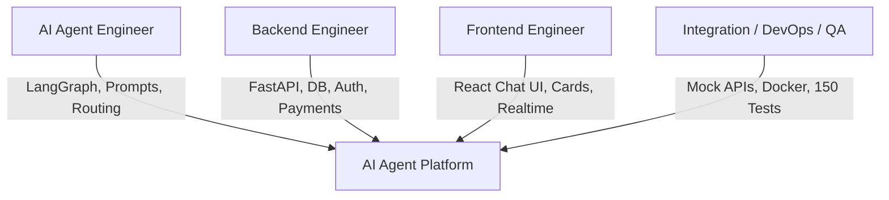

# Project Charter - AI Concierge (X-One Assistant)

> **Tài liệu Điều Lệ Dự Án & Định Hướng Chiến Lược**  
> **Sản phẩm:** X-One Assistant (AI Concierge)  
> **Thời gian thực hiện:** 6 tuần | **Quy mô nhóm:** 4 thành viên | **Cách thức triển khai:** Vertical Slice  

---

## 1. Thông Tin Tổng Quan Dự Án

| Thuộc tính | Mô tả chi tiết |
| :--- | :--- |
| **Tên sản phẩm** | X-One Assistant / AI Concierge - Intelligent Multi-Service Ride Booking & Service Agent |
| **Loại sản phẩm** | Web Application Responsive (Hỗ trợ Desktop & Mobile Web) |
| **Ngôn ngữ chính** | Tiếng Việt (Natively supported) |
| **Thời gian triển khai** | 6 tuần (6 Sprints) |
| **Quy mô nhóm** | 4 thành viên kỹ thuật |
| **Hạ tầng dự kiến** | Docker, Railway / Render / VPS |
| **Mô hình LLM cốt lõi**| Model hỗ trợ Structured Output & Tool Calling (GPT-4o / Claude 3.5 Sonnet) |
| **Khung điều phối Agent**| LangGraph (State Graph Management) |

---

## 2. Bối Cảnh & Vấn Đề Cần Giải Quyết

### 2.1 Thực trạng thị trường
1. **Phân mảnh ứng dụng:** Người dùng phải mở nhiều ứng dụng độc lập (gọi xe, đặt lịch khám, đặt bàn, thanh toán hóa đơn, bản đồ) cho một hành trình đơn lẻ.
2. **Thông tin bị chia rẽ:** Thông tin bị phân mảnh giữa các cuộc hội thoại, bản đồ, lịch hẹn và ví điện tử.
3. **Thiếu sự phối hợp thời gian tự động:** Các dịch vụ phụ thuộc chặt chẽ nhau về thời gian (ví dụ: cần đến phòng khám trước 15 phút) nhưng không được tự động tính toán và đặt nối tiếp.
4. **Rủi ro thao tác sai:** Người dùng dễ nhập sai dữ liệu, quên lịch hoặc không biết cách xử lý khi một bước trong chuỗi giao dịch thất bại.

### 2.2 Vấn đề cốt lõi
Người dùng không chỉ muốn hỏi đáp thông tin đơn thuần. Họ muốn **hoàn thành công việc từ đầu đến cuối (End-to-End Task Completion)**. Một chatbot thông thường chỉ dừng lại ở việc trả lời *"Có 3 bệnh viện gần bạn"*, nhưng một **AI Agent đáng tin cậy** phải tiếp tục tìm lịch trống, đề xuất lựa chọn, hỏi xác nhận người dùng, thực hiện đặt lịch, tính toán thời gian di chuyển, tự động đặt xe đón và theo dõi trạng thái giao dịch theo thời gian thực.

---

## 3. Tầm Nhìn, Mục Tiêu & Nguyên Tắc Thiết Kế

### 3.1 Tầm nhìn (Vision)
Xây dựng một nền tảng AI Agent đa dịch vụ có khả năng hoạt động như một mini-app ngay trong giao diện hội thoại, nơi người dùng hoàn thành các quy trình phức tạp bằng ngôn ngữ tự nhiên nhưng vẫn giữ toàn bộ quyền kiểm soát ở mọi hành động quan trọng.

### 3.2 Mục tiêu sản phẩm (Objectives)
1. **Hỗ trợ 4 domain dịch vụ** ở các mức độ chiều sâu khác nhau.
2. **Triển khai sâu 2 domain cốt lõi:** Đặt xe (Ride) và Đặt lịch khám bệnh (Medical).
3. **Thực thi thành công ít nhất 1 luồng đa dịch vụ hoàn chỉnh:** Đặt lịch khám $\rightarrow$ Tự động tính thời gian di chuyển $\rightarrow$ Đặt xe đón đúng giờ.
4. **Bắt buộc tích hợp Human-in-the-Loop:** Yêu cầu xác nhận người dùng trước booking, thanh toán và hủy dịch vụ có phí.
5. **Cung cấp tính năng vận hành nâng cao:** Realtime tracking, Memory có sự đồng ý (consent), Audit log và Dashboard dành cho Tổng đài viên (Operator).
6. **Đánh giá agent định lượng:** Đo đạc chất lượng bằng bộ test suite 150 kịch bản và các chỉ số định lượng cụ thể.

### 3.3 Nguyên tắc thiết kế cốt lõi (Design Principles)

| Nguyên tắc | Diễn giải chi tiết |
| :--- | :--- |
| **Agent không nắm toàn quyền** | Business rules, kiểm tra quyền và thực thi giao dịch nằm hoàn toàn ở Backend. |
| **Không bịa dữ liệu (No Hallucination)** | Tất cả option xe, giá tiền, lịch trống và trạng thái phải đến từ Tool/API thực tế. |
| **Xác nhận rõ ràng** | Không suy đoán sự đồng ý từ câu nói mơ hồ của người dùng. Phải có Confirmation Token. |
| **Thiết kế có thể mở rộng** | Dịch vụ mới được bổ sung dễ dàng thông qua Adapter Pattern & Tool Registry. |
| **Lỗi phải có lối thoát** | Quy định Retry có giới hạn, cho phép chỉnh sửa slot, Form fallback và Human Handoff. |
| **Đo lường được (Observability)** | Mọi lượt Agent run, Tool call và giao dịch quan trọng đều được ghi vết (Tracing & Audit). |

---

## 4. Phạm Vi Dự Án (Project Scope)

### 4.1 Phạm vi thực hiện (In-Scope)

#### 1. Dịch vụ đặt xe (Ride Booking - Triển khai sâu):
- Tìm chuyến xe theo điểm đón, điểm đến và thời gian.
- Các hạng xe: Xe máy, Economy 4 chỗ, Premium 4 chỗ, Xe 7 chỗ.
- So sánh giá, thời gian tài xế đến và thời gian di chuyển dự kiến.
- Đặt xe, thanh toán sandbox, hủy xe, hiển thị minh bạch phí hủy.
- Theo dõi realtime: Tìm tài xế $\rightarrow$ Đã nhận $\rightarrow$ Đang đến $\rightarrow$ Đã đến $\rightarrow$ Đang di chuyển $\rightarrow$ Hoàn thành.
- Chống tạo đơn trùng lặp bằng Idempotency Key.

#### 2. Dịch vụ đặt lịch khám (Medical Booking - Triển khai sâu):
- Tìm bệnh viện/phòng khám theo khu vực và khoảng cách.
- Tìm chuyên khoa, bác sĩ, mức giá và lịch trống khả dụng.
- Đặt lịch, đổi giờ và hủy lịch khám.
- Hiển thị hướng dẫn chuẩn bị trước khi khám.
- Phối hợp với dịch vụ đặt xe để đưa khách hàng đến trước giờ hẹn.

#### 3. Dịch vụ đặt bàn nhà hàng (Restaurant Booking - Mở rộng):
- Tìm nhà hàng theo khu vực, loại món ăn, ngân sách và đánh giá.
- Kiểm tra bàn trống theo thời gian và số lượng khách.
- Đặt bàn, đổi giờ, đổi số người và hủy bàn.
- Hỗ trợ các yêu cầu đặc biệt: Khu vực không hút thuốc, ghế trẻ em, dị ứng, bàn riêng.

#### 4. Thanh toán hóa đơn Sandbox (Bill Payment - Safegaurd & Transaction Safety):
- Danh sách hóa đơn giả lập: Điện, Nước, Internet, Điện thoại.
- Preview giao dịch, xác nhận, thanh toán sandbox, xử lý thất bại, timeout và refund sandbox.
- Xuất biên nhận (Receipt) và lưu lịch sử thanh toán.

---

### 4.2 Phạm vi KHÔNG thực hiện (Out-of-Scope)
- **KHÔNG** tích hợp trực tiếp API thật của Grab/Be, ngân hàng thật hoặc hệ thống bệnh viện thật.
- **KHÔNG** xử lý dòng tiền thật hoặc xác thực danh tính eKYC.
- **KHÔNG** chẩn đoán y tế, kê đơn thuốc hoặc thay thế tư vấn chuyên môn của bác sĩ.
- **KHÔNG** phát triển ứng dụng Mobile Native (iOS/Android) độc lập hoặc Voice Assistant hoàn chỉnh.
- **KHÔNG** triển khai hạ tầng Kubernetes Production multi-region hoặc tiêu chuẩn compliance doanh nghiệp phức tạp.
- **KHÔNG** xây dựng mô hình ML Recommendation riêng hoặc hệ thống sàn giao dịch thương mại lớn.

---

## 5. Phân Chia Vai Trò Trong Nhóm (Team Structure & Roles)

Dự án gồm **4 thành viên** với phân công trách nhiệm rõ ràng:

| Vai trò | Phạm vi trách nhiệm chính | Sản phẩm bàn giao (Deliverables) |
| :--- | :--- | :--- |
| **AI Agent Engineer** | Thiết kế LangGraph State Machine, Prompt engineering, Slot extraction, Multi-service planning, Routing, Guardrails và Evaluation pipeline. | Agent Graph code, Prompt versioning system, Test execution report. |
| **Backend Engineer** | Xây dựng FastAPI service, Authentication (JWT/RBAC), Database PostgreSQL, Management APIs for Orders, Confirmation Tokens, Payment Sandbox, Audit Logging. | API Documentation (OpenAPI), DB Migrations, Unit/Integration tests, Core Business logic. |
| **Frontend Engineer** | Xây dựng Chat UI responsive, Rich Cards (Ride, Appointment, Confirmation, Bill, Receipt), Realtime Tracking (WebSocket), Memory Consent UI, Operator Dashboard. | Responsive Web App, Dynamic Components, Smooth UI state transitions, E2E user flow. |
| **Integration / DevOps / QA**| Xây dựng Mock APIs cho các nhà cung cấp, Cấu hình Redis Pub/Sub, Docker Compose setup, CI/CD pipeline, Xây dựng bộ test suite 150 kịch bản, Load test & Security audit. | Môi trường Sandbox, Infrastructure scripts, Automated Test Suites, Seed Data generation. |
