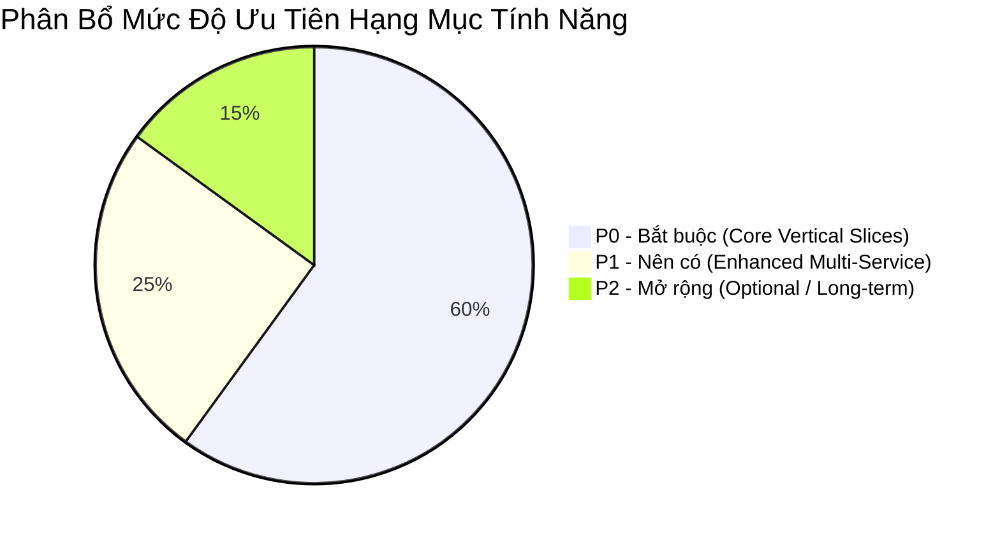

# Product Requirements Document (PRD)

> **X-ONE ASSISTANT | CONVERSATIONAL MULTI-SERVICE AI AGENT**  
> **Phiên bản PRD:** 1.0 | **Thời gian triển khai:** 6 tuần | **Nhóm:** 4 thành viên  

---

## 1. Đối Tượng Người Dùng (User Personas)

### 1.1 Customer (Khách hàng cuối)
- **Nhu cầu:** Đặt xe, đặt lịch khám, đặt bàn và thanh toán hóa đơn nhanh chóng bằng hội thoại tiếng Việt tự nhiên; được nhắc nhở lịch trình và hỗ trợ trọn gói hành trình di chuyển.
- **Hành vi:** Quản lý hồ sơ cá nhân, địa chỉ quen thuộc (nhà, công ty, trường học), gửi yêu cầu chat, xem/chọn option xe hoặc phòng khám, xác nhận hành động giao dịch, theo dõi trạng thái đơn realtime, quản lý và xóa dữ liệu memory.

### 1.2 Operator (Tổng đài viên / Nhân viên vận hành)
- **Nhu cầu:** Giám sát các cuộc hội thoại gặp sự cố, tiếp quản hội thoại khi Agent không thể xử lý (Human Handoff), xử lý các giao dịch bất thường hoặc refund vượt quyền.
- **Hành vi:** Theo dõi đơn vị lỗi, xem danh sách ticket hỗ trợ, nhận toàn bộ context cuộc đối thoại khi chuyển giao, cập nhật trạng thái đơn và duyệt refund sandbox.

### 1.3 Administrator (Quản trị viên hệ thống)
- **Nhu cầu:** Quản lý người dùng, phân quyền truy cập, cấu hình các dịch vụ tích hợp, giám sát hiệu năng hệ thống, chi phí token LLM và bảo mật.
- **Hành vi:** Xem Audit log toàn hệ thống, theo dõi Dashboard chi phí LLM, cấu hình hạn mức (rate limit) và quản lý nhà cung cấp dịch vụ (service providers).

---

## 2. User Stories & Tiêu Chí Chấp Nhận (Acceptance Criteria)

| ID | User Story | Mô tả nhu cầu | Tiêu chí chấp nhận (Acceptance Criteria) |
| :--- | :--- | :--- | :--- |
| **US-01** | Yêu cầu tự nhiên | Người dùng nhập tiếng Việt tự nhiên, kể cả câu thiếu thông tin hoặc sai chính tả phổ biến. | Agent nhận diện đúng ý định, hỏi lại khi không chắc chắn và tuyệt đối không tự bịa các slot thông tin. |
| **US-02** | Slot filling | Agent chủ động trích xuất các slot đã có và chỉ hỏi bổ sung những thông tin còn thiếu. | Không hỏi lại dữ liệu người dùng đã cung cấp; hỗ trợ người dùng sửa từng slot trực tiếp mà không cần làm lại từ đầu. |
| **US-03** | Multi-service | Người dùng đặt nhiều dịch vụ kết hợp trong một câu thoại đơn lẻ. | Agent lập kế hoạch cấu trúc (plan), tính toán phụ thuộc thời gian (dependency) và xử lý sự cố từng phần (partial failure). |
| **US-04** | Confirmation | Người dùng cần xem lại toàn bộ thông tin chi tiết trước khi hệ thống thực thi giao dịch. | Booking/Payment chỉ thực thi khi có Confirmation Token hợp lệ do backend phát hành; từ chối khi token hết hạn hoặc sai hash. |
| **US-05** | Realtime | Người dùng theo dõi trạng thái chuyến xe hoặc đơn hàng tức thì theo thời gian thực. | Đơn hàng cập nhật qua WebSocket; tự động reconnect và đồng bộ lại timeline khi mất kết nối mạng. |
| **US-06** | Memory | Agent ghi nhớ địa chỉ quen và sở thích cá nhân khi được người dùng đồng ý. | Có giao diện minh bạch cho phép người dùng xem, sửa, xóa hoặc tắt hẳn tính năng ghi nhớ memory. |
| **US-07** | Hủy đơn | Người dùng yêu cầu hủy chuyến xe hoặc lịch khám vừa đặt. | Agent xác định đúng đơn hàng, tính toán và hiển thị rõ phí hủy (nếu có), sau đó hỏi xác nhận trước khi hủy. |
| **US-08** | Xử lý lỗi | Dịch vụ bị lỗi, hết xe hoặc timeout không làm gián đoạn toàn bộ ứng dụng. | Áp dụng Retry giới hạn (tối đa 2 lần), đề xuất phương án thay thế (fallback) hoặc chuyển sang Human Handoff. |

---

## 3. Yêu Cầu Chức Năng (Functional Requirements)

| ID | Tên chức năng | Yêu cầu kỹ thuật chi tiết |
| :--- | :--- | :--- |
| **FR-01** | Authentication | Đăng ký, đăng nhập, refresh token tự động, logout, phân quyền RBAC (User, Operator, Admin), khóa tài khoản tạm thời khi đăng nhập sai nhiều lần. |
| **FR-02** | Conversation | Tạo/xóa/đổi tên phiên hội thoại, lưu trữ tin nhắn, hỗ trợ streaming response (SSE), tự động khôi phục workflow khi refresh trang. |
| **FR-03** | Intent Classification | Nhận diện chính xác intent thuộc các nhóm: ride, medical, restaurant, bill, order, memory, support và out-of-scope. |
| **FR-04** | Slot Extraction | Trích xuất chuẩn xác các slot: Địa điểm, Ngày giờ, Số người, Loại dịch vụ, Ngân sách, Provider, Yêu cầu đặc biệt. |
| **FR-05** | Planning Engine | Tạo execution plan có cấu trúc gồm từng bước (step), mối quan hệ phụ thuộc (dependency), trạng thái và mapping dữ liệu đầu ra. |
| **FR-06** | Tool Calling | Mỗi tool tuân thủ Pydantic Schema, timeout 10s, retry tối đa 2 lần, kiểm tra quyền truy cập, idempotency key, error code và audit log. |
| **FR-07** | Human-in-the-Loop | Bắt buộc hiển thị card xác nhận cho hành động: booking, thanh toán, hủy có phí, refund sandbox và lưu trữ dữ liệu nhạy cảm. |
| **FR-08** | Confirmation Token | Token do backend phát hành, gắn với `user_id`, `action_type`, `payload_hash`, `nonce`, có thời hạn TTL tối đa 5 phút. |
| **FR-09** | Order Management | Quản lý Order, Order Items, lịch sử sự kiện (Event Timeline) bất biến, theo dõi trạng thái đơn và liên kết đơn đa dịch vụ. |
| **FR-10** | Payment Sandbox | Xem trước (preview), tạo thanh toán sandbox, xác nhận, hỗ trợ các trạng thái success/failure/timeout, refund và xuất biên nhận. |
| **FR-11** | Realtime System | Hạ tầng WebSocket, cơ chế auto-reconnect, Redis Pub/Sub cho tin nhắn realtime, lưu trữ sự kiện và gửi thông báo. |
| **FR-12** | Memory Engine | Quản lý memory có sự đồng ý (consent), lưu vết nguồn gốc (source), độ tin cậy (confidence), thời gian dùng gần nhất, giao diện CRUD memory. |
| **FR-13** | Operator Dashboard | Giao diện cho tổng đài viên theo dõi đơn lỗi, support ticket, lỗi tool, lỗi thanh toán, độ trễ và chi phí LLM token. |
| **FR-14** | Human Handoff | Cơ chế chuyển giao cuộc thoại cho tổng đài viên, đính kèm toàn bộ context lịch sử hội thoại và trạng thái đơn hàng. |
| **FR-15** | Audit Logging | Ghi vết hệ thống chi tiết: Actor, Action, Resource, trạng thái Before/After, Timestamp, Result, Error code và Confirmation ID. |

---

### 3.1 Danh Sách Intent Tối Thiểu (Minimum Intent List)
- **Ride Domain:** `search_ride` | `book_ride` | `cancel_ride` | `track_ride`
- **Medical Domain:** `search_medical_appointment` | `book_medical_appointment` | `reschedule_medical_appointment` | `cancel_medical_appointment`
- **Restaurant Domain:** `search_restaurant` | `book_restaurant` | `update_restaurant_booking` | `cancel_restaurant_booking`
- **Payment Domain:** `list_bills` | `pay_bill` | `refund_payment`
- **Order & Support:** `view_order` | `cancel_order` | `update_order` | `manage_memory` | `general_support` | `out_of_scope`

---

## 4. Phân Cấp Ưu Tiên Tính Năng (Priority Matrix)

- **P0 — Bắt buộc (Must Have):** Authentication, Chat UI, Ride vertical slice (đặt xe, theo dõi realtime, hủy xe), Medical vertical slice (tìm phòng khám, bác sĩ, đặt lịch), Confirmation Token, Order management, Payment Sandbox, Audit logging, Docker deployment.
- **P1 — Nên có (Should Have):** Multi-service planning (kết hợp đặt lịch khám + đặt xe), Operator dashboard, Memory consent management, Restaurant booking cơ bản, Agent Evaluation dashboard.
- **P2 — Nếu còn thời gian (Nice to Have):** Thanh toán hóa đơn điện/nước đầy đủ, Refund sandbox nâng cao, Truy hồi Memory với pgvector, Dashboard theo dõi Circuit Breaker, Engine gợi ý nâng cao.

---

## 5. Yêu Cầu Phi Chức Năng (Non-Functional Requirements)

| Nhóm yêu cầu | Chỉ số và Yêu cầu cụ thể |
| :--- | :--- |
| **Hiệu năng (Performance)** | API thông thường $< 500\text{ ms}$; thời gian nhận token LLM đầu tiên $< 4\text{ s}$; cập nhật WebSocket $< 1\text{ s}$; tải thử nghiệm demo 50 user đồng thời. |
| **Độ tin cậy (Reliability)** | Retry tool tối đa 2 lần; lưu Checkpoint ngay sau các bước quan trọng; thanh toán không được retry mù quáng. |
| **Bảo mật (Security)** | Xác thực JWT, Refresh token rotation, Mã hóa mật khẩu Argon2/bcrypt, RBAC, Rate limiting, Masking dữ liệu nhạy cảm trong log, Chống tấn công IDOR. |
| **Khả năng quan sát (Observability)**| Log dạng Structured JSON, Trace ID xuyên suốt các dịch vụ, theo dõi Token usage, Tool latency, Error rate và Order failure rate. |
| **Khả năng mở rộng (Scalability)**| Thiết kế Tool Registry linh hoạt, Service Adapter cách ly business logic khỏi Prompt. |
| **Khả dụng (Availability)** | Giao diện Responsive Web UI, Rich Interactive Cards, trạng thái Loading/Retry/Error minh bạch, Form fallback khi LLM gặp sự cố. |

---

## 6. Bảo Mật Vấn Đề Giao Dịch & Safeguards

### 6.1 Chống Prompt Injection
1. Bỏ qua và chặn các câu lệnh yêu cầu tiết lộ System Prompt, API Key, Token hoặc thông tin bí mật.
2. Không cho phép câu lệnh trong Chat vượt qua bước Confirmation hoặc tự cấp quyền Tool Permission.
3. Không cho phép LLM tự ý chỉnh sửa giá tiền, số tiền thanh toán hoặc thông số payload đã được xác nhận.
4. Mọi dữ liệu đầu vào của Tool phải được Backend kiểm tra độc lập (Backend Validation).

### 6.2 Chính sách an toàn giao dịch (Transaction Safeguards)

| Loại hành động | Chính sách an toàn bắt buộc |
| :--- | :--- |
| **Search / View** | Không cần xác nhận, cho phép thực thi trực tiếp qua Tool. |
| **Booking (Đặt chỗ/xe)**| Bắt buộc hiển thị Summary Card và yêu cầu nhấn nút Xác nhận. |
| **Payment (Thanh toán)**| Bắt buộc xác nhận; các giao dịch giá trị cao có OTP Sandbox thử nghiệm. |
| **Cancel có phí** | Bắt buộc tính toán phí hủy, hiển thị công khai và hỏi xác nhận từ người dùng. |
| **Refund (Hoàn tiền)** | Thực hiện theo chính sách tự động hoặc chuyển Tổng đài viên (Operator) duyệt. |

### 6.3 Idempotency Key Formula
Để chống tạo đơn hàng hoặc giao dịch thanh toán trùng lặp khi người dùng nhấn nhiều lần hoặc mạng bị rớt, Backend áp dụng công thức tạo Idempotency Key:

$$\text{Key} = \text{SHA256}(\text{user\_id} + \text{action\_type} + \text{resource\_id} + \text{confirmation\_id} + \text{payload\_hash})$$

### 6.4 Privacy & Data Protection
- Không bao giờ lưu trữ số thẻ ngân hàng đầy đủ hoặc mã CVV.
- Không đưa Secret/Access Token vào Prompt gửi tới LLM.
- Giảm thiểu tối đa dữ liệu y tế gửi xuống LLM (chỉ gửi các slot cần thiết cho việc đặt lịch).
- Cho phép người dùng chủ động xóa memory và dữ liệu cá nhân theo mong muốn.
