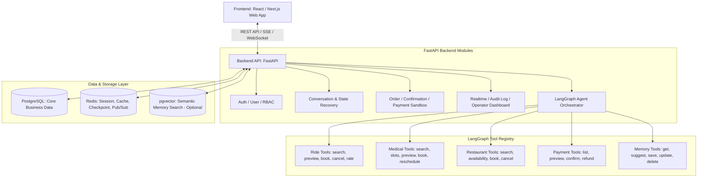
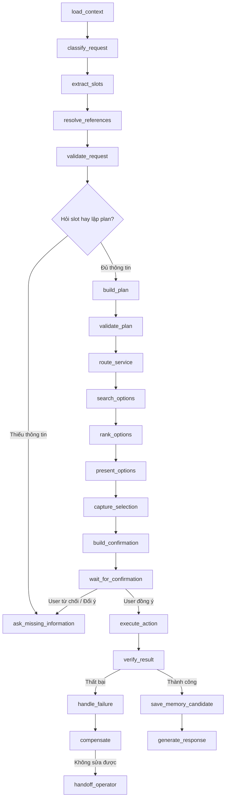
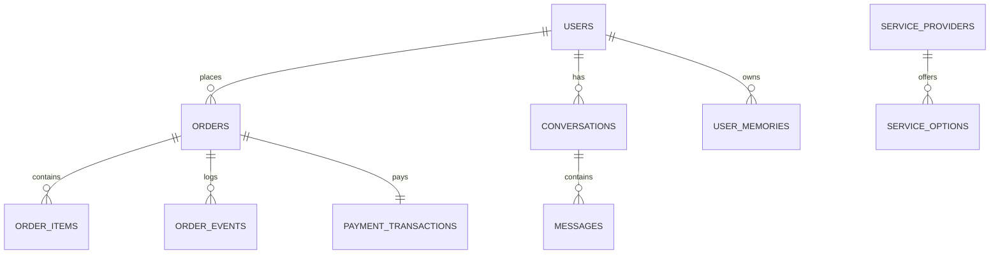

# System Architecture & AI Agent Design

> **X-ONE ASSISTANT | TÀI LIỆU KIẾN TRÚC HỆ THỐNG VÀ THIẾT KẾ AGENT**  
> **Phiên bản:** 1.0 | **Framework điều phối:** LangGraph | **Backend:** FastAPI | **Database:** PostgreSQL + Redis  

---

## 1. Sơ Đồ Kiến Trúc Tổng Thể (System Architecture Diagram)



---

## 2. Các Quyết Định Kiến Trúc Cốt Lõi (Architectural Decisions)

1. **Sử dụng FastAPI làm Backend Core:** Giúp tối ưu hóa chi phí tích hợp AI, hỗ trợ native Pydantic Schema Validation cho Tool Calling, và hỗ trợ tốt cho WebSocket / SSE Streaming.
2. **Phân chia lưu trữ PostgreSQL vs Redis:**
   - **PostgreSQL:** Lưu trữ toàn bộ dữ liệu nghiệp vụ có cấu trúc (Users, Orders, Transactions, Audit Logs, Immutable Timelines).
   - **Redis:** Lưu trữ phiên làm việc (Session), Caching kết quả tìm kiếm, lưu trữ Checkpoints trạng thái của LangGraph và đảm nhận vai trò Pub/Sub Event Broker cho WebSocket Realtime.
3. **Chiến lược Vector Database (pgvector):** Chỉ kích hoạt extension `pgvector` trên PostgreSQL khi hệ thống cần truy hồi memory ngữ nghĩa nâng cao (semantic memory retrieval), giúp giảm bớt độ phức tạp hạ tầng ban đầu.
4. **Mô hình Agent Đơn Điều Phối (Single LangGraph Agent with Modules):** Sử dụng một LangGraph Orchestrator điều phối chính chứa các module dịch vụ độc lập, chưa bắt buộc triển khai mô hình Multi-Agent phức tạp ở giai đoạn đầu để giữ tính ổn định.

---

## 3. Thiết Kế AI Agent (LangGraph Architecture)

### 3.1 Agent State Schema (22 thuộc tính state)
State của LangGraph lưu trữ toàn bộ ngữ cảnh cần thiết trong suốt vòng đời hội thoại:

```python
class AgentState(TypedDict):
    user_id: str
    conversation_id: str
    messages: List[BaseMessage]
    intent: str
    confidence: float
    requested_services: List[str]
    extracted_slots: Dict[str, Any]
    missing_slots: List[str]
    user_context: Dict[str, Any]
    execution_plan: List[Dict[str, Any]]
    current_step_index: int
    search_results: Dict[str, Any]
    selected_options: Dict[str, Any]
    pending_actions: List[Dict[str, Any]]
    confirmation_status: str  # PENDING, CONFIRMED, REJECTED
    confirmation_token: Optional[str]
    created_order_ids: List[str]
    payment_ids: List[str]
    tool_call_count: int
    retry_count: int
    error_history: List[Dict[str, Any]]
    response_type: str  # TEXT, RICH_CARD, CONFIRMATION_CARD, HANDOFF
```

---

### 3.2 Luồng Chạy Của Các LangGraph Nodes (22 Graph Nodes)



---

### 3.3 Thông Số Giới Hạn Của Agent (Agent Constraints & Limits)

| Thông số kĩ thuật | Giá trị giới hạn | Giải thích ý nghĩa |
| :--- | :--- | :--- |
| `max_graph_steps` | **20 bước** | Giới hạn số bước nhảy tối đa trong 1 turn để chống vòng lặp vô tận. |
| `max_tool_calls_per_turn` | **8 lần** | Giới hạn số lượt gọi Tool tối đa trong 1 turn của người dùng. |
| `max_retries_per_tool` | **2 lần** | Thử lại tối đa 2 lần khi Tool gặp sự cố mạng hoặc timeout. |
| `tool_timeout` | **10 giây** | Hạn ngạch thời gian chờ tối đa cho 1 Tool execution. |
| `confirmation_ttl` | **5 phút** | Thời gian sống (TTL) của Confirmation Token do Backend cấp. |
| `max_plan_services` | **4 dịch vụ** | Số lượng dịch vụ tối đa trong 1 chuỗi kế hoạch kết hợp. |

---

### 3.4 Phân Chia Trách Nhiệm (LLM vs Backend Control)

| Hạng mục | LLM được phép làm | Backend bắt buộc kiểm soát |
| :--- | :--- | :--- |
| **Phân tích & Xử lý** | Hiểu ý định (Intent), Trích xuất Slot, Lập kế hoạch tổng quan, Chọn Tool phù hợp, Tạo câu trả lời tự nhiên. | Giá tiền, Kiểm tra quyền (Auth/RBAC), Chuyển đổi trạng thái (State transition), Hạn mức, Cấp token xác nhận. |
| **Giải thích & Tương tác**| Giải thích chi tiết các lựa chọn (options) và chủ động hỏi bổ sung thông tin thiếu. | Đảm bảo tính Idempotency, Thực thi thanh toán sandbox, Ghi vết Audit Log. |
| **Ranh giới an toàn** | **KHÔNG** tự ý sửa option_id, amount, giá tiền hoặc kết quả từ Provider trả về. | **KHÔNG** cho phép LLM qua mặt bước xác nhận hoặc tự thay đổi payload giao dịch. |

---

## 4. Cơ Sở Dữ Liệu Chi Tiết (Database Schema - 20+ Tables)

Hệ thống PostgreSQL lưu trữ toàn bộ dữ liệu nghiệp vụ thông qua các bảng chính phân theo phân hệ:



### Danh sách các bảng chính:
1. **Phân hệ Người dùng & Phân quyền:** `users`, `roles`, `user_profiles`, `user_addresses`, `user_preferences`, `user_memories`.
2. **Phân hệ Hội thoại & Agent:** `conversations`, `messages`, `agent_runs`, `agent_checkpoints`.
3. **Phân hệ Danh mục & Dịch vụ:** `service_providers`, `service_catalog`, `service_options`.
4. **Phân hệ Đơn hàng & Đặt chỗ:** `orders`, `order_items`, `order_events`, `order_confirmations`.
5. **Phân hệ Thanh toán Sandbox:** `payment_intents`, `payment_transactions`, `payment_refunds`, `receipts`.
6. **Phân hệ Giám sát & Quản trị:** `tool_calls`, `audit_logs`, `notifications`, `support_tickets`, `operator_messages`.
