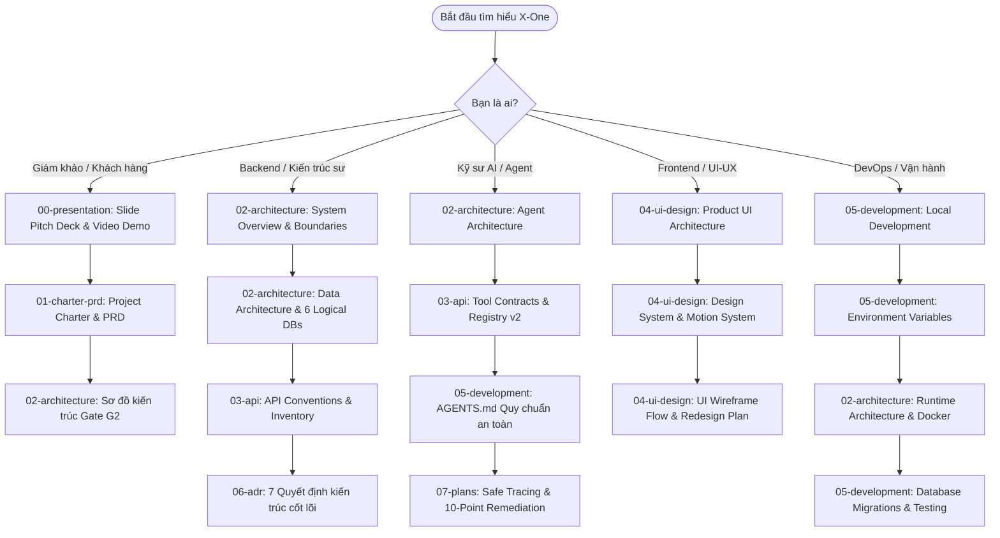

# Hệ Thống Tài Liệu Kỹ Thuật X-One (X-One Documentation Portal)

Chào mừng bạn đến với trung tâm tài liệu kỹ thuật chính thức của dự án **X-One** — Siêu ứng dụng Trợ lý AI Đa dịch vụ (AI Concierge Super-App) tích hợp 4 lĩnh vực thiết yếu: **Giao đồ ăn (Food)**, **Đặt xe di chuyển (Ride)**, **Đặt bàn nhà hàng (Restaurant)** và **Đặt lịch khám bệnh (Healthcare)**.

Kho tài liệu này được cấu trúc theo chuẩn khoa học, phân loại theo số thứ tự (`00` đến `10`) giúp việc tra cứu và tiếp cận thông tin theo luồng từ ý tưởng, kiến trúc, đặc tả API, thiết kế UI đến quy trình vận hành trở nên dễ dàng và mạch lạc nhất.

---

## 🗺️ Luồng Đọc Hiểu Dự Án (Recommended Reading Roadmap)

Tùy theo vai trò và mục đích tiếp cận, bạn có thể lựa chọn lộ trình đọc tài liệu tối ưu dưới đây:

---

## 📚 Mục Lục 11 Phân Hệ Tài Liệu

### 📁 [00-presentation](00-presentation/README.md) — Thuyết Trình, Demo & Bàn Giao
*Dành cho thuyết trình sản phẩm, demo trực quan và hồ sơ nghiệm thu.*
- [README.md](00-presentation/README.md) — Cấu trúc 10 slide chuẩn Demo Day & danh mục kiểm tra video demo.
- [pitch_deck.pptx](00-presentation/pitch_deck.pptx) — Slide thuyết trình chính thức của dự án X-One.
- [gate2.md](00-presentation/gate2.md) — Hồ sơ tổng hợp bàn giao nghiệm thu mốc Gate G2 MVP.
- [MVPdemoLink.txt](00-presentation/MVPdemoLink.txt) — Đường dẫn video demo nghiệm thu thực tế sản phẩm.
- [UIdemolink.txt](00-presentation/UIdemolink.txt) — Đường dẫn phiên bản web demo trực tuyến trên Vercel.

---

### 📁 [01-charter-prd](01-charter-prd/README.md) — Đề Cương Dự Án & Đặc Tả Sản Phẩm (PRD)
*Khởi nguồn của dự án: mục tiêu, yêu cầu chức năng, backlog và timeline 6 tuần.*
- [01_Project_Charter.md](01-charter-prd/01_Project_Charter.md) — Điều lệ dự án: Tầm nhìn, phạm vi, các bên liên quan và rủi ro.
- [02_PRD.md](01-charter-prd/02_PRD.md) — Bản đặc tả yêu cầu sản phẩm chi tiết (Product Requirement Document).
- [PRD_AI_Agent_Da_Dich_Vu_6_Tuan.docx](01-charter-prd/PRD_AI_Agent_Da_Dich_Vu_6_Tuan.docx) — Tệp Word PRD gốc của khóa đào tạo 6 tuần.
- [03_System_Architecture.md](01-charter-prd/03_System_Architecture.md) — Thiết kế kiến trúc mức cao ban đầu.
- [04_Backlog.md](01-charter-prd/04_Backlog.md) — Danh sách tính năng và backlog các user stories.
- [05_Timeline.md](01-charter-prd/05_Timeline.md) — Kế hoạch tiến độ thực hiện theo từng tuần.
- [06_API_Design.md](01-charter-prd/06_API_Design.md) — Định hướng thiết kế giao tiếp dịch vụ ban đầu.
- [07_Evaluation.md](01-charter-prd/07_Evaluation.md) — Tiêu chí đánh giá chất lượng phản hồi của Agent.
- [08_Service_API_Integration_Guide.md](01-charter-prd/08_Service_API_Integration_Guide.md) — Hướng dẫn tích hợp API các dịch vụ miền.
- [Project Build Phase.docx.pdf](01-charter-prd/Project%20Build%20Phase.docx.pdf) — Tài liệu hướng dẫn giai đoạn triển khai dự án.

---

### 📁 [02-architecture](02-architecture/system-overview.md) — Kiến Trúc Hệ Thống Cốt Lõi
*Trọng tâm kỹ thuật: mô hình đa tầng, phân quyền, dữ liệu và luồng điều phối an toàn.*
- [architecture_diagram.md](02-architecture/architecture_diagram.md) — **Sơ đồ kiến trúc Gate G2**: Mô hình MVP hiện tại, luồng dữ liệu, luồng điều khiển và checklist thẩm định.
- [ARCHITECTURE.md](02-architecture/ARCHITECTURE.md) — Điểm truy cập kiến trúc chính của toàn hệ thống.
- [system-overview.md](02-architecture/system-overview.md) — Tổng quan hệ thống đa tầng: Client, Gateway, Agent, Microservices, CSDL.
- [current-state.md](02-architecture/current-state.md) — Báo cáo trạng thái triển khai thực tế kèm bằng chứng kiểm thử trên codebase.
- [service-boundaries.md](02-architecture/service-boundaries.md) — Quy chuẩn phân định ranh giới và trách nhiệm độc lập của từng dịch vụ.
- [backend-architecture.md](02-architecture/backend-architecture.md) — Kiến trúc điều phối trung tâm NestJS Gateway và các service FastAPI.
- [agent-architecture.md](02-architecture/agent-architecture.md) — Kiến trúc AI Agent: LangGraph state machine, intent routing và deterministic fallback.
- [agent-trace-safety-remediation.md](02-architecture/agent-trace-safety-remediation.md) — Cơ chế khắc phục an toàn dữ liệu và giấu thông tin nhạy cảm trong trace.
- [workflows.md](02-architecture/workflows.md) — Luồng nghiệp vụ chi tiết của 4 dịch vụ (Đặt xe, Giao món, Đặt bàn, Khám bệnh).
- [data-architecture.md](02-architecture/data-architecture.md) — Kiến trúc 6 cơ sở dữ liệu logic, chiến lược migration và phân quyền truy cập.
- [runtime-architecture.md](02-architecture/runtime-architecture.md) — Vận hành Docker Compose, cổng dịch vụ, health checks và hạn mức tài nguyên.
- [security-architecture.md](02-architecture/security-architecture.md) — Kiến trúc an toàn: JWT Auth, xác nhận 2 bước, khóa Idempotency và phòng chống prompt injection.
- [food-vertical-slice.md](02-architecture/food-vertical-slice.md) — Phân tích chi tiết một luồng dữ liệu hoàn chỉnh (Vertical Slice) của dịch vụ Đồ ăn.
- [repository-structure.md](02-architecture/repository-structure.md) — Cấu trúc tổ chức monorepo và trách nhiệm từng thư mục.

---

### 📁 [03-api](03-api/api-inventory.md) — Đặc Tả API & Hợp Đồng Dịch Vụ
*Tất cả thông tin về giao diện lập trình ứng dụng REST và hợp đồng gọi Tool của Agent.*
- [api-conventions.md](03-api/api-conventions.md) — Quy ước thiết kế REST: Cấu trúc lỗi chuẩn, header Idempotency-Key và phân trang.
- [api-inventory.md](03-api/api-inventory.md) — Danh mục toàn bộ các endpoint đang hoạt động của Gateway và 4 Domain Services.
- [tool-contracts.md](03-api/tool-contracts.md) — Cấu trúc JSON Schema các công cụ mà AI Agent được phép yêu cầu Gateway thực thi.
- [tool-registry-v2.md](03-api/tool-registry-v2.md) — Cơ chế quản lý, đăng ký và phân quyền công cụ thế hệ 2.
- [provider-integration-and-webhook-spec.md](03-api/provider-integration-and-webhook-spec.md) — Đặc tả tích hợp đối tác và sự kiện Webhook chiều ngược lại.
- [provider-mcp.md](03-api/provider-mcp.md) — Đặc tả giao thức Model Context Protocol (MCP) dành cho nhà cung cấp.

---

### 📁 [04-ui-design](04-ui-design/README.md) — Thiết Kế Giao Diện & Trải Nghiệm (UI/UX)
*Hệ thống thiết kế, chuyển động, sơ đồ luồng người dùng và kiến trúc Next.js App Router.*
- [product-ui-architecture.md](04-ui-design/product-ui-architecture.md) — Kiến trúc Next.js App Router, quản lý trạng thái, layout 4 roles và error boundaries.
- [design-system.md](04-ui-design/design-system.md) — Hệ thống thiết kế chuẩn: Typography (Be Vietnam Pro), bảng màu, khoảng cách 4px, components.
- [motion-system.md](04-ui-design/motion-system.md) — Hệ thống chuyển động: Thời lượng, easing curves, hiệu ứng chuyển cảnh và micro-interactions.
- [ui_wireframe_flow.md](04-ui-design/ui_wireframe_flow.md) — Sơ đồ luồng giao diện người dùng qua các màn hình và trạng thái.
- [visual-qa-checklist.md](04-ui-design/visual-qa-checklist.md) — Bảng kiểm định chất lượng hiển thị responsive trên các thiết bị.
- [UI-REDESIGN-PLAN.md](04-ui-design/UI-REDESIGN-PLAN.md) — Kế hoạch nâng cấp giao diện toàn diện theo ý tưởng "Một dòng sông, bốn bến đỗ".
- [customer-ui-redesign-plan.md](04-ui-design/customer-ui-redesign-plan.md) — Kế hoạch tối ưu hóa trải nghiệm tương tác của khách hàng.

---

### 📁 [05-development](05-development/local-development.md) — Hướng Dẫn Phát Triển & Vận Hành
*Dành cho kỹ sư phát triển: hướng dẫn chạy local, cấu hình, migration và quy chuẩn code.*
- [local-development.md](05-development/local-development.md) — Hướng dẫn cài đặt và khởi chạy hệ thống (Docker hoặc Hybrid trên host).
- [environment-variables.md](05-development/environment-variables.md) — Danh mục và ý nghĩa của toàn bộ 135 biến môi trường trong `.env.example`.
- [database-and-migrations.md](05-development/database-and-migrations.md) — Quản lý nâng cấp CSDL với Alembic và SQL migrations độc lập.
- [contributing.md](05-development/contributing.md) — Quy chuẩn đóng góp mã nguồn, quy trình git branch và tiêu chuẩn kiểm thử.
- [AGENTS.md](05-development/AGENTS.md) — Quy tắc bắt buộc dành cho AI Coding Agents khi chỉnh sửa mã nguồn.
- [new-service-checklist.md](05-development/new-service-checklist.md) — Checklist từng bước khi tạo mới một microservice trong hệ sinh thái.
- [testing-strategy.md](05-development/testing-strategy.md) — Chiến lược kiểm thử toàn diện: Unit test, Integration test, E2E và Agent eval.

---

### 📁 [06-adr](06-adr/README.md) — Bản Ghi Quyết Định Kiến Trúc (ADRs)
*7 quyết định thiết kế nền tảng định hình nên sự ổn định và an toàn của hệ thống.*
- [README.md](06-adr/README.md) — Tổng quan mục đích và nguyên tắc quản lý ADRs.
- [0001-nestjs-central-orchestrator.md](06-adr/0001-nestjs-central-orchestrator.md) — ADR 0001: Lựa chọn NestJS làm API Gateway điều phối trung tâm.
- [0002-logical-database-ownership.md](06-adr/0002-logical-database-ownership.md) — ADR 0002: Mỗi service sở hữu độc quyền một Logical Database.
- [0003-synchronous-rest.md](06-adr/0003-synchronous-rest.md) — ADR 0003: Giao tiếp nội bộ qua REST/JSON đồng bộ.
- [0004-one-agent-tool-gateway.md](06-adr/0004-one-agent-tool-gateway.md) — ADR 0004: Agent chỉ phát ra Tool Request, Gateway thực thi.
- [0005-auth-session-architecture.md](06-adr/0005-auth-session-architecture.md) — ADR 0005: Kiến trúc phiên xác thực JWT tập trung tại Gateway.
- [0006-address-ownership.md](06-adr/0006-address-ownership.md) — ADR 0006: Cơ chế phân quyền và quản lý địa chỉ người dùng.
- [0007-healthcare-patient-ownership.md](06-adr/0007-healthcare-patient-ownership.md) — ADR 0007: Dịch vụ Y tế sở hữu dữ liệu hồ sơ bệnh nhân.

---

### 📁 [07-plans](07-plans/README.md) — Kế Hoạch Nâng Cấp Kỹ Thuật (Engineering Plans)
*Các bản kế hoạch chi tiết về refactor, nâng cấp mô hình AI và mở rộng tính năng.*
- [README.md](07-plans/README.md) — Tổng hợp danh mục các kế hoạch kỹ thuật.
- [agent-service-single-agent-plan.md](07-plans/agent-service-single-agent-plan.md) — Kế hoạch Single-Agent LangGraph.
- [ai-core-a-b-refactor-plan.md](07-plans/ai-core-a-b-refactor-plan.md) — Kế hoạch A/B refactor bộ xử lý hội thoại.
- [core-agent-10-point-remediation-plan.md](07-plans/core-agent-10-point-remediation-plan.md) — Kế hoạch 10 điểm xử lý rủi ro an toàn Agent.
- [core-agent-langfuse-safe-tracing-plan.md](07-plans/core-agent-langfuse-safe-tracing-plan.md) — Thiết kế Safe Tracing qua Langfuse che giấu PII.
- [core-agent-production-upgrade-plan.md](07-plans/core-agent-production-upgrade-plan.md) — Lộ trình nâng cấp Agent lên chuẩn Production.
- [restaurant-service-improvement-plan.md](07-plans/restaurant-service-improvement-plan.md) — Cải tiến dịch vụ đặt bàn nhà hàng.
- [provider-mcp-integration-plan.md](07-plans/provider-mcp-integration-plan.md) — Tích hợp Model Context Protocol (MCP).
- [gateway-real-data-ui-integration-worklog.md](07-plans/gateway-real-data-ui-integration-worklog.md) — Tích hợp dữ liệu thực lên UI.
- [admin-operations-plan.md](07-plans/admin-operations-plan.md) — Xây dựng cổng vận hành quản trị.
- [real-world-service-scenarios-plan.md](07-plans/real-world-service-scenarios-plan.md) — Kịch bản đời thực cho 4 dịch vụ.
- [implementation-plan-25-cases.md](07-plans/implementation-plan-25-cases.md) — Kế hoạch triển khai 25 ca kiểm thử nghiệp vụ.

---

### 📁 [08-reports](08-reports/README.md) — Báo Cáo Thẩm Định & Đánh Giá
*Báo cáo kết quả audit codebase, thẩm định tài chính và kiểm thử bộ nhớ Agent.*
- [README.md](08-reports/README.md) — Mục lục các báo cáo thẩm định.
- [project-status.md](08-reports/project-status.md) — Báo cáo tiến độ tổng thể và kết quả audit tính năng.
- [update-codebase-reassessment-2026-08-25.md](08-reports/update-codebase-reassessment-2026-08-25.md) — Tái đánh giá toàn diện codebase.
- [2026-08-25-service-cash-flow-review.md](08-reports/2026-08-25-service-cash-flow-review.md) — Thẩm định luồng tiền và giao dịch thanh toán.
- [memory-runtime-implementation-2026-08-25.md](08-reports/memory-runtime-implementation-2026-08-25.md) — Báo cáo triển khai Memory Runtime.
- [memory-implementation-p0-p1.md](08-reports/memory-implementation-p0-p1.md) — Đánh giá triển khai Memory Phase P0 - P1.
- [memory-implementation-p2-p5.md](08-reports/memory-implementation-p2-p5.md) — Đánh giá triển khai Memory Phase P2 - P5.

---

### 📁 [09-worklogs](09-worklogs/README.md) — Nhật Ký Triển Khai (Journals & Worklogs)
*Lịch sử chi tiết quá trình phát triển thực tế của toàn đội ngũ.*
- [README.md](09-worklogs/README.md) — Giới thiệu mục đích theo dõi nhật ký.
- [JOURNAL.md](09-worklogs/JOURNAL.md) — **Nhật ký tuần**: Mục tiêu, thành quả, khó khăn, giải pháp và bài học kinh nghiệm.
- [WORKLOG.md](09-worklogs/WORKLOG.md) — **Nhật ký ngày**: Ghi nhận chi tiết từng commit, task và kiểm thử theo ngày.

---

### 📁 [10-reference-guide](10-reference-guide/README.md) — Tài Liệu Tham Khảo Khóa Học (Course Reference)
*Tài liệu mẫu mang tính tham khảo từ ban tổ chức khóa học AI20K Agent Bootcamp (Legacy reference only).*
- Bao gồm các chương học (`chapter-01` đến `chapter-10`), kiến thức về LangGraph, RAG pattern, DevOps VPS, tài khoản miễn phí, và các lỗi thường gặp (`anti-patterns`).
