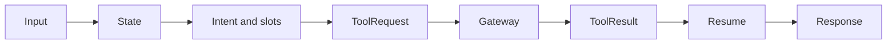

# Agent Architecture

The target agent boundary is structured state for intent, slots, workflow selection, tool request, tool-result resume, and safe response. Pydantic schemas constrain API and any future model output. The model adapter must remain isolated; default tests must mock it.

The Food slice implements this flow in `apps/agent-service/src/agents/graph.py`: configured Gemini uses LangChain's native Pydantic JSON-Schema structured-output path with `include_raw=True`; the graph accepts the validated native object and can recover the provider's raw fenced/plain JSON through a schema-validated decoder. Invalid output safely uses deterministic semantic fallback. `intent.py`, `reference_resolution.py`, `option_resolution.py`, and `tool_selection.py` are pure/testable boundaries; model-supplied resource IDs and model tool calls are discarded, and database IDs are resolved only from persisted candidates or authoritative tool results. Address labels are resolved through `list_food_delivery_addresses`, and menu options are resolved from `view_menu_item`. The graph has bounded step/tool-call limits, including nested calls. `src/services/gateway.py` discovers and executes only non-transaction tools through the Gateway with internal token and actor assertion. The public response contains no analysis, prompt, or chain-of-thought.

## Unified assistant planner

`AssistantPlan`, `SemanticTurn`, and `PlanningDecision` carry a bounded
`interaction_mode` plus `discarded_task_refs`. Chitchat and general advisory
turns produce no service task, so Gateway can answer without replaying old
cards while retaining pending state for a later turn. An explicit context
switch can mark eligible unfinished conversation tasks as `DISCARDED`;
dependent conversation tasks are discarded with their prerequisite.
`DISCARDED` is orchestration attention state only, never evidence that a
domain booking, order, reservation, appointment, hold, or payment was
cancelled. Gateway refuses to discard a task backed by an active authoritative
transaction; domain cancellation still uses its typed capability and required
confirmation.

`apps/agent-service/src/agents/assistant_graph.py` is the top-level X-One
planner. It accepts one conversation turn and returns a Pydantic-validated
compatibility `AssistantPlan` plus a typed `SemanticTurn` and
`PlanningDecision`, each bounded to at most four tasks for Ride, Food,
Restaurant, and Healthcare. The compatibility projection remains during the
Gateway rollout; the typed path is executed for both Gemini output and the
deterministic fallback. Core A is a deterministic kernel split across
`assistant/contracts.py`, `assistant/understanding/`,
`assistant/planning/`, and `assistant/policy/`; it proposes capabilities but
never dispatches them. It can express a bounded dependency such as Restaurant selection
before a Ride destination, or Healthcare hold before a Ride destination, while
the Gateway—not the Agent—executes typed service calls and confirmation
actions. A Healthcare-dependent Ride contains only the user-provided pickup;
the facility destination is resolved from the authoritative Healthcare result.
Gemini is the primary reasoning path when
`AGENT_MODEL_MODE=gemini` and a key is configured; missing-key, quota/rate-limit and
validation failures use the conservative deterministic planner. The internal
Agent status endpoint exposes only model mode/name, fallback name, key
configured boolean, and last-call diagnostics.

The planner sanitizes model slots before returning them. IDs, prices,
availability, status, and other authoritative resource facts are resolved by
the Gateway from domain results. The Gateway sends the top-level planner only a
planner-safe projection of task references, domains, goals, phases, semantic
slots, and bounded pending-choice summaries; confirmation/workflow/tool IDs,
order/appointment/reservation IDs, provider references, raw authoritative
payloads, and resource versions are excluded. The Gateway supplies the
versioned capability snapshot separately and rejects a typed plan whose
capability, domain, risk, confirmation gate, or dependency reference does not
match that snapshot. A second composition call may
explain sanitized results but cannot change their values.

Every typed Core A step is explicitly either `CAPABILITY` or
`WAIT_FOR_CONFIRMATION`. A capability step must name an implemented Gateway
snapshot capability and match its domain, risk ceiling, and confirmation gate.
A waiting step names no capability and is valid only for the matching explicit
service-details, payment, or cancellation confirmation phase. It is never a
dispatch instruction. Gateway validates this shape again because Agent output,
including deterministic and model-derived output, is untrusted.

Gateway treats its persisted task graph as untrusted runtime state too. It
rejects duplicate, self-referential, and dangling task dependencies before
propagating a failure through a bounded worklist of dependents. This preserves
the one-way `BLOCKED` transition without relying on an open-ended retry loop.

Slot normalization is domain-specific: Ride accepts only bounded addresses and
`BIKE`/`CAR_4`/`CAR_7`; Restaurant and Healthcare require timezone-aware
`start_at` values and bounded party/symptom fields; Healthcare dayparts are
bounded semantic preferences and explicit clock times remain exact; Food
accepts bounded query, location, and delivery preference fields. The adapter records the configured
primary/fallback, actual last model, fallback usage, call time, and safe status
for `/api/v1/status`; it never reports keys or raw prompts.

Unambiguous constraints parsed directly from the current user turn remain
authoritative over model guesses: an explicit Ride vehicle type cannot be
changed by the model, and an explicit Healthcare relative daypart such as
`tomorrow_morning` cannot be dropped. Response composition receives only the
planner-safe task projection and sanitized authoritative results, not the raw
user message. Gateway additionally rejects a composed final-success claim for
any domain whose task has not reached `COMPLETED`.

Heuristic location parsing is bounded independently of the API message limit:
it examines at most 512 input characters and emits at most 160 location
characters. These heuristics only propose semantic slots; authoritative place
resolution remains a Gateway/domain responsibility.

Target Agent persistence may store thread identifiers, approved checkpoint/checkpoint-write metadata, run metadata, diagnostics such as run ID/tool names/latency/error code, and no raw chain-of-thought, raw prompt, or authoritative transaction facts. The current MVP uses a process-local legacy workflow store and does not connect to `xone_agent`; Agent state is therefore not durable across an Agent restart. The LLM never determines price, availability, payment, or booking/order success.

User messages, provider responses, retrieved documents, and tool results are untrusted data—not system instructions or authorization. External text cannot grant tool permission. Validate tool output against its schema, apply policy/code before sensitive actions, redact secrets/sensitive data in logs, and do not retain raw prompt/conversation content indefinitely until a retention policy exists.
