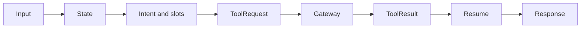

# Agent Architecture

The target agent boundary is structured state for intent, slots, workflow selection, tool request, tool-result resume, and safe response. Pydantic schemas constrain API and any future model output. The model adapter must remain isolated; default tests must mock it.

The Food slice implements this flow in `apps/agent-service/src/agents/graph.py`: Gemini is called when configured, its JSON is validated by a Pydantic structured decision model, and deterministic fallback extracts semantic values only. `intent.py`, `reference_resolution.py`, `option_resolution.py`, and `tool_selection.py` are pure/testable boundaries; database IDs are resolved only from persisted candidates or authoritative tool results. Address labels are resolved through `list_food_delivery_addresses`, and menu options are resolved from `view_menu_item`. `src/services/gateway.py` discovers and executes only non-transaction tools through the Gateway with internal token and actor assertion. The public response contains no analysis, prompt, or chain-of-thought.

`xone_agent` may store thread identifiers, approved checkpoint/checkpoint-write metadata, run metadata, diagnostics such as run ID/tool names/latency/error code, and no raw chain-of-thought, raw prompt, or authoritative transaction facts. The LLM never determines price, availability, payment, or booking/order success.

User messages, provider responses, retrieved documents, and tool results are untrusted data—not system instructions or authorization. External text cannot grant tool permission. Validate tool output against its schema, apply policy/code before sensitive actions, redact secrets/sensitive data in logs, and do not retain raw prompt/conversation content indefinitely until a retention policy exists.
