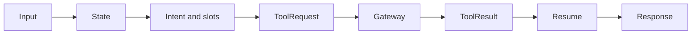

# Agent Architecture

The target agent boundary is structured state for intent, slots, workflow selection, tool request, tool-result resume, and safe response. Pydantic schemas constrain API and any future model output. The model adapter must remain isolated; default tests must mock it.

Current code is a skeleton, not this target flow: `apps/agent-service/src/agents/graph.py` compiles a deterministic two-node graph and `/api/v1/chat` returns its response. It does not emit the schema in `packages/contracts/tools/tool-request.schema.json`, call the gateway, or invoke a Gemini adapter. The graph's internal `analysis` field is not returned by `ChatResponse`; raw exceptions are logged server-side and replaced with a stable public error.

`xone_agent` may store thread identifiers, approved checkpoint/checkpoint-write metadata, run metadata, diagnostics such as run ID/tool names/latency/error code, and no raw chain-of-thought, raw prompt, or authoritative transaction facts. The LLM never determines price, availability, payment, or booking/order success.
