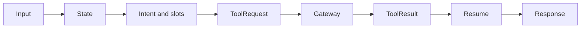

# Agent Architecture

The target agent boundary is structured state for intent, slots, workflow selection, tool request, tool-result resume, and safe response. Pydantic schemas constrain API and any future model output. The model adapter must remain isolated; default tests must mock it.

The Food slice implements this flow in `apps/agent-service/src/agents/graph.py`: configured Gemini uses LangChain's native Pydantic JSON-Schema structured-output path with `include_raw=True`; the graph accepts the validated native object and can recover the provider's raw fenced/plain JSON through a schema-validated decoder. Invalid output safely uses deterministic semantic fallback. `intent.py`, `reference_resolution.py`, `option_resolution.py`, and `tool_selection.py` are pure/testable boundaries; model-supplied resource IDs and model tool calls are discarded, and database IDs are resolved only from persisted candidates or authoritative tool results. Address labels are resolved through `list_food_delivery_addresses`, and menu options are resolved from `view_menu_item`. The graph has bounded step/tool-call limits, including nested calls. `src/services/gateway.py` discovers and executes only non-transaction tools through the Gateway with internal token and actor assertion. The public response contains no analysis, prompt, or chain-of-thought.

## Unified assistant planner

`apps/agent-service/src/agents/assistant_graph.py` is the top-level X-One
planner. It accepts one conversation turn and returns a Pydantic-validated
`AssistantPlan` with at most four tasks for Ride, Food, Restaurant, and
Healthcare. It can express a bounded dependency such as Restaurant selection
before a Ride destination, or Healthcare hold before a Ride destination, while
the Gateway—not the Agent—executes typed service calls and confirmation
actions. A Healthcare-dependent Ride contains only the user-provided pickup;
the facility destination is resolved from the authoritative Healthcare result.
Gemini is the demo primary when
`AGENT_MODEL_MODE=gemini` and a key is configured; quota/rate-limit and
validation failures use the conservative deterministic planner. The internal
Agent status endpoint exposes only model mode/name, fallback name, key
configured boolean, and last-call diagnostics.

The planner sanitizes model slots before returning them. IDs, prices,
availability, status, and other authoritative resource facts are resolved by
the Gateway from domain results. The Gateway sends the top-level planner only a
planner-safe projection of task references, domains, goals, phases, semantic
slots, and bounded pending-choice summaries; confirmation/workflow/tool IDs,
order/appointment/reservation IDs, provider references, raw authoritative
payloads, and resource versions are excluded. A second composition call may
explain sanitized results but cannot change their values.

Slot normalization is domain-specific: Ride accepts only bounded addresses and
`BIKE`/`CAR_4`/`CAR_7`; Restaurant and Healthcare require timezone-aware
`start_at` values and bounded party/symptom fields; Healthcare dayparts are
bounded semantic preferences and explicit clock times remain exact; Food
accepts bounded query, location, and delivery preference fields. The adapter records the configured
primary/fallback, actual last model, fallback usage, call time, and safe status
for `/api/v1/status`; it never reports keys or raw prompts.

`xone_agent` may store thread identifiers, approved checkpoint/checkpoint-write metadata, run metadata, diagnostics such as run ID/tool names/latency/error code, and no raw chain-of-thought, raw prompt, or authoritative transaction facts. The LLM never determines price, availability, payment, or booking/order success.

## Checked-in graphs and boundaries

| File | Role |
| --- | --- |
| `src/agents/assistant_graph.py` | Top-level unified planner returning `AssistantPlan` |
| `src/agents/graph.py` | Food ordering graph |
| `src/agents/ride_graph.py` | Ride quote and booking graph |
| `src/agents/restaurant_graph.py` | Restaurant reservation graph |
| `src/agents/healthcare_graph.py` | Healthcare department/slot/hold graph |
| `src/agents/nodes/restaurant_node.py` | Restaurant node reused by the planner |
| `src/agents/policies/tool_policy.py`, `policies/healthcare_policy.py` | Risk and tool-eligibility policy |
| `src/agents/{intent,reference_resolution,option_resolution,tool_selection,tool_ids,state}.py` | Pure, unit-testable decision boundaries |
| `src/model/adapter.py`, `src/model/gemini_adapter.py`, `src/services/llm.py` | Isolated model adapter layer, mocked by default in tests |
| `src/services/gateway.py` | The only outbound path — `GET /internal/tools`, `POST /internal/tools/execute` |
| `src/api/routes.py`, `src/api/dependencies.py` | Internal `/api/v1` surface and internal-token dependency |

There is one agent process with several graphs, not several agents — see [ADR 0004](../adr/0004-one-agent-tool-gateway.md).

User messages, provider responses, retrieved documents, and tool results are untrusted data—not system instructions or authorization. External text cannot grant tool permission. Validate tool output against its schema, apply policy/code before sensitive actions, redact secrets/sensitive data in logs, and do not retain raw prompt/conversation content indefinitely until a retention policy exists.
