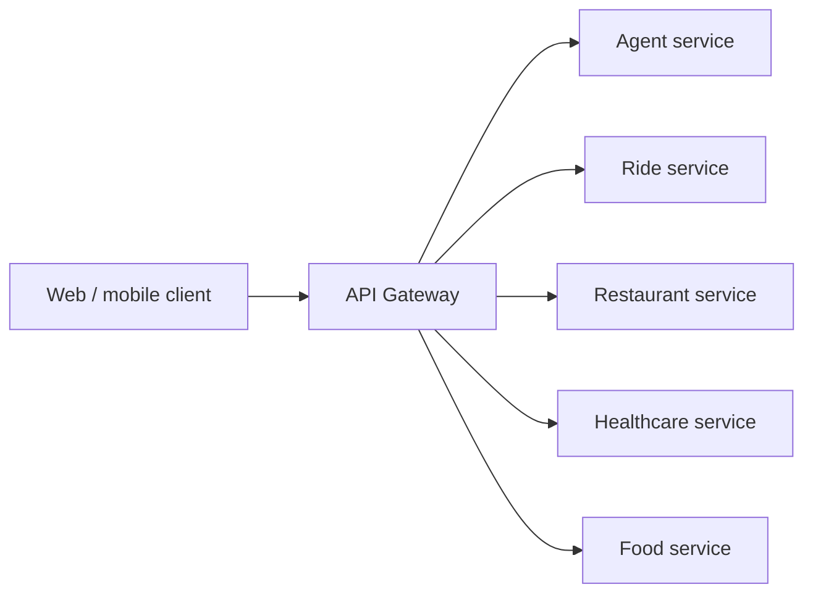

# Current Architecture State

This is the canonical, filesystem-backed source of truth for X-One's implementation status. It describes the repository as inspected on 2026-08-05; roadmap diagrams and legacy course material do not change a status below.

## Status vocabulary

- `implemented`: the repository contains the stated behavior/configuration and this document cites the supporting path and a check.
- `skeleton`: boundary, configuration, or layout exists, but the domain behavior is not wired or implemented.
- `planned`: no runnable or wired implementation exists.
- `in-process`: a module runs within an existing deployable boundary; it is not automatically a separately deployable service.
- `standalone`: a component has its own runtime/deployment boundary. This says nothing about feature completeness, availability, or production readiness.
- `deprecated`: retained but not for new development. `legacy-reference`: retained only for historical or course/reference use and not authoritative for X-One.

Status and deployment mode are independent. A current skeleton may be standalone, and a target box may remain in-process until a measured need supports a separate deployment boundary.

## Runtime shape and ownership



Clients may call only the gateway. The gateway owns public workflow orchestration, confirmation, audit/idempotency, and the payment sandbox boundary. The agent may only return a typed tool request to that gateway; it cannot call a domain service or database, create a booking, or charge payment. Restaurant owns dine-in table reservations; Food owns menus, food orders, and delivery/takeaway ordering.

Canonical product name: **X-One**. Legacy web demo name: **NaviGo**. The existing web demo includes flight, bus, train, and hotel scenarios inherited from the earlier NaviGo prototype. Those scenarios are demo-only and have no approved backend domain owner in the target architecture. The currently declared backend domains are Ride, Restaurant, Healthcare, and Food; travel and lodging ownership remain planned/TBD and must not be inferred from frontend mock data.

Each backend owner has one logical PostgreSQL database: gateway/Core `xone_core`, agent `xone_agent`, Ride `xone_ride`, Restaurant `xone_restaurant`, Healthcare `xone_healthcare`, and Food `xone_food`. The bootstrap script at `infra/postgres/init/01-create-databases.sh` creates the distinct roles/databases. Cross-database queries, foreign keys, and shared ORM models are prohibited; cross-service data travels through REST/JSON/OpenAPI contracts.

Logical ownership is mandatory: each domain owns its schema/tables, migrations, and state, while other domains use contracts rather than SQL or shared ORM entities. The local foundation currently uses one PostgreSQL instance with separate logical databases/roles. Physical instance or cluster separation is deferred until measured scale, reliability, security, compliance, team-ownership, deployment-independence, or operational-isolation needs justify it.

## Observed implementation matrix

| Component | Status | Evidence | Current limitation |
| --- | --- | --- | --- |
| Web | implemented | `apps/web/src/App.tsx`, `apps/web/src/mocks/mockService.ts` | UI is a localStorage/mock demo; it does not implement the gateway workflow. `src/api.ts` only defines a future gateway-facing helper. |
| Mobile | skeleton | `apps/mobile/App.tsx` | Expo shell only; no API integration. |
| API Gateway | skeleton | `apps/api-gateway/src/main.ts`, `src/modules/health/health.module.ts`, `src/clients/service.clients.ts` | Health, config validation, correlation IDs, module shells, and typed URL holders exist. No `/api/v1` workflow/controller, outbound call, confirmation, audit, or payment behavior is wired. |
| Agent service | skeleton | `apps/agent-service/src/agents/graph.py`, `src/api/routes.py`, `src/models/schemas.py` | A deterministic two-node LangGraph demo and chat endpoint exist. It emits no typed tool request, makes no gateway/domain call, and has no Gemini adapter invocation. |
| Ride service | skeleton | `services/ride-service/src/main.py`, `src/api/health.py`, `tests/` | Health/config/layer directories only; no ride API, persistence adapter, Alembic revision, or seed data. |
| Restaurant service | skeleton (partial vertical slice) | `services/restaurant-service/src/main.py`, `src/api/v1/`, `src/infrastructure/`, `migrations/versions/0001_restaurant_booking.py`, `seeds/seed.py`, `tests/test_restaurant_service.py` | PostgreSQL-backed discovery, availability, holds, reservation creation/replay, auth, and structured response envelope are wired and locally tested; update/cancel lifecycle, confirmation evidence contract, PostgreSQL integration/concurrency execution, and generated client remain incomplete. |
| Healthcare service | skeleton | `services/healthcare-service/src/main.py`, `src/api/health.py`, `tests/` | Health/config/layer directories only; no appointment API, persistence adapter, Alembic revision, or seed data. |
| Food service | skeleton | `services/food-service/src/main.py`, `src/api/health.py`, `tests/` | Health/config/layer directories only; no menu/order API, persistence adapter, Alembic revision, or seed data. |
| Tool/OpenAPI contracts and generated TS clients | skeleton | `packages/contracts/tools/tool-request.schema.json`, `packages/contracts/openapi/README.md`, `packages/generated-ts-clients/README.md` | One generic tool-request schema exists but is not wired to the agent/gateway. No versioned business OpenAPI description or generated client exists. |
| Local Compose and database bootstrap | implemented | `docker-compose.yml`, `.env.example`, `infra/postgres/init/01-create-databases.sh`, `scripts/validate-env-config.py` | Static configuration is verifiable; an audit must report separately whether Docker build/up was actually run. Bootstrap runs only for a new `postgres_data` volume. |
| Migrations and seeds | partial | `services/restaurant-service/migrations/versions/0001_restaurant_booking.py`, `services/restaurant-service/seeds/seed.py` | Restaurant has an owned revision and deterministic seed module; root migration/seed orchestration and other domain revisions remain incomplete. |
| Automated tests and CI | skeleton | `.github/workflows/ci.yml`, gateway/domain/agent test directories | Health/config/demo tests and CI definitions exist; no business contract, integration, or end-to-end workflow test is implemented. Remote CI execution is not implied by the workflow file. |
| Deployment | planned | no deployment manifest outside local Compose | No production deployment or cloud pipeline is present. |

## Intended ownership and deployment reading

This table describes intended authority, not a promise that an interface exists. The implementation matrix above remains the status source of truth.

| Component | Current status | Intended authority/data owner | Current deployment mode |
| --- | --- | --- | --- |
| Web | implemented (mock) | No authoritative domain data | standalone web demo |
| Mobile | skeleton | No authoritative domain data | standalone mobile shell |
| Gateway | skeleton | Public workflow/audit/idempotency metadata in Core; never domain state | standalone gateway runtime |
| Agent | skeleton | Approved agent run/checkpoint metadata only | standalone agent runtime |
| Ride, Restaurant, Healthcare, Food | skeleton | Their respective domain data and state transitions; Restaurant = tables, Food = menus/orders | standalone domain-service runtimes |

The checked repository has separate runtime entrypoints for the listed components, but that does not make their planned business interfaces implemented or available.

## Repository roles

- `apps/` contains deployable applications: the gateway and agent today, plus web/mobile shells. Future browser/mobile traffic still terminates at the gateway.
- `services/` contains independently deployable domain owners. Each owns its persistence and API; `api/` is the HTTP edge, `application/` coordinates use cases, `domain/` holds pure rules, and `repositories/` is the persistence boundary. Current `models/` directories contain API/schema placeholders, not database models.
- `packages/contracts/` holds inter-service contracts: `openapi/` for REST descriptions and `tools/` for agent capability schemas. A tool schema is not a REST endpoint.
- `packages/generated-ts-clients/` is generated from OpenAPI only; do not add business logic or hand-edit generated output.
- `packages/shared-config/` is limited to small reference configuration such as currency, timezone, service type, and common error code—never ORM, database access, business logic, or secrets.
- `infra/postgres/init/` is local PostgreSQL bootstrap only. It is not a service migration runner. Service-owned `migrations/` and `seeds/` run migration first, then deterministic seed data when those implementations exist.
- Root `tests/` is reserved for cross-service unit/integration/contract/e2e/evaluation suites; the directories currently contain README placeholders.

## Local development facts

Root `.env.example` is the Compose source of truth. Compose uses explicit mappings, not `env_file`: PostgreSQL receives bootstrap credentials; gateway receives Core DB/internal URLs/token; agent receives its DB, CORS, Gemini configuration, and token; each domain receives only its own database URL, port, and token. Internal URLs use Docker service names (`agent-service`, `ride-service`, `restaurant-service`, `healthcare-service`, `food-service`), not `localhost`.

| Service | Compose name | Host/container port in the checked example | Health endpoints |
| --- | --- | --- | --- |
| Gateway | `api-gateway` | `3000:3000` | `/health/live`, `/health/ready` |
| Agent | `agent-service` | `8001:8001` | `/health/live`, `/health/ready` |
| Ride | `ride-service` | `8101:8101` | `/health/live`, `/health/ready` |
| Restaurant | `restaurant-service` | `8102:8102` | `/health/live`, `/health/ready` |
| Healthcare | `healthcare-service` | `8103:8103` | `/health/live`, `/health/ready` |
| Food | `food-service` | `8104:8104` | `/health/live`, `/health/ready` |
| PostgreSQL | `postgres` | `5432:5432` | container `pg_isready` |

The repository provides these local commands:

```powershell
./scripts/setup-env.ps1
docker compose up --build
python scripts/validate-env-config.py
docker compose --env-file .env.example config --quiet
./scripts/migrate.ps1  # reports that migrations are not implemented
./scripts/seed.ps1     # reports that seeds are not implemented
```

The equivalent shell helpers are `scripts/setup-env.sh`, `scripts/migrate.sh`, and `scripts/seed.sh`. Do not claim database readiness: application `/health/ready` endpoints currently validate startup configuration only and do not query PostgreSQL.

## Verification observed in this audit

The following checks passed on 2026-08-05: `python scripts/validate-env-config.py` (46 root variables and 43 Compose variables), `docker compose --env-file .env.example config --quiet`, gateway lint/test/build (7 tests), each domain-service pytest suite (3 tests each), `apps/web` production build, and `python -m compileall -q apps/agent-service/src services scripts`. `git diff --check` also passed.

Agent pytest could not import `langchain`, and the host Python installation did not include `ruff`; neither result is treated as a passing agent check. Docker image build/up and HTTP smoke tests, remote GitHub Actions execution, and business integration/contract/e2e tests were not run in this documentation audit.

## Change rules derived from the current state

Business API changes must add a versioned OpenAPI contract, any needed generated client, API/contract tests, and matching documentation. A schema change needs an owned migration before an optional deterministic seed, plus data-architecture and test updates. Booking and payment remain separate confirmed actions: users first confirm service/booking details, then explicitly confirm payment. Neither confirmation flow is implemented today.

## Incremental delivery guidance

Implement one walking vertical slice at a time: user request → gateway → agent intent/tool selection → provider lookup → draft/quote → user confirmation → domain booking creation → structured result. This is a target sequence, not a running flow. Add confirmation, idempotency, and audit before its important side effects; a target box does not need to become a separate physical service/database before the first end-to-end slice is complete.
