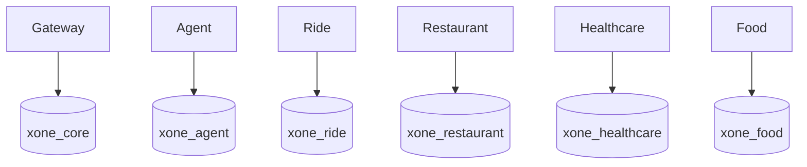

# Data Architecture

Local PostgreSQL has six logical databases and owners: `xone_core`/`core_user`, `xone_agent`/`agent_user`, `xone_ride`/`ride_user`, `xone_restaurant`/`restaurant_user`, `xone_healthcare`/`healthcare_user`, and `xone_food`/`food_user`.

Core conceptually owns users, conversations, workflows, confirmations, payments, idempotency records, tool calls, and audit logs. Food conceptually owns `food_merchants`, `menus`, `menu_items`, `food_order_quotes`, `food_orders`, `food_order_items`, and `food_order_events`; other domain conceptual tables remain owner-local.

There are no cross-database queries/FKs. Share API snapshots/external references, not tables. Each service owns migration, seed, transaction boundary, and domain idempotency. Bootstrap runs only on a new PostgreSQL volume; later deployment may split each logical database into an independent instance.
