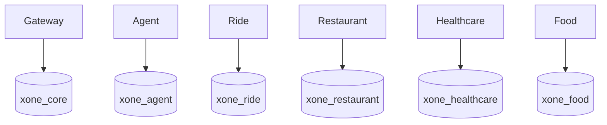

# Data Architecture

Local PostgreSQL uses one physical instance containing six logical databases and owners: `xone_core`/`core_user`, `xone_agent`/`agent_user`, `xone_ride`/`ride_user`, `xone_restaurant`/`restaurant_user`, `xone_healthcare`/`healthcare_user`, and `xone_food`/`food_user`.

Core owns confirmations, confirmation executions, payment records, refunds, receipts, conversation state, profile context, Core saved addresses, multi-service workflow plans, idempotency evidence, audit events, Assistant action execution receipts, and identity/session evidence through additive Gateway migrations `001` through `011`. Migration `010_core_personal_context.sql` owns profile fields, actor-scoped saved addresses, and conversation metadata; migration `011_core_multi_service_workflows.sql` persists the actor-scoped workflow plan, dependency/compensation state, request hash, and workflow idempotency key. It is orchestration state, not a domain booking invariant. Credentials use Argon2id hashes; only SHA-256 hashes of opaque refresh/reset tokens persist. `token_family_id` represents a revocable logical browser session while each `user_sessions` row represents one rotated token generation. The recovery migrations add durable provider transactions, stale-confirmation claims, execution payloads, atomic payment/recovery claims, refund recovery scheduling, canonical refund scope, work-queue claims, and conversation versioning. Food owns catalog/cart/order JSON snapshots, actor-scoped address discovery, immutable status events, timed workflow fields, driver state, voucher redemptions, cart idempotency, voucher eligibility indexes, transition-operation idempotency, and additive catalog provenance/version records through `006_food_catalog_provenance.sql`. Runtime repositories use PostgreSQL; in-memory adapters are explicit unit-test adapters.

Restaurant owns dine-in restaurant, hold, table-availability, reservation state, actor/operation-scoped lifecycle idempotency, and imported restaurant provenance/coordinate quality in its Alembic-managed database (`0001` through additive `0004_restaurant_catalog_provenance.py`). The imported Hanoi source retains raw coordinates and marks the repeated default coordinate as `suspicious_default`; search/ranking does not treat it as a real location. Healthcare owns departments, doctors, patients, time slots, appointments, payment acknowledgement records, audit history, facility identity, and imported catalog provenance/version records. Healthcare migrations `002` through `005` preserve slot reuse, actor-patient links, facility/source metadata, and nullable consultation prices. A missing price is returned as unknown and a slot without an authoritative price cannot be held; no zero price is fabricated. Gateway reaches these domains only through typed REST clients and never writes their tables directly.

Logical ownership is mandatory from the first vertical slice: each domain owns its schema/table/migration boundary, validates its own writes, and shares API snapshots/external references rather than tables. There are no cross-database queries/FKs or shared ORM entities. Each service owns its migration, seed, transaction boundary, and domain idempotency.

Core/Gateway owns X-One user identity, credentials, sessions, reset evidence, audit trail, profile context, and saved addresses. Food and Ride persist immutable transaction address snapshots; when Gateway calls Food preview/order tools it maps an actor-owned Core address to a validated snapshot, and Food revalidates actor ownership. Healthcare owns patient identity, medical history, symptoms, appointments and actor-to-patient links; `003_patient_user_links.sql` is the actor-link boundary and `004_healthcare_catalog_provenance.sql`/`005_healthcare_catalog_nullable_price.sql` extend imported catalog quality. `HEALTHCARE_DEFAULT_PATIENT_ID` remains a development fallback only when no explicit patient link is selected. See ADR-0006 and ADR-0007.

Migration governance is additive and owner-local: applied migrations are immutable, no runtime `create_all()` or destructive startup migration is allowed, and a schema change requires an owned migration plus data-architecture/test updates. The current filesystem baseline and next revision convention are recorded in [Database and Migrations](../development/database-and-migrations.md).

Physical database-instance/cluster separation is a later operational decision, not a claim about the current Compose layout. Defer it until measured scale, reliability, security, compliance, team-ownership, deployment-independence, or isolation needs justify it. Bootstrap runs only on a new PostgreSQL volume.
