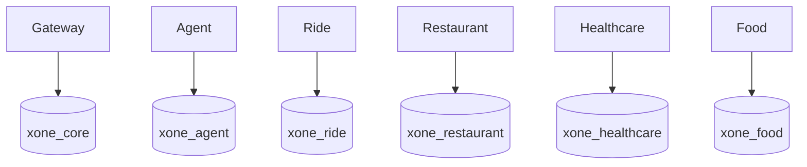

# Data Architecture

Local PostgreSQL uses one physical instance containing six logical databases and owners: `xone_core`/`core_user`, `xone_agent`/`agent_user`, `xone_ride`/`ride_user`, `xone_restaurant`/`restaurant_user`, `xone_healthcare`/`healthcare_user`, and `xone_food`/`food_user`.

Core owns confirmations, confirmation executions, payment records, refunds, receipts, conversation state, idempotency evidence, audit events, and Assistant action execution receipts through `apps/api-gateway/migrations/001_core_vertical_slice.sql` through additive `008_core_assistant_action_recovery.sql`. Migration 007 stores actor, conversation, action, idempotency key, request hash, status, timestamps, and one safe public response for replay; migration 008 adds `FAILED_RETRYABLE`, `updated_at`, and a bounded processing lease/reclaim path without editing 007. The recovery migrations add durable provider transactions, stale-confirmation claims, execution payloads, atomic payment/recovery claims, refund recovery scheduling, canonical refund scope, work-queue claims, and conversation versioning. Food owns catalog/cart/order JSON snapshots, actor-scoped address discovery, immutable status events, timed workflow fields, driver state, voucher redemptions, cart idempotency, voucher eligibility indexes, transition-operation idempotency, and catalog-owned landmark aliases through `services/food-service/migrations/001_food_vertical_slice.sql` through `006_food_location_aliases.sql`. The additive `seeds/import_food_csv.py` importer upserts source restaurant/menu/landmark-alias records without deleting carts or orders; an alias maps public place names to the administrative area present in source catalog records, so location coverage is expanded through owned data rather than application code. Imported source data without coordinates uses an explicitly marked approximate Hanoi-center location for local demo delivery quotes. Runtime repositories use PostgreSQL; in-memory adapters are explicit development/test-only adapters.

Restaurant owns dine-in restaurant, hold, table-availability, reservation state, and actor/operation-scoped lifecycle idempotency records in its Alembic-managed database (`0001_restaurant_booking` followed by additive revisions `0002_restaurant_idempotency` and `0003_restaurant_legacy_idempotency_backfill`). Revision `0003` backfills only reconstructable legacy evidence and runtime promotion preserves a surviving create key before update/cancel overwrites it; historical keys already overwritten before the migration remain unrecoverable. Healthcare owns facilities, departments, doctors, patients, time slots, appointments, payment acknowledgement records, and audit history. Additive Healthcare migration `003_healthcare_provider_catalog.sql` stores the imported facility/department/doctor source identities and metadata without deleting existing booking history; doctors without an authoritative consultation price remain discoverable but cannot be held for booking. Healthcare migration `002_healthcare_slot_reuse.sql` replaces the legacy global slot uniqueness constraint with a partial unique index for active `DRAFT`/`CONFIRMED` appointments; `CANCELLED` and `EXPIRED` history remains queryable and the slot can be reused. Gateway reaches these domains only through typed REST clients and never writes their tables directly.

Logical ownership is mandatory from the first vertical slice: each domain owns its schema/table/migration boundary, validates its own writes, and shares API snapshots/external references rather than tables. There are no cross-database queries/FKs or shared ORM entities. Each service owns its migration, seed, transaction boundary, and domain idempotency.

Physical database-instance/cluster separation is a later operational decision, not a claim about the current Compose layout. Defer it until measured scale, reliability, security, compliance, team-ownership, deployment-independence, or isolation needs justify it. Bootstrap runs only on a new PostgreSQL volume.
