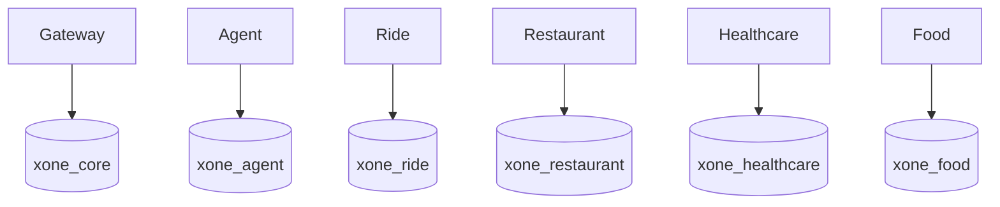

# Data Architecture

Local PostgreSQL uses one physical instance containing six logical databases and owners: `xone_core`/`core_user`, `xone_agent`/`agent_user`, `xone_ride`/`ride_user`, `xone_restaurant`/`restaurant_user`, `xone_healthcare`/`healthcare_user`, and `xone_food`/`food_user`.

Core owns confirmations, confirmation executions, payment records, refunds, receipts, conversation state, idempotency evidence, audit events, Assistant action execution receipts, and Phase 1 identity/session evidence through `apps/api-gateway/migrations/001_core_vertical_slice.sql` through additive `009_core_auth.sql`. Migration 007 stores actor, conversation, action, idempotency key, request hash, status, timestamps, and one safe public response for replay; migration 008 adds `FAILED_RETRYABLE`, `updated_at`, and a bounded processing lease/reclaim path without editing 007. Migration 009 adds Core-owned `users`, `user_credentials`, `user_sessions`, and `password_reset_tokens`. Credentials use Argon2id hashes; only SHA-256 hashes of opaque refresh/reset tokens persist. `token_family_id` represents a revocable logical browser session while each `user_sessions` row represents one rotated token generation. The recovery migrations add durable provider transactions, stale-confirmation claims, execution payloads, atomic payment/recovery claims, refund recovery scheduling, canonical refund scope, work-queue claims, and conversation versioning. Food owns catalog/cart/order JSON snapshots, actor-scoped address discovery, immutable status events, timed workflow fields, driver state, voucher redemptions, cart idempotency, voucher eligibility indexes, and transition-operation idempotency through `services/food-service/migrations/001_food_vertical_slice.sql` through `005_food_idempotency_eligibility.sql`. Runtime repositories use PostgreSQL; in-memory adapters are explicit unit-test adapters.

Restaurant owns dine-in restaurant, hold, table-availability, reservation state, and actor/operation-scoped lifecycle idempotency records in its Alembic-managed database (`0001_restaurant_booking` followed by additive revisions `0002_restaurant_idempotency` and `0003_restaurant_legacy_idempotency_backfill`). Revision `0003` backfills only reconstructable legacy evidence and runtime promotion preserves a surviving create key before update/cancel overwrites it; historical keys already overwritten before the migration remain unrecoverable. Healthcare owns departments, doctors, patients, time slots, appointments, payment acknowledgement records, audit history, and the facility identity returned by its API. Healthcare migration `002_healthcare_slot_reuse.sql` replaces the legacy global slot uniqueness constraint with a partial unique index for active `DRAFT`/`CONFIRMED` appointments; `CANCELLED` and `EXPIRED` history remains queryable and the slot can be reused. Gateway reaches these domains only through typed REST clients and never writes their tables directly.

Logical ownership is mandatory from the first vertical slice: each domain owns its schema/table/migration boundary, validates its own writes, and shares API snapshots/external references rather than tables. There are no cross-database queries/FKs or shared ORM entities. Each service owns its migration, seed, transaction boundary, and domain idempotency.

Core/Gateway owns X-One user identity, credentials, sessions, reset evidence and their audit trail. Saved addresses remain planned: Food and Ride continue to own immutable transaction address snapshots, and Food's current actor-scoped address endpoint remains a legacy compatibility shape. Healthcare owns patient identity, medical history, symptoms, appointments and any future user-to-patient link. `HEALTHCARE_DEFAULT_PATIENT_ID` remains a demo fallback, not an identity mapping. See ADR-0006 and ADR-0007; Phase 1 does not create saved-address or patient-link tables.

Migration governance is additive and owner-local: applied migrations are immutable, no runtime `create_all()` or destructive startup migration is allowed, and a schema change requires an owned migration plus data-architecture/test updates. The current filesystem baseline and next revision convention are recorded in [Database and Migrations](../development/database-and-migrations.md).

Physical database-instance/cluster separation is a later operational decision, not a claim about the current Compose layout. Defer it until measured scale, reliability, security, compliance, team-ownership, deployment-independence, or isolation needs justify it. Bootstrap runs only on a new PostgreSQL volume.
