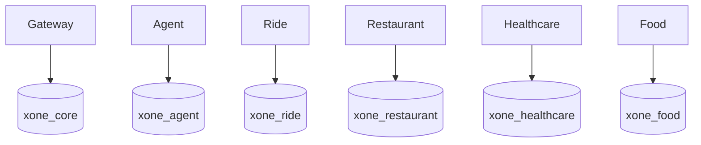

# Data Architecture

Local PostgreSQL uses one physical instance containing six logical databases and owners: `xone_core`/`core_user`, `xone_agent`/`agent_user`, `xone_ride`/`ride_user`, `xone_restaurant`/`restaurant_user`, `xone_healthcare`/`healthcare_user`, and `xone_food`/`food_user`.

Core owns confirmations, confirmation executions, payment records, refunds, receipts, conversation state, idempotency evidence, and audit events through `apps/api-gateway/migrations/001_core_vertical_slice.sql` through additive `006_core_payment_recovery_claims.sql`. The recovery migrations add durable provider transactions, stale-confirmation claims, execution payloads, atomic payment/recovery claims, refund recovery scheduling, canonical refund scope, work-queue claims, and conversation versioning. Food owns catalog/cart/order JSON snapshots, actor-scoped address discovery, immutable status events, timed workflow fields, driver state, voucher redemptions, cart idempotency, voucher eligibility indexes, and transition-operation idempotency through `services/food-service/migrations/001_food_vertical_slice.sql` through `005_food_idempotency_eligibility.sql`. Runtime repositories use PostgreSQL; in-memory adapters are explicit development/test-only adapters.

Logical ownership is mandatory from the first vertical slice: each domain owns its schema/table/migration boundary, validates its own writes, and shares API snapshots/external references rather than tables. There are no cross-database queries/FKs or shared ORM entities. Each service owns its migration, seed, transaction boundary, and domain idempotency.

Physical database-instance/cluster separation is a later operational decision, not a claim about the current Compose layout. Defer it until measured scale, reliability, security, compliance, team-ownership, deployment-independence, or isolation needs justify it. Bootstrap runs only on a new PostgreSQL volume.
