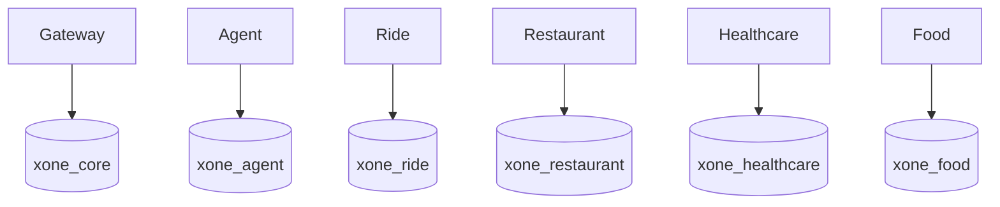

# Data Architecture

Local PostgreSQL provisions six logical databases and owners: `xone_core`/`core_user`, `xone_agent`/`agent_user`, `xone_ride`/`ride_user`, `xone_restaurant`/`restaurant_user`, `xone_healthcare`/`healthcare_user`, and `xone_food`/`food_user`. `xone_agent` stores only allowlisted run/checkpoint metadata owned by Agent; conversation state and domain facts remain Core/domain-owned.

Core owns confirmations, confirmation executions, payment records, refunds, receipts, conversation state, profile context, Core saved addresses, multi-service workflow plans, idempotency evidence, audit events, Assistant action execution receipts, and identity/session evidence through additive Gateway migrations `001` through `011`. Migration `010_core_personal_context.sql` owns profile fields, actor-scoped saved addresses, and conversation metadata; migration `011_core_multi_service_workflows.sql` persists the actor-scoped workflow plan, dependency/compensation state, request hash, and workflow idempotency key. It is orchestration state, not a domain booking invariant. Credentials use Argon2id hashes; only SHA-256 hashes of opaque refresh/reset tokens persist. `token_family_id` represents a revocable logical browser session while each `user_sessions` row represents one rotated token generation. The recovery migrations add durable provider transactions, stale-confirmation claims, execution payloads, atomic payment/recovery claims, refund recovery scheduling, canonical refund scope, work-queue claims, and conversation versioning. Agent migration `002_agent_run_metadata.sql` stores only actor/workflow/run identifiers, phase, schema version, bounded capability names, latency/retry/error codes, and an idempotency hash; it explicitly excludes raw prompts, messages, conversation state, and domain payloads. The earlier `001_agent_workflow_states.sql` remains immutable migration history after the develop integration, but its broad JSON table has no runtime writer. Food owns catalog/cart/order JSON snapshots, actor-scoped address discovery, immutable status events, timed workflow fields, driver state, voucher redemptions, voucher eligibility indexes, transition-operation idempotency, and additive catalog provenance/version records through `007_food_cart_write_idempotency.sql`. Migration `007` atomically records actor/operation/key/payload-hash evidence with the resulting cart so exact retries return one logical mutation and changed payloads conflict. Runtime repositories use PostgreSQL; in-memory adapters are explicit unit-test adapters.

Ride owns quotes, tariffs, bookings, driver availability/assignment, tracking snapshots and append-only tracking events in `xone_ride`. Its owner-local Alembic revision `20260812_0003_ride_lifecycle` adds the explicit quote/booking lifecycle, `resource_version`, and persisted tracking-event state; revision `20260816_0006` additively binds `passenger_count` and a capacity-policy version snapshot to quotes and bookings while backfilling existing rows as one-passenger transactions. Tariff and driver rows remain authoritative for quote and assignment decisions. Ride writes enforce capacity, actor/operation idempotency and confirmation evidence, while Gateway only orchestrates and shapes the public response.

Restaurant owns dine-in restaurant, hold, table-availability, reservation state, actor/operation-scoped lifecycle idempotency, and imported restaurant provenance/coordinate quality in its Alembic-managed database (`0001` through additive catalog revisions). The imported Hanoi source retains raw coordinates and marks the repeated default coordinate as `suspicious_default`; search/ranking does not treat it as a real location. Healthcare owns departments, doctors, patients, time slots, appointments, payment acknowledgement records, audit history, facility identity, and imported catalog provenance/version records. Healthcare migrations `002` through `005` preserve slot reuse, actor-patient links, facility/source metadata, and nullable consultation prices; compatibility migration `003a_healthcare_legacy_catalog_bridge.sql` upgrades old-develop catalog tables before `004` without dropping legacy IDs or rows. A missing price is returned as unknown and a slot without an authoritative price cannot be held; no zero price is fabricated. Gateway reaches these domains only through typed REST clients and never writes their tables directly.

Logical ownership is mandatory from the first vertical slice: each domain owns its schema/table/migration boundary, validates its own writes, and shares API snapshots/external references rather than tables. There are no cross-database queries/FKs or shared ORM entities. Each service owns its migration, seed, transaction boundary, and domain idempotency. Restaurant catalog provenance uses owner-local Alembic revisions `0004_restaurant_catalog` and `0005_restaurant_versions`; the latter owns the `catalog_dataset_versions` registry used by repeatable importer apply/audit.

Core/Gateway owns X-One user identity, credentials, sessions, reset evidence, audit trail, profile context, and saved addresses. Food and Ride persist immutable transaction address snapshots; when Gateway calls Food preview/order tools it maps an actor-owned Core address to a validated snapshot, and Food revalidates actor ownership. Healthcare owns patient identity, medical history, symptoms, appointments and actor-to-patient links; `003_patient_user_links.sql` is the actor-link boundary and `004_healthcare_catalog_provenance.sql`/`005_healthcare_catalog_nullable_price.sql` extend imported catalog quality. `HEALTHCARE_DEFAULT_PATIENT_ID` remains a development fallback only when no explicit patient link is selected. See ADR-0006 and ADR-0007.

Migration governance is additive and owner-local: applied migrations are immutable, no runtime `create_all()` or destructive startup migration is allowed, and a schema change requires an owned migration plus data-architecture/test updates. The current filesystem baseline and next revision convention are recorded in [Database and Migrations](../development/database-and-migrations.md).

Physical database-instance/cluster separation is a later operational decision, not a claim about the current Compose layout. Defer it until measured scale, reliability, security, compliance, team-ownership, deployment-independence, or isolation needs justify it. Bootstrap runs only on a new PostgreSQL volume.

Restaurant catalog provenance is extended by the owner-local Alembic revisions
`0004_restaurant_catalog` and `0005_restaurant_versions`. The latter creates
the Restaurant-owned `catalog_dataset_versions` table used by the importer to
record the active dataset version and repeatable apply/audit evidence; it does
not create a cross-domain catalog or shared database authority.

Food and Restaurant discovery catalogs are imported PostgreSQL data at runtime.
Operational seed commands do not create fixed restaurant or menu-item examples:
Food runs its catalog importer, while Restaurant seed only adds owned booking
resources (tables and opening hours) to already-imported restaurant rows. The
in-memory Food repository remains an explicit unit-test adapter and is never
selected by the Compose runtime configuration.

## Product/Ops and local demo persistence

Core migration `012_core_product_ops.sql` adds actor-scoped durable
`notifications`, `user_favorites`, `service_feedback`, `support_tickets` and
`support_ticket_events`. These tables store references such as
`domain/resource_id`; they do not copy or become authoritative for Food, Ride,
Restaurant or Healthcare transactions. Migration
`013_core_admin_support_idempotency.sql` adds request-hash/idempotency evidence
for Admin support updates so a replay returns the same ticket without a second
audit side effect.

The additive local seed adds only recognizable demo records: Healthcare
department/doctor/slot rows and 36 synthetic Ride drivers with complete
vehicle/license fields. `scripts/demo-reset.ps1` deletes mutable records only
for explicitly matched actors and preserves catalogs and dataset versions by
default. Local geocode fallback coordinates and accelerated Ride tracking are
configuration flags, not production data or domain authority.
