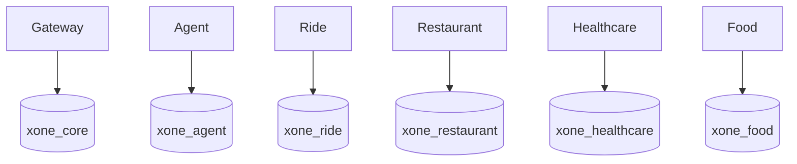

# Data Architecture

Local PostgreSQL uses one physical instance containing six logical databases and owners: `xone_core`/`core_user`, `xone_agent`/`agent_user`, `xone_ride`/`ride_user`, `xone_restaurant`/`restaurant_user`, `xone_healthcare`/`healthcare_user`, and `xone_food`/`food_user`.

Core conceptually owns users, conversations, workflows, confirmations, payments, idempotency records, tool calls, and audit logs. Food conceptually owns `food_merchants`, `menus`, `menu_items`, `food_order_quotes`, `food_orders`, `food_order_items`, and `food_order_events`; other domain conceptual tables remain owner-local.

Logical ownership is mandatory from the first vertical slice: each domain owns its schema/table/migration boundary, validates its own writes, and shares API snapshots/external references rather than tables. There are no cross-database queries/FKs or shared ORM entities. Each service owns its migration, seed, transaction boundary, and domain idempotency.

Physical database-instance/cluster separation is a later operational decision, not a claim about the current Compose layout. Defer it until measured scale, reliability, security, compliance, team-ownership, deployment-independence, or isolation needs justify it. Bootstrap runs only on a new PostgreSQL volume.
