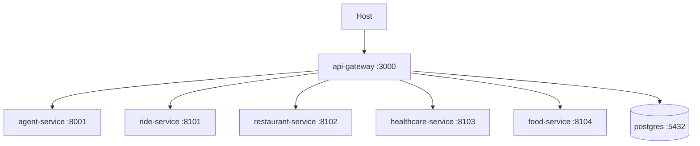

# Runtime Architecture

Each backend component has its own Docker image. Local Compose starts PostgreSQL, API gateway, agent, Ride, Restaurant, Healthcare, and Food over internal DNS: `agent-service`, `ride-service`, `restaurant-service`, `healthcare-service`, and `food-service`. The default Compose publishes only the Gateway; Agent/Food use `expose` for container-network access.

Root `.env` interpolates Compose only; containers receive explicit least-privilege variables, never a shared `env_file`. `/health/live` reports process availability. Food `/health/ready` reports its connected repository and workflow worker state; Gateway `/health/ready` reports reconciliation worker state. Domain/agent partial failure is handled by gateway client timeout/error mapping; gateway does not block Compose startup on every domain service. PostgreSQL bootstrap runs only for a new volume. Future deployments split services and databases independently.
