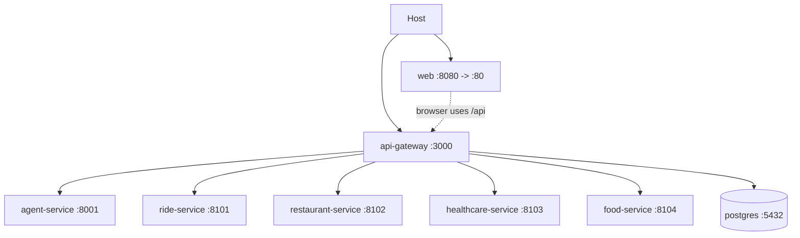

# Runtime Architecture

Each backend component has its own Docker image. Local Compose starts PostgreSQL, API gateway, Web, agent, Ride, Restaurant, Healthcare, and Food over the internal Compose network. The Web image builds the Vite bundle with the relative `/api` Gateway base URL and serves it from Nginx on container port 80; Compose publishes it only on the host loopback at port 8080. The default Compose publishes the Gateway on port 3000 for local API access; Agent/Food use `expose` for container-network access.

Root `.env` interpolates Compose only; containers receive explicit least-privilege variables, never a shared `env_file`. `/health/live` reports process availability. Food `/health/ready` reports its connected repository and workflow worker state; Gateway `/health/ready` reports reconciliation worker state. The `start-all` launcher waits for PostgreSQL and every required application health check before migrations and Web startup; individual Compose commands still remain available for service-level development. Domain/agent runtime errors are handled by gateway client timeout/error mapping after startup. PostgreSQL bootstrap runs only for a new volume. Future deployments split services and databases independently.

The Agent's optional Gemini adapter tries the configured model first. A confirmed native structured-schema/capability failure retries raw output on that same model and sends it through the existing validated parser. A configured `GEMINI_FALLBACK_MODEL` is eligible only for confirmed quota/rate-limit, temporary 5xx, timeout/network, or model-unavailable failures; authentication, permission, billing, and malformed-request failures remain visible and do not silently fall back. The checked-in `.env.example` defaults `AGENT_MODEL_MODE=gemini`; offline acceptance runs explicitly set `AGENT_MODEL_MODE=deterministic` so provider credentials are not required. The internal status response reports configured primary/fallback, actual last model, invocation mode, fallback usage, call time, safe exception type, HTTP status/category, and safe status. All public Restaurant and Healthcare turns still pass through Gateway confirmation/payment gates; the Agent only emits typed requests.

## CI/CD and staging deployment

`.github/workflows/ci-cd.yml` is the single CI/CD workflow. Pushes and pull requests for `main`, `develop`, and `staging` trigger checks on self-hosted Linux runners; path filtering reduces branch/PR work, while `main` pushes and scheduled or manually dispatched runs execute the full scope. A push to `staging` deploys only after change detection succeeds, with every applicable CI job successful and no dependency failed or cancelled. The deploy job runs on an organization self-hosted Linux x64 runner carrying the `cohort3` label and connects to the VPS over SSH. It passes the job-scoped, read-only `GITHUB_TOKEN` only for that session so `/opt/xone` can initialize/fetch and reset to the exact checked commit over HTTPS; the token is not stored on the VPS and no GitHub Deploy key is required. Docker Compose then validates and starts the stack with the VPS-owned `.env`, which remains untracked and is preserved. Staging runs are not cancelled mid-deployment by a newer push.
