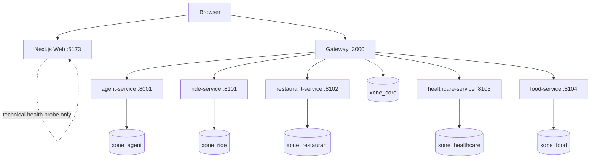

# Runtime Architecture

The local stack contains a Next.js Web application, the NestJS Gateway, an
Agent, four domain services, and one PostgreSQL instance with logically
separate databases. Compose publishes the Web at `${WEB_PORT}` (5173 in the
example) and the Gateway at `${API_GATEWAY_PORT}` (3000 in the example).
Domain and Agent ports are container-network-only.

The browser calls the public Gateway directly through `NEXT_PUBLIC_API_URL`.
The Web's `/api/health` route is an intentionally technical Next.js/Docker
probe, not a BFF and not a proxy for domain data. The browser never calls a
domain database or internal service. The Gateway is the public validation,
routing, response-shaping, correlation/audit and typed-client boundary; it
does not own a domain state transition by cross-domain SQL.

Root `.env` interpolates Compose only; every container receives explicit
least-privilege variables and no service uses a shared `env_file`. Internal
URLs use Compose DNS names (`agent-service`, `ride-service`,
`restaurant-service`, `healthcare-service`, and `food-service`), never
`localhost`. The Web image is a standalone Next output and accepts only its
build-time `NEXT_PUBLIC_*` configuration; it does not receive credentials.

`/health/live` reports process availability. Gateway `/health/ready` reports
the Gateway-owned dependencies it checks. The Web health endpoint confirms
that the rendered Next server is available; it does not claim Gateway or
domain readiness. `start-all.{ps1,sh}` waits for container health, runs the
owned migrations, then verifies Gateway and Web endpoints. Migrations remain
explicit and idempotent; starting a container never performs destructive
schema repair.

The Agent's optional Gemini adapter tries the configured model first. A
confirmed native structured-schema/capability failure retries raw output on
that model and sends it through the existing validated parser. A configured
fallback is eligible only for confirmed quota/rate-limit, temporary 5xx,
timeout/network, or model-unavailable failures; authentication, permission,
billing and malformed-request failures remain visible. All public Restaurant
and Healthcare turns still pass through Gateway confirmation/payment gates;
the Agent only emits typed requests.
