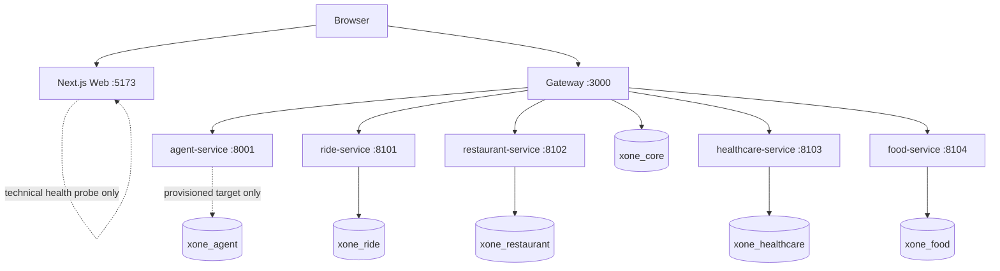

# Runtime Architecture

The local stack contains a Next.js Web application, the NestJS Gateway, an Agent, four domain services, and one PostgreSQL instance with logically separate databases. Compose publishes the Web at `${WEB_PORT}` (5173 in the example) and the Gateway at `${API_GATEWAY_PORT}` (3000 in the example). Domain and Agent ports are container-network-only. PostgreSQL is the one backing service published broadly (`5432:5432`), for local psql and migration runs.

The browser calls the public Gateway directly through `NEXT_PUBLIC_API_URL`.
The Web's `/api/health` route is an intentionally technical Next.js/Docker
probe, not a BFF and not a proxy for domain data. The browser never calls a
domain database or internal service. The Gateway is the public validation,
routing, response-shaping, correlation/audit and typed-client boundary; it
does not own a domain state transition by cross-domain SQL.

Root `.env` interpolates Compose only; every container receives explicit least-privilege variables and no service uses a shared `env_file`. Internal URLs use Compose DNS names (`agent-service`, `ride-service`, `restaurant-service`, `healthcare-service`, and `food-service`), never `localhost`. The Web image is a standalone Next output and accepts only its build-time `NEXT_PUBLIC_*` configuration; it does not receive credentials.

`/health/live` reports process availability. Gateway `/health/ready` reports the Gateway-owned dependencies it checks. The Web health endpoint confirms that the rendered Next server is available; it does not claim Gateway or domain readiness. `start-all.{ps1,sh}` waits for container health, runs the owned migrations, then verifies Gateway and Web endpoints. Migrations remain explicit and idempotent; starting a container never performs destructive schema repair.

The Agent's optional Gemini adapter tries the configured model first. A confirmed native structured-schema/capability failure retries raw output on that same model and sends it through the existing validated parser. A configured `GEMINI_FALLBACK_MODEL` is eligible only for confirmed quota/rate-limit, temporary 5xx, timeout/network, or model-unavailable failures; authentication, permission, billing, and malformed-request failures remain visible and do not silently fall back. The checked-in `.env.example` defaults `AGENT_MODEL_MODE=gemini`; offline acceptance runs explicitly set `AGENT_MODEL_MODE=deterministic` so provider credentials are not required. The internal status response reports configured primary/fallback, actual last model, invocation mode, fallback usage, call time, safe exception type, HTTP status/category, and safe status. All public Restaurant and Healthcare turns still pass through Gateway confirmation/payment gates; the Agent only emits typed requests.

## CI/CD and staging deployment

`.github/workflows/ci-cd.yml` is the single CI/CD workflow. Pushes and pull requests for `main`, `develop`, and `staging` trigger checks on self-hosted Linux runners; path filtering reduces branch/PR work, while `main` pushes and scheduled or manually dispatched runs execute the full scope. A push to `staging` deploys only after change detection succeeds, with every applicable CI job successful and no dependency failed or cancelled. The deploy job runs on an organization self-hosted Linux x64 runner carrying the `cohort3` label and connects to the VPS over SSH. It passes the job-scoped, read-only `GITHUB_TOKEN` only for that session so `/opt/xone` can initialize/fetch and reset to the exact checked commit over HTTPS; the token is not stored on the VPS and no GitHub Deploy key is required. Docker Compose then validates and starts the stack with the VPS-owned `.env`, which remains untracked and is preserved. Staging runs are not cancelled mid-deployment by a newer push.
