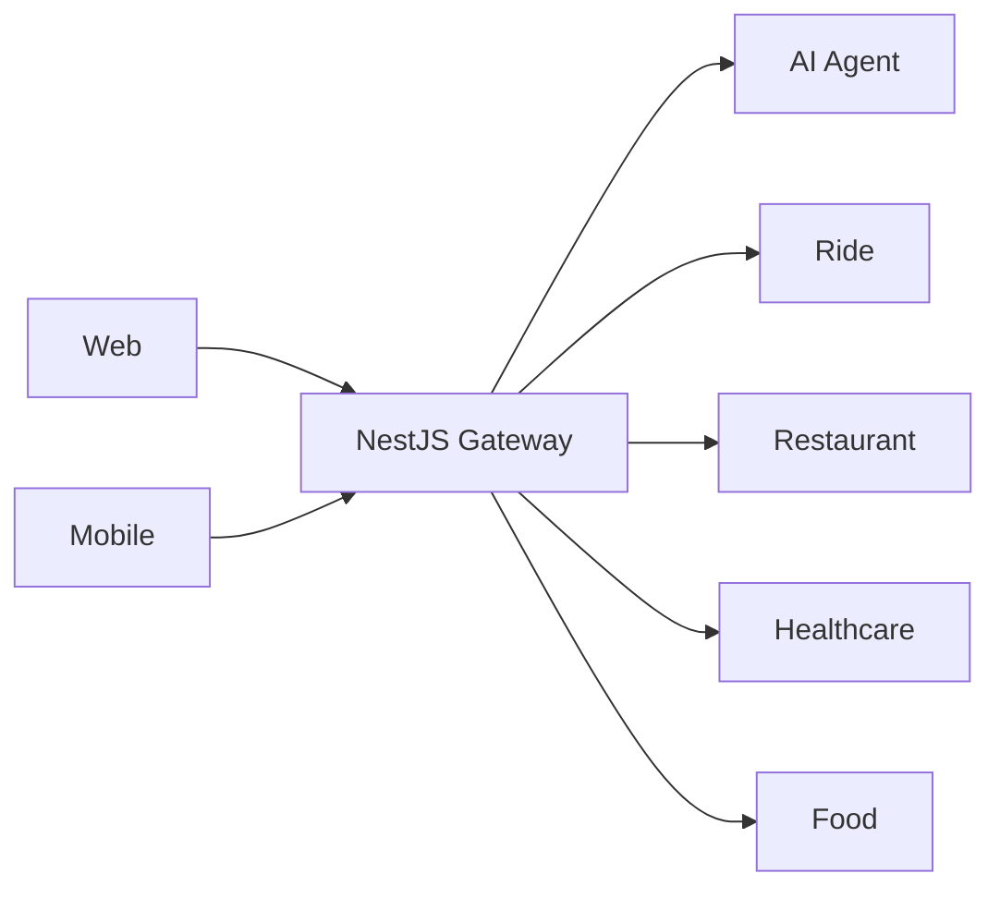
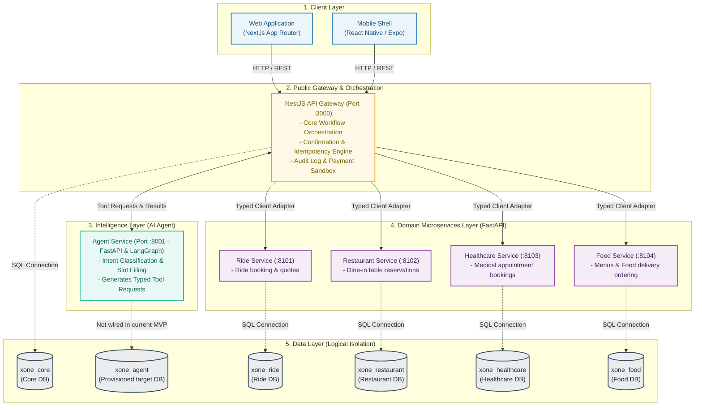

# System Overview

X-One is a conversational platform for multi-domain booking and ordering. It is backend-first: web and mobile have one public backend, while a NestJS gateway centrally orchestrates agent and domain capabilities.

Principles: domain ownership, REST/JSON/OpenAPI contracts, explicit confirmation for important side effects, idempotent writes, and least-privilege data/environment access. Public traffic ends at the gateway; all remaining links are private service links.

The current integrated local scope covers Food ordering, Ride booking/tracking simulation, Restaurant dine-in discovery/availability/holds/final confirmation, Healthcare doctor/department/patient/slot/hold/payment acknowledgement/final confirmation/cancellation, Core profile/saved addresses/conversations/history, service browsing, real-catalog provenance, deterministic ranking, and durable multi-service workflow planning through Gateway orchestration and typed Agent requests. The Agent workflow store is currently process-local; the provisioned `xone_agent` database is a target persistence seam, not a wired dependency. Final Restaurant and Healthcare actions still require explicit confirmation; Ride and Healthcare payment are local simulations/adapters. Production payment providers, queues, service mesh, Kubernetes and Redis remain outside this scope. Gate G2 manual evaluation evidence is maintained under [root eval](../../eval/README.md). The evidence-backed component matrix, ports, local commands, and environment-dependent limits live in the canonical [current architecture state](current-state.md).
