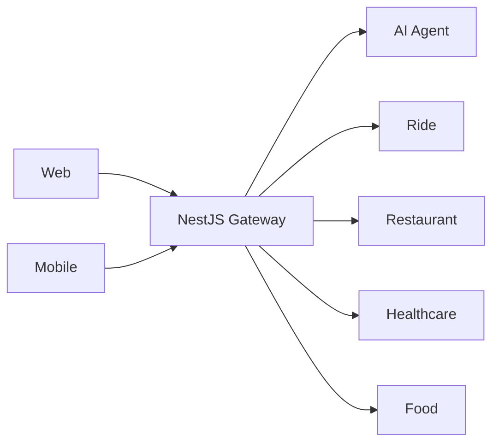
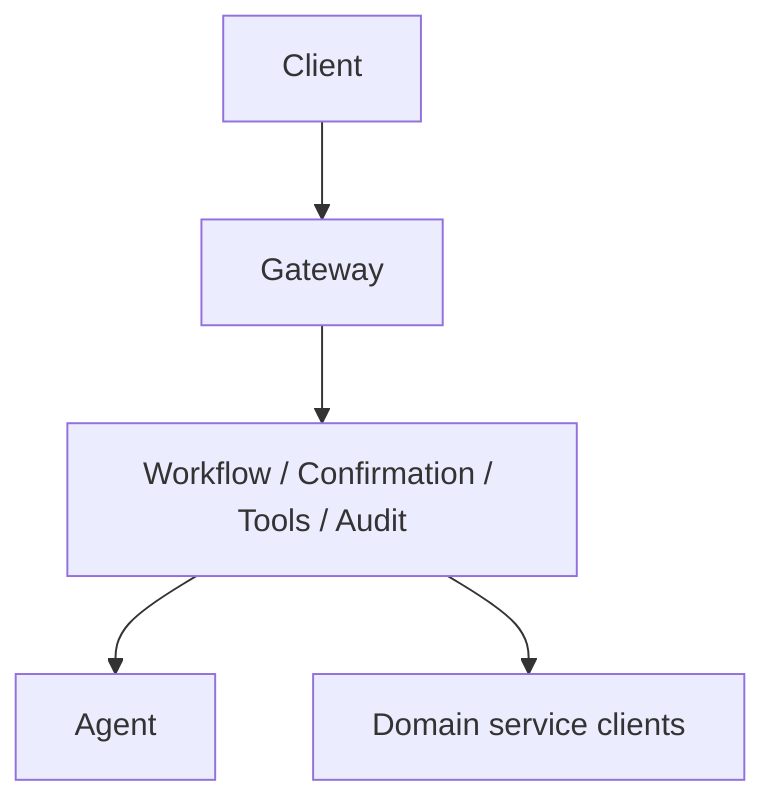

# System Overview

X-One is a conversational platform for multi-domain booking and ordering. It is backend-first: web and mobile have one public backend, while a NestJS gateway centrally orchestrates agent and domain capabilities.

Principles: domain ownership, REST/JSON/OpenAPI contracts, explicit confirmation for important side effects, idempotent writes, and least-privilege data/environment access. Public traffic ends at the gateway; all remaining links are private service links.

The current implemented business slice is Food ordering: Gateway auth/tools/confirmation/payment sandbox and reconciliation, Agent structured tool requests, and Food PostgreSQL-backed carts/orders/workflow. Ride, Restaurant, and Healthcare remain health/config skeletons. The evidence-backed component matrix, ports, local commands, and environment-dependent limits live in the canonical [current architecture state](current-state.md). Non-goals are queues, service mesh, Kubernetes, Redis, multi-agent orchestration, and production payment/authentication.
