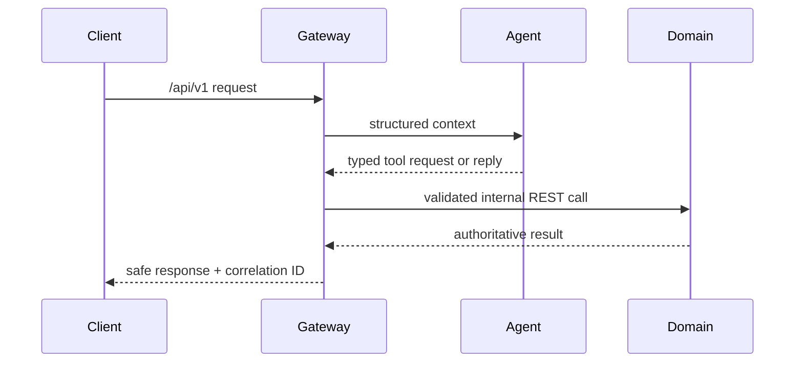
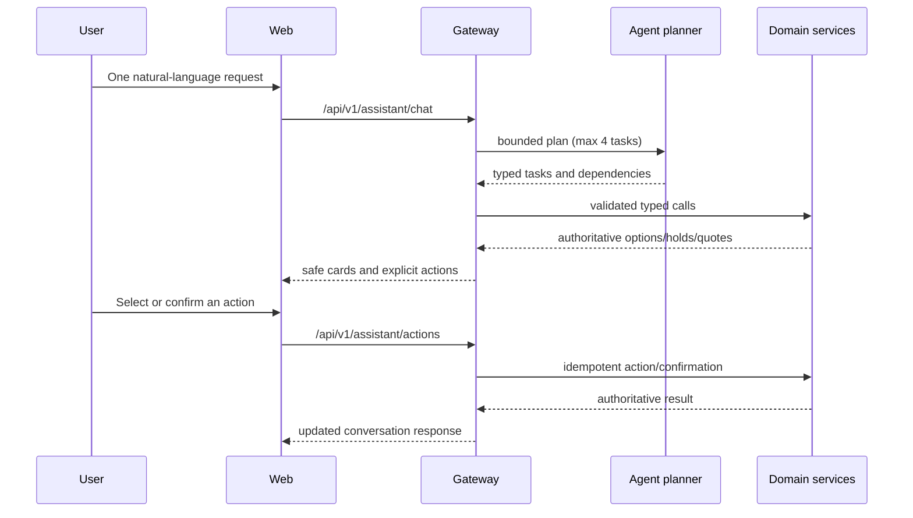
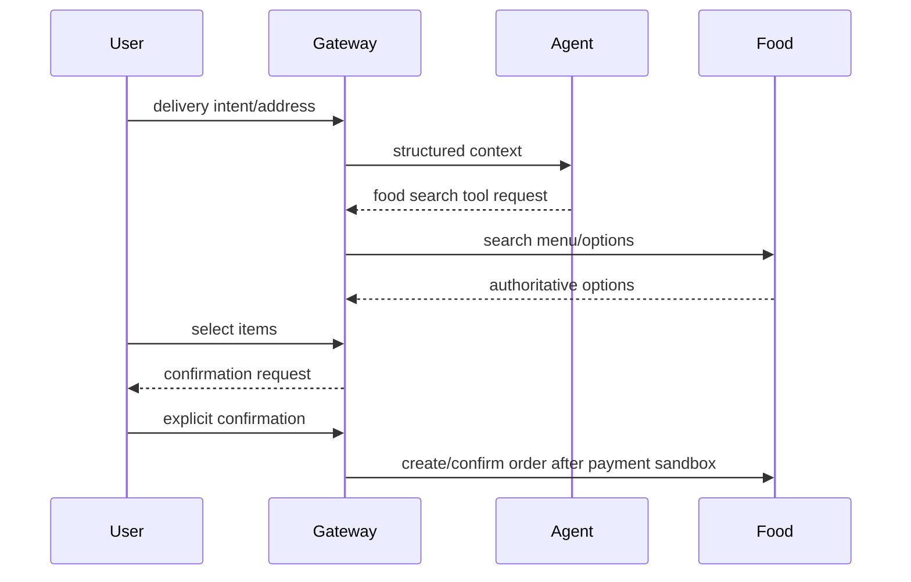
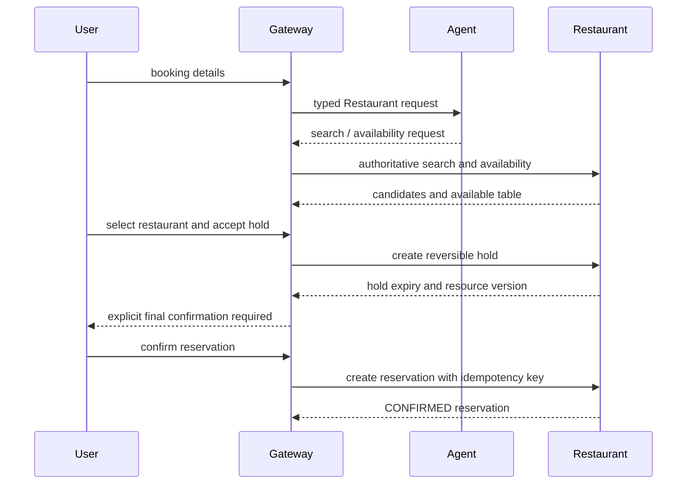

# Workflows

## General chat and tools



## Unified Web assistant routing

The Web application is a thin Gateway client with one X-One conversation. It
calls only `POST /api/v1/assistant/chat` and `POST /api/v1/assistant/actions`,
renders consumer-facing cards/actions, and records activity only after a
backend-confirmed result. Authentication uses `POST /api/v1/auth/login`
followed by `GET /api/v1/auth/me`; the access token is held in the current
browser session and is cleared on `401`. The Web does not call Agent or any
domain service directly.



Restaurant-to-Ride composition keeps Ride blocked until the selected
restaurant's authoritative location is available. No model-produced resource
ID, price, availability, status, or final-success claim is trusted.

Healthcare-to-Ride composition keeps an early Ride quote available after
Healthcare has held an appointment and returned its authoritative facility
address and start time, but exposes no executable `ride_service` action until
Healthcare is `COMPLETED`. Restaurant-to-Ride follows the same rule: selection
may produce a quote, while the executable Ride action is withheld until the
reservation is completed. The server rejects stale/manual dependent Ride
actions when the prerequisite is not complete. The Gateway then requests a Ride
quote using that address and uses the quote's authoritative duration to
calculate `recommended_departure = appointment_start
- duration - 20 minutes`. The 20-minute value is the named Gateway constant
`HEALTHCARE_RIDE_DEPARTURE_BUFFER_MINUTES`. The card explicitly says that this
is a recommendation: the local Ride contract does not schedule a future pickup,
so X-One does not claim that dispatch was scheduled. If the recommended
departure is already past or cannot be calculated, the Gateway persists a
`ride_timing_conflict` card and does not book or cancel a Ride; completed
Healthcare work remains in the conversation.

Each unified task carries a revision. A turn processes only new or semantically
changed tasks; a planner-targeted Food continuation also forwards the current
message to the Food graph while preserving its cumulative Food context.
Untouched pending/completed tasks keep their authoritative card and actions.
Ambiguous short selections are clarified instead of mutating multiple tasks.
Selection actions share a task revision/cohort, so choosing one alternative
invalidates its siblings and stale actions return `ACTION_NOT_AVAILABLE` without
a domain call. An unrelated Food or Healthcare follow-up therefore does not
re-quote an awaiting Restaurant or Ride task.

## Ride lifecycle (current runtime)

Ride is the authority for quote and booking state. A quote moves through
`QUOTE_CREATED -> AWAITING_CONFIRMATION -> CONSUMED` or `EXPIRED`; a booking
starts at `AWAITING_CONFIRMATION` and requires two explicit user confirmations:
service details first, then payment/final confirmation. The normal dispatch
path is:

```text
AWAITING_CONFIRMATION
  -> SEARCHING_DRIVER
  -> DRIVER_ASSIGNED
  -> DRIVER_TO_PICKUP
  -> DRIVER_ARRIVED
  -> IN_PROGRESS
  -> COMPLETED
```

`NO_DRIVER`, `PAYMENT_FAILED`, `FAILED`, and `CANCELLED` are terminal outcomes
where applicable. The Ride domain validates every transition, persists a
monotonic `resource_version`, records tracking events, resolves tariffs and
drivers from its own database, and enforces actor/operation idempotency. The
Gateway may retry or reconcile a result, but it never infers driver, price,
availability, or final success from model output.

## Food ordering (target flow)



The Food flow is implemented for the backend slice. Final writes require an idempotency key from the first request, confirmation bound to action/payload/version/price/expiry, audit metadata, and an authoritative Food result. Payment success ends the request at `PAID -> RESTAURANT_CONFIRMING`; Food's due-workflow worker/lazy reconciliation advances later states. Restaurant rejection and cancellation are reconciled to one idempotent refund. Stale `PROCESSING` confirmations and `PENDING` payments are claimed/recovered by the Gateway worker using the same execution/payment keys.

The unified Food task passes its task-scoped cumulative workflow context back to
the Food Agent (`previous_context` merged with each `state_updates` delta). If
Food returns no authoritative options, the Gateway emits an empty/clarifying
card instead of manufacturing catalog items or prices.

## Restaurant reservation



## Healthcare appointment

```mermaid
sequenceDiagram
  participant U as User
  participant G as Gateway
  participant A as Agent
  participant H as Healthcare
  U->>G: symptom or department request
  G->>A: authoritative department/slot context
  A-->>G: typed list/hold request
  G->>H: list slots, then hold selected slot
  H-->>G: DRAFT appointment and price
  G-->>U: payment acknowledgement required
  U->>G: local payment acknowledgement
  G->>H: actor-scoped payment webhook
  U->>G: explicit final confirmation
  G->>H: confirm appointment
  H-->>G: CONFIRMED appointment
  U->>G: cancel appointment
  G->>H: release slot; retain appointment history
```

Healthcare reconciles an expired hold before payment, confirmation, cancellation, and relevant reads. An expired hold becomes `EXPIRED`, releases the slot, clears its expiry, and remains unpaid; payment acknowledgement is only a local state acknowledgement and is not a provider refund. Healthcare write operations require actor-scoped idempotency keys. Restaurant and Healthcare final actions are never inferred from the first model turn. Gateway confirmation records bind actor, workflow, action, normalized payload, resource/quote version, expiry, and idempotency evidence before the domain write.

An explicit Healthcare clock is matched exactly when available. If no exact slot
exists, the response labels nearby or other real alternatives as unavailable at
the requested time; it never silently changes a request such as 10:00 to 14:00.
Daypart requests such as “sáng mai” remain a morning range preference rather
than an invented exact 08:00 slot.

Assistant action execution receipts are Core-owned. The first successful
`/api/v1/assistant/actions` request stores the actor, conversation, action,
idempotency key, request hash, status, and sanitized response. Replaying the
same action with the same key returns the exact stored response, while a
different key receives `ACTION_NOT_AVAILABLE` and cannot re-run the domain
side effect. This applies uniformly to Restaurant, Ride, Healthcare, and Food
actions.

## Multi-service reliability (Phase 9)

The Gateway persists a Core-owned plan before a multi-service caller records
domain results. `restaurant_ride` and `healthcare_ride` use
`STOP_DEPENDENTS`: the selected authoritative resource must succeed before a
Ride step can run. `food_healthcare` uses independent steps so a failure in one
does not block the other. The state machine exposes `PENDING`, `RUNNING`,
`COMPLETED`, `PARTIAL_SUCCESS`, `FAILED`, `COMPENSATING`, and
`RECOVERY_REQUIRED`.

The public plan request carries only the selected resource ID and owning
authority. The Gateway re-reads the active resource through the typed
Restaurant or Healthcare client before creating the snapshot; caller-supplied
address and coordinates are not authoritative. Restaurant/Healthcare
coordinates enter Ride only through that domain-owned `AuthoritativeResource`
snapshot. Suspicious default coordinates are retained as provenance but are not
used as real distance inputs. A Healthcare success followed by `NO_DRIVER` is
`PARTIAL_SUCCESS`; the appointment remains authoritative and is not
auto-cancelled. Compensation is declared per step: Healthcare is `NONE`, Food
may require a new user confirmation, and automatic compensation is permitted
only for an explicitly safe domain policy.

Workflow plans and step idempotency evidence are persisted in Core migration
`011_core_multi_service_workflows.sql`. Re-reading the plan after Gateway
process recreation returns the same state; domain writes still use their own
typed clients, confirmation evidence, and domain idempotency keys.

## Product/Ops workflow

Completed domain events are projected by the Gateway into Core-owned,
actor-scoped notifications using deterministic `event_key` values. Opening the
notification center also creates missing Healthcare reminder records inside
the local reminder window; polling and retries are idempotent. Favorites and
feedback first validate the authoritative resource through its owning service.
Feedback is accepted only for an actor-owned completed transaction.

History actions create a fresh reorder/rebook preparation: current menu,
tariff, availability or Healthcare slots are re-read and no old final price,
hold or confirmation is replayed. Support tickets store a Core timeline and
are linked to a transaction only after Gateway ownership validation. Admin
support changes require the server-side Admin guard and a durable idempotency
key; a same-payload replay returns the existing ticket without repeating the
audit side effect.
