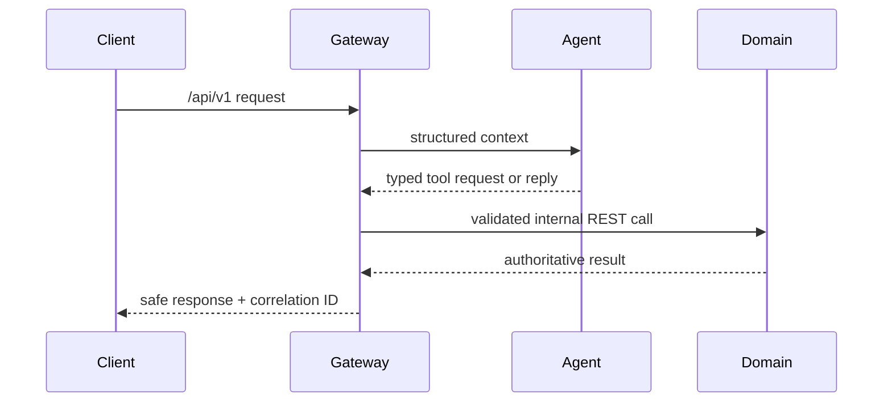
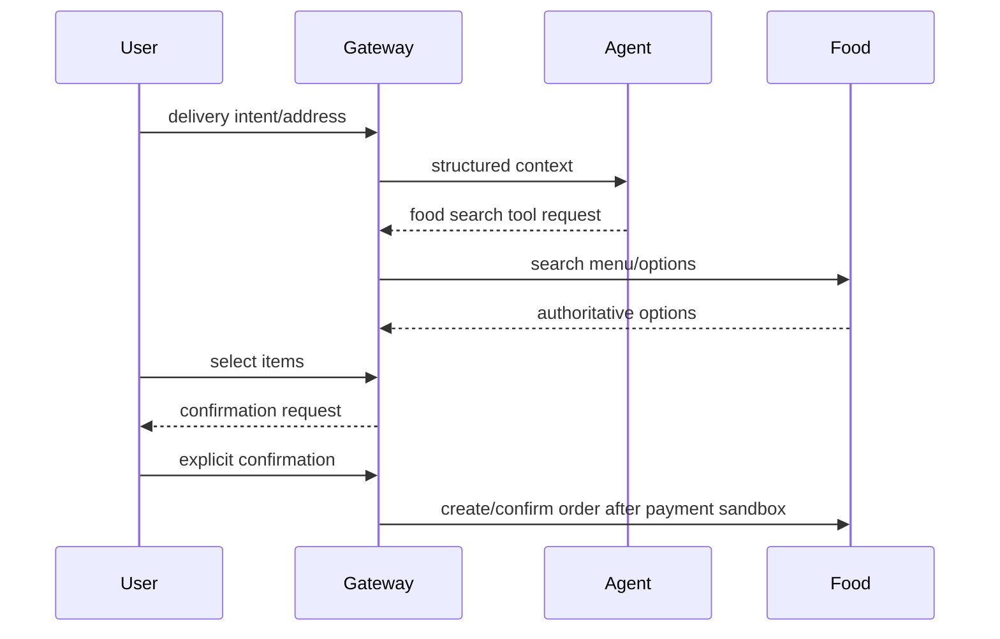
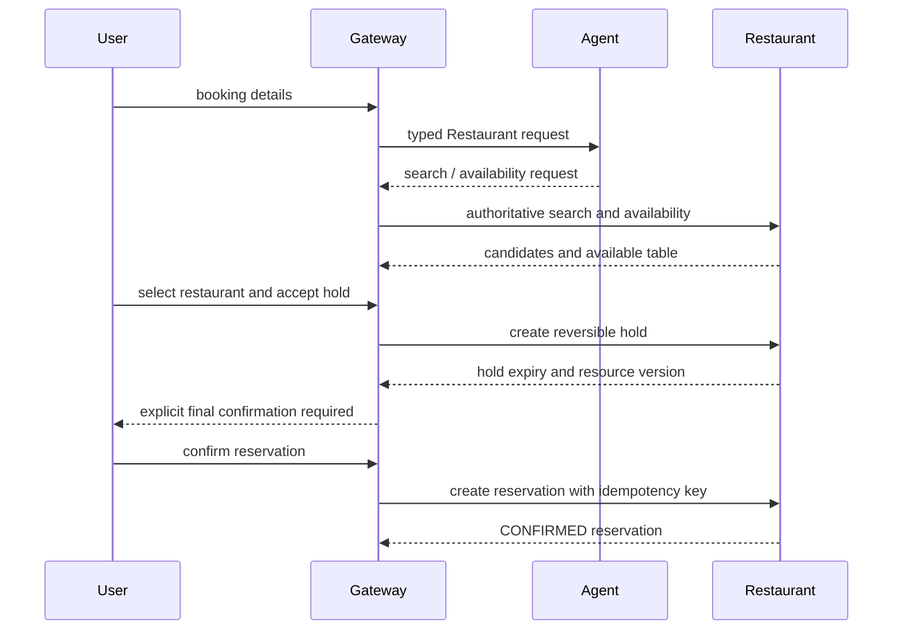

# Workflows

## General chat and tools



## Web assistant routing

The Web application is a thin Gateway client. Its primary navigation exposes only
the four implemented domains: Ride, Food, Restaurant, and Healthcare. It keeps a
separate workflow or conversation identifier for each domain, renders structured
Gateway responses, and records activity only after a backend-confirmed result.
Authentication uses `POST /api/v1/auth/login` followed by `GET /api/v1/auth/me`;
the access token is held in the current browser session and is cleared on `401`.
The Web does not call Agent or any domain service directly.

## Food ordering (target flow)



The Food flow is implemented for the backend slice. Final writes require an idempotency key from the first request, confirmation bound to action/payload/version/price/expiry, audit metadata, and an authoritative Food result. Payment success ends the request at `PAID -> RESTAURANT_CONFIRMING`; Food's due-workflow worker/lazy reconciliation advances later states. Restaurant rejection and cancellation are reconciled to one idempotent refund. Stale `PROCESSING` confirmations and `PENDING` payments are claimed/recovered by the Gateway worker using the same execution/payment keys.

## Restaurant reservation



## Healthcare appointment

```mermaid
sequenceDiagram
  participant U as User
  participant G as Gateway
  participant A as Agent
  participant H as Healthcare
  U->>G: symptom or department request
  G->>A: authoritative department/slot context
  A-->>G: typed list/hold request
  G->>H: list slots, then hold selected slot
  H-->>G: DRAFT appointment and price
  G-->>U: payment acknowledgement required
  U->>G: local payment acknowledgement
  G->>H: actor-scoped payment webhook
  U->>G: explicit final confirmation
  G->>H: confirm appointment
  H-->>G: CONFIRMED appointment
  U->>G: cancel appointment
  G->>H: release slot; retain appointment history
```

Healthcare reconciles an expired hold before payment, confirmation, cancellation, and relevant reads. An expired hold becomes `EXPIRED`, releases the slot, clears its expiry, and remains unpaid; payment acknowledgement is only a local state acknowledgement and is not a provider refund. Healthcare write operations require actor-scoped idempotency keys. Restaurant and Healthcare final actions are never inferred from the first model turn. Gateway confirmation records bind actor, workflow, action, normalized payload, resource/quote version, expiry, and idempotency evidence before the domain write.
