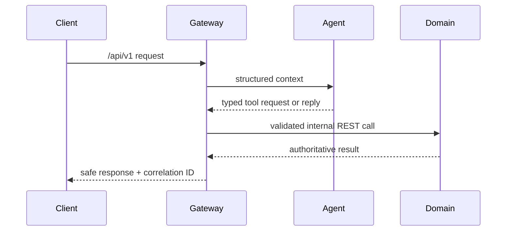
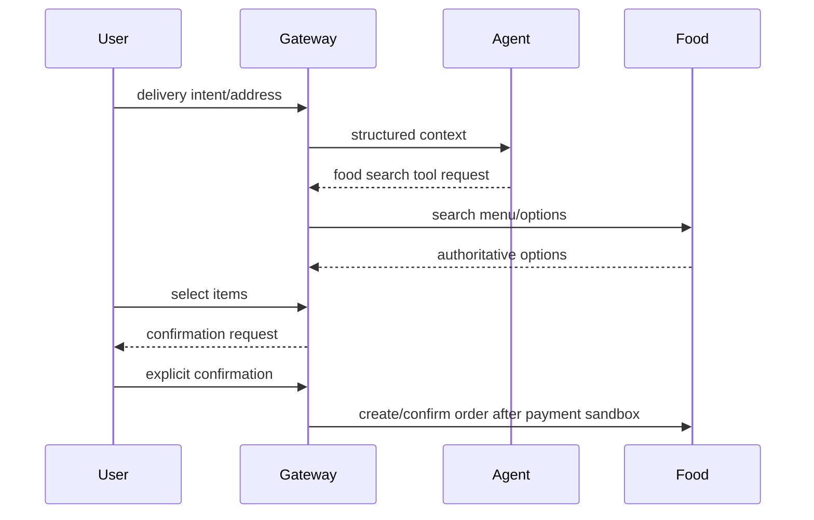

# Workflows

## General chat and tools

## Food ordering (target flow)

The Food flow is implemented for the backend slice. Final writes require an idempotency key from the first request, confirmation bound to action/payload/version/price/expiry, audit metadata, and an authoritative Food result. Payment success ends the request at `PAID -> RESTAURANT_CONFIRMING`; Food's due-workflow worker/lazy reconciliation advances later states. Restaurant rejection and cancellation are reconciled to one idempotent refund.
