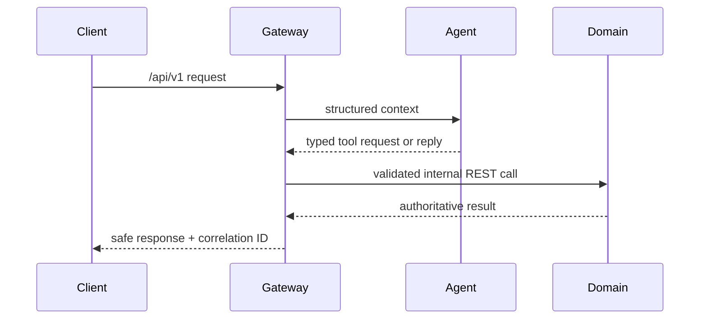
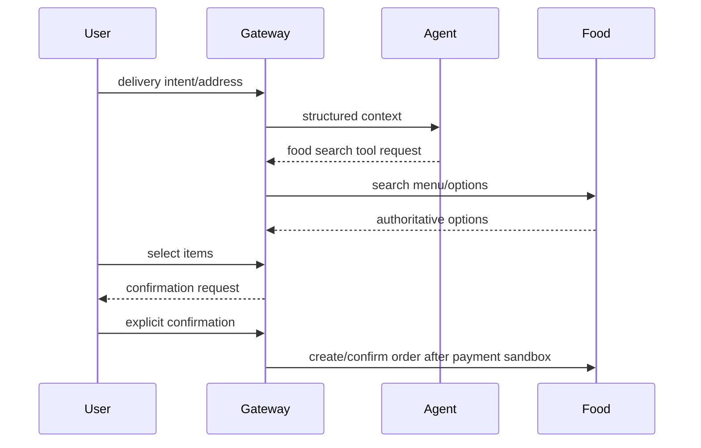

# Workflows

## General chat and tools

## Food ordering (target flow)

The food flow is architectural only: no food business endpoint or payment integration exists. Final writes require an idempotency key from the first request, confirmation bound to the action/payload/version/price/expiry, audit, and an authoritative domain result. Deliver this as a walking vertical slice before introducing more deployment boundaries.
