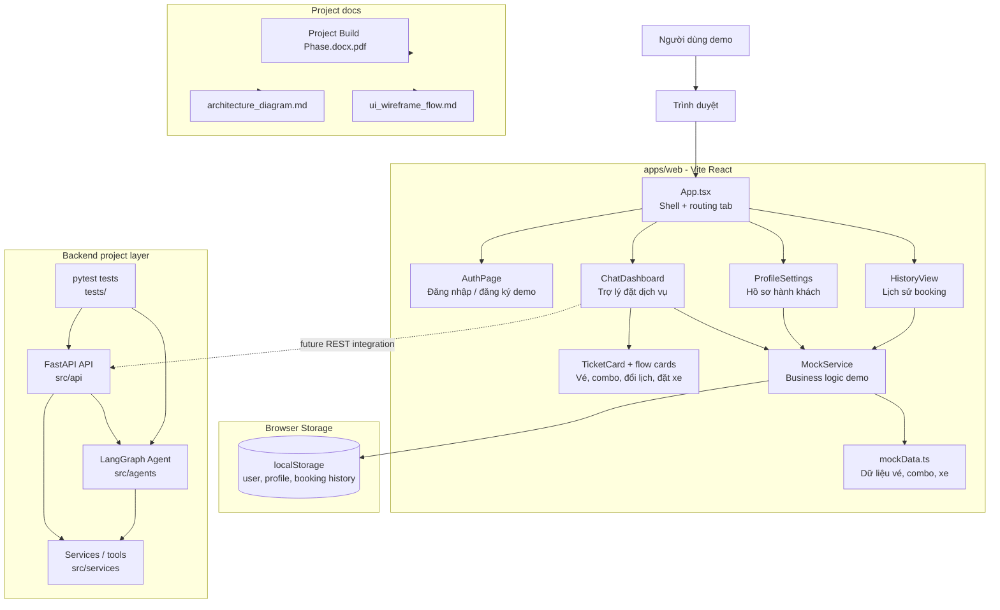
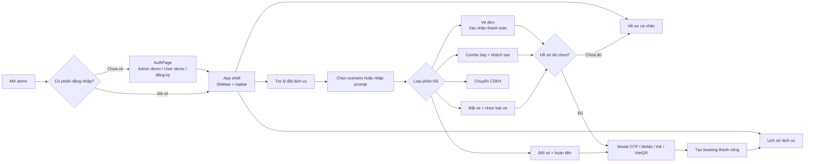
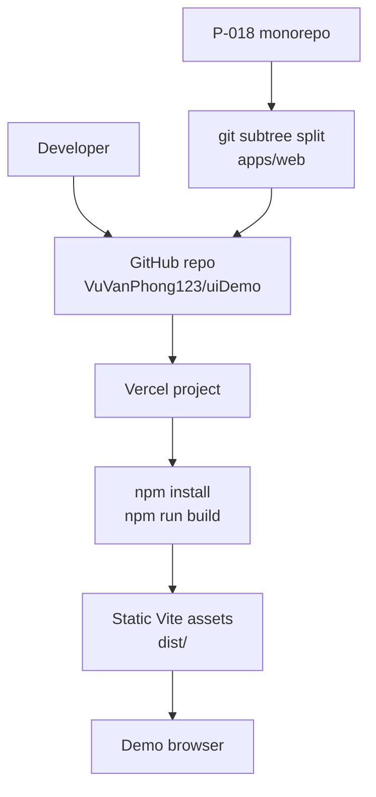

# Architecture Diagram - P-018 NaviGo Demo

Tài liệu này mô tả kiến trúc hiện tại của demo NaviGo trong repo P-018. UI demo nằm trong `apps/web/`; tài liệu Project Build Phase dạng PDF nằm trong `docs/Project Build Phase.docx.pdf`.

## System Overview

## Frontend UI Flow

## Component Details

| Component | Location | Technology | Purpose |
|-----------|----------|------------|---------|
| App shell | `apps/web/src/App.tsx` | React + TypeScript | Điều hướng 3 tab: chat, lịch sử, hồ sơ; kiểm tra phiên đăng nhập và trạng thái hồ sơ |
| Authentication | `apps/web/src/pages/AuthPage.tsx` | React state + localStorage | Đăng nhập demo admin/user, đăng ký tài khoản demo |
| Chat demo | `apps/web/src/pages/ChatDashboard.tsx` | React + lucide-react | Mô phỏng hội thoại đặt dịch vụ, chọn scenario, xác nhận thanh toán và handoff |
| Mock business layer | `apps/web/src/mocks/mockService.ts` | TypeScript | Giả lập API, booking, profile, auth, lịch sử và trạng thái demo |
| Mock data | `apps/web/src/mocks/mockData.ts` | TypeScript constants | Dữ liệu vé máy bay, tàu, khách sạn, xe, combo và lịch sử mẫu |
| Booking history | `apps/web/src/components/HistoryView.tsx` | React | Lọc, tìm kiếm, xem chi tiết, hủy và đánh giá booking |
| Profile settings | `apps/web/src/pages/ProfileSettings.tsx` | React forms | Thu thập dữ liệu hành khách bắt buộc trước khi thanh toán |
| Backend layer | `src/` | FastAPI + LangGraph | Lớp API/agent của project; sẵn để tích hợp thay cho mock service khi demo chuyển sang backend thật |
| Project docs | `docs/` | PDF + Markdown + Mermaid | Lưu tài liệu build phase, architecture diagram và wireframe/UI flow |

## Data Flow

1. Người dùng đăng nhập bằng tài khoản demo hoặc đăng ký tài khoản mới.
2. `App.tsx` hiển thị shell chính và điều hướng giữa Chat, History, Profile.
3. `ChatDashboard` gửi prompt tới `MockService.sendMessage()`.
4. `MockService` phân loại prompt theo từ khóa, trả về ticket/combo/reschedule/ride/handoff mock.
5. Khi người dùng xác nhận, hệ thống kiểm tra hồ sơ qua `MockService.getUserProfile()`.
6. Nếu hồ sơ thiếu, UI chuyển sang `ProfileSettings`; nếu đủ, hiển thị modal xác thực thanh toán.
7. Booking thành công được ghi vào `bookingHistory` và hiển thị trong `HistoryView`.
8. Ở bản tích hợp thật, bước 3-7 có thể chuyển từ `MockService` sang REST API FastAPI và LangGraph agent.

## Deployment View

## Design Decisions

| Decision | Choice | Reason |
|----------|--------|--------|
| Frontend framework | Vite + React + TypeScript | Nhẹ, build nhanh, phù hợp demo deploy trên Vercel |
| Demo data layer | MockService + localStorage | Cho phép demo bấm được ngay mà không cần backend đang chạy |
| UI navigation | Sidebar + topbar + tab content | Phù hợp dashboard vận hành, dễ demo các luồng chính |
| Payment flow | Modal OTP sandbox | Minh họa xác thực thanh toán mà không xử lý giao dịch thật |
| Backend integration path | FastAPI + LangGraph | Giữ đúng định hướng AI agent của project khi thay mock bằng API thật |
| Documentation location | `docs/` | Gom Project Build Phase PDF, architecture diagram và UI flow đúng deliverable |
