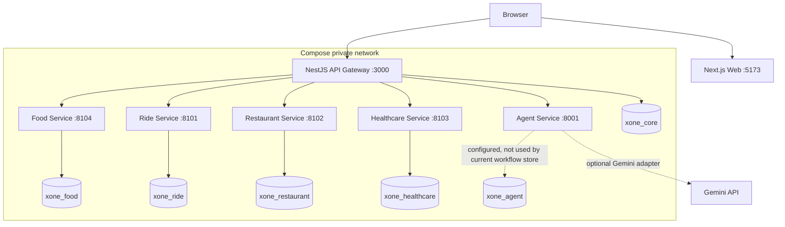
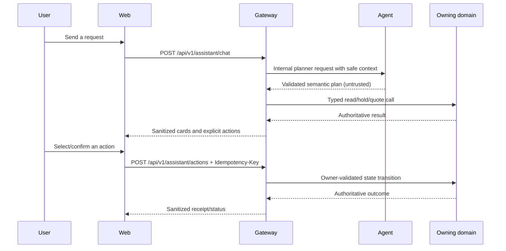
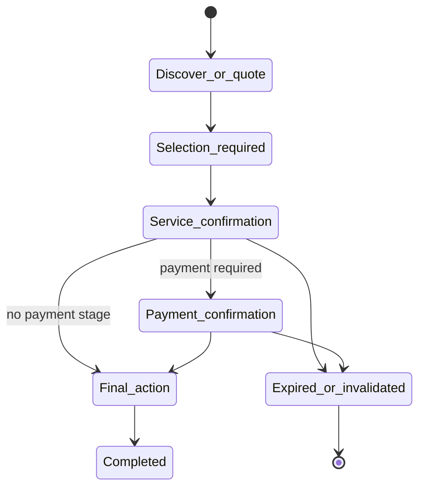
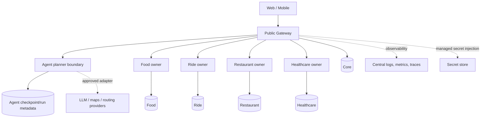

# Gate G2 Architecture Deliverable

This document is the submission-facing architecture view for X-One. It maps the
checked-in local MVP first, then describes only the next justified evolution.
Implementation status and historical verification detail remain canonical in
[current state](architecture/current-state.md).

## 1. Current MVP

### Runtime topology

Web and mobile clients are public Gateway clients only. The Next.js
`/api/health` route is a container probe, not a BFF or an authority. The Agent,
all domain services, and PostgreSQL are internal Compose-network services; only
Web, Gateway, and PostgreSQL are host-published for the local workflow.

### Ownership and interfaces

| Component | Responsibility | Interface | Persistence/status |
| --- | --- | --- | --- |
| Web | Presentation, browser auth/session UX, conversation cards | Public Gateway REST only | Browser state is non-authoritative |
| API Gateway | Public validation, authentication, response shaping, correlation/audit, confirmation orchestration, typed clients | `/api/v1` public; typed internal HTTP clients | Owns Core data in `xone_core` |
| Agent | Bounded semantic planning and safe language composition | Gateway-to-Agent internal HTTP | Current `workflow_store` is process-local; `xone_agent` is provisioned but no Agent persistence client/migration is wired |
| Food | Catalog, cart, quote, order and delivery state | Gateway-only internal REST | `xone_food` / asyncpg |
| Ride | Quote, holds, booking and synthetic tracking | Gateway-only internal REST | `xone_ride` / SQLAlchemy |
| Restaurant | Dine-in discovery, availability, holds, reservations | Gateway-only internal REST | `xone_restaurant` / SQLAlchemy |
| Healthcare | Department/doctor/slot availability, holds, payment acknowledgement, appointment lifecycle | Gateway-only internal REST | `xone_healthcare` / SQLAlchemy |
| PostgreSQL | One local instance with logical ownership separation | Private database connections | No cross-database query, FK, ORM model, or domain import |

The canonical tool inventory is V2, while active Food/Restaurant/Healthcare
compatibility flows still use bounded V1-shaped Agent requests through the
Gateway. That compatibility surface is not evidence of full V2 parity; see
[tool contracts](api/tool-contracts.md) and [API inventory](api/api-inventory.md).

### Control flow

The model never determines authoritative IDs, prices, availability, payment
status, or final success. It does not reach a domain database or final action.
Gateway orchestration does not let Gateway write a domain's database directly.

### Confirmation and recovery

A retryable write begins with an idempotency key. The domain scopes the key to
actor, operation, and normalized payload. Confirmation is bound to the actor,
action, material values/version, expiry, and one-time audit evidence. A changed
detail invalidates the prior action rather than silently reusing it.

### Local configuration and health

The recommended local path is `scripts/local/start-all.ps1` or `scripts/local/start-all.sh`
after copying root `.env.example` to private `.env`. Container liveness probes
verify processes; Gateway `/health/ready` verifies the dependencies it actually
checks. The launcher additionally applies explicit idempotent migrations and
then verifies Gateway and Web reachability. It does not claim that every
domain's `/health/ready` is a deep dependency probe.

The normal template has no Gemini credential and uses deterministic planning.
For a real-Gemini Gate G2 run, private configuration must set
`AGENT_MODEL_MODE=gemini` and a valid `GEMINI_API_KEY`; the evaluation must
prove `decision_source=model` for a multi-domain/non-fast-path case.

## 2. Current MVP limitations

- The Agent database is not yet used for durable checkpoints; legacy Agent
  workflow state is lost on Agent restart.
- Gemini is optional; the 2026-08-16 isolated Gate G2 run recorded successful
  Gemini diagnostics for the multi-domain cases without fallback. Deterministic
  planning remains the supported local fallback, not Gemini evidence.
- Ride tracking and payment are local/sandbox simulations.
- The local Geoapify integration is optional; deterministic location fallback
  is labelled and never booking authority.
- Mobile is an Expo skeleton, not a second production client.
- The legacy V1 Agent compatibility paths and one-way V2 registry parity check
  need a bounded follow-up before they can be described as fully unified.

## 3. Target architecture

The target evolves current boundaries rather than replacing them.

| Evolution | Trigger | Preserved invariant |
| --- | --- | --- |
| Process-local Agent state → owner-local checkpoint/run persistence | Restart recovery and durable conversations need it | No raw prompts/chain-of-thought; Agent remains non-authoritative |
| Local logical databases → independently managed domain databases | Operational/team isolation justifies it | One owner per domain; no cross-domain SQL |
| Process-local rate limits → distributed edge/Gateway limiter | More than one Gateway instance | Gateway remains the public control boundary |
| Local logs → central logs/metrics/traces | Operations need correlation across services | Do not log secrets, raw prompts, or unnecessary PII |
| Local provider settings → managed secrets and provider adapters | Deployment and key-rotation needs | Provider output stays untrusted and cannot authorize actions |
| Legacy V1 Agent flows → canonical V2 typed contract | Parity test and migration are complete | Agent cannot gain direct domain or final-action access |

Queues, event sourcing, service mesh, Kubernetes, multi-region topology, and a
vector database are not target commitments for this MVP. They require measured
needs and separate design decisions.

## 4. Review checklist

- Public clients call only the Gateway.
- Every domain owns its data and state transition.
- Agent output is validated/untrusted and cannot finalize a transaction.
- Financial/final steps require explicit confirmation plus idempotency.
- Current MVP claims are source-backed; target items are labelled as evolution.
- The actual Gate G2 evaluation is recorded in
  [root eval](../eval/README.md), not inferred from unit-test mocks.
