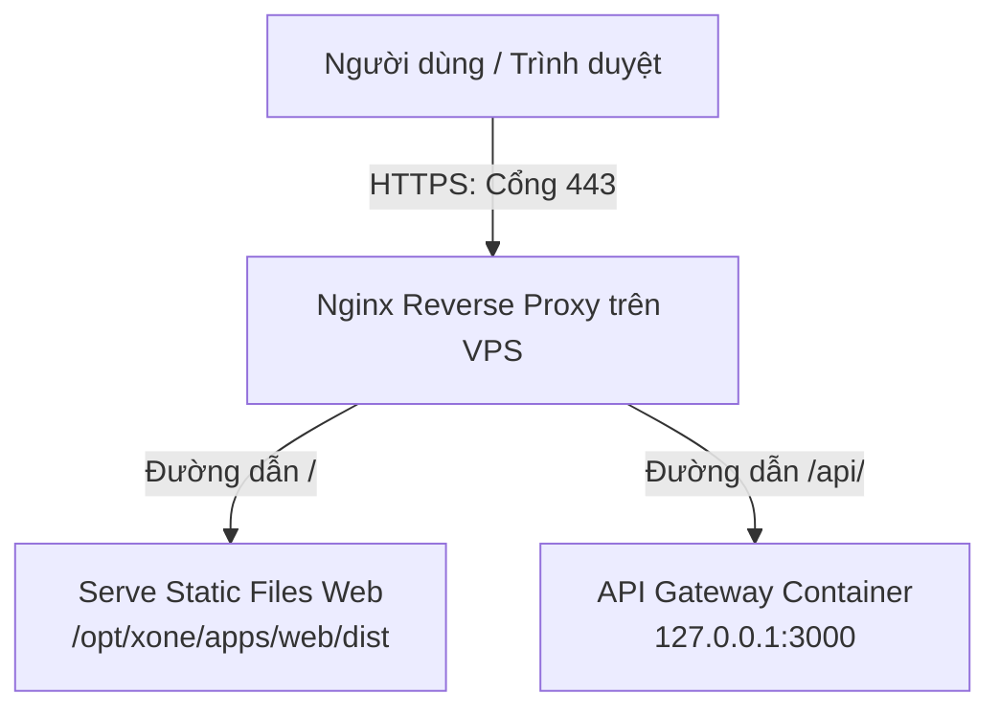

# Hướng Dẫn Cấu Hùi Tên Miền (Domain), Nginx Reverse Proxy & SSL (HTTPS) cho X-One Staging

Tài liệu này hướng dẫn chi tiết các bước thiết lập tên miền, cấu hình máy chủ Nginx làm cổng điều hướng (Reverse Proxy) và cài đặt chứng chỉ bảo mật HTTPS (SSL Let's Encrypt) cho môi trường **Staging** của dự án X-One trên VPS.

---

## 🏗️ Sơ Đồ Kiến Trúc Hoạt Động

Để bảo mật, hệ thống không mở trực tiếp cổng của ứng dụng (như cổng API Gateway `3000`) ra ngoài Internet. Thay vào đó:
1. Nginx lắng nghe ở cổng tiêu chuẩn `80` (HTTP) và `443` (HTTPS).
2. Khi người dùng truy cập tên miền, Nginx sẽ tiếp nhận request, giải mã SSL (nếu là HTTPS) rồi chuyển tiếp (proxy) đến ứng dụng tương ứng chạy dưới local của VPS.



---

## 📌 Bước 1: Cấu hình DNS trỏ về IP VPS

Trước khi cấu hình trên VPS, bạn cần trỏ tên miền (domain) của mình về địa chỉ IP tĩnh công cộng của VPS. Truy cập trang quản lý DNS của nhà cung cấp tên miền (Cloudflare, GoDaddy, Namecheap, Mắt Bão...) và tạo các bản ghi sau:

### Phương án A: Dùng chung 1 tên miền phụ (Khuyên dùng)
*Chỉ sử dụng duy nhất một tên miền phụ (ví dụ: `staging.yourdomain.com`). Phần API sẽ dùng tiền tố `/api`.*
* **Type (Loại)**: `A`
* **Name (Host)**: `staging` (hoặc `staging018` tùy ý bạn chọn)
* **Value (Points to)**: Địa chỉ IP tĩnh công cộng của VPS của bạn (ví dụ: `123.45.67.89`)
* **TTL**: `Auto` hoặc `3600`

### Phương án B: Tách biệt tên miền Web và API
*Dùng hai tên miền phụ riêng biệt (ví dụ: `staging.yourdomain.com` cho Web và `staging-api.yourdomain.com` cho API).*
* **Bản ghi 1 (Frontend)**:
  * **Type**: `A` | **Name**: `staging` | **Value**: `IP_VPS`
* **Bản ghi 2 (Backend API)**:
  * **Type**: `A` | **Name**: `staging-api` | **Value**: `IP_VPS`

> [!IMPORTANT]
> Cần đợi khoảng **5 - 15 phút** để hệ thống DNS cập nhật trên toàn cầu. Bạn có thể kiểm tra xem tên miền đã nhận đúng IP VPS chưa bằng lệnh:
> ```bash
> ping staging.yourdomain.com
> ```

---

## 📌 Bước 2: Cấu hình Nginx trên VPS

### 2.1. Cài đặt Nginx
Nếu chưa cài đặt Nginx trên VPS, bạn chạy lệnh sau:
```bash
sudo apt update
sudo apt install nginx -y
```

### 2.2. Tạo file cấu hình Virtual Host mới
Tạo một file cấu hình Nginx dành riêng cho môi trường Staging của X-One:
```bash
sudo nano /etc/nginx/sites-available/xone-staging
```

### 2.3. Cấu hình Server Block
Sao chép và dán cấu hình phù hợp với phương án bạn đã lựa chọn:

#### 🎯 LỰA CHỌN A: Dùng chung 1 tên miền (Khuyên dùng để tránh lỗi CORS)
```nginx
server {
    listen 80;
    server_name staging.yourdomain.com; # Thay thế bằng domain thực tế của bạn

    # Giới hạn kích thước file tải lên (ví dụ: upload ảnh)
    client_max_body_size 20M;

    # 1. Cấu hình phục vụ Frontend (Serve Static Files)
    location / {
        root /opt/xone/apps/web/dist; # Đường dẫn đến thư mục build dist của web trên VPS
        index index.html;
        try_files $uri $uri/ /index.html; # Hỗ trợ React Router SPA
    }

    # 2. Cấu hình điều hướng cho Backend API (Reverse Proxy sang cổng 3000)
    location /api/ {
        proxy_pass http://127.0.0.1:3000/; # Chuyển tiếp request đến API Gateway
        
        # Cấu hình Header chuyển tiếp thông tin IP gốc của Client
        proxy_http_version 1.1;
        proxy_set_header Upgrade $http_upgrade;
        proxy_set_header Connection 'upgrade';
        proxy_set_header Host $host;
        proxy_cache_bypass $http_upgrade;
        proxy_set_header X-Real-IP $remote_addr;
        proxy_set_header X-Forwarded-For $proxy_add_x_forwarded_for;
        proxy_set_header X-Forwarded-Proto $scheme;
    }
}
```

#### 🎯 LỰA CHỌN B: Tách biệt tên miền Frontend và Backend API
```nginx
# ==========================================
# 1. CẤU HÌNH FRONTEND (staging.yourdomain.com)
# ==========================================
server {
    listen 80;
    server_name staging.yourdomain.com; # Thay thế bằng domain web của bạn

    location / {
        root /opt/xone/apps/web/dist;
        index index.html;
        try_files $uri $uri/ /index.html;
    }
}

# ==========================================
# 2. CẤU HÌNH BACKEND (staging-api.yourdomain.com)
# ==========================================
server {
    listen 80;
    server_name staging-api.yourdomain.com; # Thay thế bằng domain API của bạn

    client_max_body_size 20M;

    location / {
        proxy_pass http://127.0.0.1:3000; # Chuyển tiếp đến API Gateway
        
        proxy_http_version 1.1;
        proxy_set_header Upgrade $http_upgrade;
        proxy_set_header Connection 'upgrade';
        proxy_set_header Host $host;
        proxy_cache_bypass $http_upgrade;
        proxy_set_header X-Real-IP $remote_addr;
        proxy_set_header X-Forwarded-For $proxy_add_x_forwarded_for;
        proxy_set_header X-Forwarded-Proto $scheme;
    }
}
```

### 2.4. Kích hoạt và áp dụng cấu hình
Chạy chuỗi lệnh sau để liên kết cấu hình và khởi động lại dịch vụ Nginx:
```bash
# Liên kết file cấu hình từ sites-available sang sites-enabled để kích hoạt
sudo ln -s /etc/nginx/sites-available/xone-staging /etc/nginx/sites-enabled/

# Kiểm tra cú pháp cấu hình xem có lỗi gì không
sudo nginx -t

# Khởi động lại dịch vụ Nginx để áp dụng cấu hình mới
sudo systemctl restart nginx
```

---

## 📌 Bước 3: Đăng ký chứng chỉ SSL (HTTPS) tự động bằng Certbot

Để mã hóa dữ liệu truyền tải và kích hoạt giao thức HTTPS (ổ khóa xanh trên thanh địa chỉ):

**1. Cài đặt Certbot và plugin Nginx:**
```bash
sudo apt install certbot python3-certbot-nginx -y
```

**2. Đăng ký chứng chỉ SSL miễn phí từ Let's Encrypt:**

* **Nếu đi theo Lựa chọn A (1 domain):**
  ```bash
  sudo certbot --nginx -d staging.yourdomain.com
  ```
* **Nếu đi theo Lựa chọn B (2 domains):**
  ```bash
  sudo certbot --nginx -d staging.yourdomain.com -d staging-api.yourdomain.com
  ```

> [!TIP]
> * Trong quá trình chạy, Certbot sẽ yêu cầu cung cấp Email để nhận thông báo gia hạn chứng chỉ.
> * Certbot sẽ hỏi bạn có muốn tự động cấu hình redirect toàn bộ traffic HTTP (cổng 80) sang HTTPS (cổng 443) hay không. Hãy chọn **Yes** (hoặc nhập số tương ứng) để Certbot tự động ghi cấu hình bảo mật vào Nginx.

**3. Kiểm tra tính năng tự động gia hạn (Auto-renewal):**
Chứng chỉ của Let's Encrypt có thời hạn **90 ngày**. Certbot đã tự động cấu hình một cronjob chạy nền để tự động gia hạn trước khi hết hạn 30 ngày. Bạn có thể chạy lệnh test thử quá trình gia hạn này:
```bash
sudo certbot renew --dry-run
```

---

## ⚠️ Lưu Ý Quan Trọng Về Build Frontend (API Endpoint)

Do React ứng dụng Vite đóng gói cứng (hardcode) giá trị biến môi trường `VITE_API_URL` vào gói JS tĩnh khi build, bạn cần kiểm tra và sửa cấu hình file `.env` của frontend trước khi thực hiện deploy:

* **Nếu chọn Lựa chọn A (1 domain dùng chung)**:
  Cấu hình `VITE_API_URL` dưới dạng đường dẫn tương đối (relative path) hoặc đúng domain:
  ```env
  VITE_API_URL=/api
  ```
* **Nếu chọn Lựa chọn B (2 domain riêng biệt)**:
  Cấu hình `VITE_API_URL` trỏ chính xác về domain API:
  ```env
  VITE_API_URL=https://staging-api.yourdomain.com
  ```

*(Nếu quên cấu hình phần này, ứng dụng React trên trình duyệt người dùng sẽ cố gắng gọi API về `http://localhost:3000` dẫn đến lỗi kết nối).*
