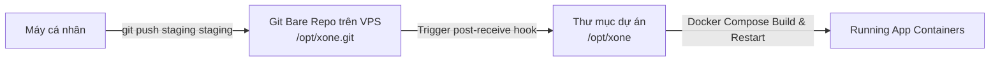
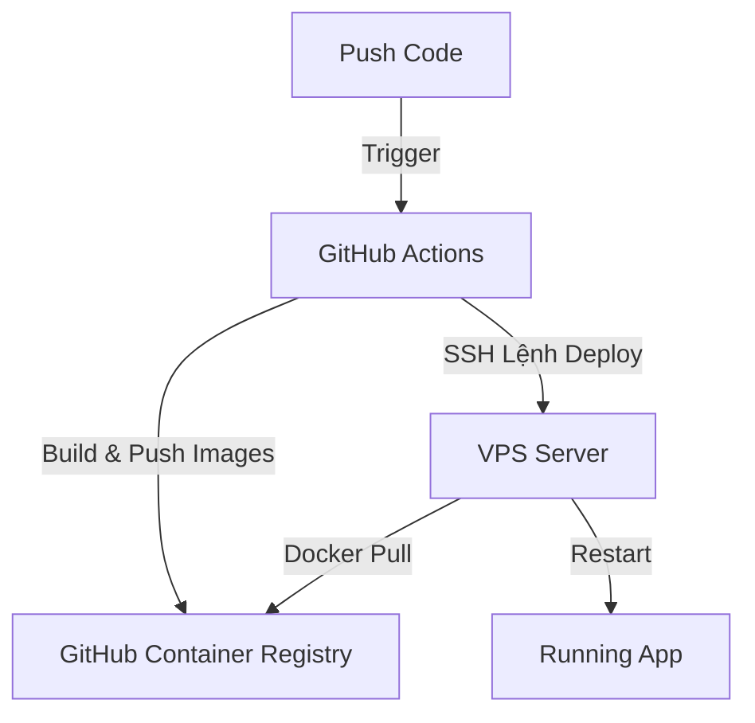
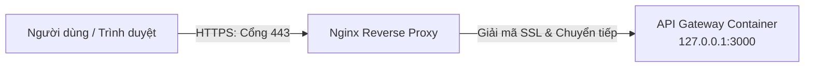

# Hướng dẫn Triển khai X-One lên VPS GCP & Cấu hình CI/CD Chuẩn Doanh Nghiệp

Tài liệu này hướng dẫn chi tiết từng bước (Step-by-step) từ việc tạo Máy ảo (VPS) trên Google Cloud Platform (GCP) đến việc thiết lập bảo mật, cài đặt môi trường và cấu hình quy trình triển khai liên tục (CI/CD) chuẩn doanh nghiệp.

---

## 1. Khởi Tạo Máy Ảo (Compute Engine VM Instance) trên GCP

Đầu tiên, bạn cần khởi tạo máy ảo để làm môi trường lưu trữ (Staging hoặc Production).

1.  **Truy cập GCP Console:** Vào mục **Compute Engine** -> **VM instances** -> Nhấn **Create Instance**.
2.  **Cấu hình phần cứng tối thiểu:**
    *   **Region/Zone:** Chọn region gần người dùng nhất (ví dụ: `asia-southeast1 - Singapore`).
    *   **Machine configuration:** Chọn dòng **General-purpose**.
    *   **Machine type:** Chọn tối thiểu `e2-medium` (2 vCPU, 4GB RAM) để đảm bảo đủ tài nguyên build container.
3.  **Boot disk (Hệ điều hành):**
    *   Nhấn **Change** -> Chọn **Ubuntu LTS (phiên bản 22.04 LTS hoặc 24.04 LTS)**.
    *   **Size:** Tối thiểu **30 GB (SSD Persistent Disk)** để chứa Docker images.
4.  **Firewall:**
    *   Tích chọn **Allow HTTP traffic** và **Allow HTTPS traffic**.
5.  **Nhấn Create** để khởi tạo máy ảo. Sau 1-2 phút, bạn sẽ nhận được một **External IP** (IP Công cộng) của máy ảo.

---

## 2. Thiết Lập Bảo Mật & Môi Trường cho VM

Sau khi có máy ảo, việc đầu tiên cần làm là bảo mật đường kết nối SSH và cấu hình hệ thống mạng.

### 2.1. Cấu hình IP Tĩnh (Static IP)
Mặc định GCP cấp IP động (Ephemeral IP), IP này sẽ bị thay đổi khi reset máy. Bạn cần chuyển nó thành IP tĩnh:
1.  Vào mục **VPC network** -> **IP addresses**.
2.  Tìm IP của VM vừa tạo, chuyển **Type** từ *Ephemeral* sang *Static*.

### 2.2. Cấu hình SSH Key bảo mật
Không sử dụng mật khẩu để đăng nhập VPS. Hãy dùng SSH Key:
1.  **Tạo SSH Key ở máy cá nhân (Local):**
    ```bash
    ssh-keygen -t ed25519 -C "your_email@example.com" -f ~/.ssh/gcp-vps-key
    ```
2.  **Đưa Public Key lên GCP:**
    *   Mở file public key vừa tạo và copy nội dung: `cat ~/.ssh/gcp-vps-key.pub`.
    *   Trên GCP Console, vào **Compute Engine** -> **Metadata** -> **SSH Keys** -> Nhấn **Add SSH Keys** và dán nội dung vào.
3.  **Kết nối từ máy cá nhân:**
    ```bash
    ssh -i ~/.ssh/gcp-vps-key username@vps-static-ip
    ```

---

## 3. Cài Đặt Docker & Docker Compose trên VPS

Sau khi SSH vào VPS thành công, hãy thực hiện cài đặt các công cụ chạy container.

```bash
# Update hệ thống
sudo apt update && sudo apt upgrade -y

# Cài đặt Docker
sudo apt install apt-transport-https ca-certificates curl gnupg lsb-release -y
curl -fsSL https://download.docker.com/linux/ubuntu/gpg | sudo gpg --dearmor -o /usr/share/keyrings/docker-archive-keyring.gpg
echo "deb [arch=$(dpkg --print-architecture) signed-by=/usr/share/keyrings/docker-archive-keyring.gpg] https://download.docker.com/linux/ubuntu $(lsb_release -cs) stable" | sudo tee /etc/apt/sources.list.d/docker.list > /dev/null
sudo apt update && sudo apt install docker-ce docker-ce-cli containerd.io -y

# Cho phép chạy Docker không cần quyền sudo
sudo usermod -aG docker $USER
newgrp docker

# Cài đặt Docker Compose v2
sudo apt install docker-compose-plugin -y

# Kiểm tra phiên bản
docker --version
docker compose version
```

---

## 4. Khởi Tạo Cơ Sở Dữ Liệu Logic (Postgres Logical Separation)

Dự án X-One yêu cầu sự cô lập dữ liệu nghiêm ngặt giữa các dịch vụ theo nguyên tắc tại [AGENTS.md](file:///d:/VIN/Projects/P-018/AGENTS.md). Ta cần tạo 6 database logic trên một cụm cơ sở dữ liệu duy nhất.

### 4.1. Chuẩn bị thư mục chứa dữ liệu trên VPS
```bash
sudo mkdir -p /opt/xone/postgres_data
sudo chown -R $USER:$USER /opt/xone
```

### 4.2. Khởi tạo file `.env` trên VPS
Tạo file `/opt/xone/.env` chứa các biến môi trường cấu hình mật khẩu thực tế (Production/Staging):
```bash
nano /opt/xone/.env
```
Nhập cấu hình mẫu (chỉnh sửa mật khẩu an toàn):
```env
POSTGRES_USER=xone_admin
POSTGRES_PASSWORD=SuperSecurePassword123

CORE_DB_NAME=xone_core
CORE_DB_USER=core_service
CORE_DB_PASSWORD=CorePassword123

AGENT_DB_NAME=xone_agent
AGENT_DB_USER=agent_service
AGENT_DB_PASSWORD=AgentPassword123

RIDE_DB_NAME=xone_ride
RIDE_DB_USER=ride_service
RIDE_DB_PASSWORD=RidePassword123

RESTAURANT_DB_NAME=xone_restaurant
RESTAURANT_DB_USER=restaurant_service
RESTAURANT_DB_PASSWORD=RestaurantPassword123

HEALTHCARE_DB_NAME=xone_healthcare
HEALTHCARE_DB_USER=healthcare_service
HEALTHCARE_DB_PASSWORD=HealthcarePassword123

FOOD_DB_NAME=xone_food
FOOD_DB_USER=food_service
FOOD_DB_PASSWORD=FoodPassword123

# Cấu hình API key và các dịch vụ khác
GEMINI_API_KEY=AIzaSy...
```

### 4.3. Chạy Database Engine
Khi deploy lần đầu, container Postgres sẽ tự động đọc file khởi tạo database có cấu trúc tương tự script [01-create-databases.sh](file:///d:/VIN/Projects/P-018/infra/postgres/init/01-create-databases.sh) để phân tách các role và database.

---

## 5. Triển Khai CI/CD Chuẩn Doanh Nghiệp

Tùy vào quyền hạn của bạn đối với Repository trên GitHub của tổ chức, hãy lựa chọn 1 trong 2 phương án triển khai sau:

### PHƯƠNG ÁN A: Git Push To Deploy (Dành cho tài khoản bị khóa quyền Settings/Secrets trên GitHub)
*Phương án này sử dụng Git Hooks tích hợp sẵn trong Git qua giao thức SSH, hoàn toàn độc lập và không phụ thuộc vào GitHub Actions.*



#### Bước A1: Khởi tạo Bare Git Repo trên VPS
```bash
# Tạo thư mục nhận Git
mkdir -p /opt/xone.git
cd /opt/xone.git
git init --bare
```

#### Bước A2: Cấu hình Git Hook `post-receive` trên VPS
Tạo file `/opt/xone.git/hooks/post-receive`:
```bash
nano /opt/xone.git/hooks/post-receive
```
Nội dung file:
```bash
#!/usr/bin/env bash
TARGET="/opt/xone"
GIT_DIR="/opt/xone.git"

echo "==== [1/3] Đang chuyển mã nguồn sang thư mục chạy ứng dụng ===="
git --work-tree=$TARGET --git-dir=$GIT_DIR checkout -f staging

cd $TARGET

echo "==== [2/3] Xây dựng và khởi động Docker Containers ===="
# Nạp biến môi trường từ .env đã cấu hình thủ công ở Bước 4
docker compose up -d --build --remove-orphans

echo "==== [3/3] Dọn dẹp Docker images không dùng đến ===="
docker image prune -f

echo "==== TRIỂN KHAI HOÀN TẤT THÀNH CÔNG! ===="
```
Cấp quyền chạy cho Hook:
```bash
chmod +x /opt/xone.git/hooks/post-receive
```

#### Bước A3: Cấu hình ở máy cá nhân của Developer
Mở terminal tại máy cá nhân, cd vào project X-One và thêm remote:
```bash
git remote add staging ssh://username@vps-static-ip/opt/xone.git
```
Mỗi khi muốn deploy code mới lên Staging VPS, bạn chỉ cần gõ:
```bash
git push staging staging
```

---

### PHƯƠNG ÁN B: Triển Khai Qua GitHub Actions + GitHub Container Registry (GHCR)
*Phương án chuẩn mực tự động hóa hoàn toàn. Yêu cầu bạn được cấp quyền tạo Secrets hoặc nhờ Admin cấu hình giúp Secrets trên repo.*



#### Bước B1: Tạo file cấu hình Workflow
Tạo file `.github/workflows/deploy.yml` trong mã nguồn dự án:
```yaml
name: VPS Staging Deployment

on:
  push:
    branches:
      - staging

env:
  REGISTRY: ghcr.io
  IMAGE_NAME: ${{ github.repository }}

jobs:
  build-and-push:
    runs-on: ubuntu-latest
    permissions:
      contents: read
      packages: write
    steps:
      - name: Checkout code
        uses: actions/checkout@v4

      - name: Log in to GHCR
        uses: docker/login-action@v3
        with:
          registry: ${{ env.REGISTRY }}
          username: ${{ github.actor }}
          password: ${{ secrets.GITHUB_TOKEN }}

      - name: Set up Docker Buildx
        uses: docker/setup-buildx-action@v3

      # Build các image tương ứng
      - name: Build and Push Gateway
        uses: docker/build-push-action@v5
        with:
          context: .
          file: apps/api-gateway/Dockerfile
          push: true
          tags: ${{ env.REGISTRY }}/${{ env.IMAGE_NAME }}-api-gateway:staging
          cache-from: type=gha
          cache-to: type=gha,mode=max

      # Thêm các block build cho Agent service và các Domain service khác...

  deploy:
    needs: build-and-push
    runs-on: ubuntu-latest
    steps:
      - name: Checkout code
        uses: actions/checkout@v4

      # Đẩy file docker-compose.yml mới nhất sang VPS
      - name: Copy docker-compose.yml to VPS
        uses: appleboy/scp-action@v0.1.7
        with:
          host: ${{ secrets.STAGING_HOST }}
          username: ${{ secrets.STAGING_USER }}
          key: ${{ secrets.STAGING_SSH_KEY }}
          source: "docker-compose.yml"
          target: "/opt/xone"

      # SSH vào VPS để kéo image mới và chạy docker compose up
      - name: Deploy to VPS via SSH
        uses: appleboy/ssh-action@v1.0.3
        with:
          host: ${{ secrets.STAGING_HOST }}
          username: ${{ secrets.STAGING_USER }}
          key: ${{ secrets.STAGING_SSH_KEY }}
          script: |
            cd /opt/xone
            echo "${{ secrets.GITHUB_TOKEN }}" | docker login ghcr.io -u ${{ github.actor }} --password-stdin
            export IMAGE_TAG=staging
            export GITHUB_REPOSITORY_OWNER=${{ github.repository_owner }}
            docker compose pull
            docker compose up -d --remove-orphans
            docker image prune -f
```

#### Bước B2: Cấu hình Secrets trên GitHub
Nhờ Repo Admin hoặc tự truy cập `Settings` -> `Secrets and variables` -> `Actions` để thêm các khóa:
*   `STAGING_HOST`: IP tĩnh của VPS Staging.
*   `STAGING_USER`: Tên user đăng nhập SSH (ví dụ: `ubuntu`).
*   `STAGING_SSH_KEY`: Nội dung private key tương ứng (file `~/.ssh/gcp-vps-key`).

---

## 6. Vận Hành & Giám Sát Sau Triển Khai (Operations)

### 6.1. Thiết lập Backup dữ liệu tự động
Tạo script backup cơ sở dữ liệu hàng ngày `/opt/xone/backup.sh`:
```bash
#!/usr/bin/env bash
BACKUP_DIR="/opt/xone/backups"
mkdir -p $BACKUP_DIR
TIMESTAMP=$(date +"%Y%m%d_%H%M%S")

# Dump dữ liệu của core database
docker exec -t xone-postgres-container pg_dump -U core_service xone_core > $BACKUP_DIR/xone_core_$TIMESTAMP.sql

# Xóa các bản backup cũ hơn 7 ngày
find $BACKUP_DIR -type f -mtime +7 -name "*.sql" -delete
```
Cấu hình cronjob chạy lúc 2h sáng mỗi ngày:
```bash
0 2 * * * /bin/bash /opt/xone/backup.sh
```

### 6.2. Kiểm tra Logs hệ thống
```bash
# Xem log thời gian thực của toàn bộ hệ thống
docker compose -f /opt/xone/docker-compose.yml logs -f

# Xem log riêng biệt của Gateway
docker compose -f /opt/xone/docker-compose.yml logs -f api-gateway
```

---

## 7. Cấu Hình Nginx Reverse Proxy & SSL (HTTPS) Bảo Mật

Để hệ thống hoạt động ổn định và bảo mật chuẩn doanh nghiệp, bạn không nên mở cổng ứng dụng trực tiếp ra Internet. Thay vào đó, tất cả lưu lượng sẽ đi qua cổng tiêu chuẩn HTTP (80) và HTTPS (443) được quản lý bởi **Nginx Reverse Proxy**, tích hợp **SSL Let's Encrypt** miễn phí để tự động mã hóa dữ liệu.



### 7.1. Cài đặt Nginx và Certbot trên VPS
Chạy lệnh sau trên VPS để cài đặt máy chủ Nginx và công cụ Certbot (dùng để cấp phát SSL Let's Encrypt tự động):
```bash
sudo apt update
sudo apt install nginx certbot python3-certbot-nginx -y
```

### 7.2. Cấu hình Server Block (Virtual Host) của Nginx
Tạo một cấu hình Nginx mới dành cho dự án X-One:
```bash
sudo nano /etc/nginx/sites-available/xone
```
Dán cấu hình mẫu sau vào (thay đổi `staging018.yourdomain.com` thành tên miền (domain) thực tế trỏ về IP VPS của bạn):
```nginx
server {
    listen 80;
    server_name staging018.yourdomain.com; # Thay thế bằng domain của bạn

    # Tăng giới hạn dung lượng tải file lên (ví dụ: upload ảnh/avatar)
    client_max_body_size 20M;

    location / {
        # Chuyển tiếp request đến API Gateway chạy cổng 3000
        proxy_pass http://127.0.0.1:3000;
        
        # Cấu hình header chuẩn cho proxy chuyển tiếp thông tin IP gốc
        proxy_http_version 1.1;
        proxy_set_header Upgrade $http_upgrade;
        proxy_set_header Connection 'upgrade';
        proxy_set_header Host $host;
        proxy_cache_bypass $http_upgrade;
        proxy_set_header X-Real-IP $remote_addr;
        proxy_set_header X-Forwarded-For $proxy_add_x_forwarded_for;
        proxy_set_header X-Forwarded-Proto $scheme;
    }
}
```
Kích hoạt cấu hình và khởi động lại Nginx:
```bash
# Liên kết file cấu hình để Nginx kích hoạt nó
sudo ln -s /etc/nginx/sites-available/xone /etc/nginx/sites-enabled/

# Kiểm tra cú pháp cấu hình xem có lỗi không
sudo nginx -t

# Khởi động lại dịch vụ Nginx
sudo systemctl restart nginx
```

### 7.3. Đăng ký chứng chỉ SSL (HTTPS) tự động qua Certbot
Chạy lệnh dưới đây để Certbot tự động kết nối với Let's Encrypt, xác thực tên miền của bạn và tự động ghi đè cấu hình SSL HTTPS vào file cấu hình Nginx:
```bash
sudo certbot --nginx -d staging018.yourdomain.com
```
> [!NOTE]
> Quá trình này yêu cầu tên miền `staging018.yourdomain.com` của bạn phải được trỏ (DNS A Record) về đúng địa chỉ IP công cộng của VPS trước đó.

### 7.4. Tự động gia hạn chứng chỉ SSL (Auto-renewal)
Chứng chỉ Let's Encrypt có thời hạn 90 ngày. Certbot đã tự động thiết lập một tác vụ chạy nền (cronjob) để tự động gia hạn khi chứng chỉ còn dưới 30 ngày. Bạn có thể kiểm tra thử quá trình gia hạn bằng lệnh:
```bash
sudo certbot renew --dry-run
```

