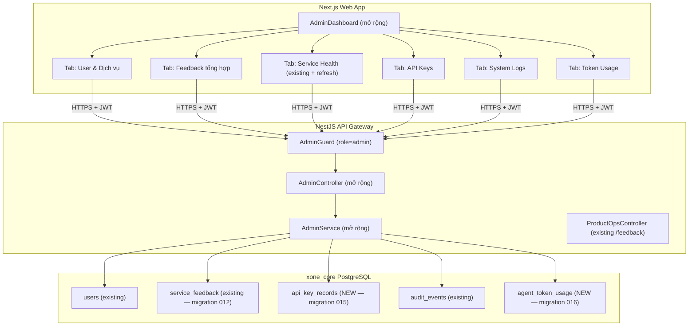

# [FEATURE][P1][Admin] Trang quản trị API Key, Log hệ thống, Token Usage & User-Service View

> **Trạng thái:** Draft — chờ phê duyệt
> **Ưu tiên:** P1
> **Phạm vi:** Admin-only — `/admin` (mở rộng trang hiện có)

---

## 1. Mục tiêu

Mở rộng khu vực Admin hiện có (`/admin`) thành một **Operations Hub** đầy đủ với **5 tab mới**, bổ sung vào `AdminDashboard` đang có. Mọi route đều được bảo vệ bởi `AdminGuard` (role = `admin`) ở cả API lẫn UI.

---

## 2. Phạm vi chức năng

### 2.1 User & Dịch vụ
- Bảng danh sách user: Email, Tên, Vai trò, Trạng thái, Ngày tạo.
- Filter theo role (`admin` / `user`) và status (`active` / `disabled`).
- Click vào từng user → xem tóm tắt service activity: số lần dùng Ride, Food, Restaurant, Healthcare.
- Mỗi user có tab con **Feedback** xem toàn bộ đánh giá (rating + comment) user đó đã gửi, kèm domain, resource_id, thời gian.

### 2.2 Feedback tổng hợp
- Bảng tổng hợp toàn bộ feedback của tất cả user (không lọc theo actor).
- Cột: Actor, Domain (food/ride/restaurant/healthcare), Resource ID, Rating (1–5 sao), Comment, Thời gian.
- Filter theo: domain, rating range (min/max), time range.
- Sắp xếp theo: rating thấp nhất (ưu tiên xem sự cố), mới nhất.
- Thống kê nhanh: trung bình sao theo từng domain.

### 2.3 Service Health
- Bảng health check real-time của tất cả service: gateway-core, agent-service, food-service, ride-service, restaurant-service, healthcare-service.
- Thông tin mỗi service: Tên, Status (healthy/unavailable), Latency (ms), Thời điểm kiểm tra, Lỗi (nếu có).
- Nút **Refresh** để probe lại ngay lập tức.
- Badge màu rõ ràng: xanh (healthy), đỏ (unavailable).
- Tích hợp vào section **Sức khỏe hệ thống** hiện có — mở rộng thêm tính năng refresh thủ công.

### 2.4 API Keys
- Hiển thị danh sách provider key: Gemini, Trello, Geoapify, Google Maps, Other.
- Thông tin: Provider, Label, `last4` (**không bao giờ hiện plaintext**), Status, Environment, Ngày hết hạn, Người cập nhật.
- Chức năng: **Thêm**, **Test Connection**, **Rotate** (+ Idempotency-Key + confirm), **Revoke** (+ Idempotency-Key + confirm).
- Mọi thao tác Rotate/Revoke ghi **audit log bất biến**.

### 2.5 System Logs
- Lọc theo: time range, service, level, HTTP status, correlation ID, actor ID.
- Xem chi tiết request lifecycle (an toàn — không có raw prompt, secret, PII không cần thiết).
- Phân trang. Xuất CSV (đã loại bỏ thông tin nhạy cảm).

### 2.6 Token Usage
- Tổng prompt/completion/total token theo khoảng thời gian.
- Filter theo: model, provider, feature (assistant/ride/food/restaurant/healthcare), actor.
- Biểu đồ xu hướng theo ngày. Bảng top consumer. Ước tính chi phí.

---

## 3. Kiến trúc tổng quan



---

## 4. Thay đổi theo layer

### 4.1 Database — Core Migrations

> Bảng `service_feedback` **đã có sẵn** trong migration 012. Không cần migration mới cho feedback.

#### [NEW] `apps/api-gateway/migrations/015_core_api_keys.sql`
```sql
CREATE TABLE api_key_records (
  id TEXT PRIMARY KEY,
  provider TEXT NOT NULL CHECK (provider IN ('gemini','trello','geoapify','google_maps','other')),
  label TEXT NOT NULL,
  last4 TEXT NOT NULL CHECK (length(last4) <= 8),  -- masked, never plaintext
  status TEXT NOT NULL DEFAULT 'active' CHECK (status IN ('active','disabled','expired')),
  environment TEXT NOT NULL DEFAULT 'development',
  expires_at TIMESTAMPTZ,
  updated_at TIMESTAMPTZ NOT NULL DEFAULT now(),
  updated_by TEXT NOT NULL,
  created_at TIMESTAMPTZ NOT NULL DEFAULT now()
);
```

#### [NEW] `apps/api-gateway/migrations/016_core_token_usage.sql`
```sql
CREATE TABLE agent_token_usage (
  id TEXT PRIMARY KEY,
  actor_id TEXT,                      -- nullable: system calls
  model TEXT NOT NULL,
  provider TEXT NOT NULL DEFAULT 'google',
  feature TEXT NOT NULL CHECK (feature IN ('assistant','ride','food','restaurant','healthcare','other')),
  prompt_tokens INTEGER NOT NULL DEFAULT 0,
  completion_tokens INTEGER NOT NULL DEFAULT 0,
  total_tokens INTEGER NOT NULL DEFAULT 0,
  estimated_cost_usd NUMERIC(12,8),
  recorded_at TIMESTAMPTZ NOT NULL DEFAULT now()
);
```

---

### 4.2 Backend — API Gateway

#### [MODIFY] `apps/api-gateway/src/modules/core/product-ops.store.ts`
Thêm method `listAllFeedback(filters)` — query toàn bộ `service_feedback` (không giới hạn `actor_id`), hỗ trợ filter domain/rating/time:

```typescript
async listAllFeedback(filters: {
  domain?: string; min_rating?: number; max_rating?: number;
  from?: string; to?: string; page: number; page_size: number;
}): Promise<{ items: FeedbackRecord[]; total: number }>
```

#### [MODIFY] `apps/api-gateway/src/modules/core/core.module.ts`
Thêm types + methods vào `CoreRepository`, `PostgresCoreRepository`, `InMemoryCoreRepository`, `CoreStore`:

| Method | Mô tả |
| :--- | :--- |
| `queryApiKeys()` | Danh sách api_key_records (masked) |
| `getApiKeyRecord(id)` | Lấy 1 record |
| `createApiKeyRecord(data)` | Tạo record mới |
| `rotateApiKeyRecord(id, data, idempotencyKey, hash)` | Cập nhật last4/expires_at |
| `revokeApiKeyRecord(id, actorId, idempotencyKey, hash)` | Đặt status = disabled |
| `queryAuditLogs(filters)` | Query audit_events, không trả PII/secret |
| `queryTokenUsage(filters)` | Aggregate agent_token_usage |

#### [MODIFY] `apps/api-gateway/src/modules/admin/admin.service.ts`

| Method | Mô tả |
| :--- | :--- |
| `userServiceSummary(userId, correlationId)` | Activity domain của 1 user |
| `userFeedback(userId, page, pageSize)` | Feedback của 1 user cụ thể |
| `allFeedback(filters)` | Toàn bộ feedback + thống kê trung bình sao |
| `listApiKeys()` | Metadata masked |
| `createApiKey(data, actorId, correlationId)` | Tạo + audit |
| `rotateApiKey(id, data, actorId, correlationId, idempotencyKey)` | Rotate + audit |
| `revokeApiKey(id, actorId, correlationId, idempotencyKey)` | Revoke + audit |
| `testApiKey(id, correlationId)` | Ping provider health |
| `systemLogs(filters)` | Query audit log, strip sensitive |
| `tokenUsageSummary(filters)` | Aggregate token usage |

#### [MODIFY] `apps/api-gateway/src/modules/admin/admin.controller.ts`
Thêm endpoints (tất cả `@UseGuards(AuthGuard, AdminGuard)`):

| Method | Route | Mô tả |
| :--- | :--- | :--- |
| GET | `/api/v1/admin/users/:id/services` | Service activity của 1 user |
| GET | `/api/v1/admin/users/:id/feedback` | Feedback của 1 user |
| GET | `/api/v1/admin/feedback` | Tổng hợp toàn bộ feedback + stats |
| GET | `/api/v1/admin/api-keys` | Danh sách keys (masked) |
| POST | `/api/v1/admin/api-keys` | Tạo key record |
| PATCH | `/api/v1/admin/api-keys/:id/rotate` | Rotate + Idempotency-Key |
| PATCH | `/api/v1/admin/api-keys/:id/revoke` | Revoke + Idempotency-Key |
| POST | `/api/v1/admin/api-keys/:id/test` | Test provider connectivity |
| GET | `/api/v1/admin/logs` | System logs với filter |
| GET | `/api/v1/admin/token-usage` | Token usage summary |

> **Lưu ý:** `GET /api/v1/admin/system-health` **đã có sẵn**. Chỉ cần bổ sung nút Refresh thủ công trên UI.

---

### 4.3 Frontend — Web App

#### [MODIFY] `apps/web/src/types/index.ts`
Thêm 5 interfaces:
- `AdminApiKeyRecord` — id, provider, label, last4, status, environment, expires_at, updated_at, updated_by
- `AdminLogEntry` — id, action, actor_id, resource_id, correlation_id, created_at
- `AdminTokenUsageReport` — summary, by_model[], by_feature[], by_day[]
- `AdminUserServiceSummary` — user_id, services[{ domain, status, recent_count }]
- `AdminFeedbackSummary` — items: FeedbackItem[], total, avg_rating_by_domain: Record\<string, number\>

#### [MODIFY] `apps/web/src/lib/api-client.ts`
Thêm 10 hàm:

| Hàm | Endpoint |
| :--- | :--- |
| `getAdminUserServices(userId)` | GET `/admin/users/:id/services` |
| `getAdminUserFeedback(userId, page)` | GET `/admin/users/:id/feedback` |
| `getAdminAllFeedback(filters)` | GET `/admin/feedback` |
| `getAdminApiKeys()` | GET `/admin/api-keys` |
| `postAdminApiKey(body)` | POST `/admin/api-keys` |
| `rotateAdminApiKey(id, idempotencyKey)` | PATCH `/admin/api-keys/:id/rotate` |
| `revokeAdminApiKey(id, idempotencyKey)` | PATCH `/admin/api-keys/:id/revoke` |
| `testAdminApiKey(id)` | POST `/admin/api-keys/:id/test` |
| `getAdminLogs(filters)` | GET `/admin/logs` |
| `getAdminTokenUsage(filters)` | GET `/admin/token-usage` |

#### [MODIFY] `apps/web/src/features/admin/admin-dashboard.tsx`
Bổ sung 5 nav item vào `navItems`:
```typescript
["user-services", "User & Dịch vụ"],
["feedback", "Feedback"],
// "health" đã có sẵn → chỉ thêm nút Refresh thủ công
["api-keys", "API Keys"],
["logs", "System Logs"],
["token-usage", "Token Usage"],
```

#### [NEW] `apps/web/src/features/admin/sections/`

| File | Mô tả |
| :--- | :--- |
| `user-services-section.tsx` | Bảng user + service activity + tab Feedback của từng user |
| `feedback-section.tsx` | Tổng hợp feedback toàn hệ thống. Filter domain/rating/time. Thống kê trung bình sao. |
| `api-keys-section.tsx` | Danh sách key masked. Test/Rotate/Revoke có confirm dialog. |
| `system-logs-section.tsx` | Filter time/service/level/status/correlationId/actor. Phân trang. Export CSV. |
| `token-usage-section.tsx` | Filter time/model/feature/actor. Biểu đồ xu hướng. Top consumer. |

#### [MODIFY] Section `health` hiện có trong `admin-dashboard.tsx`
- Thêm nút **Refresh thủ công** vào header section Sức khỏe hệ thống.
- Khi bấm → gọi lại `getAdminSystemHealth()` và cập nhật trạng thái.

---

## 5. Quyền & An toàn

| Quy tắc | Chi tiết |
| :--- | :--- |
| ADMIN-only | Non-admin nhận 403 ở cả UI và API |
| Không lộ secret | Response chỉ chứa `last4`, không bao giờ trả plaintext key |
| Rotate/Revoke | Bắt buộc `Idempotency-Key` header + confirm dialog trên UI |
| Audit bất biến | Mọi mutation ghi vào `audit_events` với actor, timestamp, action, result |
| Log an toàn | Không ghi raw prompt, chain-of-thought, token, credential, PII không cần thiết |
| Secret store | Secret nằm trong env/secret manager, không lưu plaintext trong DB hay FE bundle |
| Feedback | Admin chỉ đọc feedback, không thể xóa/sửa — chỉ user chủ sở hữu được chỉnh sửa |

---

## 6. Thứ tự thực hiện

```
Step 1.  DB migrations (015_core_api_keys, 016_core_token_usage)
Step 2.  product-ops.store.ts — thêm listAllFeedback(filters)
Step 3.  core.module.ts — interface + PostgresCoreRepository + InMemory + CoreStore cho api_keys, audit_logs, token_usage
Step 4.  admin.service.ts — 10 methods mới
Step 5.  admin.controller.ts — 10 endpoints + DTOs
Step 6.  types/index.ts — 5 interfaces mới
Step 7.  api-client.ts — 10 hàm mới
Step 8.  admin-dashboard.tsx — 5 nav items + nút Refresh health
Step 9.  sections/ — 5 section components
Step 10. Tests
```

---

## 7. Verification Plan

### Automated Tests
```bash
cd apps/api-gateway && npx jest --testPathPattern=admin
cd apps/web && npx jest --testPathPattern=admin
```

### Test cases bắt buộc

| # | Case | Kết quả mong đợi |
| :--- | :--- | :--- |
| 1 | Non-admin gọi bất kỳ endpoint admin mới | 403 ADMIN_REQUIRED |
| 2 | Response API key có chứa plaintext secret | Không bao giờ — chỉ last4 |
| 3 | Rotate thiếu Idempotency-Key | 400 IDEMPOTENCY_KEY_REQUIRED |
| 4 | Rotate đúng key → ghi audit | Audit event ADMIN_API_KEY_ROTATED tồn tại |
| 5 | Log filter theo correlation_id | Trả đúng entries, không có secret/PII |
| 6 | Token total = prompt + completion | Đúng cho mọi bản ghi |
| 7 | Token filter theo feature=food | Chỉ trả entries của food |
| 8 | Non-admin xem UI /admin | Tab mới không hiển thị |
| 9 | GET /admin/feedback → trả feedback của nhiều user | Không lọc theo actor của admin |
| 10 | GET /admin/users/:id/feedback → chỉ trả feedback của user đó | Đúng actor_id |
| 11 | Refresh health → cập nhật latency realtime | Giá trị mới hơn timestamp cũ |

### Manual Verification
- [ ] Đăng nhập Admin → thấy đủ 5 tab mới
- [ ] Tab Feedback → thấy feedback của nhiều user khác nhau
- [ ] Tab User → click vào user → xem feedback riêng của user đó
- [ ] Service Health → bấm Refresh → badge cập nhật realtime
- [ ] Test Connection provider → badge "Kết nối thành công"
- [ ] Rotate key → confirm dialog → submit → audit log ghi nhận
- [ ] Filter log theo correlation ID → đúng request lifecycle
- [ ] Token usage filter theo ngày → biểu đồ cập nhật
