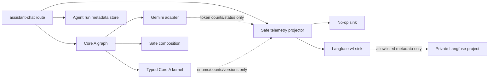

# Core Agent Langfuse Safe Tracing Plan

Status: `IMPLEMENTED_LOCAL_AND_LIVE_VERIFIED`  
Owner: Agent Service  
Date: 2026-08-20  
Scope: `apps/agent-service`, Agent Compose wiring, tests, and canonical docs

Evidence:
[`eval/results/core-agent-langfuse-tracing-2026-08-20.md`](../../eval/results/core-agent-langfuse-tracing-2026-08-20.md)

## 1. Outcome

Add production-grade Langfuse tracing for the Core Agent decision flow without
capturing or reconstructing hidden chain-of-thought.

The trace must make the following operational path inspectable:

```text
request validation
  -> plan or compose route
  -> model attempt or deterministic path
  -> schema/policy validation
  -> Core A planning decision
  -> bounded task/capability projection
  -> response composition
  -> allowlisted run-metadata persistence
```

The observable “reasoning flow” is the sequence of validated decisions,
transitions, policy outcomes, capability choices, fallback codes, timings, and
token counts. It is not raw model reasoning, prompts, messages, graph state, or
provider responses.

## 2. Non-negotiable boundaries

- Never send raw chain-of-thought, analysis, prompts, user messages, assistant
  responses, provider bodies, LangGraph state, tool arguments, semantic slot
  values, authoritative results, payment data, confirmation evidence, or
  credentials to Langfuse.
- Do not attach the Langfuse LangChain/LangGraph callback handler to
  `assistant_agent`; framework callbacks can receive complete input/output
  state.
- Use manual Langfuse v4 observations through a typed, allowlisted projection.
- Do not use `@observe` on functions whose arguments or return values contain
  request, prompt, model, or graph payloads.
- Agent remains proposal-only. Tracing must not add a domain/Gateway execution
  client or make telemetry authoritative for workflow success.
- Langfuse delivery failure must not change an Agent result, retry a domain
  write, or make readiness fail. Explicitly enabled but structurally invalid
  configuration must fail at startup.
- Traces remain private. Code must never call a public-trace API.
- There is no development-only switch that enables prompt or response capture.

## 3. Current-state findings

- `/api/v1/assistant-chat` already owns a bounded run lifecycle and records an
  allowlisted `RunMetadata` row after graph completion.
- `assistant_graph.py` has a single LangGraph node, `decide`, with explicit
  model, deterministic fallback, Core A, and composition boundaries. Manual
  spans are therefore clearer and safer than automatic graph callbacks.
- `GeminiAdapter` is the correct generation boundary. It already reduces
  provider failures to safe diagnostics but does not expose per-call token
  usage to an observability port.
- The Agent manifest now pins the Langfuse SDK and the built Agent image
  contains that version.
- Compose now maps only the three Langfuse variables into `agent-service`.
- Root `.env.example` contains exactly the three blank/endpoint Langfuse
  variables; real values remain in ignored/local or deployment secret storage.
  The implementation and verification did not print `.env` or credential
  values.
- The approximately 936 KB `h.json` trace-like artifact introduced by commit
  `41eb42f` had no runtime/build reference, was removed, and future Langfuse
  JSON exports are ignored.

## 4. Target architecture



Introduce an Agent-owned observability port:

- `SafeTelemetry`: request-scoped root observation and typed child
  observations.
- `NoopTelemetry`: default when tracing is disabled or in deterministic unit
  tests.
- `LangfuseTelemetry`: the only SDK adapter.
- `TelemetryEnvelope` models: Pydantic `extra="forbid"`, bounded strings,
  enums, numeric counts, and no generic payload dictionary.
- request context: `ContextVar` or the SDK's active OpenTelemetry context,
  created at the route and propagated across async calls. Never put the
  telemetry client or trace payload into LangGraph state.

Use Langfuse Python SDK v4 manual observations:

- `start_as_current_observation(...)` for the root and nested observations;
- explicit observation metadata for the existing application environment and
  safe tags;
- an isolated tracer provider plus an export-stage `mask_otel_spans` hook as
  defense in depth;
- bounded `flush`/async shutdown from the FastAPI lifespan.

## 5. Trace hierarchy and field contract

### 5.1 Root observation

Name: `agent.core_a.run`  
Type: `agent`

Allowed metadata:

- correlation/run ID;
- route name and `plan|compose` mode;
- application environment;
- Agent schema, Core A contract, and capability-catalog versions;
- model mode;
- total latency;
- final safe status: `succeeded|degraded|failed`;
- safe error category;
- tracing-enabled flag.

Do not set Langfuse `user_id` or `session_id`. Never send the raw actor or
workflow ID to the provider.

Do not set root input or output.

### 5.2 Child observations

| Observation | Type | Allowed fields |
|---|---|---|
| `request.validate` | `guardrail` | route, request schema version, actor assertion outcome |
| `planner.route` | `chain` | mode, decision source, interaction mode, task count, workflow relation |
| `model.generate.plan` | `generation` | model, invocation mode, prompt-template name/version, response-schema name, input/output/total token counts, latency, fallback/retry flags, safe status/error category |
| `core_a.validate` | `guardrail` | accepted flag, contract/catalog versions, clarification flag, blocked/discarded counts |
| `core_a.task` | `span` | task index, domain, disposition, dependency count, step kinds, capability names, risk ceiling, confirmation gate |
| `response.compose` | `chain` | source, task/result counts, safe status, latency |
| `model.generate.compose` | `generation` | same generation allowlist as planning |
| `run_metadata.persist` | `span` | phase, capability count, safe result, latency |
| `fallback` | `event` | bounded reason code and fallback target |

There are at most four `core_a.task` spans because the contract already caps
the task count.

### 5.3 Explicit denylist

The projector and export masker reject or remove any field whose normalized
name contains:

- `prompt`, `message`, `query`, `input`, `output`, `completion`,
  `response_body`, `raw`, `content`, or `reasoning`;
- `authorization`, `cookie`, `token`, `secret`, `api_key`, or
  `password`;
- `semantic_arguments`, `slots`, `authoritative_results`,
  `conversation_state`, `user_profile`, or `tool_result`;
- transaction/resource IDs, addresses, phone/email, payment/confirmation data,
  or arbitrary exception messages.

Only named safe error enums are emitted. Exception class names and exception
messages are reduced through a reviewed mapping.

## 6. Configuration contract

Add typed process-environment settings:

| Variable | Rule |
|---|---|
| `LANGFUSE_SECRET_KEY` | Optional; never committed or logged |
| `LANGFUSE_PUBLIC_KEY` | Optional |
| `LANGFUSE_BASE_URL` | HTTPS allowlist; no credentials in URL |

Tracing auto-enables only when both keys are present. Two blank keys select the
no-op adapter. A partial key pair or invalid base URL fails configuration
validation.

Update together:

- root `.env.example` with placeholders only;
- Agent standalone example with placeholders only;
- explicit `docker-compose.yml` mapping for Agent only;
- `Settings` validation and tests;
- `scripts/validate-env-config.py` expectations;
- environment and Agent architecture documentation.

Do not introduce a shared `env_file`.

## 7. Implementation phases

### Phase 0 — Secret and artifact hygiene

1. Replace all real values in tracked example files with unmistakable
   placeholders without printing the previous values.
2. Rotate any secret key that was placed in a tracked/synced example.
3. Confirm `.env` remains ignored and is not present in Git history.
4. Safely scan `h.json` for forbidden field classes without echoing content,
   verify no runtime/build reference needs it, remove it, and ignore future
   trace exports.
5. Add a secret scanner regression check for Langfuse secret-key patterns.

Exit gate: no actual secret or raw trace export is tracked.

### Phase 1 — Typed telemetry core

1. Add the pinned Langfuse v4 dependency; this service has no committed Python
   lock/install artifact beyond its owned `pyproject.toml`.
2. Add `src/observability/contracts.py` with strictly typed envelopes,
   bounded-value projection, and numeric-only token extraction.
3. Add `src/observability/telemetry.py` containing the port, no-op adapter,
   manual Langfuse adapter, isolated export, and `mask_otel_spans`.

Exit gate: unit tests prove no arbitrary payload can enter the adapter.

### Phase 2 — Instrument the Agent flow

1. Create the root `agent.core_a.run` observation in
   `api/routes.py::assistant_chat`.
2. Instrument model attempts at `_invoke_structured`, the shared typed model
   boundary; extract only numeric usage metadata from the returned envelope.
3. Instrument `assistant_graph.py::decide`, `_invoke_structured`,
   `plan_core_a`, and `compose_response` with typed observations.
4. Emit task spans from the already-validated `PlanningDecision`, never from
   raw model output.
5. Wrap existing `_record_run` persistence with the safe persistence span.
6. Keep deterministic execution and all legacy domain-specific Agent routes
   behaviorally unchanged.

Exit gate: enabled and disabled tracing produce byte-equivalent public Agent
responses for deterministic fixtures.

### Phase 3 — Lifecycle and deployment wiring

1. Initialize the client only when settings enable it.
2. Attach only the existing application environment and safe tags to the root
   scope.
3. Flush/shutdown in the FastAPI lifespan with a bounded timeout.
4. Treat export/network failure as telemetry degradation, never Agent failure.
5. Map variables explicitly through Compose and deployment configuration.
6. Keep readiness based only on dependencies it actually checks; expose no
   key or trace URL.

Exit gate: a fake unavailable exporter does not change HTTP status or result.

### Phase 4 — Verification and live smoke

1. Run unit, API, deterministic evaluation, Ruff, environment validation,
   migration parity, Compose render, and OpenAPI checks.
2. Run a local fake-exporter integration test and inspect every exported span
   against the allowlist.
3. Run an opt-in Langfuse smoke test using process environment secrets:
   create one synthetic non-PII plan request, flush, query the trace by safe
   run ID, and assert the expected hierarchy and absence of forbidden fields.
4. Do not print credentials, raw exporter payloads, or full trace JSON in test
   output.
5. Record evidence in a dated Markdown/JSON result pair.

Exit gate: live trace exists, hierarchy is complete, and forbidden-field count
is zero.

### Phase 5 — Controlled rollout

1. Development: enable for synthetic/non-production traffic.
2. Staging: inspect exported attributes and latency for at least one release
   window.
3. Production: enable only after privacy review and a documented
   retention/deletion policy.
4. Roll back instantly by unsetting both Langfuse keys; no code or database
   rollback is required.

## 8. Test matrix

### Contract and privacy tests

- Unknown telemetry fields are rejected.
- Sentinel prompt, message, secret, email, phone, address, transaction ID,
  authoritative result, and model output never reach the fake exporter.
- Raw actor/workflow IDs are absent from every exported observation.
- Export-stage masking removes forbidden third-party OpenTelemetry attributes.
- Trace metadata has bounded lengths and enum-only decision/error fields.

### Behavior and resilience tests

- Tracing off uses the no-op adapter and makes no network call.
- Tracing on with missing/invalid required settings fails configuration
  validation.
- Export timeout/failure does not change the Agent response.
- Concurrent requests do not leak observation context across actors.
- Provider retry/fallback produces bounded events without duplicated root
  observations.
- Planning and composition produce separate generation observations.
- Deterministic fallback produces no fake generation span.
- Shutdown performs one bounded flush and does not hang.

### Regression gates

- Full Agent pytest suite.
- Core A deterministic and provider-backed release evaluations.
- Ruff on changed Python files.
- `python scripts/validate-env-config.py`.
- `python scripts/check-migration-parity.py`.
- `docker compose --env-file .env.example config --quiet` after placeholders
  are restored.
- Static scan proving there is no Langfuse callback attached to full graph
  state and no tracked trace export.

## 9. Expected file changes

Production:

- `apps/agent-service/pyproject.toml` and the owned dependency artifact;
- `apps/agent-service/src/config.py`;
- `apps/agent-service/src/main.py`;
- `apps/agent-service/src/api/routes.py`;
- `apps/agent-service/src/services/llm.py`;
- `apps/agent-service/src/agents/assistant_graph.py`;
- new `apps/agent-service/src/observability/` package;
- `docker-compose.yml`;
- placeholder-only environment examples;
- `.gitignore` after artifact verification.

Tests:

- new observability contract, sanitizer, adapter, context-isolation, and
  lifecycle tests;
- focused Assistant API and model-adapter tests;
- opt-in live smoke/evidence script.

Documentation:

- `docs/architecture/agent-architecture.md`;
- `docs/architecture/security-architecture.md`;
- `docs/architecture/current-state.md`;
- environment/development runbook;
- dated evaluation evidence.

No database migration or public API change is expected.

## 10. Acceptance criteria

- One traced Assistant request creates exactly one private root observation.
- Root and child observations reconstruct the validated decision timeline
  without storing raw content.
- Every exported field belongs to the documented allowlist.
- Forbidden-field scan reports zero findings.
- Public Agent responses and Core A decisions are unchanged with tracing on or
  off.
- Telemetry exporter failure is non-authoritative and non-blocking.
- Token usage, latency, model/fallback source, contract versions, task domains,
  capabilities, dispositions, gates, and safe failure categories are visible.
- No secret, trace export, raw prompt, raw response, PII, authoritative ID, or
  chain-of-thought is committed or sent.
- Canonical architecture, security, environment, and current-state documents
  match the implementation and verified evidence.

## 11. Implementation order

Use four reviewable commits:

1. `chore(security): remove trace artifacts and restore env placeholders`
2. `feat(agent): add typed safe telemetry boundary`
3. `feat(agent): instrument Core A decision flow with Langfuse`
4. `test(docs): verify and document safe Langfuse tracing`

Do not start commit 3 until the export-capture privacy tests from commit 2
pass.

## 12. Reference basis

- Langfuse Python SDK v4 observations-first migration:
  <https://langfuse.com/docs/observability/sdk/upgrade-path/python-v3-to-v4>
- Manual instrumentation:
  <https://langfuse.com/docs/observability/sdk/instrumentation>
- Export-stage masking:
  <https://langfuse.com/docs/observability/features/masking>
- Queue, flush, and shutdown:
  <https://langfuse.com/docs/observability/features/queuing-batching>
