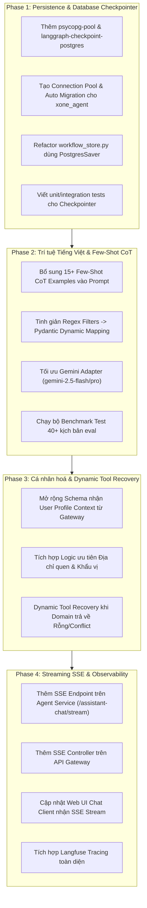

# Core Agent Production Upgrade Plan

## 1. Objective & Invariants

Nâng cấp toàn diện `apps/agent-service` của X-One từ mức MVP hiện tại lên chuẩn **Production-Grade**:
1. **Bền vững trạng thái (Persistence):** Kết nối trực tiếp vào PostgreSQL `xone_agent` bằng LangGraph Checkpointer (`PostgresSaver`), xóa bỏ hoàn toàn in-memory `workflow_store.py`.
2. **Trí tuệ & Độ linh hoạt (Intelligence & Flexibility):** Tối ưu `XONE_SYSTEM_PROMPT` với 15+ Few-Shot CoT tiếng Việt thực tế, giảm phụ thuộc vào Regex ghi đè thô cứng, nâng cấp model adapter hỗ trợ Gemini 2.5/1.5 với cơ chế fallback cascade.
3. **Cá nhân hoá & Bộ nhớ (Memory & Personal Context):** Tích hợp thông tin cá nhân (địa chỉ quen thuộc, thói quen ăn uống, tiền sử khám) từ `xone_core` vào ngữ cảnh lập kế hoạch.
4. **Tương tác thời gian thực (Streaming SSE):** Cung cấp Server-Sent Events (SSE) để stream câu trả lời từng từ và sự kiện lập kế hoạch theo thời gian thực về Web client.
5. **Giám sát & Đánh giá (Observability):** Hoàn thiện tích hợp Langfuse để đo lường độ trễ, token cost, prompt versioning.

### Ranh giới an toàn bất biến (Architecture Invariants)
- **Agent tuyệt đối không truy cập trực tiếp Database nghiệp vụ** (`xone_food`, `xone_ride`, `xone_restaurant`, `xone_healthcare`, `xone_core`).
- **Agent chỉ kết nối vào `xone_agent`** để đọc/ghi LangGraph Checkpoints và metadata đàm thoại.
- **Agent không tự ý thực hiện side-effects** (không tự thanh toán, không tự chốt đơn). Gateway và Domain Services giữ toàn quyền kiểm soát nghiệp vụ và giao dịch.
- **Duy trì cơ chế Dual Engine:** Hoạt động hoàn hảo với LLM online (Gemini) và tự động fallback sang Heuristic Deterministic Plan khi mất kết nối.

---

## 2. Phased Architecture & Implementation Roadmap

---

## 3. Chi tiết từng giai đoạn thực thi (Step-by-Step Details)

### Phase 1: Database Persistence (`xone_agent`)

#### 1.1 Cập nhật Dependencies
- File: `apps/agent-service/pyproject.toml`
- Thêm:
  - `psycopg[binary,pool]>=3.2.0`
  - `langgraph-checkpoint-postgres>=2.0.0`

#### 1.2 Xây dựng Database Pool & Checkpoint Manager
- File mới: `apps/agent-service/src/infrastructure/database.py`
- Nhiệm vụ:
  - Quản lý `AsyncConnectionPool` hoặc `ConnectionPool` kết nối tới `settings.database_url` (`xone_agent`).
  - Khởi tạo bảng checkpoint schema chuẩn của LangGraph (`checkpoints`, `checkpoint_blobs`, `checkpoint_writes`) khi ứng dụng khởi động.
  - Cung cấp factory hàm `get_checkpointer()` trả về `PostgresSaver`.

#### 1.3 Nâng cấp `WorkflowStore`
- File: `apps/agent-service/src/application/workflow_store.py`
- Thay thế toàn bộ `threading.RLock()` và `self._items` bằng `PostgresSaver` hoặc PostgreSQL repository tương ứng.
- Đảm bảo khi container bị khởi động lại, cuộc trò chuyện tiếp tục liền mạch từ `conversation_id`.

#### 1.4 Gắn Checkpointer vào Assistant StateGraph
- File: `apps/agent-service/src/agents/assistant_graph.py`
- Compile đồ thị với `checkpointer`: `assistant_agent = build_assistant_graph(checkpointer=get_checkpointer())`.

---

### Phase 2: Trí tuệ Tiếng Việt & Few-Shot CoT Engine

#### 2.1 Mở rộng Prompt với Few-Shot CoT Đa Dịch Vụ
- File: `apps/agent-service/src/agents/assistant_graph.py`
- Xây dựng 15+ kịch bản mẫu chất lượng cao trong `XONE_SYSTEM_PROMPT`:
  1. *Đơn giản 1 dịch vụ:* "Tìm phở bò tái lăn gần đây giao về nhà".
  2. *Đa dịch vụ tuần tự có phụ thuộc:* "Tìm quán nướng cho 4 người ở Cầu Giấy tối mai lúc 19h rồi đặt xe 7 chỗ đưa cả nhà tới đó".
  3. *Đa dịch vụ song song độc lập:* "Tìm bún chả giao tận nơi và đặt lịch khám da liễu sáng thứ 7".
  4. *Đổi ý giữa chừng (Discard prior context):* "Thôi không đi xe nữa, tìm quán cà phê yên tĩnh gần đây".
  5. *Câu hỏi tư vấn / Chitchat:* "Hôm nay trời lạnh ăn gì ngon bạn nhỉ?".
  6. *Xử lý từ ngữ địa phương & viết tắt:* "bún riêu", "xe 4c", "7h tối", "sáng mai tầm 8-9h".

#### 2.2 Tinh giản Regex Filter thô cứng
- Giữ lại các bộ lọc an toàn bắt buộc (loại bỏ `*_id`, `price`, `amount` tự chế).
- Bỏ cơ chế regex đè thô bạo lên `extracted_slots`, cho phép Pydantic validator xử lý linh hoạt các giá trị trích xuất từ LLM.

#### 2.3 Nâng cấp LLM Adapter & Fallback Cascade
- File: `apps/agent-service/src/services/llm.py`
- Hỗ trợ chuyển đổi mượt mà: `Primary Model (gemini-2.5-flash / pro)` ➡️ `Fallback Model (gemini-1.5-flash / flash-lite)` ➡️ `Deterministic Heuristic Plan`.

---

### Phase 3: Cá nhân hoá & Dynamic Tool Recovery

#### 3.1 Nhận Ngữ Cảnh Cá Nhân (User Profile Context)
- File: `apps/agent-service/src/models/schemas.py`
- Mở rộng `AssistantChatRequest` nhận:
  - `saved_addresses` (Nhà riêng, Cơ quan, v.v.)
  - `dietary_preferences` (Ăn chay, không ăn hành, dị ứng)
  - `frequent_locations`
- File: `apps/api-gateway/src/modules/conversation/assistant.service.ts`
- Gateway tự động truy vấn thông tin Profile từ `xone_core` và gửi kèm sang Agent.

#### 3.2 Dynamic Tool Recovery trong `compose` mode
- Khi Domain Service trả về kết quả `EMPTY_RESULT` hoặc `CONFLICT` (hết bàn, không tìm thấy quán), Agent trong mode `compose` tự động đề xuất phương án thay thế thông minh (ví dụ: gợi ý lùi giờ hoặc tìm quán tương tự lân cận).

---

### Phase 4: Streaming SSE & Observability

#### 4.1 Server-Sent Events trên Agent Service
- Endpoint mới: `POST /api/v1/assistant-chat/stream`
- Stream các event theo chuỗi:
  1. `event: plan_created` (Kế hoạch tác vụ)
  2. `event: tool_dispatched` (Đang gọi dịch vụ)
  3. `event: text_delta` (Từng token câu trả lời tự nhiên)
  4. `event: finish` (Hoàn tất kèm payload dữ liệu thẻ giao diện)

#### 4.2 Endpoint SSE trên API Gateway
- File: `apps/api-gateway/src/modules/conversation/assistant-stream.controller.ts`
- Cung cấp `POST /api/v1/assistant/chat/stream` cho Web Frontend.

#### 4.3 Web UI Token Streaming
- File: `apps/web/src/features/assistant/components/chat-box.tsx`
- Nhận luồng SSE và render text streaming mượt mà.

#### 4.4 Langfuse Observability
- Gửi đầy đủ trace span, prompt version, input/output tokens, latency và chi phí ước tính lên dashboard Langfuse.

---

## 4. Kế hoạch Kiểm thử & Tiêu chí Nghiệm thu 100% Pass (Verification Matrix)

Hệ thống sẽ chạy kiểm thử liên tục theo chu trình TDD (Red-Green-Refactor) cho tới khi đạt 100% các tiêu chí:

| Bộ Test Suite | Lệnh kiểm thử | Tiêu chí đạt (Pass Criteria) |
| :--- | :--- | :--- |
| **1. Database Persistence Test** | `pytest apps/agent-service/tests/test_postgres_checkpoint.py -v` | Lưu thành công state vào `xone_agent`, khôi phục chính xác 100% sau khi khởi động lại process. |
| **2. Agent Unit & LangGraph Tests** | `pytest apps/agent-service/tests/test_agents/ -v` | 13/13 test files đạt 100% pass (bao gồm multi-turn context, intent reconciliation, hardening, structured output). |
| **3. Gate G2 Evaluation Benchmark** | `python eval/gate_g2_mvp.py` | Đạt tối thiểu **40/40 test cases** tiếng Việt đa dạng (10 Food, 10 Ride, 10 Restaurant, 10 Healthcare & Multi-intent). |
| **4. Gateway Integration & E2E** | `npm --prefix apps/api-gateway test` | Toàn bộ unit/integration test của NestJS Gateway đạt 100% pass. |
| **5. Environment & Config Validation** | `python scripts/validate-env-config.py` `docker compose --env-file .env.example config --quiet` | Không có lỗi cấu hình môi trường, Compose render hoàn hảo. |
| **6. Web E2E Browser Test** | `npx --prefix apps/web playwright test` | 27/27 responsive & live transaction browser tests pass. |

---

## 5. Quy tắc thực thi cho Agent (Self-Correction & Test-Until-Success Protocol)

Khi thực thi từng bước trong kế hoạch:
1. **Không bỏ qua lỗi:** Nếu bất kỳ bài test nào fail, Agent phải phân tích log lỗi, sửa code và chạy lại test cho tới khi pass.
2. **Kiểm tra hồi quy (Regression Testing):** Sau mỗi thay đổi lớn, chạy lại toàn bộ test suite hiện có để đảm bảo không phá vỡ các chức năng cũ.
3. **Báo cáo trung thực:** Báo cáo chính xác kết quả pass/fail kèm logs thực tế, không dùng kết quả giả lập.
